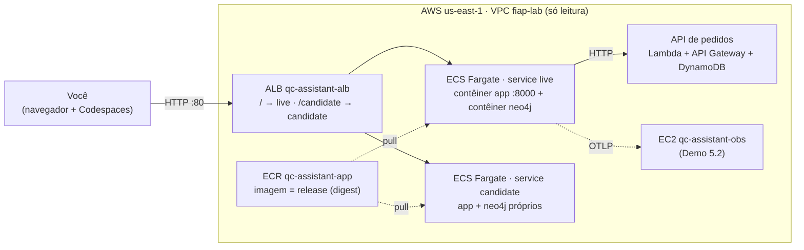
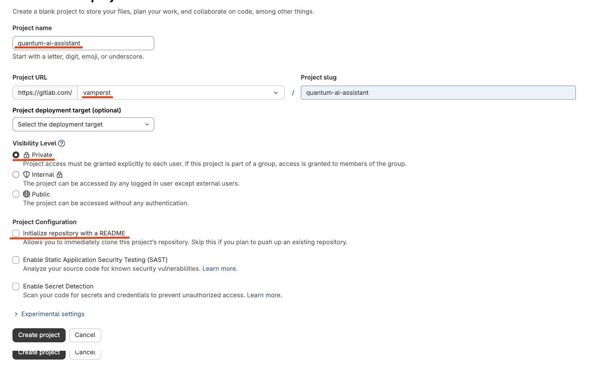
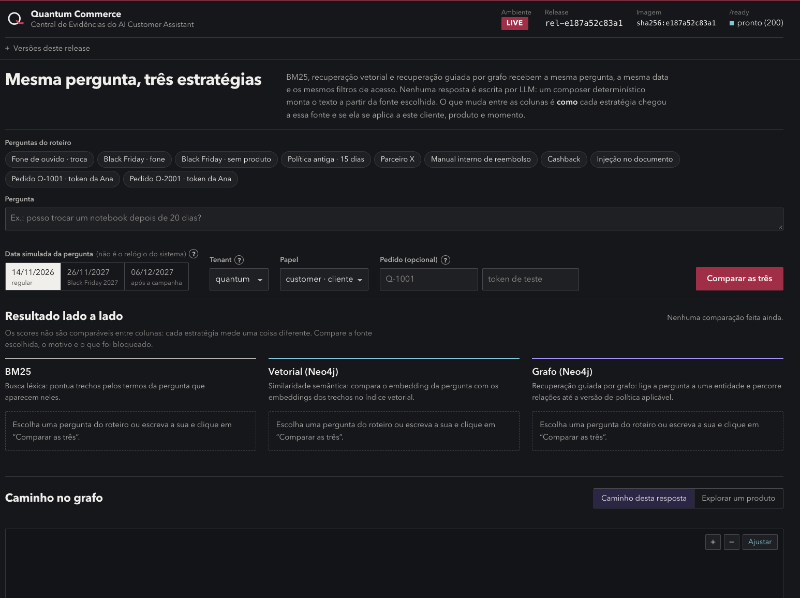
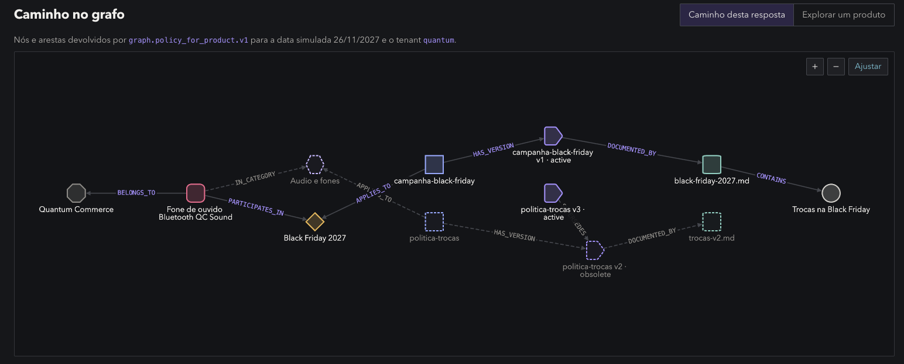
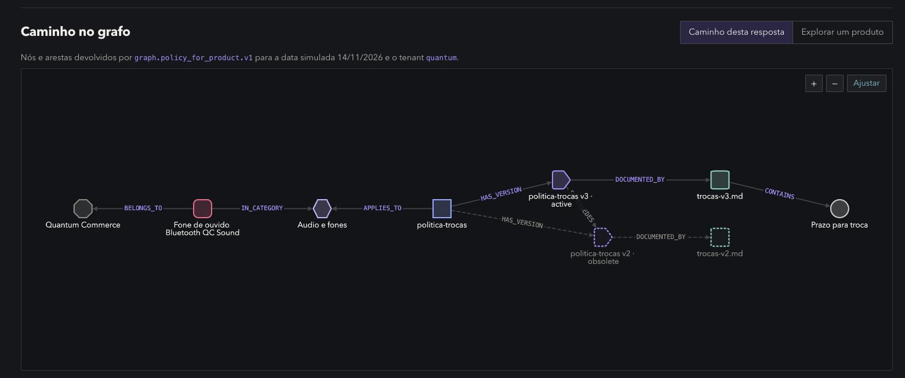

# 04.1 — Demo 5.1: A evidência por trás da resposta


> **Quinta-feira, 8h50. Três semanas depois do pipeline com quality gates entrar no ar.**
> **Helena Marques**, Head de Engenharia de IA e Entrega Contínua, chega com o celular na mão e um print de conversa:
>
> > *— "Uma cliente perguntou ao assistente quantos dias tinha para trocar um fone. Ele respondeu **15 dias**, com fonte citada, em HTTP 200. A política vigente diz **30**. O pipeline estava verde. Eu descobri pelo Instagram. Antes de qualquer correção, eu quero **ver a evidência**: de onde veio essa resposta, por que essa fonte foi escolhida e por que ela não deveria ter sido."*
>
> **Diego Tavares**, AI SRE sênior: *— "A busca achou um texto **parecido** com a pergunta. Parecido não é **aplicável**. Aplicável depende de cliente, produto, loja e data. Hoje eu quero que a turma veja essas duas coisas separadas, lado a lado, com três estratégias de busca diferentes respondendo a mesma pergunta."*

**A frase-guia da aula:** *uma resposta pode estar bem escrita, vir com HTTP 200 e até citar uma fonte. Mas essa fonte se aplica àquele cliente, produto e momento?*

Você é o **AI DevOps Engineer** da Quantum Commerce. Nesta demo você abre a **Central de Evidências** do AI Customer Assistant, que roda inteira na AWS, e compara a **mesma pergunta** respondida por três estratégias de recuperação (BM25, vetorial e grafo), lendo as evidências de cada uma. Não há modelo de linguagem gerativo: a resposta é montada a partir do trecho escolhido, e é isso que permite olhar **só** para a escolha da fonte.

Quatro palavras que aparecem o tempo todo, definidas uma vez: **corpus** é o conjunto de documentos de política (arquivos Markdown); o **front matter** é o cabeçalho de cada documento, entre `---`, com metadados como versão, `status` (`active`/`obsolete`), datas de vigência, **tenant** (de qual loja o documento é: `quantum` ou `parceiro-x`) e **nível de acesso** (`public` para clientes, `internal` só para funcionários). Vigência, tenant e nível de acesso são as três regras de **aplicabilidade** que toda estratégia precisa respeitar.

Os comandos rodam em dois lugares, e cada passo diz qual: **Codespaces** (terminal) e **navegador** (o GitLab, na Parte 1, e a Central de Evidências, hospedada no ALB da sua conta, no resto da aula). A Aula 5 é **independente das anteriores**: o assistente vive num projeto GitLab próprio, `quantum-ai-assistant`, e a Parte 1, feita **agora, no início da aula**, cria tudo o que ele precisa, com ou sem as aulas 2 a 4 feitas.

Três siglas de infraestrutura que aparecem desde já: **ALB** é o balanceador de carga da AWS, o endereço público que recebe o seu navegador e encaminha para a aplicação; **ECS Fargate** é o serviço da AWS que roda contêineres sem você gerenciar servidor; **Terraform** é a ferramenta que descreve essa infraestrutura em arquivos e a cria (um *data source* é quando ele só **lê** algo que já existe, como a rede `fiap-lab`, em vez de criar).

Nunca usou terminal? Copie o bloco cinza inteiro, cole no terminal indicado e aperte Enter. Se aparecer `Error`, `ERRO` ou `FAIL`, pare no passo em que está e abra o bloco **⚠ Se der erro** logo abaixo dele.

> [!WARNING]
> **Pré-requisitos obrigatórios antes de começar:**
>
> - [ ] **Codespaces aberto no fork do repositório da disciplina**, sincronizado hoje pelo [Início de aula](../../00-create-codespaces/Inicio-de-aula.md), com as **credenciais AWS do Academy** atualizadas (elas expiram a cada sessão).
> - [ ] **Conta no [GitLab](https://gitlab.com/)** (gratuita). Se ainda não tem, o passo 1 cria em um minuto; a chave SSH também é cadastrada lá.
> - [ ] **Nenhuma aula anterior é obrigatória.** O passo 4 é o mesmo para todos: o `make runner` reaproveita a EC2 da Aula 3 se ela existir (e a registra neste projeto) ou cria uma nova.
>
> **Valide rapidamente** (terminal do Codespaces):
>
> ```bash
> aws sts get-caller-identity --query Account --output text
> ls /workspaces/FIAP-AI-Devops-CICD/04-GenAIOps/quantum-assistant/Makefile
> ```
>
> Saída esperada: o número da sua conta (12 dígitos) e o caminho do `Makefile`. Se o primeiro der `ExpiredToken`, refaça o Início de aula; se o segundo der `No such file or directory`, sincronize o fork.
>
> **Tempo de aula: ~85 min, incluindo montar o ambiente** (Parte 1, ~25 min: cerca de 9 min de comandos medidos na homologação, o resto é leitura e espera usada para estudar; mais ~5 min se a sua conta ainda não tiver a EC2 do runner) **mais o roteiro das Partes 2 a 7 (60 min)**. Nada é feito antes da aula: cada aluno sobe o próprio ambiente, na própria conta do Learner Lab, com a turma.

## Principais pontos de aprendizagem

- separar **similaridade** (o texto parece com a pergunta) de **aplicabilidade** (a regra vale para este cliente, produto, loja e data)
- ler as evidências de três estratégias de recuperação, com o mesmo filtro de vigência, tenant e permissão: **BM25** (palavras), **vetorial** (significado, por embeddings) e **grafo** (relações entre produto, categoria, campanha, política e versão)
- entender o que é um **embedding**, por que ele **não é** um LLM gerativo e o que `model_version = none` continua significando
- percorrer um caminho **multi-hop** real num banco de grafo (Neo4j) e ler a consulta Cypher parametrizada que o produziu
- usar a **data simulada da pergunta** (`as_of_date`) para ver a mesma pergunta mudar de resposta em 2026, na Black Friday de 2027 e depois dela
- distinguir **regra especial**, **troca**, **arrependimento** e **status do pedido** (que vem da API, nunca de documento)
- provar que mudar uma relação do grafo em runtime muda a resposta e o `graph_version`, e que **isso não é um release**

## O que você terá ao final

A Central de Evidências do assistente rodando na AWS (ECS Fargate + Neo4j + ALB), a mesma pergunta respondida pelas três estratégias com evidências lado a lado, e a resposta à pergunta de Helena: **qual evidência autoriza um release?** É essa pergunta que a [Demo 5.2](../02-Operacao-Observabilidade-Qualidade-Continua/README.md) transforma em pipeline e em operação.

Os blocos **💡 Clique para entender** trazem o aprofundamento; os blocos **⚠ Se der erro** só importam se o passo falhar; os blocos **🤔 Pare e pense** são perguntas para responder antes de rolar a tela.

## Mapa do lab

| Parte | Relógio | O que você faz | Passos | Tempo |
|-------|---------|----------------|--------|-------|
| [Parte 1](#parte-1---montar-o-ambiente-dentro-da-aula) | 00–25 | Criar o projeto GitLab `quantum-ai-assistant`, rodar `make bootstrap`, criar o runner do projeto, construir a imagem, subir o ambiente na AWS e esperar o `/ready`; cada espera longa vem com leitura guiada (vale para 5.1 e 5.2) | [1](#passo-1) · [2](#passo-2) · [3](#passo-3) · [4](#passo-4) · [5](#passo-5) · [6](#passo-6) | 25 min (35 com o Caminho B) |
| [Parte 2](#parte-2---a-reclamação-da-cliente) | 25–33 | Abrir a Central, ler `/ready`, release, tenant e data de referência | [7](#passo-7) · [8](#passo-8) | 8 min |
| [Parte 3](#parte-3---bm25-e-vetorial-a-mesma-pergunta-duas-buscas) | 33–43 | A mesma pergunta no BM25 e no vetorial: trechos, scores, citação e limites | [9](#passo-9) · [10](#passo-10) · [11](#passo-11) | 10 min |
| [Parte 4](#parte-4---grafo-o-caminho-até-a-política) | 43–58 | Navegar o caminho produto → categoria → campanha → política → versão → trecho e ler o Cypher | [12](#passo-12) · [13](#passo-13) · [14](#passo-14) | 15 min |
| [Parte 5](#parte-5---desafio-datas-tenants-e-quatro-coisas-diferentes) | 58–68 | Trocar `as_of_date` entre 2026 e 2027; tenant errado; troca × arrependimento × pedido | [15](#passo-15) · [16](#passo-16) · [17](#passo-17) · [18](#passo-18) | 10 min |
| [Parte 6](#parte-6---mexer-no-grafo-e-ver-a-versão-mudar) | 68–78 | Remover uma aresta de laboratório, ver a resposta e o `graph_version` mudarem, restaurar | [19](#passo-19) · [20](#passo-20) · [21](#passo-21) · [22](#passo-22) | 10 min |
| [Parte 7](#parte-7---qual-evidência-autoriza-o-release) | 78–85 | A pergunta de Helena, a escolha de estratégia e o gancho para a 5.2 | [23](#passo-23) · [24](#passo-24) | 7 min |

<details>
<summary><b>💡 O que é "recuperação" num assistente de IA, em 3 parágrafos</b></summary>
<blockquote>

Um assistente que responde sobre políticas precisa, antes de qualquer coisa, **achar o trecho certo** entre os documentos da empresa. Esse passo se chama **recuperação** (*retrieval*). O "R" de RAG é isso. Neste laboratório a resposta é montada **diretamente** a partir do trecho recuperado, sem um modelo gerativo reescrevê-la: assim, quando a resposta está errada, a culpa é da recuperação, e é a recuperação que vamos estudar.

Há várias formas de recuperar. **BM25** compara **palavras**: quanto mais termos da pergunta aparecem no trecho (e quanto mais raros eles são), maior a pontuação. **Busca vetorial** compara **significado**: um modelo de embeddings transforma pergunta e trechos em listas de números (vetores), e trechos com significado parecido ficam próximos, mesmo com palavras diferentes. **Busca por grafo** não compara texto: ela **percorre relações** conhecidas (este produto pertence a esta categoria, que participa desta campanha, que tem esta política, cuja versão vigente é esta) e chega ao trecho pelo caminho.

Nenhuma das três sabe, sozinha, se o trecho **se aplica**: se está vigente, se é da loja certa, se o cliente pode ver. Por isso as três passam pelo **mesmo filtro** de vigência, tenant e permissão antes de qualquer resposta. A pergunta da aula é o que cada uma mostra de evidência, e em que casos cada uma erra.

</blockquote>
</details>

## Contexto

| Aspecto | Resposta curta |
|---------|----------------|
| **Problema de negócio** | Uma política antiga, um documento de outra loja ou uma campanha fora da vigência viram resposta com cara de confiável. A cliente recebe prazo errado; a empresa descobre nas redes. |
| **Pergunta que este lab responde bem** | "De onde veio esta resposta, por que esta fonte foi escolhida e ela **se aplica** a este cliente, produto e data?" |
| **Pergunta que ele responde mal** | "Como impedir que isso chegue ao cliente, e como descobrir quando piora depois de publicado?" É a Demo 5.2. |
| **Quando acontece na vida real** | Em todo time que já ouviu "mas a resposta citou a fonte" depois de um incidente de conteúdo. |

### Arquitetura



![Arquitetura da Demo 5.1: o aluno acessa pelo ALB o service live em ECS Fargate (contêiner app FastAPI e contêiner Neo4j na mesma task) e, pelo prefixo /candidate, o service candidate; dentro do app, um roteador manda pergunta de pedido para a API de pedidos (API Gateway, Lambda e DynamoDB) e as demais para três buscas em paralelo (BM25 no índice em memória, vetorial no índice do Neo4j e grafo no Neo4j), que passam pelo mesmo filtro de vigência, tenant e ACL antes do composer sem LLM; ECR e SSM Parameter Store abastecem as duas tasks quando elas sobem, e o Terraform grava o state no S3](img/arquitetura-5-1.png)

> Fonte editável: [`diagramas/arquitetura-5-1.excalidraw`](../diagramas/arquitetura-5-1.excalidraw), gerada por `diagramas/gerar_aula5_ecs.py`.

Quatro decisões que explicam esse desenho, e que você vai ver na prática:

| Decisão | Por quê |
|---|---|
| **A imagem do contêiner é o release.** Ela carrega código, corpus, a semente do grafo, os pesos do modelo de embeddings e os embeddings pré-calculados. | Para que "voltar a versão anterior" volte **tudo junto**, e para que a task nasça pronta sem baixar nada da internet. O identificador do release é o **digest** da imagem no ECR, não uma tag. |
| **O Neo4j roda dentro da task, com dados efêmeros.** Ao subir, a aplicação reconstrói o grafo e o índice vetorial a partir da imagem. | Fonte de verdade é a imagem versionada, não o disco do banco. Reiniciar a task devolve o grafo ao que foi publicado (a Demo 5.2 explora o que isso significa, e o que não significa). |
| **Dois serviços, `live` e `candidate`, cada um com o seu Neo4j.** | Um candidato em teste nunca compartilha dados com o que o cliente usa. |
| **Nenhum modelo de linguagem gerativo.** O modelo de embeddings é pequeno, aberto e roda em CPU. | O Learner Lab não oferece Bedrock, e, mais importante, o composer determinístico deixa a aula olhar só para a escolha da fonte. Onde um LLM entraria está explicado no 💡 do passo 10. |

| Componente | Onde roda | Papel |
|---|---|---|
| `quantum-assistant/core/` | Dentro da imagem | Roteamento de intenção, BM25, filtros de vigência/ACL (`check_access`), composer determinístico, versões. **Preservado** da versão anterior. |
| `quantum-assistant/graph/`, `vector/`, `lab/` | Dentro da imagem | Semente do grafo (JSON legível), encoder de embeddings, recuperadores vetorial e por grafo, motor do `/lab/compare`. |
| `quantum-assistant/web/` | Dentro da imagem | API FastAPI (`/health`, `/ready`, `/lab/*`, `/assistant/ask`) e a Central de Evidências (HTML/JS sem build). |
| Neo4j Community (versão pinada) | Mesma task ECS, só `localhost` | Grafo + índice vetorial `chunk_embedding` (cosseno, 384 dimensões). Nunca exposto fora da task. |
| `quantum-assistant/infra-ecs/` | Terraform, state em `s3://base-config-<SEU RM>/quantum-assistant/ecs/terraform.tfstate` | ECR, cluster, dois serviços, ALB, target groups, security groups, log groups. Zero `aws_iam_*`: usa o `LabRole`. |
| `quantum-assistant/infra/` | Terraform, state em `quantum-assistant/terraform.tfstate` | A **mesma** API de pedidos da versão anterior (Lambda `qc-assistant-orders` + DynamoDB). |
| `Makefile` e `scripts/cloud/` (raiz do projeto) | Codespaces | Os comandos da Parte 1 e da operação: cada alvo `make` chama um script e imprime o resultado em `chave=valor`. |
| Projeto GitLab `quantum-ai-assistant` + runner EC2 | GitLab + AWS | O repositório **de produto** do assistente (criado na Parte 1) e o runner que roda o pipeline da Demo 5.2. |

> [!CAUTION]
> **Custo enquanto estiver de pé.** Cada task Fargate ligada (1 vCPU + 3 GB, app + Neo4j juntos: ~US$ 0,053/h), o ALB (~US$ 0,0225/h) e a EC2 do runner (`t3.small`, ~US$ 0,02/h) cobram **por hora, com ou sem uso**. Com os preços públicos de `us-east-1` de novembro de 2026 (vCPU-hora US$ 0,04048; GB-hora US$ 0,004445; ALB-hora US$ 0,0225), cada task custa **US$ 0,054/h** e o ALB **US$ 0,0225/h**: **US$ 0,13/h** com as duas tasks ligadas, **US$ 0,08/h** só com o `live`. Em números de aula: uma sessão de **4 horas** com as duas tasks custa **≈ US$ 0,52** por aluno (0,215 por task + 0,09 do ALB + centavos de LCU e ECR); desligando o `candidate` após a promoção, **≈ US$ 0,36**. Para uma turma de 40, ≈ US$ 21 ou ≈ US$ 14. Fora dessa conta, porque são de outros states: o runner `t3.small` (~US$ 0,02/h) e a EC2 de observabilidade da 5.2 (`t3.medium`, ~US$ 0,04/h) (preços de lista de `us-east-1`; o `terraform output cost_warning` repete o lembrete). A API de pedidos (Lambda, API Gateway, DynamoDB) custa ~US$ 0 parada. **Não destrua nada entre a 5.1 e a 5.2**: a 5.2 opera exatamente este ambiente. A limpeza segura está na Parte 7 e sempre começa em `--dry-run`.

---

## Parte 1 - Montar o ambiente (dentro da aula)

> **00–25 min.** Helena abre a reunião, antes de qualquer análise: *— "O assistente deixou de ser um experimento dentro do repositório de infraestrutura. A partir de hoje ele é um **produto**, com repositório próprio, pipeline próprio e ciclo de release próprio. Quem está nesta sala não precisa saber o que fizemos nas aulas passadas: clona, roda o bootstrap e tem o ambiente de pé. Diego, sobe com eles agora; eu volto com o print quando o `/ready` responder."*
>
> Diego, já com o terminal aberto no telão: *— "Vinte e cinco minutos. Enquanto a AWS trabalha, a gente lê o que ela está subindo."*

### Resultado esperado desta parte

Um projeto GitLab **novo**, `quantum-ai-assistant`, com o código do assistente na raiz e um runner habilitado; a conta AWS com bucket de state, rede `fiap-lab`, API de pedidos, segredos no SSM, imagem no ECR, os serviços `live` e `candidate` ligados atrás do ALB; e `GET /ready` respondendo `200`. Tudo isso é feito **agora, com a turma**, na sua conta do Learner Lab. **Ela vale para as duas demos**: a 5.2 usa o mesmo projeto e o mesmo ambiente.

Toda a preparação na AWS passa por **um** arquivo: o `Makefile` na raiz do projeto. Cada alvo é idempotente (pode rodar de novo sem medo), descobre sozinho o que precisa (conta, bucket, rede) e diz, item a item, o que conferiu (`[PASS]`) ou o que falta (`[FAIL]`, com a correção na mesma linha).

**Quanto tempo leva, e onde o tempo vai.** Os tempos abaixo são os medidos na homologação deste lab; o que domina é a espera pela AWS, e cada espera tem uma leitura para fazer em paralelo:

| Passo | Comando | Tempo medido | O que você faz enquanto espera |
|---|---|---|---|
| 1 e 2 | projeto GitLab, chave SSH, clone e primeiro push | ~5 min de cliques e comandos (não é espera) | |
| 3 | `make bootstrap` | **32 s** com tudo já criado; na primeira vez, mais o `apply` da API de pedidos e, se faltar, ~1 min recriando a rede <!-- CONFIRMAR-SAIDA: duração do primeiro bootstrap numa conta vazia não foi cronometrada --> | ler a tabela 💡 do `Makefile` |
| 4 | `make runner TOKEN=...` | **~3-5 min** para re-registrar a EC2 da Aula 3; ~6-8 min se não houver EC2 | ler o 💡 do runner e do token no SSM |
| 5 | `make image` | **74 s** de build a frio (mais o envio do contexto e o push); **8-30 s** com o cache do runner quente | abrir a arquitetura e apostar numa estratégia |
| 6 | `make up` + `make deploy-live` + `make deploy-candidate` + `make ready` | `apply` de 28 recursos <!-- CONFIRMAR-SAIDA: duração do apply de infra-ecs não foi cronometrada -->; cold start de **202 s** (`live`) e **190 s** (`candidate`); `ready` 5 s | ler o corpus (v2 × v3, Black Friday) e a semente do grafo |

Somando: cerca de **9 a 12 minutos de comandos** e **25 minutos de relógio** com a leitura, as esperas e os checkpoints; **~30 minutos** se a sua conta ainda não tem a EC2 do runner. Repetir a Parte 1 numa sessão nova do Academy, com tudo já criado, leva ~2,5 min de comandos (`preflight` 25 s, `bootstrap` 32 s, `runner` 25 s, `image` 30 s, `ready` 5 s).

**Seu ambiente é seu.** Cada aluno tem a própria conta do Learner Lab e o próprio projeto GitLab; ninguém mais altera o seu `live`. Quando este README diz "alguém da sala", na sua conta esse alguém é você mesmo numa tentativa anterior. Se algum passo da Parte 1 travar e não resolver com o bloco **⚠ Se der erro**, não pare a turma: o professor projeta o próprio ambiente no telão, você acompanha o roteiro nele e volta ao seu assim que o passo destravar (quase sempre é credencial expirada ou runner desligado).

---

<a id="passo-1"></a>

**1. Crie o projeto `quantum-ai-assistant` no GitLab**

No navegador: o repositório **de produto** do assistente, onde roda o pipeline da Demo 5.2. Sem conta no [GitLab](https://gitlab.com/)? Crie uma agora (gratuita, um minuto) e volte.

**1.1. Crie o projeto em branco.** Em [Novo projeto](https://gitlab.com/projects/new), clique em **Create blank project** e preencha **um campo por vez**, na ordem da tela:

- **Project name**: `quantum-ai-assistant`.
- **Project URL**: no seletor ao lado de `https://gitlab.com/`, escolha o **seu nome de usuário** (o seu nick, não um grupo nem outro workspace).
- **Project slug**: fica `quantum-ai-assistant` sozinho; **Project deployment target (optional)**: deixe em branco.
- **Visibility Level**: **Private**.
- **Project Configuration**: **desmarque** *Initialize repository with a README* (o código vai entrar pelo seu primeiro push); deixe *Enable Static Application Security Testing (SAST)* e *Enable Secret Detection* desmarcados.
- Clique em **Create project**.



**1.2. Nada para copiar.** O passo 2 monta o endereço SSH sozinho. Não abra o botão **Code**.

**1.3. Garanta uma chave SSH no GitLab.** Já cadastrou a chave `/home/vscode/.ssh/gitlab` numa aula anterior? Pule para o passo 2. Se não, no terminal do Codespaces:

```bash
test -f /home/vscode/.ssh/gitlab || ssh-keygen -t rsa -b 2048 -C "gitlab key" -f /home/vscode/.ssh/gitlab -N ""
code /home/vscode/.ssh/gitlab.pub
```

Copie a linha inteira que começa com `ssh-rsa` (ou `ssh-ed25519`). Em [Chaves SSH do GitLab](https://gitlab.com/-/user_settings/ssh_keys), clique em **Add new key**, cole em **Key** e clique em **Add key**.

**Esperado:** o projeto `quantum-ai-assistant` **vazio** (página *Command line instructions*) e a chave `gitlab key` listada em SSH Keys.

<details>
<summary><b>💡 Clique para entender: por que um par de chaves, e não senha</b></summary>
<blockquote>

**O namespace.** O seu usuário, escolhido no **Project URL**, é o que entra na URL SSH (`git@gitlab.com:<seu-usuario>/quantum-ai-assistant.git`), e o passo 2 a **monta sozinho** a partir da sua chave SSH. Na chave, `ssh-ed25519` também serve, e o **Title** `gitlab key` vem preenchido.

O `git push` precisa provar ao GitLab que é você: em vez de senha, usa um par de chaves (uma **privada**, que fica só no seu Codespaces, e uma **pública**, que você cadastra no GitLab). O `test -f ... ||` não sobrescreve uma chave que já exista; o comando de criação é o mesmo do módulo 02. O usuário que entra na URL SSH é descoberto pela própria chave no passo 2, o mesmo truque do módulo 02.

</blockquote>
</details>

<details>
<summary><b>⚠ Se der erro: <code>Project namespace ... has already been taken</code></b></summary>
<blockquote>

Já existe um projeto com esse nome na sua conta. Abra-o e use-o (se estiver vazio) ou escolha `quantum-ai-assistant-2` e **lembre de trocar o nome** em todos os comandos abaixo.

</blockquote>
</details>

<details>
<summary><b>⚠ Se der erro: a URL do projeto mostra um grupo em vez do seu usuário</b></summary>
<blockquote>

O projeto nasceu no namespace errado. Apague-o em **Settings → General → Advanced → Delete project** e crie de novo escolhendo o **seu usuário** no seletor do **Project URL**.

</blockquote>
</details>

---

<a id="passo-2"></a>

**2. Clone o projeto, copie o código do assistente para a raiz e faça o primeiro push**

No Codespaces: o seu produto é uma **cópia** de `04-GenAIOps/quantum-assistant/` na raiz do projeto novo. Copie o bloco inteiro, sem editar nada:

```bash
eval $(ssh-agent -s) >/dev/null && ssh-add -k /home/vscode/.ssh/gitlab
export GITLAB_USER=$(ssh -o StrictHostKeyChecking=accept-new -T git@gitlab.com 2>&1 | sed -n 's/.*@\([A-Za-z0-9._-]*\)!.*/\1/p')
echo "usuario do GitLab: $GITLAB_USER"
mkdir -p /home/vscode/environment
git clone "git@gitlab.com:$GITLAB_USER/quantum-ai-assistant.git" /home/vscode/environment/quantum-ai-assistant
cp -r /workspaces/FIAP-AI-Devops-CICD/04-GenAIOps/quantum-assistant/. /home/vscode/environment/quantum-ai-assistant/
cd /home/vscode/environment/quantum-ai-assistant
ls
git add -A
git commit -m "quantum-ai-assistant: codigo do assistente, grafo, vetor, infra e pipeline"
git push -u origin "$(git branch --show-current)"
```

**Esperado:** o push termina com `branch 'main' set up to track 'origin/main'.`

<details>
<summary><b>📋 Saída completa esperada</b></summary>
<blockquote>

```text
Cloning into '/home/vscode/environment/quantum-ai-assistant'...
warning: You appear to have cloned an empty repository.
Makefile  adapters  config  containers  core  corpus  evals  graph  infra  infra-ecs  infra-obs  lab  ops  orders  prompts  pytest.ini  release  requirements-engine.txt  requirements-ops.txt  requirements-web.txt  scripts  tests  vector  web
[main (root-commit) <sha>] quantum-ai-assistant: codigo do assistente, grafo, vetor, infra e pipeline
...
 * [new branch]      main -> main
branch 'main' set up to track 'origin/main'.
```

</blockquote>
</details>

**2.1. Ligue o terminal ao state da AWS.** Só **lê** o state do bucket `base-config-<SEU RM>` (não cria nada); seguro repetir em todo terminal novo:

```bash
cd /home/vscode/environment/quantum-ai-assistant
BUCKET=$(aws s3 ls | awk '{print $3}' | grep '^base-config' | head -1); echo "bucket: $BUCKET"
terraform -chdir=infra-ecs init -input=false -reconfigure -backend-config="bucket=$BUCKET" >/dev/null && echo "init: ok"
terraform -chdir=infra-ecs output -raw app_url 2>/dev/null; echo
```

**Esperado:** `bucket: base-config-<RM>` e `init: ok`; na primeira vez a última linha vem **vazia**.

<details>
<summary><b>💡 Clique para entender: o que cada linha do bloco faz</b></summary>
<blockquote>

- O `echo` mostra o usuário do GitLab que o bloco descobriu pela chave.
- O aviso `cloned an empty repository` é esperado: o projeto nasceu vazio no passo 1. No GitLab, o projeto agora mostra os arquivos e, em **Build → Pipelines**, um pipeline **pendente** (ainda não há runner; o passo 4 resolve).
- `eval $(ssh-agent -s)` e `ssh-add` carregam a sua chave privada na memória deste terminal (repita sempre que abrir um terminal novo).
- A linha do `GITLAB_USER` **descobre o seu usuário do GitLab pela chave**: o GitLab responde *Welcome to GitLab, @seu-usuario!*, e o `sed` extrai o nome. É o mesmo truque do módulo 02.
- O `cp -r .../quantum-assistant/.` (com o ponto no fim) copia o **conteúdo** da pasta, inclusive o `.gitlab-ci.yml` oculto, para a raiz.
- A branch pode se chamar `main` ou `master` conforme a configuração da sua conta; os comandos usam `$(git branch --show-current)` para não depender disso.
- A partir daqui, tudo roda em `/home/vscode/environment/quantum-ai-assistant`.
- No 2.1, os comandos da aula leem a URL do assistente com `terraform -chdir=infra-ecs output`; para isso o Terraform precisa conhecer o state que fica no bucket `base-config-<SEU RM>` da **sua** conta. Se o ambiente já existe (sessão repetida), a última linha traz a `app_url` (`http://qc-assistant-alb-...`); na primeira vez ela vem vazia porque o ambiente ainda não existe, e é o que os passos 3 a 6 criam.

</blockquote>
</details>

<details>
<summary><b>⚠ Se der erro: <code>Permission denied (publickey)</code></b></summary>
<blockquote>

A chave não está no GitLab (passo 1.3) ou o `ssh-add` não rodou neste terminal. Repita as duas primeiras linhas do bloco.

</blockquote>
</details>

<details>
<summary><b>⚠ Se der erro: <code>usuario do GitLab:</code> vazio</b></summary>
<blockquote>

A chave não foi carregada neste terminal ou não está no GitLab. Refaça o passo 1.3 e rode o bloco de novo.

</blockquote>
</details>

<details>
<summary><b>⚠ Se der erro: <code>Repository not found</code></b></summary>
<blockquote>

O projeto foi criado com outro nome ou em outro namespace (passo 1.1). Confira o nome e o namespace no GitLab.

</blockquote>
</details>

<details>
<summary><b>⚠ Se der erro: <code>cp: cannot stat</code></b></summary>
<blockquote>

Repositório do curso desatualizado: `cd /workspaces/FIAP-AI-Devops-CICD && git pull origin master` e repita o bloco.

</blockquote>
</details>

<details>
<summary><b>⚠ Se der erro: <code>bucket:</code> vazio no 2.1</b></summary>
<blockquote>

As credenciais expiraram ou a conta ainda não tem bucket (o `make bootstrap` do passo 3 cria). Repita o 2.1 depois do passo 3.

</blockquote>
</details>

<details>
<summary><b>💡 Clique para entender: o que há em cada pasta do projeto</b></summary>
<blockquote>

| Pasta | Papel | Quem muda isso na vida real |
|-------|-------|------------------------------|
| `core/` | Roteamento de intenção, BM25 com filtros de vigência e ACL, composer determinístico, versões. Stdlib pura. | Engenharia |
| `corpus/*.md` | As políticas, com cabeçalho `doc_id`, `version`, `effective_date`, `status`, `tenant`, `access_level`. **Fonte única** dos metadados de vigência, usada pelas três estratégias. | Jurídico, marketing, atendimento |
| `graph/` | Semente do grafo em JSON legível (tenants, produtos, categorias, campanhas, políticas, relações com procedência), schema e consultas Cypher parametrizadas. | Catálogo, marketing, engenharia |
| `vector/` | Encoder de embeddings (modelo pinado) e recuperador vetorial sobre o índice do Neo4j. | Engenharia de IA |
| `lab/` | O motor do `/lab/compare`: roda as três estratégias com o mesmo input e os mesmos filtros. | Engenharia |
| `web/` | API FastAPI e a Central de Evidências (HTML/CSS/JS sem build). | Engenharia + produto |
| `containers/` | `Dockerfile` da imagem `qc-assistant-app` (código + corpus + grafo + pesos + embeddings) e do mirror do Neo4j. | Plataforma |
| `infra-ecs/` | Terraform do runtime: ECR, cluster, serviços `live`/`candidate`, ALB, SGs, logs. State em `quantum-assistant/ecs/terraform.tfstate`. | Plataforma |
| `infra/` | Terraform da API de pedidos (Lambda + API Gateway + DynamoDB). State em `quantum-assistant/terraform.tfstate`. | Plataforma |
| `infra-obs/`, `ops/cloud/` | Observabilidade na AWS (Demo 5.2): EC2 com Collector, Jaeger, Prometheus, Loki, Grafana, probes. | Operação |
| `evals/` | Golden set, adversarial, thresholds, `run_eval.py`, `graph_gate.py`. | Qualidade |
| `orders/` | Pedidos e tokens **100% fictícios** da API de pedidos. | (só laboratório) |
| `scripts/cloud/`, `Makefile` | Os alvos `make` desta Parte 1 e da operação. | Plataforma |
| `.gitlab-ci.yml` | O pipeline da Demo 5.2, na raiz. | Plataforma |

</blockquote>
</details>

---

<a id="passo-3"></a>

**3. Rode o bootstrap da conta AWS**

No Codespaces, com as credenciais do Academy atualizadas ([Início de aula](../../00-create-codespaces/Inicio-de-aula.md)): confere a conta e **cria o que faltar**; rodar de novo é seguro.

```bash
cd /home/vscode/environment/quantum-ai-assistant
make help
make bootstrap
```

**Esperado:** a última linha é `Bootstrap ok. Proximo: make runner e depois make preflight.`

<details>
<summary><b>📋 Saída completa esperada</b></summary>
<blockquote>

A lista de alvos (uma linha cada) e, do bootstrap, estas linhas-chave (saída real da homologação, 32 s, conta em que tudo já existia):

```text
Bucket do state: base-config-<SEU RM>
Rede fiap-lab: ok
orders-up: empacotando o bundle da Lambda (release/build_bundle.py)
orders-up: terraform init/apply da API de pedidos (state s3://base-config-<SEU RM>/quantum-assistant/terraform.tfstate)
...  (saída do terraform; na primeira vez cria a Lambda, a tabela e a API)
orders-up: smoke: Q-1001 (dona)=200 esperado 200 | Q-2001 (outro cliente)=403 esperado 403 | sem token=401 esperado 401
orders-up: URL gravada em /qc-assistant/orders-base-url
https://<id>.execute-api.us-east-1.amazonaws.com
/qc-assistant/live/neo4j-password exists
/qc-assistant/live/neo4j-auth exists
/qc-assistant/live/admin-hmac exists
/qc-assistant/candidate/neo4j-password exists
/qc-assistant/candidate/neo4j-auth exists
/qc-assistant/candidate/admin-hmac exists
Bootstrap ok. Proximo: make runner e depois make preflight.
```

</blockquote>
</details>

**Enquanto o Terraform da API de pedidos roda**, leia a tabela do `Makefile` no 💡 abaixo: são os alvos que o pipeline da 5.2 vai chamar.

<details>
<summary><b>💡 Clique para entender: o <code>make help</code>, a API de pedidos e o que o bootstrap confere</b></summary>
<blockquote>

O `make bootstrap` confere credenciais, bucket de state, rede `fiap-lab` e API de pedidos, e cria o que faltar **sem tocar no que já existe**. Na **primeira** vez os segredos aparecem como `created`, o bucket como `Criando o bucket base-config-<SEU RM>...` e, se a rede não existe, `Rede fiap-lab ausente: recriando...` (~1 min).

Saída real do `make help` na homologação (1,8 s). O `Makefile` não tem lógica própria: cada alvo chama um script de `scripts/cloud/`, e o que você roda aqui é o mesmo que o pipeline roda.

```text
  make help               Mostra os alvos
  make bootstrap          Prepara a conta: bucket, rede fiap-lab, API de pedidos, segredos (idempotente)
  make preflight          Confere a conta sem mudar nada (credencial, rede, runner, quotas, API de pedidos)
  make runner             Deixa o runner DESTE projeto pronto: make runner TOKEN=glrt-... (mesmo resultado a cada execucao)
  make runner-docker      Instala o Docker no runner (necessario para buildar a imagem)
  make orders-up          Implanta a API de pedidos (Lambda + DynamoDB + API Gateway) e grava a URL no SSM
  make secrets            Cria as senhas do Neo4j e a chave admin no SSM (nunca exibe valor)
  make up                 Cria ECR, cluster ECS, ALB e services (Terraform, state quantum-assistant/ecs/)
  make image              Builda a imagem do app NO RUNNER e envia ao ECR (digest no SSM /qc-assistant/image-digest)
  make deploy             Implanta DIGEST (ou o ultimo make image) em ENV=live|candidate e espera /ready
  make deploy-live        Atalho: make deploy ENV=live
  make deploy-candidate   Atalho: make deploy ENV=candidate
  make ready              GET /ready do ambiente ENV pelo ALB
  make diagnose           Estado do service, tasks, target group, eventos e logs (sem segredos)
  make down               Desliga as tasks (desired 0) dos dois ambientes; nada e apagado
  make start              Liga de novo a task do ENV na mesma revisao
  make plan               terraform plan do runtime (deve dizer "No changes" depois do up)
  make destroy-dry-run    Lista o que o cleanup apagaria (so o state do runtime ECS)
```

Um alvo existe mas não aparece na lista: `make mirror-neo4j` (copia o Neo4j pinado para o ECR). O `help` só lista nomes com letras e hífen, e esse tem um dígito; você não precisa chamá-lo, o `make up` o chama sozinho.

O bootstrap confere ou cria, nesta ordem: o bucket, a rede, a API de pedidos (Terraform de `infra/`) e os seis segredos. Você pode ou não ter feito as aulas anteriores que criavam essas quatro coisas; por isso ele existe. A API de pedidos é a Lambda `qc-assistant-orders` + DynamoDB: o assistente a chama por `QC_ORDERS_BASE_URL`, e o status do pedido do passo 18 vem dela. Rodar o bootstrap de novo depois de um commit novo mostra `Plan: 0 to add, 3 to change, 0 to destroy` no Terraform da API (o pacote da Lambda carrega o `git_sha` do projeto, então ganha uma versão nova); nada é destruído.

Para conferir tudo **sem criar nada** (ao voltar numa sessão nova do Academy, por exemplo), `make preflight` imprime uma linha `[PASS]`/`[FAIL]` por item, com a correção ao lado de cada `[FAIL]`; na homologação deste lab foram 26 `[PASS]`, 0 `[FAIL]`, e a última linha `[PASS] preflight ok`.

</blockquote>
</details>

<details>
<summary><b>⚠ Se der erro: <code>Credencial AWS invalida/expirada</code></b></summary>
<blockquote>

Refaça o [Início de aula](../../00-create-codespaces/Inicio-de-aula.md) e repita o `make bootstrap`.

</blockquote>
</details>

<details>
<summary><b>⚠ Se der erro: <code>Nenhum bucket base-config-* na conta. Rode: make bootstrap RM=&lt;seu-rm&gt;</code></b></summary>
<blockquote>

Faça exatamente isso, com o seu RM: `make bootstrap RM=<seu-rm>`.

</blockquote>
</details>

<details>
<summary><b>⚠ Se der erro: <code>Nao achei o repositorio da disciplina</code></b></summary>
<blockquote>

O bootstrap precisa do repositório do curso (para recriar a rede e para o runner). Se o seu está fora de `/workspaces/FIAP-AI-Devops-CICD`, rode `make bootstrap COURSE_REPO=/caminho/para/FIAP-AI-Devops-CICD`.

</blockquote>
</details>

<details>
<summary><b>⚠ Se der erro: <code>multiple EC2 VPCs matched</code></b></summary>
<blockquote>

Há duas redes `fiap-lab` na conta. Não apague nada; chame o professor.

</blockquote>
</details>

<details>
<summary><b>💡 Clique para entender: o que cada comando do <code>Makefile</code> faz de verdade</b></summary>
<blockquote>

| Comando | O que executa por baixo | Por que existe / quando usar |
|---|---|---|
| `make bootstrap` | No próprio Makefile: `sts get-caller-identity`; se não há bucket `base-config-*`, `s3api create-bucket base-config-$(ALUNO_RM)` com versionamento (você digita `RM=<seu-rm>`; o Makefile guarda o valor em `ALUNO_RM`, porque `RM` é uma variável embutida do GNU make que vale `rm -f`) e bloqueio de acesso público; `ec2 describe-vpcs` (tag `Name=fiap-lab`) e, se faltar, `$COURSE_REPO/01-Terraform/scripts/recriar-rede.sh`; depois `make orders-up` (`scripts/cloud/orders-up.sh`: Terraform de `infra/` e URL no SSM `/qc-assistant/orders-base-url`) e `make secrets`. | Garante sozinho tudo o que as aulas anteriores criavam. Rode em toda sessão nova do Academy. |
| `make runner` | grava o `TOKEN=` no SSM só se ele mudou (compara o hash) e anota o projeto dono; sem `TOKEN=`, só segue se o token do SSM foi gravado por este projeto. Depois, `$COURSE_REPO/04-GenAIOps/shared/runner/runner-preflight.sh` (só leitura: diagnóstico `reuse`, `start`, `restart`, `recreate`...); se o diagnóstico não for `reuse`, `runner-recover.sh --apply` (liga a EC2 parada, reinicia o serviço, ou cria a EC2 com Terraform + Ansible e a registra com o token do SSM); por fim `make runner-docker` (`runner-docker.sh`: instala Docker no runner, se faltar, porque é lá que a imagem é construída). | Nos **dois** caminhos do passo 4: para quem já tem runner, confere e liga se preciso; para quem não tem, cria. Nunca registra runner duplicado. |
| `make secrets` | `scripts/cloud/secrets.sh`: `aws ssm put-parameter --type SecureString` em `/qc-assistant/<env>/neo4j-password`, `.../neo4j-auth` e `.../admin-hmac` (live e candidate), valor aleatório de 32 bytes, só se não existir (`--rotate` para girar). | Com a CLI, e não com o Terraform, para a senha **nunca** entrar no state. A task lê o valor na subida (`secrets` da task definition). |
| `make image` | `scripts/cloud/remote-build.sh`: empacota o projeto → S3 (`quantum-assistant/build-context/<sha>.tgz`) → `aws ssm send-command` no runner, que roda `scripts/cloud/build-push.sh` (`docker buildx build --platform linux/amd64`, baixa o modelo de embeddings **no build**, pré-calcula os embeddings, `docker push` ao ECR) e devolve o **digest**. | Imagem = release. Build onde o pipeline também vai construir (runner, `amd64`), sem Docker no Codespaces. |
| `make up` | `terraform -chdir=infra-ecs init/apply` (ECR, cluster, dois services com `desired_count = 0`, task definitions **template**, ALB, TGs, SGs, log groups; grava a URL do ALB no SSM `/qc-assistant/ecs/alb-url`) e `make mirror-neo4j` (`scripts/cloud/mirror-neo4j.sh`: copia a imagem oficial do Neo4j para o ECR com o mesmo digest, para a task não depender do Docker Hub). **Não** publica a aplicação. | Terraform cria a **forma** (os services nascem desligados). |
| `make deploy-live` (= `make deploy ENV=live`) | `scripts/cloud/deploy.sh live <digest>` com o digest do último `make image` (lido do SSM `/qc-assistant/image-digest`; ou `DIGEST=sha256:...`): copia a task definition template, troca só a imagem do contêiner `app` por `repo@sha256:...`, registra uma revisão nova, `update-service` com `desired 1`, e espera `services-stable`, target saudável e `/ready` 200 **servido por esse digest**. | Publica o **release**. É o mesmo script que o pipeline da 5.2 usa para candidate, promote e rollback. |
| `make ready` | Um `curl` em `GET /ready` pelo ALB (`ENV=candidate` para `/candidate/ready`), com o código HTTP na última linha. | Conferência rápida; a espera está no `make deploy`. |
| `make down` / `make start` | `scripts/cloud/stop.sh all` / `start.sh $(ENV)` (`scale.sh 0|1`): só muda o `desired_count` dos services. | Desligar ao fim da aula e ligar no começo da próxima custa minutos de boot, não um deploy: a **mesma** revisão volta. |
| `make diagnose` | `scripts/cloud/diagnose.sh $(ENV)`. | Quando o `/ready` não chega a 200. |
| `make links` | `scripts/cloud/links.sh`: monta, com o seu usuário do GitLab (descoberto pela chave SSH) e o endereço do ALB (lido do SSM), os links do projeto, de `pipelines`, de `runners`, da Central (`live` e `candidate`) e dos três painéis do Grafana. | Sempre que precisar abrir uma tela: em vez de navegar por menus ou trocar usuário em URL. |
| `make plan` / `make destroy-dry-run` | `terraform plan` do runtime (deve dizer `No changes` depois do `up`) / `scripts/cloud/cleanup.sh --dry-run`. | Conferir drift; ver o que a limpeza faria. |
| `make preflight` | `scripts/cloud/preflight.sh`, só leitura: ferramentas; `sts get-caller-identity` (conta mascarada, role `voclabs`/`LabRole`, região); `head-bucket`; `describe-vpcs`/`describe-subnets` da `fiap-lab`; `iam get-role LabRole` (confia em `ecs-tasks`?); `ecs list-clusters`, `ecr describe-repositories`, `elbv2 describe-load-balancers`; quota de vCPU Fargate; EC2 do runner `running` e `Online` no SSM, e o SG dela; `GET /orders/Q-1001` na API de pedidos; existência dos seis segredos (sem ler o valor); oferta de `t3.medium` na região (é o tamanho da EC2 de observabilidade da Demo 5.2; o runner é `t3.small`). Sai `[PASS]`/`[FAIL]` por item e exit 0/1. | Para conferir o ambiente sem mexer em nada, no início de cada sessão. Falha de credencial aparece em segundos, não no minuto 8 disfarçada de outro erro. |

</blockquote>
</details>

---

<a id="passo-4"></a>

**4. Crie o runner do projeto e deixe o `make runner` fazer o resto**

Todos seguem este mesmo passo, tendo feito a Aula 3 ou não. O runner da Aula 3 pode estar ligado a **outro** projeto; o comando descobre isso sozinho.

**4.1.** Desligue as máquinas compartilhadas do GitLab (*instance runners*) neste projeto. Rode o comando abaixo e abra o link da linha `runners`:

```bash
cd /home/vscode/environment/quantum-ai-assistant && make links
```

Na aba **Instance**, desligue **Turn on instance runners for this project**. **Esperado:** a chave fica desligada (cinza).

**4.2.** Crie o runner do projeto. Abra o link da linha `novo-runner`. Em **Tags**, digite `shell, terraform`; marque **Run untagged jobs**; clique em **Create runner**. Copie o token `glrt-...` que aparece na tela seguinte (ele não aparece de novo). **Esperado:** a tela seguinte mostra um token que começa com `glrt-`.

**4.3.** Rode, colando o seu token no lugar de `glrt-...`:

```bash
cd /home/vscode/environment/quantum-ai-assistant
make runner TOKEN='glrt-...'
```

**Esperado:** a linha `Runner pronto e registrado neste projeto.` e, no link `runners`, o seu runner **online** (bolinha verde) em **Assigned project runners**, com a aba **Instance** desligada.

<details>
<summary><b>📋 Saída completa esperada</b></summary>
<blockquote>

A primeira linha é `Token do runner no SSM: gravado` na primeira vez e `ja era este (nada mudou)` nas seguintes. Depois vem o diagnóstico, que depende do que já existe na sua conta; todos terminam no mesmo lugar:

| Diagnóstico | Situação | O que o `make runner` faz | Tempo |
|---|---|---|---|
| `reconfigure (token_from_other_project)` | a EC2 da Aula 3 existe, mas registrada em outro projeto | re-registra a mesma EC2 neste projeto (playbook do Módulo 02) | ~3-5 min |
| `start (instance_stopped)` | a EC2 existe e está desligada | liga e, se o token for de outro projeto, re-registra | ~1-5 min |
| `recreate (instance_missing)` | não há EC2 de runner na conta | cria a EC2 (Terraform do Módulo 02) e registra | ~6-8 min |
| `reuse (runner_online)` | já está registrada neste projeto | nada | ~25 s |

Depois, em todos os casos, as linhas do Docker do runner (`docker_installed=already` ou `now`, `buildx_installed=...`, `docker_version=...`) e, por último, `Runner pronto e registrado neste projeto.`

</blockquote>
</details>

<details>
<summary><b>💡 Clique para entender: como o comando sabe se o runner é deste projeto</b></summary>
<blockquote>

**Um runner, um token.** No GitLab, cada runner criado num projeto tem um token próprio (`glrt-...`). A EC2 guarda o token com que foi registrada em `/etc/gitlab-runner/config.toml`. O `make runner` grava o token deste projeto no **SSM Parameter Store** (`/fiap/gitlab-runner/token`, `SecureString`) e o `runner-preflight.sh` compara o **hash** do token do SSM com o hash do token do `config.toml` (o valor nunca é impresso nem trafega). Hashes diferentes = a EC2 está ligada a outro projeto, e o playbook do Módulo 02 troca o registro, deixando um único `[[runners]]` no arquivo.

**Idempotente.** Rodar de novo com o mesmo token dá `reuse`, não regrava o SSM (compara o hash antes) e, da segunda vez em diante, imprime sempre a mesma saída. Depois do 4.3, `make runner` **sem** `TOKEN=` também funciona (ex.: runner desligado entre aulas), porque o SSM anota qual projeto gravou qual token (`/fiap/gitlab-runner/project`, projeto + hash do token); num projeto diferente, ele recusa e pede o token, em vez de dizer "pronto" com o runner de outro projeto. O comando nunca registra duas vezes, nunca usa `terraform destroy` e aborta se um plano Terraform fosse apagar algo.

**Por que desligar os runners do GitLab.** No GitLab.com, todo projeto novo vem com os *instance runners* (as máquinas compartilhadas do próprio GitLab) ligados. Os jobs deste pipeline pedem as tags `shell` e `terraform`, que só o seu runner tem; então um runner do GitLab não pegaria esses jobs. Mesmo assim, desligar garante que **só o seu runner** atende o projeto, como no lab 02.1, e que um job sem tag não vá para uma máquina sem acesso à sua conta AWS. O `make runner` não consegue fazer isso por você: mudar essa opção exige a API do GitLab com um token pessoal, que o lab não usa.

**O token não serve em outro projeto.** O `glrt-` autentica **o runner criado neste projeto**; não é um token de projeto que se reaproveita. Um mesmo runner até pode atender vários projetos (botão **Enable for this project**), mas é mais simples e previsível criar um runner por projeto, como aqui.

**O runner antigo.** Ao re-registrar, o runner do projeto antigo fica **offline** no GitLab (a máquina passou a atender este projeto). Isso é esperado; se quiser, apague-o depois em **Settings → CI/CD → Runners** do projeto antigo.

📚 Documentação oficial: [GitLab: create a project runner](https://docs.gitlab.com/ci/runners/runners_scope/#create-a-project-runner-with-a-runner-authentication-token) e [AWS SSM Parameter Store](https://docs.aws.amazon.com/systems-manager/latest/userguide/systems-manager-parameter-store.html).

</blockquote>
</details>

<details>
<summary><b>⚠ Se der erro: <code>TOKEN invalido: tem que comecar com glrt-</code></b></summary>
<blockquote>

O valor colado não é o token do runner. Volte à tela **New project runner** do 4.2, copie o token que começa com `glrt-` e rode o 4.3 de novo, entre aspas simples.

</blockquote>
</details>

<details>
<summary><b>⚠ Se der erro: <code>Falta o TOKEN</code></b></summary>
<blockquote>

Você rodou `make runner` sem `TOKEN=`. Ainda não há no SSM um token gravado por este projeto (ou outro script o trocou), e é o token que diz a qual projeto o runner pertence. Se ainda tem o seu `glrt-`, repita o 4.3; senão, crie outro runner (4.2) e rode o 4.3.

</blockquote>
</details>

<details>
<summary><b>⚠ Se der erro: <code>Bloqueado (token_missing)</code></b></summary>
<blockquote>

O parâmetro do token sumiu do SSM. Rode o 4.3 de novo com o seu token; se não o tem mais, crie outro runner (4.2).

</blockquote>
</details>

<details>
<summary><b>⚠ Se der erro: <code>Credencial AWS invalida/expirada</code></b></summary>
<blockquote>

A sessão do Learner Lab expirou. **Start Lab** → **AWS Details**, cole o bloco em `~/.aws/credentials` e repita o 4.3.

</blockquote>
</details>

<details>
<summary><b>⚠ Se der erro: <code>Bloqueado (token_revoked)</code></b></summary>
<blockquote>

O runner deste token foi apagado no GitLab. Crie outro (4.2) e rode o 4.3 com o token novo.

</blockquote>
</details>

<details>
<summary><b>⚠ Se der erro: <code>ERRO: falta o session-manager-plugin neste terminal</code></b></summary>
<blockquote>

Codespaces anterior a esta versão do devcontainer. **Nada foi criado** (o comando confere o plugin antes de tudo). Rode o comando de instalação que a mensagem imprime e repita o 4.3.

</blockquote>
</details>

<details>
<summary><b>⚠ Se der erro: o job roda num runner <code>saas-linux-...</code> (do GitLab), não no seu</b></summary>
<blockquote>

Os *instance runners* continuam ligados. Refaça o 4.1 (aba **Instance**, desligue **Turn on instance runners for this project**) e clique em **Retry** no job.

</blockquote>
</details>

<details>
<summary><b>⚠ Se der erro: runner online no GitLab, mas o job fica <code>stuck</code></b></summary>
<blockquote>

O job pede tags que o runner não tem. Confira no link `runners` que o runner tem `shell` e `terraform` (as tags vêm da criação no 4.2; se faltarem, edite o runner ali e salve).

</blockquote>
</details>

---

<a id="passo-5"></a>

**5. Crie os segredos e construa a imagem**

No Codespaces: os segredos nascem no SSM e a imagem, que **é** o release, é construída **no runner** (você não instala nada).

```bash
cd /home/vscode/environment/quantum-ai-assistant
make secrets
make image
```

**Esperado:** a última linha é o digest `sha256:<64 caracteres hex>`, o identificador do release de hoje.

<details>
<summary><b>📋 Saída completa esperada</b></summary>
<blockquote>

Saída real da homologação (`make image` em 30 s com o cache do runner quente; na primeira vez o build demora vários minutos):

```text
/qc-assistant/live/neo4j-password exists
/qc-assistant/live/neo4j-auth exists
/qc-assistant/live/admin-hmac exists
/qc-assistant/candidate/neo4j-password exists
/qc-assistant/candidate/neo4j-auth exists
/qc-assistant/candidate/admin-hmac exists
remote-build: contexto 448K -> s3://base-config-<SEU RM>/quantum-assistant/build-context/<sha>.tgz
remote-build: build no runner i-... (SSM <id do comando>); 1 a 3 min...
build-push: build qc-assistant-app:<tag> (linux/amd64, commit <12 hex>)...
build-push: build 8 s, push 1 s, tag <tag>
remote-build: digest gravado em /qc-assistant/image-digest
sha256:<64 caracteres hex>
```

</blockquote>
</details>

**Enquanto o build roda (1 a 3 min):** abra a [arquitetura da demo](img/arquitetura-5-1.png) e aposte no caderno: para *"quantos dias eu tenho para trocar um fone?"*, **qual das três estratégias cita a política certa** (`politica-trocas@v3`, 30 dias)? Os passos 9 e 12 dão a resposta.

<details>
<summary><b>💡 Clique para entender: os seis segredos, o que vai dentro da imagem e por que o modelo é baixado no build</b></summary>
<blockquote>

**O digest.** Guarde a última linha: você vai vê-la no `/ready` (passo 8) e, na Demo 5.2, no manifesto de release. Os segredos (senha do Neo4j e chave HMAC da porta administrativa) nunca passam pelo Git nem pela tela.

**A arquitetura.** Na figura, localize o ECR, as duas tasks (`live` e `candidate`, cada uma com `app` + `neo4j`) e o ALB na frente; anote também qual estratégia você acha que cita outra coisa.

**Os segredos.** O Neo4j precisa de uma senha e a porta administrativa precisa de uma chave **HMAC** (uma chave secreta que assina cada chamada; só quem a tem mexe no grafo). São seis parâmetros `SecureString` (três por ambiente: a senha do Neo4j, a mesma senha no formato `neo4j/<senha>` que a imagem do banco espera, e a chave HMAC). O `make bootstrap` do passo 3 já os criou, por isso aparecem como `exists` (se você pulou o passo 3, `created`). Rodar `make secrets` de novo é sempre seguro: parâmetro que já existe **não** é trocado (trocar a senha com a task rodando quebraria a conexão app → Neo4j); os **valores** nunca aparecem no terminal.

**A imagem.** Uma imagem de contêiner é um pacote imutável, identificado pelo hash do seu conteúdo (o **digest**, `sha256:...`). Uma **tag** (`v1`, `latest`) é só um apelido que pode ser movido para outra imagem; por isso o Terraform e o manifesto de release apontam para o **digest**, nunca para a tag. Ela carrega código, corpus, semente do grafo, modelo de embeddings e embeddings pré-calculados, e é construída **no runner** via SSM, porque ele é `amd64` como o Fargate e já tem Docker. As linhas `remote-build:`/`build-push:` são o progresso (`build 8 s, push 1 s` é o cache quente; na primeira vez aparece o log do build, que é longo). Na primeira vez, o build a frio levou **74 s** na medição de referência (mais o envio do contexto e o push), porque baixa o modelo de embeddings e pré-calcula os vetores; com o cache do runner quente, 8 a 30 s.

**O Dockerfile** em `containers/` faz três coisas que importam para a aula: (1) instala dependências com versões pinadas; (2) baixa do Hugging Face o modelo de embeddings **com revisão fixa** (um commit específico do repositório do modelo) e grava os pesos na imagem; (3) roda o encoder sobre todos os trechos do corpus e grava os vetores (384 números por trecho) junto com o hash do corpus. Na subida da task, o bootstrap compara o hash: se o corpus é o mesmo, usa os vetores prontos; se não, recalcula.

Resultado: a task não depende de internet para ficar pronta, o cold start cabe no tempo de aula, e dois ambientes com a mesma imagem têm **exatamente** o mesmo índice vetorial. Isso é o que torna `vector_index_version` e `graph_seed_version` comparáveis entre `live` e `candidate`. Na Demo 5.2, quem constrói e publica a imagem é o **pipeline**, no runner (que tem Docker); agora, na Parte 1, é você, do terminal, para ter um primeiro release no ar.

📚 Regras do Learner Lab (resumo do guia oficial da AWS Academy) que valem para este módulo: só `us-east-1` e `us-west-2`; EC2 até `large`, no máximo 9 instâncias e 32 vCPU ao mesmo tempo; ECS/Fargate usam o `LabRole` como task role e execution role; ao encerrar a sessão, as EC2 **param** e voltam com IP público novo (e as tasks Fargate param também: `make start` as religa na mesma revisão; `make ready` confere).

📚 Documentação oficial: [Docker: image digests](https://docs.docker.com/reference/cli/docker/image/pull/#pull-an-image-by-digest-immutable-identifier), para a diferença entre tag e digest; [Hugging Face Hub: revisions](https://huggingface.co/docs/hub/repositories-getting-started#revisions), para o que significa pinar a revisão de um modelo.

</blockquote>
</details>

<details>
<summary><b>⚠ Se der erro: <code>AccessDenied</code> em <code>ssm:PutParameter</code></b></summary>
<blockquote>

Credenciais de outra sessão. Refaça o Início de aula e repita.

</blockquote>
</details>

<details>
<summary><b>⚠ Se der erro: <code>InvalidInstanceId</code> ou <code>runner nao esta Online</code></b></summary>
<blockquote>

O runner está desligado: `make runner` e repita o `make image`.

</blockquote>
</details>

<details>
<summary><b>⚠ Se der erro: <code>no space left on device</code> (no log do build)</b></summary>
<blockquote>

O disco do runner encheu de imagens antigas. Avise o professor (ele limpa com `docker system prune` via SSM).

</blockquote>
</details>

<details>
<summary><b>⚠ Se der erro: <code>digest nao encontrado no ECR</code></b></summary>
<blockquote>

O push falhou no meio (as credenciais do runner expiram junto com a sessão do Academy). `make image` de novo: o build é cacheado no runner, só o push se repete.

</blockquote>
</details>

---

<a id="passo-6"></a>

**6. Suba o runtime, publique o primeiro release e espere o `/ready`**

No Codespaces, os quatro comandos em sequência, no mesmo terminal. Cada `deploy` espera sozinho o cold start (3 a 5 min) e termina com `deploy: pronto em <n>s`:

```bash
cd /home/vscode/environment/quantum-ai-assistant
make up
make deploy-live
make deploy-candidate
make ready
```

**Enquanto espera, num segundo terminal** (botão `+` no painel do terminal): durante o `make deploy-live`, compare o front matter das duas versões da política de trocas (a v2 diz 15 dias, a v3 diz 30):

```bash
cd /home/vscode/environment/quantum-ai-assistant
cat corpus/trocas-v2.md
cat corpus/trocas-v3.md
```

Durante o `make deploy-candidate`, a campanha e a semente do grafo:

```bash
cd /home/vscode/environment/quantum-ai-assistant
cat corpus/black-friday-2027.md
grep -n -E 'fone-bluetooth-qc|black-friday-2027|politica-trocas' graph/seed/catalog.json
```

**Esperado:** o `make ready` termina com `HTTP 200`. Copie o `app_url` do `apply`: é o endereço da Central de Evidências para a aula inteira.

<details>
<summary><b>📋 Saída completa esperada</b></summary>
<blockquote>

Linhas-chave da saída real:

```text
Apply complete! Resources: 28 added, 0 changed, 0 destroyed.
app_url = "http://qc-assistant-alb-<id>.us-east-1.elb.amazonaws.com"
candidate_url = "http://qc-assistant-alb-<id>.us-east-1.elb.amazonaws.com/candidate"
cluster = "qc-assistant"
cost_warning = "Cobra por hora: ALB (~US$ 0,0225/h) + cada task ligada (1 vCPU + 3 GB ~US$ 0,053/h). ..."
...
mirror-neo4j: neo4j:5.26.x ja no ECR com o digest certo (ou copiando...)
deploy: t=10s rollout=IN_PROGRESS healthy_targets=0 /ready=503 digest_servido=
...
deploy: t=<n>s rollout=COMPLETED healthy_targets=1 /ready=200 digest_servido=sha256:<19 primeiros>
deploy: pronto em <n>s: http://qc-assistant-alb-<id>.us-east-1.elb.amazonaws.com
{"ok": true, "environment": "live", "service": "qc-assistant-live", "task_definition_revision": "<n>", "image_digest": "sha256:<...>", "served_digest": "sha256:<o mesmo>", "release_id": "<id>", "rollout_state": "COMPLETED", "ready_http": 200, "cold_start_s": <n>, "url": "http://..."}
{"ready": true, "environment": "live", "checks": {...}, "versions": {..., "image_digest": "sha256:<o mesmo do passo 5>", "model_version": "none", ...}}
HTTP 200
```

</blockquote>
</details>

<details>
<summary><b>💡 Clique para entender: o que cada comando faz, o que o <code>terraform apply</code> cria e o que ele só lê</b></summary>
<blockquote>

**As leituras.** Nas duas versões da política de trocas, compare só o front matter entre `---`: `version`, `status`, `effective_date` e, na v3, `supersedes`; a v2 está `obsolete` e diz 15 dias, a v3 está vigente e diz 30; é a v2 que a cliente recebeu. Na campanha, repare nas datas de vigência; cada linha do `grep` é uma relação que o grafo percorre na Parte 4.

**O endereço.** O `app_url` do `apply` também aparece como `url` no JSON do deploy. Se perder, `terraform -chdir=infra-ecs output -raw app_url` (passo 2.1) o devolve.

**Os quatro comandos.** `make up` é o Terraform de `infra-ecs/`: cria cluster, os dois serviços (desligados), ALB, target groups, security groups e logs, só **lendo** a rede `fiap-lab`. `make deploy-live` e `make deploy-candidate` publicam o release: registram a task definition com o digest do `make image`, ligam cada serviço e **esperam** o `/ready` responder 200 pelo ALB. `make ready` é a conferência final; enquanto o `/ready` responder 503, nada adiante funciona.

**A saída.** O `apply` lista 28 recursos e os outputs (entre eles `app_url` e um `cost_warning`). As linhas `deploy: t=...` são o progresso (a cada 10 s: estado do rollout do ECS, targets saudáveis no ALB, código do `/ready` e o digest que respondeu); o JSON do `deploy` é o resultado, e `cold_start_s` é o tempo real da task nova até o `/ready` 200. O `make ready` imprime o JSON do `/ready` e `HTTP 200` na última linha. Na homologação deste lab, o `cold_start_s` dos deploys ficou entre **190 s** (`candidate`) e **202 s** (`live`), do `update-service` ao `/ready` 200 servido pelo digest novo; conte com **3 a 5 minutos** por deploy, porque varia por execução (puxar a imagem, subir o Neo4j, reconstruir o grafo, esperar o índice, aquecer as consultas), e o `READY_TIMEOUT` do script é de 10 minutos. O `make ready` levou 5 s.

**Lê (data sources):** a VPC `fiap-lab` (tag `Name`), as subnets com `Tier=Public`, o `LabRole` (`data aws_iam_role`), o security group do runner (para liberar a porta administrativa só para ele).

**Cria:** repositório ECR `qc-assistant-app` (ou adota o existente), cluster `qc-assistant`, uma **task definition** por ambiente com dois contêineres (`app` na porta 8000 e `neo4j` ouvindo só em `localhost:7687`, com a senha vinda do SSM via `secrets`), dois **services** (`qc-assistant-live` e `qc-assistant-candidate`, Fargate `1.4.0`) que nascem com `desired_count = 0` (o `deploy.sh` é quem sobe para 1 ao publicar um release), deployment circuit breaker **com rollback automático** e 240 s de carência para o health check (o tempo do Neo4j e do índice subirem), e `RegisterTaskDefinition`/`UpdateService` a cada mudança de digest; um **ALB** `qc-assistant-alb` HTTP:80 com regra `/candidate*` → TG candidate e default → TG live, health check em `GET /ready`; security group da task aceitando 8000 **só do SG do ALB** e 8001 **só do SG do runner**; log groups com retenção curta.

**Não cria:** nenhuma IAM role (as tasks usam o `LabRole` como execution role e task role), nenhum NAT Gateway (a task em subnet pública usa IP público **de saída** para alcançar ECR, CloudWatch e SSM; nenhuma porta de entrada além das duas acima), nenhum recurso fora do prefixo `qc-assistant-`.

Por que `/ready` e não `/health` no health check: `/health` diz que o processo está vivo; `/ready` diz que o Neo4j conectou, o índice vetorial está `ONLINE`, o modelo carregou e o grafo foi reconstruído. O ALB só manda tráfego para uma task que responde `/ready` com `200`; durante um deploy, a task nova só recebe clientes quando está realmente pronta.

📚 Documentação oficial: [Fargate task networking](https://docs.aws.amazon.com/AmazonECS/latest/developerguide/fargate-task-networking.html), para o IP público de saída sem NAT; [ECS deployment circuit breaker](https://docs.aws.amazon.com/AmazonECS/latest/developerguide/deployment-circuit-breaker.html), para o que acontece quando a task nova nunca fica saudável; [ALB listener rules](https://docs.aws.amazon.com/elasticloadbalancing/latest/application/listener-update-rules.html), para a regra de path `/candidate*`.

</blockquote>
</details>

<details>
<summary><b>⚠ Se der erro: <code>the ECS service linked role could not be assumed</code></b></summary>
<blockquote>

A service-linked role do ECS ainda não existia na conta nova. **Rode `make up` de novo** (o guia do Learner Lab documenta exatamente isso).

</blockquote>
</details>

<details>
<summary><b>⚠ Se der erro: <code>Error: creating ECS Service ... PassRole</code> ou <code>not authorized to perform: elasticloadbalancing:CreateLoadBalancer</code></b></summary>
<blockquote>

A conta não permite. **Pare e avise o professor** (não tente criar role).

</blockquote>
</details>

<details>
<summary><b>⚠ Se der erro: <code>ParameterNotFound: /qc-assistant/image-digest</code></b></summary>
<blockquote>

O `make image` não terminou; rode-o de novo (passo 5).

</blockquote>
</details>

<details>
<summary><b>⚠ Se der erro: <code>No changes</code> no <code>apply</code> e <code>mirror-neo4j: ... ja no ECR</code></b></summary>
<blockquote>

Não é erro: você já tinha rodado o `make up`. É esperado e seguro; siga para o `make deploy-live`.

</blockquote>
</details>

<details>
<summary><b>⚠ Se der erro: <code>deploy: ... NAO ficou pronto em 600s</code> (<code>"ok": false</code>), <code>/ready</code> fica em 503</b></summary>
<blockquote>

O `/ready` devolve `503` com um JSON `checks` dizendo **qual** condição falta. Leia-o com `make ready` e, para ver o service, as tasks, o target group, os eventos e as últimas linhas de log sem segredos, `make diagnose`:

```bash
cd /home/vscode/environment/quantum-ai-assistant
make ready
make diagnose
```

| `checks` | O que está acontecendo | O que fazer |
|---|---|---|
| `"neo4j": false` | O contêiner do banco ainda não aceitou conexão (leva ~30-60 s) ou a senha do SSM não chegou. | Espere 1 min. Se persistir, `make diagnose` mostra os eventos e o log do Neo4j. |
| `"vector_index": "POPULATING"` | O índice vetorial está sendo construído. | Normal na primeira subida; espere. |
| `"vector_index": "MISSING"` | O bootstrap ainda não criou o índice, ou falhou. | Veja os logs; se houver `Traceback`, copie-o para pedir ajuda. |
| `"model_loaded": false` | O modelo de embeddings ainda está carregando em CPU. | Espere 1 min. |
| `"graph_loaded": false` | O grafo ainda está sendo reconstruído a partir da semente. | Espere. |

Se o service entrou em `deployment failed` (circuit breaker), a task morreu antes de ficar saudável: a seção de **eventos** do `make diagnose` mostra o motivo (quase sempre `ResourceInitializationError` por pull da imagem, ou `CannotPullContainer`). Avise o professor com essa mensagem.

</blockquote>
</details>

### Checkpoint

- o projeto `quantum-ai-assistant` existe no GitLab com o código na raiz, e o runner aparece **online** nele
- `make bootstrap` terminou com `Bootstrap ok`; `make image` imprimiu um digest
- `make up` aplicou sem erro, `make deploy-live` e `make deploy-candidate` terminaram com `"ok": true`, e `make ready` devolveu `HTTP 200`
- você tem a `app_url` anotada, a sua aposta de estratégia no caderno, e **nada foi destruído**

---

## Parte 2 - A reclamação da cliente

> **25–33 min.** Helena projeta o print do Instagram: *"15 dias para trocar o fone. Fonte: Política de trocas."* E pergunta à sala: *"Essa resposta está errada. Mas ela está errada **por quê**? Antes de mexer no sistema, eu quero saber o que ele está rodando."*

### Resultado esperado desta parte

A Central de Evidências aberta no navegador, e você sabendo **exatamente** o que está atendendo: release, digest da imagem, versões de corpus, grafo e índice, tenant e data de referência.

---

<a id="passo-7"></a>

**7. Abra a Central de Evidências**

No Codespaces, imprima os links e abra o da linha `central-live` (**Ctrl+clique**, ou **Cmd+clique** no Mac). Deixe a aba aberta: é a tela dos próximos 60 minutos.

```bash
cd /home/vscode/environment/quantum-ai-assistant && make links
```

**Esperado:** a aba do navegador diz **LIVE · Central de Evidências · Quantum Commerce**.

<details>
<summary><b>📋 Saída completa esperada</b></summary>
<blockquote>

No cabeçalho, o selo `LIVE`, **Release**, **Imagem** (digest curto) e **/ready** (`pronto (200)`); abaixo, o campo **Pergunta**, o seletor **Data simulada da pergunta** em **14/11/2026 regular**, **Tenant** `quantum`, e as três colunas (**BM25**, **Vetorial (Neo4j)**, **Grafo (Neo4j)**) vazias.

</blockquote>
</details>

<!-- NOVA-IMAGEM: img/central-evidencias-inicial.png | capturar: a Central de Evidências recém-aberta, com o seletor de data em 14/11/2026, tenant quantum e o painel das três estratégias vazio | FONTE REAL já capturada (live R3, pelo ALB): /tmp/qc18/evid/5.1/screenshots/r3/central-evidencias-inicial-1920.png (versão 1366 ao lado; release-health-1920.png para a seção Release & Health) | depois de salvar o arquivo, descomente a linha abaixo -->
<!--  -->

<details>
<summary><b>💡 Clique para entender: o que há em cada parte da tela</b></summary>
<blockquote>

A data no seletor é a **data simulada da pergunta**, não a do seu computador: o sistema responde "como se" a pergunta fosse feita naquele dia. Hoje começamos em 14/11/2026, o dia da reclamação.

O `make links` lê o endereço do ALB direto do SSM; não precisa copiar nada do log do passo 6. A linha `central-candidate` é a mesma tela no ambiente candidate; você vai usá-la na Demo 5.2.

No cabeçalho: **Quantum Commerce / Central de Evidências do AI Customer Assistant** e, à direita, **Ambiente** (selo `LIVE` em magenta), **Release**, **Imagem** (digest curto) e **/ready** (`pronto (200)`). Logo abaixo, uma linha recolhida **+ Versões deste release**: ao abrir, todas as versões (`release_id`, `image_digest`, `git_sha`, `corpus_version`, `graph_version`, `graph_seed_version`, `embedding_model_id`, `model_version`...) e o bloco **Checks de /ready**. Depois, o título **Mesma pergunta, três estratégias**, o grupo **Perguntas do roteiro** (botões prontos: *Fone de ouvido · troca*, *Black Friday · fone*, *Black Friday · sem produto*, *Política antiga · 15 dias*, *Parceiro X*, *Manual interno de reembolso*, *Cashback*, *Injeção no documento*, *Pedido Q-1001 · token da Ana*, *Pedido Q-2001 · token da Ana*), o campo **Pergunta**, o seletor **Data simulada da pergunta (não é o relógio do sistema)** com três botões (**14/11/2026 regular**, selecionado; **26/11/2027 Black Friday 2027**; **06/12/2027 após a campanha**), **Tenant** (`quantum`/`parceiro-x`), **Papel** (`customer · cliente`/`agent · atendente`) e **Pedido (opcional)**. O painel **Resultado lado a lado** tem três colunas, vazias até a primeira consulta. No fim da página, a seção **Release & Health** repete as versões por ambiente; o rodapé lembra: *"Sem modelo gerativo. model_version=none: o texto vem de templates."*

</blockquote>
</details>

<details>
<summary><b>⚠ Se der erro: a página não carrega</b></summary>
<blockquote>

O ALB ainda está registrando a task (espere 1 min) ou a URL está sem `http://`.

</blockquote>
</details>

<details>
<summary><b>⚠ Se der erro: <code>503 Service Temporarily Unavailable</code> vindo do ALB</b></summary>
<blockquote>

Nenhuma task saudável. Volte ao `⚠` do passo 6 (`make ready` + `make diagnose`).

</blockquote>
</details>

---

<a id="passo-8"></a>

**8. Leia o `/ready` como quem vai assinar um incidente**

No Codespaces: **qual** release, corpus, grafo e índice estão atendendo; é contra isso que toda evidência será comparada.

```bash
cd /home/vscode/environment/quantum-ai-assistant
APP=$(terraform -chdir=infra-ecs output -raw app_url)
curl -s "$APP/ready" | python3 -m json.tool
```

**Esperado:** `"ready": true` e `"vector_index": "ONLINE"`. Anote **`graph_version`**, **`graph_seed_version`** e **`image_digest`**: a Parte 6 e a Demo 5.2 vão compará-los.

<details>
<summary><b>📋 Saída completa esperada</b></summary>
<blockquote>

```json
{
  "ready": true,
  "environment": "live",
  "cold_start_s": 16.5,
  "checks": {
    "neo4j": true,
    "vector_index": "ONLINE",
    "model_loaded": true,
    "graph_loaded": true,
    "corpus_version": "<12 hex>"
  },
  "versions": {
    "application_version": "...",
    "prompt_version": "templates-v1",
    "corpus_version": "72532257bea3",
    "index_version": "4f0ea92022d2",
    "vector_index_version": "10d85da52f32",
    "graph_seed_version": "c07dde5b8806",
    "graph_version": "c07dde5b8806",
    "embedding_model_id": "sentence-transformers/paraphrase-multilingual-MiniLM-L12-v2",
    "embedding_model_revision": "e8f8c211226b894fcb81acc59f3b34ba3efd5f42",
    "embedding_dim": 384,
    "eval_set_version": "<12 hex>",
    "model_version": "none",
    "git_sha": "<sha do commit>",
    "image_digest": "sha256:fcd1253f04ee508fb6a1a840d2d0440a6f96def795d7a3dbfa64e72a7d85c2dd",
    "release_id": "rel-infra-live-1"
  }
}
```

</blockquote>
</details>

<details>
<summary><b>💡 Clique para entender: como ler este JSON, e as versões que acompanham cada resposta</b></summary>
<blockquote>

"O assistente está no ar" não é informação. Hoje `graph_version` e `graph_seed_version` são **iguais entre si** (o grafo em memória é exatamente o que veio na imagem), e `model_version` é `"none"`: não há modelo gerativo.

Na homologação, `graph_version` = `graph_seed_version` = `c07dde5b8806`; se o catálogo mudar numa turma futura, o valor muda, e o que importa é a igualdade. `corpus_version` é `72532257bea3` e `index_version` é `4f0ea92022d2`, os **mesmos** hashes das aulas anteriores: o conteúdo das políticas e o índice BM25 não mudaram; o que mudou foi o que há **além** deles (`vector_index_version`, `graph_seed_version`). O `cold_start_s` é quanto esta task levou, do início do processo ao `/ready` pronto, para carregar o modelo, reconstruir o grafo e esperar o índice (na homologação, 16,5 s numa task e 25,5 s em outra: varia por execução); o resto dos ~200 s do deploy é o Fargate puxando a imagem e subindo o Neo4j. Os valores de digest e `release_id` acima são os da homologação; os seus mudam se a imagem foi reconstruída. O que há, em vez de modelo gerativo, é um **modelo de embeddings**, identificado à parte (`embedding_model_id`, `embedding_model_revision`, `embedding_dim`). São coisas diferentes, e o 💡 do passo 10 explica por quê.

| Versão | Muda quando... | Quem muda |
|---|---|---|
| `application_version` | o código do assistente muda | Engenharia |
| `prompt_version` | os templates de resposta/recusa mudam (sem LLM, ainda assim versionados) | Produto |
| `corpus_version` | qualquer vírgula de qualquer política muda | Jurídico, marketing, atendimento |
| `index_version` | o índice BM25 é reconstruído com corpus ou parâmetros diferentes | derivada |
| `vector_index_version` | o índice vetorial muda (corpus, modelo ou revisão diferentes) | derivada |
| `graph_seed_version` | a semente do grafo na imagem muda (produtos, campanhas, relações) | Catálogo, marketing |
| `graph_version` | o **conteúdo do grafo em runtime** muda. Igual à seed quando ninguém mexeu. | ninguém deveria, fora de um release (Parte 6) |
| `embedding_model_id` / `_revision` / `_dim` | o modelo de embeddings é trocado | Engenharia de IA |
| `eval_set_version` | o golden set ganha ou perde casos | Qualidade |
| `model_version` | um modelo **gerativo** entrar no caminho. Hoje `none`. | (ainda não) |
| `git_sha`, `image_digest`, `release_id` | a identidade do release | o pipeline |

A diferença entre `graph_seed_version` e `graph_version` é o coração da Demo 5.2: a primeira é o que foi **publicado**; a segunda é o que está **atendendo**. Quando divergem, algo mudou sem release.

</blockquote>
</details>

<details>
<summary><b>⚠ Se der erro: <code>"ready": false</code></b></summary>
<blockquote>

Volte ao `⚠` do passo 6 (`make ready` + `make diagnose`).

</blockquote>
</details>

<details>
<summary><b>⚠ Se der erro: <code>command not found: terraform</code></b></summary>
<blockquote>

Você está fora do devcontainer. Abra o terminal do Codespaces.

</blockquote>
</details>

### Checkpoint

- a Central está aberta no navegador com a data simulada em 14/11/2026
- o `/ready` devolveu `"ready": true`, `vector_index: ONLINE`, e você anotou `graph_version`, `graph_seed_version` e `image_digest`

---

## Parte 3 - BM25 e vetorial: a mesma pergunta, duas buscas

> **33–43 min.** Diego: *"Façam a pergunta da cliente. Primeiro vejam o que a busca por **palavras** devolve. Depois a busca por **significado**. E antes de olhar, apostem: qual das duas vai trazer a política antiga mais perto do topo?"*

### Resultado esperado desta parte

A pergunta da cliente respondida pelo BM25 e pelo vetorial, com os trechos recuperados, os scores (e a unidade de cada score), a citação escolhida e os documentos **bloqueados** pelo filtro, visíveis como evidência mas sem texto.

---

<a id="passo-9"></a>

**9. Faça a pergunta da cliente na Central**

No navegador: a pergunta da cliente, nas três estratégias de uma vez.

Em **Perguntas do roteiro**, clique no botão pronto **Fone de ouvido · troca** (preenche *"Comprei um fone de ouvido bluetooth. Em quantos dias posso trocar?"*). Mantenha **14/11/2026 regular** e o tenant `quantum`, e clique em **Comparar as três** (ou `Ctrl`/`Cmd`+`Enter`).

**Esperado:** as três colunas **não dizem a mesma coisa**, e só o **Grafo** responde 30 dias.

<details>
<summary><b>📋 Saída completa esperada</b></summary>
<blockquote>

Homologação, pelo ALB:

| Coluna | O que respondeu | Fonte citada |
|---|---|---|
| **BM25** | Junta **dois** trechos: a seção *"Troca de presente"* da política de trocas e *"Todo eletrônico vendido pela Quantum Commerce tem garantia de 90 dias contra defeitos..."* | `politica-trocas@v3` **e** `politica-garantia-eletronicos@v1#garantia-legal` |
| **Vetorial** | **Abstém**: *"Nao encontrei essa informacao nas politicas vigentes..."* (`insufficient_evidence`) | nenhuma |
| **Grafo** | *"Você tem até 30 dias corridos, contados a partir da data de recebimento, para trocar qualquer produto..."* | `politica-trocas@v3#prazo-para-troca` |

A faixa-resumo acima das colunas diz: *"As estratégias divergiram: BM25 politica-trocas@v3 · Vetorial absteve-se (insufficient_evidence) · Grafo politica-trocas@v3. Abra "Por que esta fonte?" em cada coluna."*

</blockquote>
</details>

<!-- NOVA-IMAGEM: img/tres-estrategias-fone-2026.png | capturar: Resultado lado a lado para a pergunta do fone em 14/11/2026, com a faixa-resumo As estratégias divergiram, BM25 juntando troca de presente + garantia, Vetorial abstendo e Grafo respondendo 30 dias, com os blocos Bloqueados visíveis | FONTE REAL já capturada (live R3): /tmp/qc18/evid/5.1/screenshots/r3/tres-estrategias-30-dias-1920.png (e a versão 1366; conferir que é a pergunta do fone em 14/11/2026) | depois de salvar o arquivo, descomente a linha abaixo -->
<!--  -->

<details>
<summary><b>💡 Clique para entender: por que cada coluna respondeu assim, e o que cada coluna mostra</b></summary>
<blockquote>

**Isso é intencional, e é a aula inteira em uma tela.** O BM25 achou trechos **parecidos** e compôs uma resposta que mistura a seção errada da política certa com a **garantia**; o vetorial preferiu recusar; só o grafo, que **partiu do fone** e percorreu as relações até a política de trocas, chegou à resposta **aplicável**: 30 dias.

**Por que a redação importa.** Use o botão, não uma redação sua: a tabela da saída esperada foi medida com esse texto. Digitar outra redação muda o que o BM25 encontra (ele depende das palavras, e esse é o ponto da aula): com `Qual o prazo para trocar um fone de ouvido?`, a redação que os passos 10 e 14 mandam pela API, o BM25 cita **só** a garantia de eletrônicos, em vez de juntar dois trechos. Enquanto consulta, o botão mostra *Consultando…*; os passos seguintes chamam esse botão só de **Comparar**. Quando as três concordam, a faixa diz *"Concordar não prova que está certo; confira a versão e a data."*

**O que aconteceu.** O BM25 achou trechos **parecidos** (falam de fone, eletrônico, dias, prazo); ao clicar em **Por que esta fonte?**, a coluna explica: *"A resposta juntou 2 trechos: palavras em comum bastam para o BM25, mesmo quando o trecho fala de outra regra."* Repare: a garantia **passou no filtro** (está vigente, é da Quantum, é pública: perfeitamente aplicável a fones); ela não foi barrada, ela **venceu o ranking** por palavras. A `politica-trocas@v3` também passou no filtro, e ficou em 2º. O vetorial achou trechos de significado próximo (entrega, prazos), também todos permitidos pelo filtro, mas nenhum passou do mínimo de evidência, e preferiu recusar. Nenhuma das três mentiu; duas delas não sabiam que "fone" é um produto da categoria áudio, à qual a política de trocas se aplica.

**O que há em cada coluna**, nesta ordem: a caixa da resposta (ou *"Absteve-se · <motivo> · <explicação>"*); **Citações** (`doc_id@vN`); **Trechos considerados**, uma tabela com **Fonte e motivo | Score | Situação** (`citada` ou `candidata`, e abaixo *versão vigente*/*versão obsoleta*; a unidade do score aparece junto: *"BM25, sem teto"*, *"cosseno, −1 a 1"*, *"saltos"*); **Bloqueados** (`doc@vN` + motivo, por exemplo *"versão não vigente (status)"*, *"ainda não vigente nesta data (future)"*, *"pertence a outro tenant (tenant)"*, **sem o texto**); **Latência medida no backend** (embedding, banco, filtros, composição, total, em ms) com os ids (`source`, `index_name`, `cypher_query_id`, `path_hops`, `trace_id`, `request_id`); e o botão **Por que esta fonte?**. Ao lado do título **Resultado lado a lado**: *"Data simulada 14/11/2026 · tenant quantum · papel customer · rota knowledge · trace_id … · NN ms ida e volta, medido no navegador"*.

</blockquote>
</details>

<details>
<summary><b>⚠ Se der erro: colunas vazias com uma faixa vermelha</b></summary>
<blockquote>

O `/ready` caiu (task reiniciando). Espere 1 min e repita o **Comparar**.

</blockquote>
</details>

<details>
<summary><b>⚠ Se der erro: BM25 respondeu garantia e o vetorial absteve</b></summary>
<blockquote>

**Não é falha**: é o resultado esperado desta pergunta (veja a saída completa esperada acima). Siga para a R1.

</blockquote>
</details>

<details>
<summary><b>⚠ Se der erro: resposta <code>15 dias</code> na coluna Grafo</b></summary>
<blockquote>

O grafo em memória está alterado (o cenário da Demo 5.2 ficou ativo de uma tentativa anterior). Rode `bash ops/cloud/incident.sh state --env live` e, se `"in_sync": false`, o `restore` do passo 22 com o cenário que `active_mutations` indicar.

</blockquote>
</details>

> 🤔 **Pare e pense (R1):** três estratégias, três respostas diferentes para a mesma pergunta, todas em HTTP 200 e duas com fonte citada. Se o `live` usasse o BM25 como padrão, a cliente teria recebido "90 dias de garantia" como resposta a "quantos dias para trocar". Que informação a busca por texto **não tinha** e o grafo tinha? E o que faria as três errarem **juntas**?

---

<a id="passo-10"></a>

**10. Leia a evidência do BM25 e do vetorial pela API**

No Codespaces: a API mostra **tudo** o que a tela resume, e é o que o pipeline da Demo 5.2 vai consumir.

```bash
cd /home/vscode/environment/quantum-ai-assistant
APP=$(terraform -chdir=infra-ecs output -raw app_url)
curl -s -X POST "$APP/lab/compare" -H 'content-type: application/json' -d '{
  "question": "Qual o prazo para trocar um fone de ouvido?",
  "as_of_date": "2026-11-14",
  "tenant": "quantum",
  "user_role": "customer",
  "strategies": ["bm25", "vector"]
}' > /tmp/compare.json
python3 - <<'PY'
import json
r = json.load(open("/tmp/compare.json"))
for name in ("bm25", "vector"):
    s = r["strategies"][name]
    print(f"== {name}  fonte={s['source']}  abstained={s['abstained']}  latencia_total_ms={s['latency_ms']['total']}")
    print("   resposta:", s["answer"][:90], "...")
    print("   citacao :", [(c["doc_id"], c["version"]) for c in s["citations"]])
    for x in s["results"][:4]:
        print(f"   {x['status']:<8} {x['score_type']:<6} {x['score']:<8} {x['chunk_id']}  {x['reason']}")
    print("   bloqueados:", [(b["doc_id"], b["version"], b["reason"]) for b in s["blocked"]])
print("trace_id:", r["trace_id"], "| graph_version:", r["versions"]["graph_version"])
PY
```

**Esperado:** a linha do BM25 cita `politica-garantia-eletronicos` e a do vetorial traz `abstained=True`; a v2 aparece em `bloqueados` com `status` nas duas.

<details>
<summary><b>📋 Saída completa esperada</b></summary>
<blockquote>

Saída real da homologação pelo ALB, live R3; os scores e as latências variam um pouco entre execuções:

```text
== bm25  fonte=bm25-inmemory  abstained=False  latencia_total_ms=1.48
   resposta: Todo eletrônico vendido pela Quantum Commerce tem garantia de 90 dias contra defeitos, contada a partir do rec ...
   citacao : [('politica-garantia-eletronicos', '1')]
   active   bm25   4.6405   politica-garantia-eletronicos@v1#garantia-legal  BM25 sobre trechos permitidos pelo filtro
   active   bm25   3.7597   politica-trocas@v3#prazo-para-troca  BM25 sobre trechos permitidos pelo filtro
   active   bm25   2.3858   politica-trocas@v3#troca-de-presente  BM25 sobre trechos permitidos pelo filtro
   bloqueados: [('politica-trocas', '2', 'status'), ('parceiro-x-trocas', '1', 'tenant'), ('campanha-black-friday', '1', 'future')]
== vector  fonte=neo4j-vector  abstained=True  latencia_total_ms=29.26
   resposta: Nao encontrei essa informacao nas politicas vigentes da Quantum Commerce, entao prefiro nao responder do que ar ...
   citacao : []
   active   cosine 0.4531   politica-entrega-frete@v2#atraso-na-entrega  vizinho mais proximo no indice vetorial, permitido pelo filtro
   active   cosine 0.4059   politica-entrega-frete@v2#prazos-de-entrega  vizinho mais proximo no indice vetorial, permitido pelo filtro
   active   cosine 0.3865   status-do-pedido@v1#entregue  vizinho mais proximo no indice vetorial, permitido pelo filtro
   bloqueados: [('politica-trocas', '2', 'status'), ('campanha-black-friday', '1', 'future')]
trace_id: <32 hex> | graph_version: c07dde5b8806
```

</blockquote>
</details>

<details>
<summary><b>💡 Clique para entender: como ler a saída, o ponto de Diego, e o que é um embedding (e por que não é um LLM)</b></summary>
<blockquote>

**O que o comando faz.** O `/lab/compare` executa **as três buscas de verdade** com o mesmo input e os mesmos filtros; o bloco pede só BM25 e vetorial.

**As duas colunas, lado a lado.** Leia com atenção ao que **difere**:

| | BM25 | Vetorial |
|---|---|---|
| `source` | `bm25-inmemory`: índice de palavras em memória, o mesmo da versão anterior do assistente. | `neo4j-vector`: a pergunta virou um vetor de 384 números **dentro do contêiner na AWS**, e o Neo4j buscou os vetores mais próximos no índice `chunk_embedding`. |
| `score_type` | `bm25`: pontuação sem limite fixo; só serve para **ordenar** dentro da mesma busca. | `cosine`: similaridade de cosseno, entre -1 e 1 (na prática, 0 a 1). Quanto mais perto de 1, mais parecido o **significado**. |
| O que ficou no topo | A **garantia de eletrônicos**: compartilha as palavras "fone", "eletrônico", "dias", "prazo". A `politica-trocas@v3` veio logo atrás, **permitida**, mas em 2º e 3º. | Trechos de **entrega** e de **status do pedido**: significado próximo ("prazo", "receber"), mas nenhum alcançou o mínimo de evidência; a abstenção é a saída honesta. |
| O que fez a v2 aparecer | As **palavras** "dias", "trocar": a v2 obsoleta usa as mesmas. | O **significado** "prazo de troca": a v2 fala exatamente disso. |
| O que **barrou** a v2 | O filtro (`reason=status`), **não** o score. | O filtro. O mesmo. |

**A saída.** A primeira coluna de cada linha de `results` é o **`status` do documento no front matter** (`active` em todos: só o que passou no filtro entra em `results`; o que não passou está em `bloqueados`). O script pede os 4 primeiros, mas cada estratégia devolveu 3. Na coluna BM25, a `politica-trocas@v3` aparece em 2º e 3º, atrás da garantia. Nada aqui é pré-calculado; ler o JSON uma vez ensina a ler a tela pelo resto da aula.

**O ponto de Diego, duas vezes.** Primeiro: a v2 aparece em `blocked` nas duas buscas, porque é **similar** à pergunta; não é **aplicável**, porque o metadado `status` diz `obsolete` e a v3 a supersede. Se o filtro falhar, a v2 pode vencer; a Demo 5.2 mostra isso acontecendo. Segundo, e mais sutil: o BM25 **não errou por causa da v2**. Ele errou escolhendo a garantia, um documento vigente, da loja certa, público, perfeitamente aplicável a fones... só que a pergunta era sobre **troca**. Nenhum filtro de metadado pega isso. O que pega é saber que "fone" é um produto, que produtos têm categoria, e que a política de trocas se aplica à categoria: **relações**, que é a Parte 4.

**Papel e latência.** No JSON enviado, `user_role: "customer"` diz que quem pergunta é um cliente (só documentos `public`); o canal público do assistente **fixa** esse valor no servidor, e o `/lab/compare` o aceita só para você poder comparar com `internal` em laboratório. Repare também em `latency_ms`: a coluna vetorial tem um estágio `embed` (gerar o vetor da pergunta, em CPU) que o BM25 não tem. É custo real, medido agora, não um número de slide. Na homologação, 20 chamadas ao `/lab/compare` pelo ALB, a partir do Codespaces: **p50 312 ms, p95 402 ms** de ida e volta, dos quais o servidor gastou **p50 21 ms, p95 28 ms**; o resto é rede até `us-east-1`.

**O que é um embedding.** Um **modelo de embeddings** recebe um texto e devolve uma lista fixa de números (aqui, 384). Textos com significado parecido ficam com listas parecidas, e "parecido" é medido pelo **cosseno** do ângulo entre os dois vetores. O modelo usado aqui, `paraphrase-multilingual-MiniLM-L12-v2` (revisão `e8f8c211…` do Hugging Face), é pequeno, aberto (licença Apache 2.0), multilíngue e roda em CPU: a imagem leva a versão **ONNX quantizada** (`onnx/model_qint8_avx512.onnx`, executada pelo `onnxruntime`, sem PyTorch), que vetoriza uma frase em centenas de milissegundos numa task de 1 vCPU e produz vetores de 384 dimensões normalizados (norma 1, por isso o cosseno vira um produto escalar). Ele foi treinado para aproximar paráfrases, e é bom nisso.

O que ele **não** faz: gerar texto. Ele não escreve a resposta, não resume, não "entende" instruções, não alucina um prazo. Ele só mede proximidade. Por isso `model_version` continua `none`: esse campo, no contrato do assistente, significa **ausência de modelo gerativo**. O modelo de embeddings tem os seus próprios campos (`embedding_model_id`, `embedding_model_revision`, `embedding_dim`), e trocá-lo muda `vector_index_version`, não `model_version`.

**Onde um LLM entraria** num sistema GenAI completo: depois da recuperação e do filtro, no lugar do **composer determinístico**. Ele receberia os trechos **aplicáveis** e redigiria a resposta. Tudo o que você está vendo nesta aula (as três buscas, o filtro, as versões, o grafo) continuaria exatamente igual; mudaria só a última etapa, e com ela entrariam riscos novos (fidelidade ao trecho, injeção de instruções) que o golden set da Demo 5.2 já prepara. A terminologia honesta para o que roda aqui: **recuperação vetorial** e **recuperação guiada por grafo** num pipeline RAG **sem geração por LLM**. Não é "GraphRAG completo".

📚 Documentação oficial: [Sentence-Transformers: modelo `paraphrase-multilingual-MiniLM-L12-v2`](https://huggingface.co/sentence-transformers/paraphrase-multilingual-MiniLM-L12-v2), para dimensão, licença e idiomas; [Neo4j: vector indexes](https://neo4j.com/docs/cypher-manual/current/indexes/search-indexes/vector-indexes/), para `CREATE VECTOR INDEX` e `db.index.vector.queryNodes`, as duas chamadas que o recuperador vetorial faz.

</blockquote>
</details>

<details>
<summary><b>⚠ Se der erro: <code>KeyError: 'vector'</code></b></summary>
<blockquote>

O índice vetorial não está `ONLINE`. Confira o `/ready` (passo 8) e espere ficar `ONLINE`.

</blockquote>
</details>

<details>
<summary><b>⚠ Se der erro: <code>abstained=True</code> com <code>insufficient_evidence</code> nas duas</b></summary>
<blockquote>

O `as_of_date` ou o `tenant` estão errados no JSON. Compare com o bloco acima e repita.

</blockquote>
</details>

---

<a id="passo-11"></a>

**11. Preveja o que acontece quando a fonte é antiga**

Nenhum comando; caderno. Entender uma busca é saber **prever** o que ela faz. Responda à R2 por escrito (um minuto); R3 e R4 ficam para quem sobrar tempo.

**Pergunta R2.** Se o metadado `status` da v2 for trocado de `obsolete` para `active` (sem mudar uma palavra do texto), o que muda no score do BM25? No cosseno do vetorial? E na coluna `blocked`?

<details>
<summary><b>💡 Se sobrar tempo: R3 e R4</b></summary>
<blockquote>

**Pergunta R3.** Em qual das duas buscas um documento com **palavras diferentes** e **significado igual** ("Em quanto tempo posso devolver um produto para pegar outro?") tem mais chance de ser achado? Por quê?

**Pergunta R4.** Nenhuma das duas buscas sabe que um **fone de ouvido** é um **eletrônico**, nem que eletrônicos têm garantia própria. O que faltaria para o sistema saber isso?

</blockquote>
</details>

<details>
<summary><b>💡 Respostas de R2 a R4 (abra só depois de escrever as suas)</b></summary>
<blockquote>

**R2.** Nada muda nos scores: BM25 olha palavras, cosseno olha significado, e o texto é o mesmo. O que muda é a coluna `blocked`: a v2 **sai** dela e passa a disputar o topo com a v3. Como os textos são quase iguais, quem vence depende de detalhes de pontuação, e às vezes é a v2. É exatamente a regressão da Demo 5.2.

**R3.** A vetorial. "devolver para pegar outro" não compartilha palavras com "troca", mas o significado é próximo, e o modelo multilíngue foi treinado para paráfrases. O BM25 provavelmente abstém ou acha a política de **devoluções** (que fala de "devolver"), e aí a resposta seria sobre arrependimento de 7 dias, não sobre troca de 30. Teste na Central se quiser.

**R4.** Um **conhecimento relacional**: fone → categoria áudio (um eletrônico) → políticas que se aplicam a essa categoria (troca, garantia) → versão vigente. Nenhum texto contém essa cadeia inteira; ela existe como **relações** entre entidades. É o que a Parte 4 mostra.

</blockquote>
</details>

### Checkpoint

- para a pergunta do fone em 14/11/2026, o BM25 respondeu **garantia de 90 dias**, o vetorial **absteve**, e só o grafo respondeu **30 dias** com `politica-trocas@v3`: similaridade não é aplicabilidade
- você leu `source`, `score_type`, `results` e `blocked` de cada uma, e viu a v2 em `blocked` com `reason=status` nas três
- você sabe a diferença entre modelo de embeddings e modelo gerativo, e por que `model_version` segue `none`

---

## Parte 4 - Grafo: o caminho até a política

> **43–58 min.** Diego: *"Agora a terceira coluna. Ela não procurou texto parecido. Ela **partiu do fone** e andou pelas relações até a política. Quero que vocês vejam cada passo desse caminho, e a consulta que o produziu."*

### Resultado esperado desta parte

O caminho **Produto → Categoria → (Campanha) → Política → Versão → Documento → Trecho** desenhado na Central com nós e arestas **vindos da consulta real** ao Neo4j, a consulta Cypher parametrizada lida (somente leitura), e o mesmo caminho conferido pela API.

---

<a id="passo-12"></a>

**12. Abra a coluna do grafo e navegue o caminho**

No navegador, role até a seção **Caminho no grafo**, abaixo das três colunas: a aba **Caminho desta resposta** já desenha o caminho real da coluna Grafo. Passe o mouse em cada nó e aresta e clique para abrir **Detalhe do item selecionado**.

**Esperado:** o caminho escolhido sai em **traço sólido** (`path_hops = 6`); a v2 e o ramo da campanha saem **tracejados e esmaecidos**.

<details>
<summary><b>📋 Saída completa esperada</b></summary>
<blockquote>

Um desenho com nós coloridos por tipo e arestas rotuladas, algo como:

```text
fone-bluetooth-qc ─BELONGS_TO→ quantum                                  (sólido)
fone-bluetooth-qc ─IN_CATEGORY→ audio                                   (sólido)
  politica-trocas ─APPLIES_TO→ audio                                     (sólido)
  politica-trocas ─HAS_VERSION→ politica-trocas@v3                       (sólido)
  politica-trocas@v3 ─DOCUMENTED_BY→ trocas-v3.md                        (sólido)
  trocas-v3.md ─CONTAINS→ politica-trocas@v3#prazo-para-troca            (sólido)
  politica-trocas ─HAS_VERSION→ politica-trocas@v2 · bloqueado           (tracejado, esmaecido)
  politica-trocas@v3 ─SUPERSEDES→ politica-trocas@v2 · bloqueado         (tracejado)
fone-bluetooth-qc ─PARTICIPATES_IN→ black-friday-2027 · bloqueado        (tracejado; todo o ramo da campanha idem)
```

</blockquote>
</details>

<!-- NOVA-IMAGEM: img/grafo-caminho-fone-2026.png | capturar: o painel do grafo (Cytoscape) com o caminho Product → Category → Policy → PolicyVersion v3 → Document → Chunk destacado, a v2 em cinza como superseded e a campanha Black Friday esmaecida por vigência | FONTE REAL já capturada (live R3): /tmp/qc18/evid/5.1/screenshots/r3/grafo-caminho-fone-2026-1920.png (e a versão 1366) | depois de salvar o arquivo, descomente a linha abaixo -->
<!--  -->

<details>
<summary><b>💡 Clique para entender: o que o desenho mostra e de onde ele vem</b></summary>
<blockquote>

**Os controles.** O tooltip de cada nó e aresta mostra tipo/id e `provenance`; **+**, **−** e **Ajustar** ficam no canto do desenho.

A visualização existe para você **ler** a decisão do sistema: por que esta política, por que esta versão, por qual caminho. Cada nó e cada aresta vieram da resposta do banco a esta pergunta; não é uma figura pronta. A outra aba, **Explorar um produto**, deixa escolher produto, data e tenant e clicar em **Ver relações** (é o passo 14, pela tela). O tooltip mostra `provenance: <valor>`, de onde a relação veio (semente do catálogo ou front matter do corpus). O layout é fixo em colunas, Tenant → Produto → Categoria/Campanha → Política → Versão → Documento → Trecho, então nada se sobrepõe; **Ajustar** recentraliza.

Na lista **Relações percorridas, em texto**, ao lado do desenho, cada relação bloqueada termina em *· bloqueado*. A legenda abaixo do desenho nomeia os tipos (Tenant, Produto, Categoria, Campanha, Política, Versão da política, Documento, Trecho). O caminho sólido foi percorrido pela consulta `graph.policy_for_product.v1` (o id aparece na legenda acima do desenho). A **Campanha** `black-friday-2027` aparece ligada **diretamente ao fone** (no catálogo fictício, quatro produtos entram na campanha por nome e a categoria `informatica` entra inteira), mas **tracejada**; o motivo não fica no desenho, fica na coluna Grafo, em **Bloqueados**: *"campanha-black-friday@v1 ainda não vigente nesta data (future)"* e *"politica-trocas@v2 versão não vigente (status)"*. O caminho destacado tem **pelo menos duas arestas semânticas** antes de chegar ao documento: não é um lookup por `doc_id` disfarçado de grafo.

</blockquote>
</details>

<details>
<summary><b>⚠ Se der erro: desenho vazio, legenda <code>A estratégia de grafo não percorreu relações para esta pergunta (absteve-se: entity_not_found)</code></b></summary>
<blockquote>

A estratégia por grafo **abstém** quando não acha um produto ou categoria na pergunta (a coluna Grafo explica: *"nenhum produto ou categoria do catalogo foi reconhecido; sem entidade a travessia nao comeca"*). É comportamento esperado para perguntas genéricas; veja o 💡 do passo 13. Refaça o passo 9 com o botão **Fone de ouvido · troca**.

</blockquote>
</details>

<details>
<summary><b>⚠ Se der erro: desenho fora do enquadramento</b></summary>
<blockquote>

Clique em **Ajustar**, no canto do desenho.

</blockquote>
</details>

---

<a id="passo-13"></a>

**13. Leia a consulta Cypher parametrizada**

No Codespaces: a explicação do grafo é a **consulta** que rodou (`cypher_query_id`, na coluna Grafo), e a fonte dela é o código versionado.

```bash
cd /home/vscode/environment/quantum-ai-assistant
sed -n '/^POLICY_FOR_PRODUCT = {/,/^}$/p' graph/queries.py
```

**Esperado:** 26 linhas, do `POLICY_FOR_PRODUCT = {` ao `}` que fecha o dicionário.

<details>
<summary><b>📋 Saída completa esperada</b></summary>
<blockquote>

Com o `{_TAIL}` expandido e as chaves desescapadas, a consulta `graph.policy_for_product.v1` é esta:

```cypher
MATCH tp = (p:Product {id: $product_id})-[:BELONGS_TO]->(:Tenant {id: $tenant})
CALL (p) {
  MATCH path = (p)-[:IN_CATEGORY]->(:Category)<-[:APPLIES_TO]-(pol:Policy)-[:HAS_VERSION]->(pv:PolicyVersion)-[:DOCUMENTED_BY]->(d:Document)
  WHERE $topic IN pol.topics
  RETURN path, pv, d, 'category' AS via, null AS cmp
  UNION
  MATCH path = (p)-[:PARTICIPATES_IN]->(cmp:Campaign)<-[:APPLIES_TO]-(pol:Policy)-[:HAS_VERSION]->(pv:PolicyVersion)-[:DOCUMENTED_BY]->(d:Document)
  WHERE $topic IN pol.topics
  RETURN path, pv, d, 'campaign' AS via, cmp
  UNION
  MATCH path = (p)-[:IN_CATEGORY]->(:Category)-[:PARTICIPATES_IN]->(cmp:Campaign)<-[:APPLIES_TO]-(pol:Policy)-[:HAS_VERSION]->(pv:PolicyVersion)-[:DOCUMENTED_BY]->(d:Document)
  WHERE $topic IN pol.topics
  RETURN path, pv, d, 'category-campaign' AS via, cmp
}
OPTIONAL MATCH (newer:PolicyVersion)-[s:SUPERSEDES]->(pv)
WITH ... collect(newer {.id, .status}) AS superseded_by, collect(...) AS supersedes_edges   -- resumido
RETURN via, properties(pv) AS version, d.id AS document, cmp AS campaign, superseded_by, supersedes_edges,
       length(path) + 1 AS hops, [n IN nodes(tp) + nodes(path) | ...] AS nodes, [r IN relationships(tp) + relationships(path) | ...] AS edges
ORDER BY via, version.id
LIMIT 50
```

(Recorte legível; a parte do `WITH` está resumida.) **Parâmetros:** `product_id = "fone-bluetooth-qc"`, `tenant = "quantum"`, `topic = "troca"`.

</blockquote>
</details>

Leia como frase: *"pegue o produto com este id, que pertence a este tenant; siga três caminhos possíveis até uma política sobre este assunto e traga **todas as versões**."* A consulta traz **candidatos**; quem decide é `check_access`, a mesma regra do BM25 e do vetorial.

<details>
<summary><b>💡 Clique para entender: como ler o arquivo, parâmetros contra injeção, uma regra de aplicabilidade, e por que nenhuma estratégia é "a melhor"</b></summary>
<blockquote>

**A frase inteira.** *"Pegue o produto com este id, que pertence a este tenant; siga três caminhos possíveis até uma política sobre este assunto (pela categoria; pela campanha do produto; pela campanha da categoria) e traga **todas as versões** com seus metadados, quem as supersede, e os nós e arestas percorridos."* Repare: a consulta **não** filtra por `status`, data nem nível de acesso. "O grafo decidiu" não é explicação; a Central mostra **qual** consulta rodou (`cypher_query_id`, na coluna Grafo e na legenda do desenho).

**O arquivo.** Ler Cypher não exige saber programar: leia como uma frase. O texto no arquivo é um f-string do Python: `{{` e `}}` são chaves escapadas (viram `{` e `}` no Cypher enviado ao banco), e `{_TAIL}` é o trecho comum aos três caminhos, `(pol:Policy)-[:HAS_VERSION]->(pv:PolicyVersion)-[:DOCUMENTED_BY]->(d:Document) WHERE $topic IN pol.topics`, definido logo acima no mesmo arquivo. O id `graph.policy_for_product.v1` aparece no JSON como `cypher_query_id` e no trace. A partir do release que inclui esta versão da Central, a coluna Grafo traz também o painel recolhível **Cypher parametrizado (somente leitura)**, com o texto da consulta e os nomes dos parâmetros (o `/lab/compare` passa a devolver `cypher` e `cypher_params`, só nomes, nunca valores).

**Uma regra de aplicabilidade.** A v2 e a v3 vêm juntas, com `status`, `effective_date`, `access_level` e a aresta `SUPERSEDES`; quem decide é **uma única regra em Python**, `core.retrieval.check_access`, a mesma que o BM25 e o vetorial usam (na Demo 5.2 você vai vê-la como a etapa `policy.version.filter` do trace). Isso é de propósito: três estratégias, **uma** regra, nunca três cópias divergentes. O tenant, esse sim, está na consulta (`BELONGS_TO`): produto de outra loja nem sai do banco.

**Os `$`** são **parâmetros**. A pergunta do cliente nunca é colada dentro da consulta; o sistema extrai a entidade (`fone-bluetooth-qc`, pelos sinônimos do catálogo: "fone", "headphone"...) e o assunto (`troca`), valida contra listas fechadas e passa como valor. É a mesma regra de `prepared statements` em SQL, e é o que impede "injeção de Cypher". `LIMIT 50`, a profundidade fixa dos padrões (no máximo 7 arestas) e um timeout de 3 s por transação limitam o custo: ninguém consegue pedir "o grafo inteiro".

**Similaridade × expansão por grafo.** **Similaridade** (BM25, vetorial) responde: *"qual trecho parece com a pergunta?"*. É ótima quando a pergunta e o documento falam da mesma coisa com palavras (ou significados) próximos, e quando não há relação externa a considerar. Ela erra quando dois documentos são parecidos e só um se aplica (v2 × v3), e quando a resposta depende de algo que **não está no texto** (este produto é um fone, da categoria áudio). **Expansão por grafo** responde: *"partindo desta entidade, quais regras se aplicam, por quais relações?"*. É ótima quando a pergunta menciona uma entidade conhecida e a resposta depende de relações (produto → categoria → campanha → política → versão). Ela **abstém** quando não reconhece entidade ("Quantos dias para trocar **um produto**?" não tem produto), e depende da qualidade das relações: uma aresta errada no grafo é uma resposta errada com HTTP 200 (Demo 5.2).

Por isso a Central **não elege uma vencedora**: ela mostra as três lado a lado e deixa a evidência falar. Em sistemas reais as duas abordagens costumam ser **combinadas** (o grafo restringe o conjunto de documentos aplicáveis; a similaridade escolhe o trecho dentro dele). Aqui elas ficam separadas de propósito, para você ver o que cada uma enxerga.

| Pergunta | Estratégia que tende a ir melhor | Por quê |
|---|---|---|
| "Qual o prazo para trocar um fone de ouvido?" | **Só o grafo** (homologação: BM25 respondeu garantia; vetorial absteve) | Entidade clara, e a resposta depende de uma relação (fone → áudio → troca) que nenhum texto contém. |
| "Em quanto tempo posso devolver para pegar outro?" | Vetorial | Paráfrase sem palavras-chave; sem entidade para o grafo. |
| "O prazo de troca ainda é de 15 dias?" | Nenhuma sozinha: todas dependem do **filtro** | A pergunta já contém o prazo errado; só o metadado de vigência salva. |
| "Qual o prazo para trocar um fone comprado na Black Friday?" (em 26/11/2027) | Grafo | BM25 e vetorial acham o documento certo (Black Friday) e a **seção errada** (prazos de entrega); o grafo chega à seção de trocas pela relação produto → campanha → política. |

</blockquote>
</details>

<details>
<summary><b>⚠ Se der erro: o <code>sed</code> não imprime nada</b></summary>
<blockquote>

O arquivo tem outro nome de constante. `grep -n 'id": "graph' graph/queries.py` lista as quatro consultas (`graph.policy_for_product.v1`, `graph.policy_for_category.v1`, `graph.chunks_for_version.v1` e, para o vetorial, `vector.chunk_knn.v1`). O `GET /lab/meta` expõe só esses ids, em `query_ids`, não o texto.

</blockquote>
</details>

---

<a id="passo-14"></a>

**14. Confira o caminho pela API**

No Codespaces: os `nodes` e `edges` crus provam que o desenho não é ilustração, e mostram a `provenance` de cada aresta.

```bash
cd /home/vscode/environment/quantum-ai-assistant
APP=$(terraform -chdir=infra-ecs output -raw app_url)
PRODUTO=fone-bluetooth-qc
curl -s "$APP/lab/meta" | python3 -c 'import json,sys; m=json.load(sys.stdin); print("produtos conhecidos:", [p["id"] for p in m["products"]])'
curl -s "$APP/lab/graph/product/$PRODUTO?as_of_date=2026-11-14&tenant=quantum" > /tmp/graph.json
python3 - <<'PY'
import json
g = json.load(open("/tmp/graph.json"))
print("policy_version escolhida:", g["policy_version"], "| motivo:", g["reason"])
print("nos:", len(g["nodes"]), "| arestas:", len(g["edges"]))
for e in g["edges"]:
    print(f"  {e['source']:<34} -{e['type']}-> {e['target']:<34} prov={e['props'].get('provenance')}")
PY
```

**Esperado:** `policy_version escolhida: politica-trocas@v3 | motivo: via category`.

<details>
<summary><b>📋 Saída completa esperada</b></summary>
<blockquote>

Saída real da homologação (live, 14/11/2026, tenant `quantum`):

```text
produtos conhecidos: ['fone-bluetooth-qc', 'caixa-som-qc', 'notebook-qc14', 'smartphone-qc-x', 'smartwatch-qc-fit', 'camiseta-basica', 'calca-jeans-slim', 'jaqueta-corta-vento', 'tenis-corrida-qc', 'mochila-urbana-qc', 'relogio-parceiro-x']
policy_version escolhida: politica-trocas@v3 | motivo: via category
nos: 13 | arestas: 13
  fone-bluetooth-qc        -BELONGS_TO-> quantum                       prov=seed:graph/seed/catalog.json#products[fone-bluetooth-qc].tenant
  fone-bluetooth-qc        -PARTICIPATES_IN-> black-friday-2027       prov=seed:graph/seed/catalog.json#campaigns[black-friday-2027].participants.products
  campanha-black-friday    -APPLIES_TO-> black-friday-2027            prov=seed:graph/seed/catalog.json#policies[campanha-black-friday].applies_to.campaigns
  campanha-black-friday    -HAS_VERSION-> campanha-black-friday@v1    prov=corpus:black-friday-2027.md#front_matter.doc_id+version
  campanha-black-friday@v1 -DOCUMENTED_BY-> black-friday-2027.md     prov=corpus:black-friday-2027.md#front_matter.version
  fone-bluetooth-qc        -IN_CATEGORY-> audio                        prov=seed:graph/seed/catalog.json#products[fone-bluetooth-qc].category
  politica-trocas          -APPLIES_TO-> audio                         prov=seed:graph/seed/catalog.json#policies[politica-trocas].applies_to.categories
  politica-trocas          -HAS_VERSION-> politica-trocas@v2          prov=corpus:trocas-v2.md#front_matter.doc_id+version
  politica-trocas@v2       -DOCUMENTED_BY-> trocas-v2.md              prov=corpus:trocas-v2.md#front_matter.version
  politica-trocas@v3       -SUPERSEDES-> politica-trocas@v2           prov=corpus:trocas-v3.md#front_matter.supersedes
  politica-trocas          -HAS_VERSION-> politica-trocas@v3          prov=corpus:trocas-v3.md#front_matter.doc_id+version
  politica-trocas@v3       -DOCUMENTED_BY-> trocas-v3.md              prov=corpus:trocas-v3.md#front_matter.version
  trocas-v3.md             -CONTAINS-> politica-trocas@v3#prazo-para-troca   prov=corpus:trocas-v3.md#secao:Prazo para troca
```

</blockquote>
</details>

<details>
<summary><b>💡 Clique para entender: o resto do JSON e de onde vem cada metadado</b></summary>
<blockquote>

**A procedência.** Cada aresta tem **procedência** apontando para a **linha de origem**: `seed:graph/seed/catalog.json#...` (a semente do catálogo) ou `corpus:trocas-v3.md#front_matter.supersedes` (o front matter do documento). O grafo não inventa metadado: ele **materializa** o que já estava nos documentos, mais as relações de catálogo que texto nenhum tinha.

O JSON traz também `blocked: [campanha-black-friday@v1 (future), politica-trocas@v2 (status)]`, `cypher_query_id: graph.policy_for_product.v1`, `graph_version: c07dde5b8806` e cada aresta com `role: selected` ou `blocked` (é o que o desenho usa para traço sólido ou tracejado). Pela tela, o mesmo resultado está na aba **Explorar um produto** da seção **Caminho no grafo**: escolha o fone, a data e o tenant e clique em **Ver relações**.

A semente do catálogo é um JSON legível com um campo `evidence` explicando cada decisão. O `status`, a vigência e o `supersedes` vieram do **front matter do corpus**, que é a mesma fonte única que o BM25 e o vetorial usam para filtrar; a janela da campanha também vem do corpus (`window_from_doc: campanha-black-friday`).

</blockquote>
</details>

<details>
<summary><b>⚠ Se der erro: <code>422 Unprocessable</code></b></summary>
<blockquote>

O `product_id` não está na lista de produtos conhecidos (a rota valida por lista; não aceita texto livre). Use um id da linha `produtos conhecidos`.

</blockquote>
</details>

<details>
<summary><b>⚠ Se der erro: <code>nos: 0</code></b></summary>
<blockquote>

A data ou o tenant não deixaram nenhuma versão passar. Confira o `reason` impresso e os parâmetros da URL (`as_of_date=2026-11-14&tenant=quantum`).

</blockquote>
</details>

### Checkpoint

- a seção **Caminho no grafo** desenhou o caminho sólido de 6 saltos até o trecho, com a v2 e o ramo da campanha **tracejados** (bloqueados por status e por vigência)
- você leu a consulta Cypher como frase, identificou os `$parâmetros`, e sabe que ela traz **candidatos** (todas as versões) e que a aplicabilidade é decidida depois, por `check_access`, a mesma regra das três estratégias
- a API devolveu `nodes` e `edges` com `provenance`, e a `policy_version` escolhida foi `politica-trocas@v3`

---

## Parte 5 - Desafio: datas, tenants e quatro coisas diferentes

> **58–68 min.** Helena: *"Agora eu quero ver o sistema **mudar de ideia** quando o mundo muda. Mesma pergunta, outra data. Mesma pergunta, outra loja. E quero que vocês me digam a diferença entre troca, arrependimento, regra de campanha e status do pedido, porque a cliente do Instagram misturou as quatro."*

### Resultado esperado desta parte

A mesma pergunta respondida em 2026, dentro da Black Friday de 2027 e depois dela, com a regra especial aparecendo **só** quando a data e o escopo permitem; a política do Parceiro X **nunca** aparecendo para a Quantum; e as quatro noções (troca, arrependimento, regra de campanha, status de pedido) separadas com evidência.

---

<a id="passo-15"></a>

**15. Viaje para a Black Friday de 2027**

No navegador: a política da Black Friday já está aprovada no corpus, mas só vale de 22/11/2027 a 05/12/2027. **Antes de clicar, aposte:** o prazo de troca muda para o quê?

Mude **Data simulada da pergunta** para `26/11/2027`, digite em **Pergunta** `Qual o prazo para trocar um fone de ouvido?` e clique em **Comparar**.

**Esperado:** na coluna **Grafo**, a campanha **acende** e a resposta passa a ser *"Produtos comprados durante a Black Friday podem ser trocados até 10 de janeiro..."*.

<details>
<summary><b>📋 Saída completa esperada</b></summary>
<blockquote>

Homologação, 26/11/2027: na coluna **Grafo**, a aresta `Product(fone-bluetooth-qc) ─PARTICIPATES_IN→ Campaign(black-friday-2027)` **acende**, e a política escolhida passa a ser a da campanha (`campanha-black-friday@v1#trocas-na-black-friday`): *"Produtos comprados durante a Black Friday podem ser trocados até 10 de janeiro..."*. Nas colunas **BM25** e **Vetorial**, o documento da Black Friday **sai** de `blocked`, mas o BM25 segue respondendo **garantia de 90 dias** e o vetorial segue **abstendo**: a vigência mudou, a similaridade não.

</blockquote>
</details>

<!-- NOVA-IMAGEM: img/grafo-black-friday-2027.png | capturar: a Central com a data 26/11/2027, o nó Campaign black-friday-2027 aceso no caminho do grafo e a resposta citando a regra Trocas na Black Friday (até 10 de janeiro) | FONTE REAL já capturada (live R3): /tmp/qc18/evid/5.1/screenshots/r3/grafo-black-friday-2027-1920.png (grafo) e grafo-black-friday-2027-comparar-1920.png (colunas); versões 1366 ao lado | depois de salvar o arquivo, descomente a linha abaixo -->
<!--  -->

<details>
<summary><b>💡 Clique para entender: precedência da campanha, a seção errada do documento certo, e um limite honesto do modelo</b></summary>
<blockquote>

Hoje (14/11/2026) a política da Black Friday foi **bloqueada por vigência futura**; em 26/11/2027 ela está dentro da janela.

A `politica-trocas@v3` continua no grafo, mas não é a escolhida: a regra de campanha tem precedência **enquanto vigente**. Nas colunas BM25 e Vetorial, `reason=future` desapareceu e o documento passa a disputar; com a redação `Qual o prazo para trocar um fone de ouvido?` (a do passo 10, pela API), ele não vence. Se você reescrever a pergunta como `Qual o prazo para trocar um fone de ouvido comprado na Black Friday?`, as três colunas passam a citar a Black Friday, mas BM25 e vetorial escolhem a seção **errada** da campanha (`#prazos-de-entrega-na-black-friday`, *"acréscimo de até 5 dias úteis"* na **entrega**), enquanto o grafo escolhe `#trocas-na-black-friday`. Mesmo documento, seção errada: similaridade de novo.

Leia o texto da regra com atenção: ela vale para **produtos comprados durante a Black Friday**. O sistema aplica a regra porque a data simulada está dentro da campanha; se a pergunta fosse sobre um produto comprado em outubro, a regra **não** deveria valer, e isso o grafo não sabe pela data da pergunta. É um **limite honesto** do modelo: a vigência da campanha é um proxy da data da compra. Um sistema de produção pediria a data do pedido (que vem da API, não do documento). O arrependimento de 7 dias não muda.

</blockquote>
</details>

<details>
<summary><b>⚠ Se der erro: a campanha continua esmaecida em 26/11/2027</b></summary>
<blockquote>

A data não mudou (confira o seletor) ou o seletor não enviou `as_of_date` (abra a aba Rede do navegador; o POST deve ter `"as_of_date":"2027-11-26"`).

</blockquote>
</details>

---

<a id="passo-16"></a>

**16. Um dia depois do fim da campanha**

No navegador: o corpus diz `expires_date: 2027-12-05`. Mude a data para `06/12/2027` e compare de novo.

**Esperado:** em `blocked` das três colunas, `campanha-black-friday@v1` aparece com **`reason=expired`**, e o grafo volta a **30 dias**.

<details>
<summary><b>📋 Saída completa esperada</b></summary>
<blockquote>

Homologação, 06/12/2027: a campanha volta a ficar **esmaecida** e, em `blocked` das três colunas, `campanha-black-friday@v1` aparece com **`reason=expired`** (em 14/11/2026 o motivo era `future`). O grafo volta a `politica-trocas@v3`, **30 dias**; BM25 e vetorial voltam ao que faziam em 2026.

</blockquote>
</details>

<details>
<summary><b>💡 Clique para entender: a segunda campanha do catálogo</b></summary>
<blockquote>

Uma regra especial que **continua valendo** depois de expirar é o segundo erro mais comum em conteúdo.

É o mesmo documento, bloqueado por motivos opostos nas duas datas (`future` e `expired`). O catálogo tem uma segunda campanha para o mesmo ponto: `liquida-inverno-2026` (vestuário, 01/06 a 31/07/2026, já encerrada e sem regra própria de troca). Pergunte sobre uma camiseta em qualquer das três datas: a campanha aparece no grafo, sempre esmaecida, e **nunca** muda a resposta. Campanha fora da vigência é ruído, não regra.

</blockquote>
</details>

<details>
<summary><b>⚠ Se der erro: a campanha segue acesa em 06/12/2027</b></summary>
<blockquote>

**Isso seria um bug grave de vigência.** Anote o `trace_id` e avise o professor.

</blockquote>
</details>

> 🤔 **Pare e pense (R5):** três datas, três respostas, **zero** mudanças no sistema. O que isso diz sobre testar um assistente só com "a data de hoje"? Quantas datas o golden set precisa cobrir para esta política?

---

<a id="passo-17"></a>

**17. A loja errada: por que o Parceiro X nunca pode responder**

No Codespaces: a política do **Parceiro X** (60 dias, outro tenant) é muito **similar** à pergunta, mas nunca pode aparecer para um cliente da Quantum.

```bash
cd /home/vscode/environment/quantum-ai-assistant
APP=$(terraform -chdir=infra-ecs output -raw app_url)
curl -s -X POST "$APP/lab/compare" -H 'content-type: application/json' -d '{
  "question": "Qual o prazo para trocar um fone de ouvido?",
  "as_of_date": "2026-11-14", "tenant": "quantum", "user_role": "customer"
}' > /tmp/compare-tenant.json
python3 - <<'PY'
import json
r = json.load(open("/tmp/compare-tenant.json"))
for name, s in r["strategies"].items():
    em_resposta = "parceiro" in s["answer"].lower() or "60 dias" in s["answer"]
    em_results  = [x["chunk_id"] for x in s["results"] if "parceiro-x" in x["doc_id"] and x["status"] != "blocked"]
    em_path     = [n["id"] for n in (s.get("path") or {}).get("nodes", []) if "parceiro" in n["id"]]
    bloqueado   = [(b["doc_id"], b["reason"]) for b in s["blocked"] if "parceiro-x" in b["doc_id"]]
    print(f"{name:<7} na_resposta={em_resposta} em_results_permitidos={em_results} no_caminho={em_path} bloqueado={bloqueado}")
PY
```

**Esperado:** as três linhas com `na_resposta=False` e `em_results_permitidos=[]`.

<details>
<summary><b>📋 Saída completa esperada</b></summary>
<blockquote>

```text
bm25    na_resposta=False em_results_permitidos=[] no_caminho=[] bloqueado=[('parceiro-x-trocas', 'tenant')]
vector  na_resposta=False em_results_permitidos=[] no_caminho=[] bloqueado=[]
graph   na_resposta=False em_results_permitidos=[] no_caminho=[] bloqueado=[]
```

(Saída real da homologação, live R3.)

</blockquote>
</details>

<details>
<summary><b>💡 Clique para entender: por que o vetorial não listou o Parceiro X, e o inverso (perguntar como o Parceiro X)</b></summary>
<blockquote>

**O que o bloco faz.** Ele procura o Parceiro X em qualquer lugar da resposta das três estratégias (a data vai no JSON do `curl`; a Central não interfere). A política do Parceiro X é mais generosa que a da Quantum, o que a torna perigosa.

**O que a saída mostra.** Na busca por palavras, o Parceiro X **foi encontrado** (é similar) e **bloqueado** pelo tenant, registrado **sem o texto**; no grafo, ele nem aparece em `blocked`: a consulta começa por `(p)-[:BELONGS_TO]->(:Tenant {id: $tenant})`, então o caminho **nunca atravessa** outro tenant.

O motivo registrado em `blocked` é a palavra curta `tenant`. Para **esta** pergunta, o vetorial nem trouxe o Parceiro X entre os vizinhos mais próximos (o top-k dele é entrega e status do pedido, como no passo 10), por isso `bloqueado=[]`; com `Posso desistir da compra depois de receber?` ou `Como funciona o programa de cashback?`, o vetorial traz `('parceiro-x-trocas', 'tenant')` em `blocked`, medido. A pergunta que mais provoca o Parceiro X, `Qual o prazo de troca do parceiro-x? São 60 dias?`, deu: BM25 respondeu os **30 dias** da Quantum, o vetorial respondeu **prazo de entrega** (similaridade de novo), e o grafo absteve por `entity_not_found`, porque "parceiro-x" não é um produto.

Na vetorial o mesmo filtro vale, e aparece em `blocked` quando o documento entra no top-k. Dois mecanismos (filtro e consulta), o mesmo resultado, e uma única regra de autorização (`check_access`) compartilhada pelas três. A lista `blocked` é a evidência de exclusão que a Central mostra para quem estuda o sistema, sem revelar o texto do documento.

**Se sobrar tempo, o inverso.** Troque `"tenant": "quantum"` por `"tenant": "parceiro-x"` no bloco acima e rode de novo. Nas colunas **BM25** e **Vetorial**, a resposta passa a ser **60 dias**, citando `parceiro-x-trocas@v1`, e `politica-trocas` é quem aparece em `blocked`. Na coluna **Grafo**, espere uma **abstenção** (`entity_not_found`): o fone de ouvido pertence ao tenant `quantum`, então a consulta `(p)-[:BELONGS_TO]->(:Tenant {id: "parceiro-x"})` não encontra o produto e o grafo não inventa caminho. Para ver o grafo responder pelo Parceiro X, pergunte sobre o produto dele: `"Quantos dias para trocar o relógio?"` (o catálogo tem `relogio-parceiro-x`). A pergunta é a mesma; muda quem pergunta.

</blockquote>
</details>

<details>
<summary><b>⚠ Se der erro: <code>em_results_permitidos</code> não vazio para <code>quantum</code></b></summary>
<blockquote>

**Violação de tenant**, regra dura do golden set. Anote o `trace_id` e avise o professor imediatamente.

</blockquote>
</details>

---

<a id="passo-18"></a>

**18. Quatro coisas que a cliente misturou: troca, arrependimento, regra de campanha, status do pedido**

No navegador e no Codespaces: troca, arrependimento, regra de campanha e status do pedido, separados com evidência. Na Central, em `14/11/2026`, faça as três perguntas, uma por vez:

- `Qual o prazo para trocar um fone de ouvido?` → esperado no **grafo**: `politica-trocas@v3`, **30 dias**
- `Posso desistir da compra depois de receber?` → esperado: `politica-devolucoes@v4`, **7 dias**, no BM25 e no vetorial; o **grafo abstém**
- `Onde está o meu pedido Q-1001?` → esperado: **nenhuma das três busca o status em documento**; a rota vira `order_status`

Para a terceira, use a API com o token de laboratório da dona do pedido (todos fictícios):

```bash
cd /home/vscode/environment/quantum-ai-assistant
APP=$(terraform -chdir=infra-ecs output -raw app_url)
for TOKEN in "" "lab-token-bruno" "lab-token-ana"; do
  curl -s -X POST "$APP/assistant/ask" -H 'content-type: application/json' \
    -d "{\"question\":\"Onde está o meu pedido Q-1001?\",\"order_id\":\"Q-1001\",\"auth_token\":\"$TOKEN\"}" > /tmp/ask.json
  TOKEN="$TOKEN" python3 - <<'PY'
import json, os
r = json.load(open("/tmp/ask.json"))
print(f"token={os.environ['TOKEN'] or '(nenhum)':<16} route={r['route']} abstained={r['abstained']} reason={r['abstain_reason']} order={r['order']}")
PY
done
```

**Esperado:** só a linha `token=lab-token-ana` traz `abstained=False` e `'status': 'em_transito'`; as outras duas, `reason=forbidden`.

<details>
<summary><b>📋 Saída completa esperada</b></summary>
<blockquote>

```text
token=(nenhum)         route=order_status abstained=True reason=forbidden order=None
token=lab-token-bruno  route=order_status abstained=True reason=forbidden order=None
token=lab-token-ana    route=order_status abstained=False reason=None order={'order_id': 'Q-1001', 'status': 'em_transito', 'updated_at': '2026-10-30T14:05:00Z'}
```

</blockquote>
</details>

<details>
<summary><b>💡 Clique para entender: o critério "documento ou API?"</b></summary>
<blockquote>

**O que a cliente misturou.** A reclamação dizia "15 dias para trocar"; **trocas** diz 30, **arrependimento** diz 7, **Black Friday** diz "até 10 de janeiro" (só na vigência), e o **status do pedido** não é política: é um fato que vive na API. Na pergunta do fone, o BM25 responde garantia e o vetorial abstém, como no passo 10; na de desistência, o grafo abstém por `entity_not_found` (não há produto na pergunta), e a resposta das outras duas é arrependimento.

**A API de pedidos.** O `status` veio da **API de pedidos na AWS** (Lambda + DynamoDB), não de nenhum documento; a autorização acontece **no servidor** da API de pedidos. Sem token, ou com o token do Bruno (dono do `Q-2001`), a resposta é `forbidden`: pedido de outro cliente é dado pessoal.

Saída real da homologação pelo ALB: `em_transito`, `2026-10-30T14:05:00Z`; sem token e com o token do Bruno, `forbidden`. A resposta pode citar o documento "Significado dos status do pedido" para **explicar** o que `em_transito` quer dizer, mas o fato (`em_transito`, data) está no campo `order`. Na homologação, `Como funciona o programa de cashback?` fez as três abstiverem: BM25 e vetorial por `insufficient_evidence`, grafo por `entity_not_found`. Separar os quatro é o que o atendimento humano faz; o assistente precisa fazer igual.

**Documento** é o que muda por **decisão humana** e vale para **todos** (política, FAQ, regra de campanha). Tem versão, vigência, tenant e permissão; é o que as três estratégias recuperam. **Transacional** é o que muda por **evento do sistema** e vale para **um** cliente (pedido, pagamento, estoque). Não tem "versão vigente"; tem **estado agora**, e dono. Vem da API, com autorização no servidor.

A cliente do Instagram juntou as duas coisas numa pergunta ("meu fone chegou, posso trocar?"): o "chegou" é transacional (status do pedido, data de entrega, que define **quando começa** o prazo); o "posso trocar" é documental (qual prazo vale). Um bom assistente consulta os dois e deixa claro de onde veio cada parte. Um grafo que indexasse o status do pedido estaria errado no minuto seguinte, e é por isso que **status nunca vem do grafo** neste laboratório.

</blockquote>
</details>

<details>
<summary><b>⚠ Se der erro: <code>reason=order_api_unavailable</code> na primeira chamada</b></summary>
<blockquote>

A Lambda de pedidos estava fria (primeira chamada em minutos). Repita o bloco.

</blockquote>
</details>

<details>
<summary><b>⚠ Se der erro: três linhas <code>forbidden</code></b></summary>
<blockquote>

A API de pedidos não tem as fixtures. Rode `make bootstrap` de novo (ele reaplica o Terraform de `infra/`) e repita.

</blockquote>
</details>

### Checkpoint

- em `26/11/2027` a regra da Black Friday foi aplicada (campanha acesa no grafo); em `06/12/2027` voltou a `politica-trocas@v3` por expiração; em `14/11/2026` foi bloqueada por vigência futura
- o Parceiro X apareceu **só** em `blocked` (texto) ou em lugar nenhum (grafo) para o tenant `quantum`, e respondeu 60 dias para o tenant `parceiro-x`
- troca (30), arrependimento (7), campanha (até 10/jan, só na vigência) e status do pedido (API, com token do dono) ficaram separados com evidência

---

## Parte 6 - Mexer no grafo e ver a versão mudar

> **68–78 min.** Diego: *"Tudo isso depende das **relações** estarem certas. Agora eu quero que vocês quebrem uma, de propósito, num ambiente de laboratório, e vejam o que o sistema mostra. E quero que vocês anotem o `graph_version` antes e depois."*

### Resultado esperado desta parte

Uma relação do grafo removida **em runtime, no ambiente de laboratório**, por uma ação autenticada; a resposta e o caminho mudando; o `graph_version` divergindo do `graph_seed_version`; e tudo restaurado, com o `graph_version` voltando ao original.

> [!IMPORTANT]
> A porta administrativa (8001) **não passa pelo ALB**: só o runner, dentro da rede `fiap-lab`, alcança a task, e toda chamada é assinada com uma chave HMAC que vive no SSM. O script abaixo pede ao runner, via SSM, que faça a chamada por você. Nada disso existe num ambiente de produção; é um instrumento de laboratório, registrado em log.

---

<a id="passo-19"></a>

**19. Anote o estado do grafo antes de mexer**

No Codespaces: sem o "antes", não há "depois". O estado diz o `graph_version` em memória, o da imagem e se há mutação ativa.

```bash
cd /home/vscode/environment/quantum-ai-assistant
bash ops/cloud/incident.sh state --env live
```

**Esperado:** o JSON traz `"in_sync": true` e `"active_mutations": []`, isto é, sem drift.

<details>
<summary><b>📋 Saída completa esperada</b></summary>
<blockquote>

```text
incident: live: GET /admin/graph/state via runner i-... -> task 10.0.x.x:8001
{"environment": "live", "action": "state", "scenario": null, "started_at": "...Z", "finished_at": "...Z", "graph_version_before": null, "graph_version": "c07dde5b8806", "graph_seed_version": "c07dde5b8806", "in_sync": true, "active_mutations": [], "diff": {"node_props_changed": [], "nodes_missing": [], "nodes_extra": [], "edges_missing": [], "edges_extra": []}, "counts": {"nodes": 79, "edges": 109, "chunks": 31}}
```

A linha `incident:` é o progresso; o **resultado** é o JSON (homologação: 79 nós, 109 arestas, 31 trechos).

</blockquote>
</details>

<details>
<summary><b>⚠ Se der erro: <code>ssm send-command ... InvalidInstanceId</code></b></summary>
<blockquote>

O runner está desligado. Rode `make runner` (passo 4), que o liga e espera ficar `Online`, e repita.

</blockquote>
</details>

<details>
<summary><b>⚠ Se der erro: <code>401</code> da porta admin</b></summary>
<blockquote>

A chave HMAC do SSM não bate com a da task (a chave foi girada depois do deploy?). Uma task nova relê o segredo: `make deploy-live` (mesmo digest) a substitui sem mudar o release.

</blockquote>
</details>

---

<a id="passo-20"></a>

**20. Remova a aresta da campanha (cenário de laboratório)**

No Codespaces: o cenário `remove_campaign_edge` apaga **em runtime** a relação `Product(fone-bluetooth-qc) ─PARTICIPATES_IN→ Campaign(black-friday-2027)`; é reversível. **Aposte antes:** o que muda na resposta em `14/11/2026`? E em `26/11/2027`?

```bash
cd /home/vscode/environment/quantum-ai-assistant
bash ops/cloud/incident.sh apply --scenario remove_campaign_edge --env live
bash ops/cloud/incident.sh state --env live
```

**Esperado:** `"graph_version": "38e59be10549"` com `"in_sync": false`; o `graph_seed_version` continua `c07dde5b8806`.

<details>
<summary><b>📋 Saída completa esperada</b></summary>
<blockquote>

```text
incident: live: POST /admin/graph/scenario via runner i-... -> task 10.0.x.x:8001
{"environment": "live", "action": "apply", "scenario": "remove_campaign_edge", "started_at": "...Z", "finished_at": "...Z", "graph_version_before": "c07dde5b8806", "graph_version": "38e59be10549", "graph_seed_version": "c07dde5b8806", "in_sync": false, "active_mutations": ["remove_campaign_edge"], "diff": {"node_props_changed": [], "nodes_missing": [], "nodes_extra": [], "edges_missing": ["(fone-bluetooth-qc)-[:PARTICIPATES_IN]->(black-friday-2027)"], "edges_extra": []}, "counts": {"nodes": 79, "edges": 108, "chunks": 31}}
```

</blockquote>
</details>

<details>
<summary><b>💡 Clique para entender: o que o cenário faz no banco</b></summary>
<blockquote>

**A saída.** 109 arestas viraram **108**, o `graph_version` mudou de `c07dde5b8806` para `38e59be10549` (`in_sync: false`), o `graph_seed_version` **não** mudou, e o `diff` diz exatamente qual aresta falta. A imagem continua a mesma; o que está atendendo, não.

O `apply` é um `MATCH ... DELETE r` parametrizado; o `restore` refaz a aresta com `MERGE` e as mesmas propriedades da semente. É uma mutação **reversível e registrada**, feita só no serviço escolhido. Cada chamada do `incident.sh` leva 15 a 25 s (é o `send-command` via runner). O `/health` pelo ALB passa a mostrar `graph_version 38e59be10549` com `graph_seed_version c07dde5b8806`. É exatamente a assinatura que a Demo 5.2 vai ensinar a procurar.

</blockquote>
</details>

<details>
<summary><b>⚠ Se der erro: <code>active_mutations</code> já trazia <code>remove_campaign_edge</code> antes do <code>apply</code></b></summary>
<blockquote>

Alguém da sala (na sua conta, você numa tentativa anterior) aplicou antes. Siga para o passo 21: o estado é o mesmo.

</blockquote>
</details>

<details>
<summary><b>⚠ Se der erro: <code>chamada admin falhou</code> com <code>unknown scenario</code></b></summary>
<blockquote>

Nome digitado errado. Os dois cenários são `remove_campaign_edge` e `stale_graph_policy` (este último é da Demo 5.2; **não** o aplique hoje).

</blockquote>
</details>

---

<a id="passo-21"></a>

**21. Veja o impacto na resposta e no caminho**

No navegador: a resposta deve mudar **só** onde a relação era necessária.

Clique no botão pronto **Black Friday · fone**, com a data em **14/11/2026 regular**, e **Comparar as três**; depois mude para **26/11/2027 Black Friday 2027** e compare de novo.

**Esperado:** em `26/11/2027`, a coluna **Grafo** volta a `politica-trocas@v3`, **30 dias**, e o cabeçalho mostra o selo âmbar *"grafo em runtime difere da imagem"*.

<details>
<summary><b>📋 Saída completa esperada</b></summary>
<blockquote>

Homologação, live com a aresta removida: em `14/11/2026`, **nada muda** nas três colunas (a campanha já estava fora da vigência). Em `26/11/2027`, a coluna **Grafo** muda: o nó **Black Friday 2027** **some do desenho** e a resposta volta a `politica-trocas@v3`, **30 dias**, mesmo dentro da Black Friday; BM25 e Vetorial **não mudam** (não usam o grafo). No cabeçalho, o painel **Versões deste release** abre sozinho com o selo âmbar *"grafo em runtime difere da imagem"*.

</blockquote>
</details>

<!-- NOVA-IMAGEM: img/grafo-sem-aresta-campanha.png | capturar: a Central em 26/11/2027 com a aresta PARTICIPATES_IN removida: o caminho do grafo sem o nó Campaign, resposta 30 dias, e o selo âmbar de drift no cabeçalho | FONTE REAL já capturada: /tmp/qc18/evid/5.1/screenshots/r3/grafo-sem-aresta-campanha-1920.png (grafo 2027), -cabecalho-1920.png (selo de drift), -health-1920.png (Release & Health), -comparar-1920.png (colunas 2027), -2026-1920.png (grafo 2026); versões 1366 ao lado | depois de salvar o arquivo, descomente a linha abaixo -->
<!--  -->

<details>
<summary><b>💡 Clique para entender: o que muda em cada tela, e como a Central denuncia o drift</b></summary>
<blockquote>

O botão **Black Friday · fone** preenche *"Comprei um fone de ouvido na Black Friday. Até quando posso trocar?"*; o outro, **Black Friday · sem produto**, faz o grafo se abster, porque não há entidade.

Em `14/11/2026`: BM25 `politica-trocas@v3`, Vetorial abstém, Grafo `politica-trocas@v3`; no desenho só some o ramo **tracejado** da campanha. Em `26/11/2027`: antes da mutação o Grafo citava `campanha-black-friday@v1` (*"...podem ser trocados até 10 de janeiro"*, via campanha); agora o nó **Black Friday 2027** e o ramo da campanha somem, o caminho sólido fica `Quantum Commerce ← Fone de ouvido Bluetooth QC Sound → Audio e fones ← politica-trocas → politica-trocas v3 · active → trocas-v3.md → Prazo para troca`. A faixa-resumo diz: *"As estratégias divergiram: BM25 campanha-black-friday@v1 · Vetorial campanha-black-friday@v1 · Grafo politica-trocas@v3."* As colunas BM25 e Vetorial não mudam entre o passo 15 e agora.

A Central denuncia o drift sem dar o diagnóstico de bandeja: o painel **Versões deste release** abre sozinho com o selo âmbar *"grafo em runtime difere da imagem"* e `graph_version 38e59be10549` / `graph_seed_version c07dde5b8806` em âmbar; no quadro **LIVE** de **Release & Health**, os dois valores em âmbar e a caixa *"graph_version em runtime é diferente do graph_seed_version da imagem deste release"* (o quadro **CANDIDATE** segue com `c07dde5b8806` nos dois, sem caixa: a mutação foi só no live); e a **Linha do tempo desta sessão** registra o `graph_version` de cada resposta e, se você repetir a pergunta de 2027, *"mesma pergunta e data, resultado diferente: ..."*. A página relê o `/health` a cada 15 s (**Verificar de novo** força).

</blockquote>
</details>

<details>
<summary><b>⚠ Se der erro: o grafo ainda mostra a campanha em 2027</b></summary>
<blockquote>

Compare de novo (a Central não guarda resposta antiga). Se o desenho não mudou, o `apply` do passo 20 não pegou: confira `in_sync: false` com `bash ops/cloud/incident.sh state --env live`.

</blockquote>
</details>

> 🤔 **Pare e pense (R6):** essa resposta (30 dias dentro da Black Friday) está **errada** em relação ao que a empresa aprovou, mas é **coerente** com o grafo que está em memória, e veio em HTTP 200 com fonte citada. Que sinal técnico acusaria isso? Qual sinal **de negócio** acusaria?

---

<a id="passo-22"></a>

**22. Restaure e confira o `graph_version`**

No Codespaces: o `restore` re-sincroniza o grafo a partir da semente da imagem; a prova é o `graph_version` voltar **exatamente** ao do passo 19.

```bash
cd /home/vscode/environment/quantum-ai-assistant
bash ops/cloud/incident.sh restore --scenario remove_campaign_edge --env live
bash ops/cloud/incident.sh state --env live
```

**Esperado:** `"graph_version": "c07dde5b8806"` de novo, com `"in_sync": true` e `"active_mutations": []`.

<details>
<summary><b>📋 Saída completa esperada</b></summary>
<blockquote>

```text
incident: live: POST /admin/graph/scenario via runner i-... -> task 10.0.x.x:8001
{"environment": "live", "action": "restore", "scenario": "remove_campaign_edge", "started_at": "...Z", "finished_at": "...Z", "graph_version_before": "38e59be10549", "graph_version": "c07dde5b8806", "graph_seed_version": "c07dde5b8806", "in_sync": true, "active_mutations": [], "diff": {"node_props_changed": [], "nodes_missing": [], "nodes_extra": [], "edges_missing": [], "edges_extra": []}, "counts": {"nodes": 79, "edges": 109, "chunks": 31}}
```

</blockquote>
</details>

<details>
<summary><b>💡 Clique para entender: o que o <code>incident.sh</code> faz por baixo, e por que "mutação em runtime" não é release</b></summary>
<blockquote>

**A saída.** 109 arestas de volta, `diff` vazio, `in_sync: true`. **O `graph_version` voltou ao valor original porque o conteúdo voltou ao original**: é um hash do grafo, não um contador (`c07dde5b8806` → `38e59be10549` → `c07dde5b8806`). Na Central, em `26/11/2027`, o Grafo volta a citar `campanha-black-friday@v1` e o selo âmbar desaparece. Laboratório se deixa como se encontrou.

**Por baixo, o `incident.sh`:**

1. Lê a chave HMAC do ambiente **dentro do runner** (`aws ssm get-parameter --with-decryption /qc-assistant/live/admin-hmac`), nunca no Codespaces, nunca em log.
2. Descobre o IP privado da task do service (`aws ecs list-tasks` + `describe-tasks`).
3. Via `aws ssm send-command` no runner, roda o cliente `web/admin_client.py` (enviado junto com o comando; o runner não precisa do repositório) contra `http://<ip-privado>:8001/admin/graph/scenario`, com os cabeçalhos `X-QC-Admin-Timestamp` e `X-QC-Admin-Signature = HMAC_SHA256(chave, "<ts>\nPOST\n/admin/graph/scenario\n<sha256 do corpo>")`. A janela de ±120 s do timestamp impede reuso de uma assinatura antiga.
4. A aplicação valida a assinatura, aplica (ou desfaz) a mutação no Neo4j da própria task com `MERGE`/`DELETE` idempotentes, recalcula o `graph_version` e registra a ação no log estruturado (sem segredo). O `state` compara o grafo em memória com a semente e **deduz** os cenários ativos pela diferença (uma aresta `PARTICIPATES_IN` faltando = `remove_campaign_edge`; a v2 `active` supersedendo a v3 = `stale_graph_policy`): não há um "interruptor" guardado, há o grafo e a semente.

Por que isso **não é um release**: o release é a imagem (digest) e o que ela carrega. A mutação mudou o que está em memória numa task, sem commit, sem pipeline, sem manifesto. Se a task reiniciar, a mutação **desaparece** (o grafo é reconstruído da imagem). Isso é ótimo para laboratório e **péssimo** para quem acha que "corrigiu em produção": a correção some no próximo deploy ou restart. E o inverso também vale: uma mutação **errada** some no restart, o que pode esconder a causa de um incidente. A Demo 5.2 trata as duas faces.

</blockquote>
</details>

<details>
<summary><b>⚠ Se der erro: <code>in_sync: false</code> depois do restore</b></summary>
<blockquote>

Algum outro cenário continua ativo; `active_mutations` diz qual, e o `restore --scenario <nome>` o desfaz. Se persistir, há um caminho mais drástico, discutido na Demo 5.2: reiniciar a task reconstrói o grafo da imagem (`aws ecs update-service --cluster qc-assistant --service qc-assistant-live --force-new-deployment`), ao custo de alguns minutos de `503` no `/ready`. Não é a correção certa para hoje; o `restore` é.

</blockquote>
</details>

### Checkpoint

- `graph_version` antes = depois do restore; durante a mutação, diferente de `graph_seed_version` (`in_sync: false`)
- a remoção da aresta mudou **só** a coluna Grafo, **só** em 2027; BM25 e Vetorial não dependem do grafo
- `active_mutations: []` no final

---

## Parte 7 - Qual evidência autoriza o release?

> **78–85 min.** Helena, fechando o notebook: *"Vocês viram três estratégias, três datas, duas lojas e um grafo alterado por fora. Agora me respondam: quando um release novo chegar, **qual evidência** me autoriza a dizer que ele pode ir para o cliente? E quem vai perceber se, depois, alguém mexer no grafo como vocês acabaram de mexer?"*

### Resultado esperado desta parte

A sua resposta à pergunta de Helena por escrito, a escolha (justificada) de estratégia para o caso da cliente, e a pergunta que abre a Demo 5.2.

---

<a id="passo-23"></a>

**23. Escolha uma estratégia e defenda a escolha**

Caderno e discussão: não há resposta única, há justificativa com evidência. Responda por escrito, em até cinco linhas cada:

**Pergunta R7.** Para a pergunta da cliente ("quantos dias para trocar um fone?"), qual estratégia você colocaria como padrão no `live`, e **qual evidência desta aula** sustenta a escolha? O que você perde ao escolhê-la?

**Pergunta R8.** Liste as evidências que você exigiria **antes** de promover um release novo deste assistente: pense em corpus, grafo, índice, embeddings, datas, tenants e pedidos. Quais delas o pipeline da Aula 4 já cobria? Quais ele não cobria?

**Pergunta R9.** Alguém remove a aresta da campanha **no `live`**, às 23h, sem commit. O `/health` continua `200`. Que sinal faria o time saber antes da cliente?

<details>
<summary><b>💡 Gabarito comentado (abra depois de escrever)</b></summary>
<blockquote>

**R7.** O grafo é a escolha natural para a pergunta **com entidade** (fone → áudio → troca → v3; e fone → Black Friday, quando vigente): o caminho é a explicação, e a precedência de campanha por data é modelada. O que se perde: perguntas **sem entidade** ("um produto") abstêm, e uma aresta errada vira resposta errada com 200. Por isso o `QC_DEFAULT_STRATEGY=graph` do laboratório vem acompanhado das outras duas como **comparação**, e por isso a Demo 5.2 monitora o grafo. A resposta "vetorial como padrão, grafo como filtro de aplicabilidade" também é defensável, e é como muitos sistemas reais combinam as duas.

**R8.** Antes de promover: (1) golden set **offline** verde nas três estratégias, com casos de vigência em três datas, tenant e ACL (regras duras); (2) `graph_seed_version`, `vector_index_version` e `corpus_version` do candidato **iguais** ao manifesto; (3) smoke no **candidate real** na AWS, não no laptop; (4) casos de pedido com token certo, errado e ausente; (5) caminho multi-hop do grafo conferido aresta a aresta (um gate `graph-policy`). A Aula 4 cobria o (1) só para BM25 e sem datas simuladas; não cobria (2), (3) nem (5).

**R9.** Nenhum sinal técnico: HTTP 200, p95 normal, zero 5xx. O que acusa é **qualidade medida de propósito**: probes com gabarito rodando contra o `live` e um monitor que compara `graph_version` com `graph_seed_version` (drift) e a fonte citada com a esperada. Isso é a Demo 5.2.

</blockquote>
</details>

---

<a id="passo-24"></a>

**24. O gancho: o que esta demo não responde**

Leitura: a Central mostra **evidência**, mas não **impede** uma mudança ruim de ser publicada nem **percebe** uma mudança feita por fora. Isso é a segunda metade da aula.

> Diego, apontando para o painel **Versões deste release**: *— "Vocês acabaram de mexer no grafo com um script de laboratório, e o `graph_version` denunciou na hora **porque vocês estavam olhando**. Às 23h ninguém está olhando. E antes disso: quem garante que a próxima imagem que for para o `live` tem o grafo certo? O pipeline da Aula 4 testava BM25 contra um corpus. Ele não sabe o que é uma aresta."*
>
> Helena: *— "Então, depois do intervalo, eu quero duas coisas. Um pipeline que fique **vermelho** se alguém ligar um produto à política errada. E um painel que fique **vermelho** se isso acontecer depois, sem commit. HTTP verde não me serve mais."*

Prossiga para a **[Demo 5.2: O dashboard estava verde. O cliente, errado.](../02-Operacao-Observabilidade-Qualidade-Continua/README.md)** Ela usa **exatamente este ambiente**: não destrua nada.

> [!CAUTION]
> **Não rode limpeza antes da Demo 5.2.** Quando chegar a hora (fim do módulo), a limpeza começa sempre em `--dry-run`:
>
> ```bash
> cd /home/vscode/environment/quantum-ai-assistant
> bash scripts/cloud/cleanup.sh --dry-run
> ```

<details>
<summary><b>💡 Clique para entender: três comandos de limpeza, três alcances</b></summary>
<blockquote>

**Entre aulas**, se a 5.2 for em outro dia: `make down` ao sair e `make start` ao voltar; o runner se desliga com `aws ec2 stop-instances --instance-ids <id do runner> --region us-east-1` (o `make runner` liga de volta).

Todos sem destruir nada por padrão. **`make down`** só desliga as tasks (escala os serviços a zero; ALB, ECR e state ficam; `make start` religa a mesma revisão em minutos). **`make destroy-dry-run`** (= `bash scripts/cloud/cleanup.sh --dry-run`) mostra o plano de destruição do runtime ECS (state `quantum-assistant/ecs/`): cluster, serviços, ALB, target groups, security groups, log groups, repositório ECR e as revisões de task definition, e termina com `cleanup: --dry-run: nada foi destruido. Para destruir: bash scripts/cloud/cleanup.sh --apply` (saída real; 31 s); ele **aborta sozinho** se o plano tocar VPC, subnet, runner ou bucket, e **nunca** toca na API de pedidos do `infra/`. Só com `--apply` (e a confirmação digitada `destruir runtime ecs`) ele destrói; `--with-secrets` apaga também os seis `SecureString`. A observabilidade da 5.2 tem o próprio `ops/cloud/obs.sh destroy [--apply]`, e deve ser removida **antes** (a regra `/grafana` dela fica pendurada no ALB deste runtime). Entre aulas, o que custa é o runner e as tasks Fargate + ALB.

</blockquote>
</details>

### Checkpoint

- você respondeu R7, R8 e R9 por escrito
- o ambiente continua de pé, com `in_sync: true`, pronto para a Demo 5.2

---

## Conclusão

Nesta demo você:

- leu o `/ready` como um contrato: release, digest, corpus, grafo (seed e runtime), índice vetorial, modelo de embeddings e `model_version = none`
- viu a **mesma pergunta** respondida por BM25, vetorial e grafo, com scores de tipos diferentes, citação, latência por etapa e os documentos **bloqueados** com motivo e sem texto
- separou **similaridade** de **aplicabilidade**: a v2 obsoleta e o Parceiro X são similares; o filtro de vigência, tenant e permissão, compartilhado pelas três estratégias, é o que os barra
- percorreu um caminho multi-hop **real** no Neo4j, leu a consulta Cypher parametrizada e os `nodes`/`edges` com procedência
- viu a resposta mudar com a **data simulada** (2026, Black Friday 2027, pós-campanha) sem nenhuma mudança no sistema, e separou troca, arrependimento, regra de campanha e status do pedido
- removeu uma aresta **em runtime**, viu `graph_version` divergir de `graph_seed_version`, viu a resposta mudar só onde a aresta importava, e restaurou

**Mensagem para Helena e Diego:** a evidência por trás da resposta existe e é legível: fonte, versão, caminho, filtros, versões do que está atendendo. O que ainda falta é **impedir** que a evidência errada seja publicada e **perceber** quando ela muda por fora. Depois do intervalo.

---

## Próximo passo

**[Demo 5.2: O dashboard estava verde. O cliente, errado.](../02-Operacao-Observabilidade-Qualidade-Continua/README.md)**: o mesmo ambiente, um pipeline que fica vermelho por uma aresta errada, uma promoção `candidate → live` por digest, um incidente injetado no grafo sem commit, o alerta de qualidade com HTTP 200, o trace que acha o elo quebrado e o postmortem que vira caso golden. A versão anterior desta demo (runtime Lambda) está preservada em [LEGADO-lambda.md](LEGADO-lambda.md) para quem quiser comparar.

---

<details>
<summary><b>💡 Glossário rápido</b></summary>
<blockquote>

| Termo | O que é |
|-------|---------|
| **Recuperação (retrieval)** | Achar os trechos relevantes entre os documentos. O "R" de RAG. |
| **BM25** | Busca por palavras: pontua trechos pelos termos da pergunta que contêm. Score sem escala fixa. |
| **Embedding** | Lista de números (aqui 384) que representa o significado de um texto; textos parecidos têm vetores próximos. |
| **Similaridade de cosseno** | Medida de proximidade entre dois vetores, de -1 a 1. O `score_type=cosine`. |
| **Índice vetorial** | Estrutura no Neo4j (`chunk_embedding`) que acha rápido os vetores mais próximos de um dado vetor. |
| **Grafo de conhecimento** | Entidades (produto, categoria, campanha, política, versão, documento, trecho) ligadas por relações com procedência. |
| **Multi-hop** | Caminho com várias arestas (produto → categoria → política → versão → trecho). |
| **Cypher** | Linguagem de consulta do Neo4j. Parametrizada = valores entram por `$parâmetro`, nunca colados no texto. |
| **Similaridade × aplicabilidade** | Parecer com a pergunta × valer para este cliente, produto, loja e data. |
| **`as_of_date`** | Data simulada da pergunta; define o que está vigente. Não é a data do sistema. |
| **Vigência** | `status=active`, `effective_date` passada, `expires_date` não vencida. |
| **Tenant / ACL** | De qual loja o documento é (`quantum`/`parceiro-x`) / quem pode vê-lo (`public`/`internal`). |
| **Composer determinístico** | Monta a resposta a partir do trecho escolhido; mesma entrada, mesma saída; sem LLM. |
| **`model_version = none`** | Ausência de modelo **gerativo**. O modelo de embeddings tem campos próprios. |
| **Imagem = release** | O contêiner carrega código, corpus, seed do grafo, pesos e embeddings; o **digest** identifica o release. |
| **`graph_seed_version` × `graph_version`** | O grafo publicado na imagem × o grafo em memória agora. Diferentes = drift. |
| **Mutação em runtime** | Mudança no grafo em memória sem release; some no restart da task. Não é correção, nem é deploy. |
| **SSM Parameter Store / `SecureString`** | O cofre de parâmetros da AWS; `SecureString` é um parâmetro guardado criptografado. Senhas, chave HMAC e token do runner moram aqui. |
| **HMAC** | Assinatura calculada com uma chave secreta; a porta administrativa só aceita chamadas assinadas por quem tem a chave. |
| **`--target seed` / `local` / `http`** (do `graph_gate.py`, Demo 5.2) | Gate contra a semente e o corpus em disco, sem banco / contra um Neo4j efêmero no runner / contra o que está atendendo. |
| **OTLP** | O protocolo do OpenTelemetry pelo qual a aplicação envia spans e métricas ao Collector (Demo 5.2). |
| **Golden set / probe** | Perguntas com gabarito, usadas para testar (golden set, no pipeline) e para medir em operação (probes, na Demo 5.2). |
| **Cold start** | O tempo entre a task ser criada e o `/ready` responder 200 (puxar imagem, subir Neo4j, reconstruir grafo, índice `ONLINE`). |
| **Task definition / target group / security group** | A receita da task (imagens, env, segredos) / o grupo de tasks que atende cada rota do ALB / o firewall que diz quem fala com quem (8000 só do ALB; 8001 só do runner). |
| **Abstenção (`abstained`)** | O assistente recusou responder, com um motivo (`insufficient_evidence`, `forbidden`, `out_of_scope`...), em vez de inventar. |
| **ECS Fargate / task / service** | Contêineres sem servidor para gerenciar / a unidade que roda (app + Neo4j) / o que mantém uma task de pé e a registra no ALB. |
| **ALB** | O balanceador que recebe o HTTP público e encaminha por rota (`/` → live, `/candidate` → candidate). |

</blockquote>
</details>

<details>
<summary><b>💡 Como pedir ajuda se travou</b></summary>
<blockquote>

Antes de pedir ajuda, junte estas 4 informações:

1. **Em que passo você está** (ex.: "passo 6, o `make ready` ficou em 503 com `vector_index: POPULATING`")
2. **A mensagem literal** do terminal ou da Central (texto, não print), incluindo o `trace_id` se houver
3. **O estado do ambiente**: a saída de `make ready` e de `bash ops/cloud/incident.sh state --env live`
4. **O que você já tentou**

Canais, em ordem:

- **Issues do repositório:** [github.com/vamperst/FIAP-AI-Devops-CICD/issues](https://github.com/vamperst/FIAP-AI-Devops-CICD/issues)
- **E-mail do professor:** `Rafael@rfbarbosa.com`
- **LinkedIn:** [rafael-barbosa-serverless](https://www.linkedin.com/in/rafael-barbosa-serverless/)

</blockquote>
</details>
