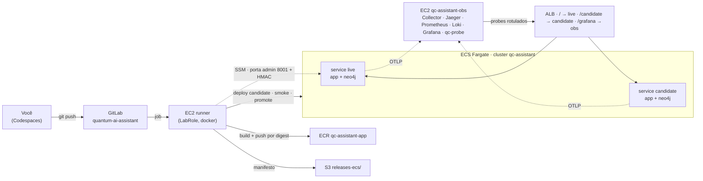
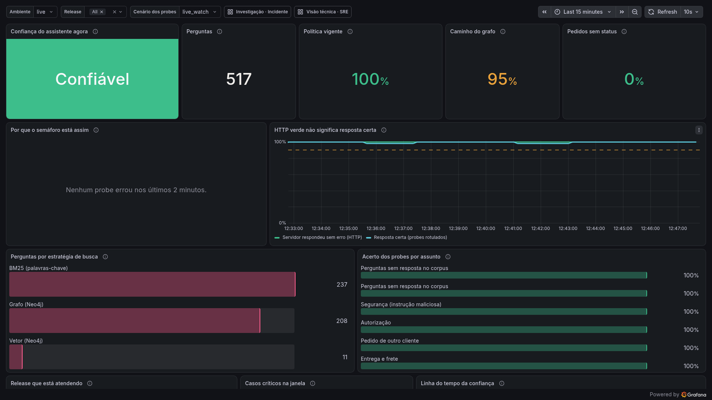
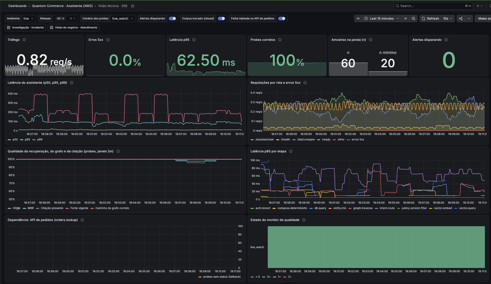
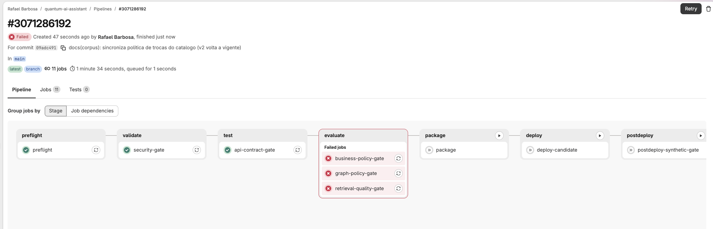
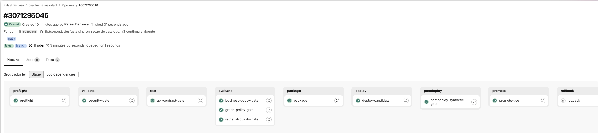
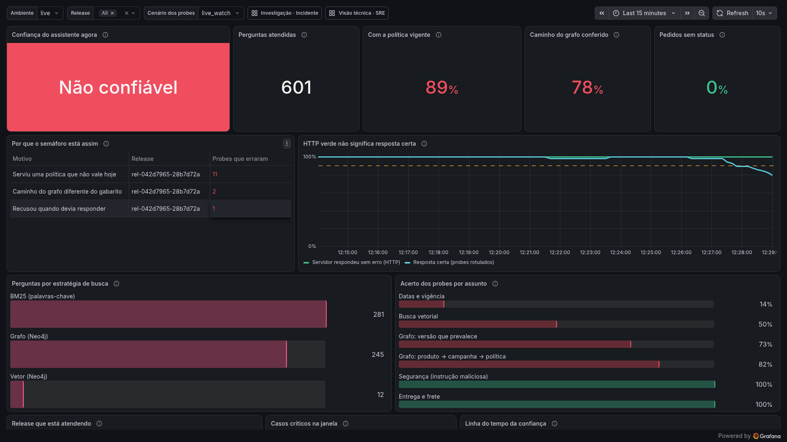
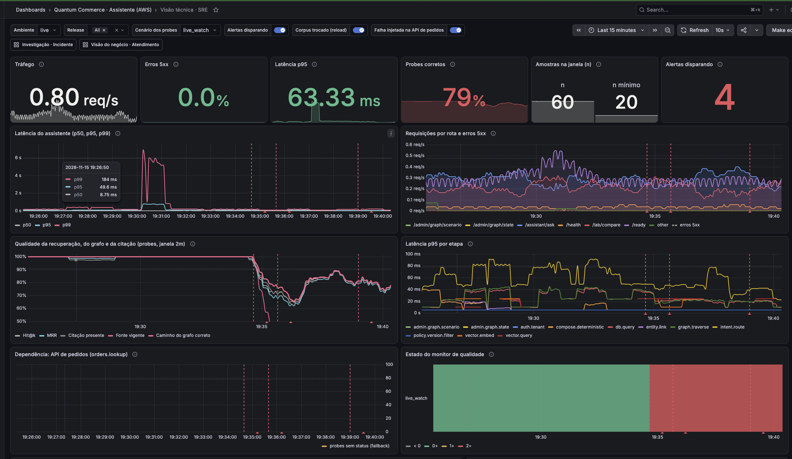
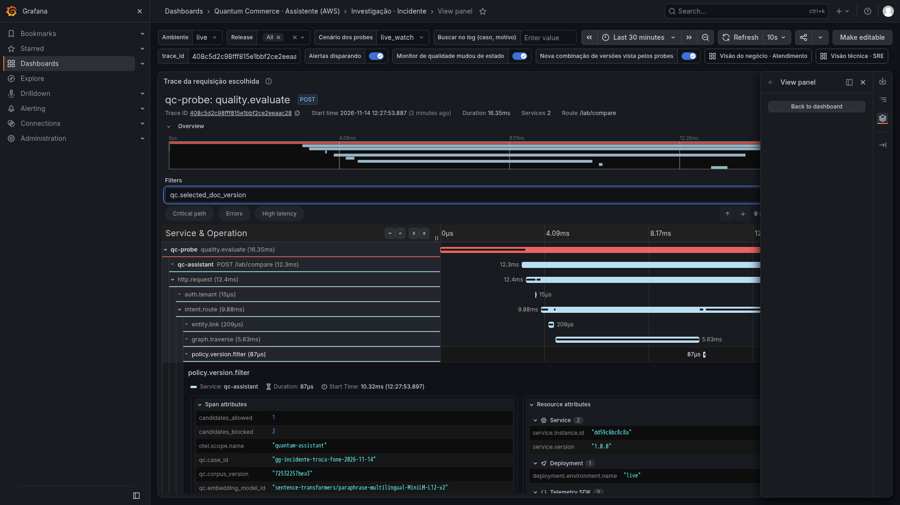
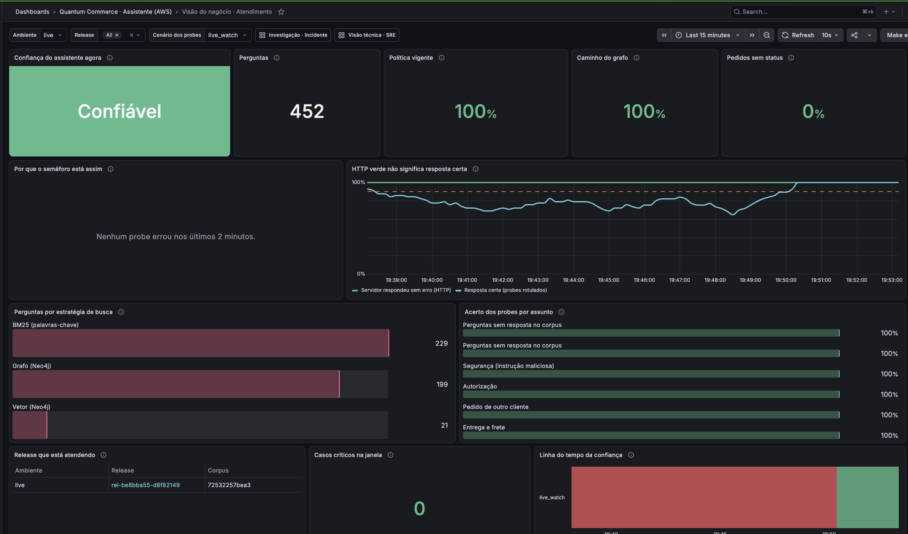
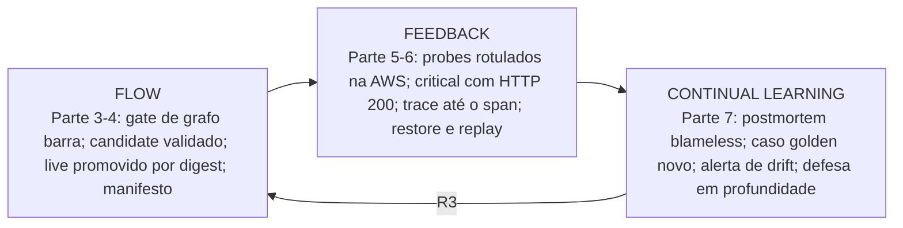

# 04.2 — Demo 5.2: O dashboard estava verde. O cliente, errado.

<!--
CONVENÇÃO DESTE README (nota para o professor, não aparece renderizada)
- NOVA-IMAGEM: print que ainda não existe; salve o PNG no caminho indicado e descomente a linha de imagem logo abaixo.
- CONFIRMAR-SAIDA: trecho que depende de uma saída real da homologação na AWS/GitLab e ainda não foi conferido; substituir pelo valor observado (nunca inventar).
- Saídas marcadas "varia por execução": o aluno confere a FORMA e os campos indicados, não o valor exato.
- A versão anterior desta demo (pilha de observabilidade local no Codespaces) está preservada em LEGADO-local-demo.md.
-->

> **Quinta-feira, 10h20. Depois do intervalo, na segunda metade da aula.**
> **Diego Tavares**, AI SRE sênior, liga para você do andar de baixo:
>
> > *— "O atendimento abriu três tickets só esta manhã. Cliente pergunta prazo de troca, o assistente responde um prazo que não existe mais. Eu abri o painel: health 200, latência normal, zero 5xx, **nenhum deploy hoje**. Tudo verde e o produto errado. Quando você chegar, eu quero duas coisas: um pipeline que **fique vermelho** se alguém publicar a política errada, e um painel que **fique vermelho** se ela voltar depois, sem commit."*
>
> **Helena Marques**, Head de Engenharia de IA e Entrega Contínua, já na sala: *— "Na primeira metade da aula vocês me mostraram a evidência por trás da resposta. Agora eu quero a evidência por trás do **release**: o que me autoriza a promover, o que me avisa quando piora, e o que a gente promete ao cliente depois disso. Não quero slide com check verde. Quero ver o vermelho acontecer e ser barrado."*

Esta demo usa algumas palavras novas; o bloco abaixo define cada uma, para consultar quando aparecer.

<details>
<summary><b>📖 Palavras novas desta demo</b></summary>
<blockquote>

- **JUnit** é o formato de relatório de testes (um XML com um resultado por teste) que o GitLab lê para desenhar a aba **Tests**; `when: always` é a instrução para publicá-lo mesmo quando o job reprova.
- **HMAC** é uma assinatura calculada com uma chave secreta: a porta administrativa do laboratório só aceita chamadas assinadas por quem tem a chave (que vive no SSM).
- **Digest** é a impressão digital (`sha256:...`) de uma imagem de contêiner: identifica o release de forma imutável, ao contrário de uma tag, que pode ser movida.
- **Task definition** é a receita que o ECS usa para rodar a aplicação (qual imagem, por digest; variáveis; segredos); um **service** mantém uma cópia dela de pé e registrada no ALB.
- **Manifesto** é o JSON que o pipeline grava no S3 a cada promoção, amarrando digest, commit, versões e resultado dos gates.
- **Trace** é a história de uma requisição, dividida em **spans** (etapas com nome, duração e atributos), e o `trace_id` é o número que liga tudo.
- **Candidate** e **live** são os dois ambientes no ECS: o `candidate` recebe cada release novo para ser testado, o `live` atende o cliente.
- **Smoke** é o teste rápido que o pipeline faz no `candidate`, pelo ALB, antes de promover.
- **OTLP** é o protocolo do OpenTelemetry com que a aplicação envia traces e métricas ao coletor.
- **Probe** é uma pergunta com gabarito feita ao `live` sem parar, por um robô (`qc-probe`), para medir se a resposta continua certa; **golden** (golden set, caso golden) é a lista dessas perguntas com a resposta esperada.
- **Drift** é o grafo em memória do `live` diferente do grafo publicado na imagem.
- **FIRING** é o estado de um alerta disparado agora.
- **p95**, nos painéis, é o tempo que 95% das requisições não ultrapassam; **5xx** são respostas de erro do servidor.

</blockquote>
</details>

Você é o **AI DevOps Engineer** da Quantum Commerce. Nesta demo você opera **o mesmo produto** que a Demo 5.1 deixou na AWS: faz um pipeline real ficar **vermelho** por uma aresta errada no grafo (e prova que o `live` não mudou), corrige e vê a promoção `candidate → live` por digest, injeta um incidente **sem commit** no grafo do `live`, vê o alerta de qualidade disparar enquanto HTTP e latência seguem verdes, acha o elo quebrado no trace, restaura, prova com replay e fecha com um postmortem que vira caso golden. É o último capítulo prático da disciplina.

Os comandos rodam em três lugares, e cada passo diz qual: **Codespaces** (terminal), **GitLab** (navegador) e **Grafana** (navegador, atrás do ALB da sua conta, com login; o Jaeger é lido **por dentro** do Grafana, como fonte de dados, e não tem endereço público).

> [!WARNING]
> **Pré-requisitos obrigatórios antes de começar:**
>
> - [ ] **Demo 5.1 feita hoje, na primeira metade da aula**, com a [Parte 1 dela](../01-Release-RAG-Quality-Gates/README.md#parte-1---montar-o-ambiente-dentro-da-aula) de pé: projeto GitLab `quantum-ai-assistant` com o código na raiz, runner **online** nele ([passo 4 da 5.1](../01-Release-RAG-Quality-Gates/README.md#passo-4), 4.1 a 4.4), e o ambiente ECS respondendo (`make ready` com `HTTP 200`).
> - [ ] **Credenciais AWS do Academy válidas** ([Início de aula](../../00-create-codespaces/Inicio-de-aula.md); se a sessão virou desde a 5.1, recole-as).
> - [ ] **Grafo íntegro**: `"in_sync": true` no estado administrativo (o passo 1 confere; a Parte 6 da 5.1 terminou com o restore).
>
> **Valide rapidamente** (terminal do Codespaces):
>
> ```bash
> cd /home/vscode/environment/quantum-ai-assistant && make ready | tail -1
> ```
>
> Saída esperada: `HTTP 200`. Se vier `HTTP 503` (ou `000`, sem resposta), as tasks pararam (a sessão do Academy virou): `make start ENV=all`, espere 3 a 5 min e repita o `make ready`. Se continuar, `make diagnose`, ou volte ao [passo 6 da Demo 5.1](../01-Release-RAG-Quality-Gates/README.md#passo-6) (`make deploy-all` + `make ready`); se o runtime foi destruído, aos passos 5 e 6 de lá.
>
> **Tempo de aula: ~72 min, incluindo subir a observabilidade** (Parte 1, ~12 min: `obs.sh up` medido em 125 s com a pilha já de pé e ~5 a 7 min na primeira vez, já contando o restart de `live` e `candidate`, que passam a enviar telemetria e reiniciam em paralelo com o bootstrap; mais o grafo e o baseline) <!-- CONFIRMAR-SAIDA: tempo do obs.sh up com restart em paralelo nao medido na AWS --> **e o roteiro das Partes 2 a 7 (60 min)**; o Encerramento (limpeza) leva ~8 min no fim do módulo. Com a 5.1 (~85 min), as duas demos cabem no dia de aula.

Cada aluno faz **todas** as Partes no próprio projeto GitLab e na própria conta: o seu pipeline, o seu `candidate`, o seu `live`. Se o seu ambiente travar em algum passo e o **⚠ Se der erro** não resolver, acompanhe o roteiro no ambiente que o professor projeta no telão enquanto destrava o seu; o `incident.sh` é idempotente, então dá para retomar de onde parou.

## Principais pontos de aprendizagem

- distinguir cinco frases que costumam ser confundidas: **"pipeline concluído"**, **"teste passou"**, **"candidate validado"**, **"live promovido"** e **"cliente atendido corretamente"**
- ver um gate de **grafo** (`graph-policy`) reprovar uma mudança de **conteúdo** antes do deploy, e provar com a AWS CLI que o `live` ficou intocado
- entender release como **conjunto coerente** identificado por **digest** de imagem: código, corpus, grafo, índice e modelo voltam juntos no rollback
- separar **disponibilidade** (HTTP 200, p95, 5xx) de **qualidade** (fonte vigente, aresta certa), medida com **probes rotulados** rodando na AWS
- ler um trace OpenTelemetry (`http.request → auth.tenant → intent.route → entity.link → graph.traverse → policy.version.filter → compose.deterministic`) e achar **em qual span** a resposta errada nasceu
- entender por que, **nesta arquitetura**, reiniciar a task restaura o grafo, e por que isso **não** quer dizer que "restart resolve sempre"
- escrever um **postmortem blameless** cuja ação preventiva é um caso golden novo, e fechar os **Three Ways** (Flow, Feedback, Continual Learning)

## O que você terá ao final

Dois pipelines reais no seu projeto (um vermelho, um verde com promoção), um incidente injetado e detectado por medição, um trace que mostra a causa, um replay que prova a recuperação, um postmortem e um caso golden novo. **Diego quer ver o alerta disparar antes do ticket. Helena quer saber o que pode prometer ao cliente.**

Os blocos **💡 Clique para entender** trazem o aprofundamento; **📋 Saída completa esperada** mostra a saída inteira; os blocos **⚠ Se der erro** só importam se o passo falhar (um por mensagem); os blocos **🤔 Pare e pense** são perguntas (P1 a P5) para responder antes de rolar a tela. **R1, R2 e R3** são sempre os três releases do dia, nunca perguntas.

## Mapa do lab

| Parte | Relógio | O que você faz | Passos | Tempo |
|-------|---------|----------------|--------|-------|
| [Parte 1](#parte-1---subir-a-observabilidade-dentro-da-aula) | 00–12 | Conferir o grafo, subir a observabilidade na AWS (lendo a arquitetura enquanto ela sobe) e registrar o baseline R1 | [1](#passo-1) · [2](#passo-2) · [3](#passo-3) | 12 min (já inclui os ~5 a 7 min do `obs.sh up` na 1ª vez, com o restart das tasks em paralelo) |
| [Parte 2](#parte-2---pipeline-verde-cliente-errado) | 12–19 | Ver o `live` R1, health 200 e o baseline de qualidade no Grafana | [4](#passo-4) · [5](#passo-5) | 7 min |
| [Parte 3](#parte-3---o-gate-protege-o-cliente) | 19–32 | Republicar a v2 como vigente no corpus, commit, push, pipeline **vermelho** real, `live` intocado | [6](#passo-6) · [7](#passo-7) · [8](#passo-8) · [9](#passo-9) | 13 min |
| [Parte 4](#parte-4---a-correção-merece-confiança) | 32–47 | Corrigir e dar push; **enquanto o pipeline verde roda** (10–15 min), ler o 💡 do passo 10 e acompanhar os jobs; candidate → smoke → promote R2, manifesto e digest | [10](#passo-10) · [11](#passo-11) · [12](#passo-12) | 15 min (10 de espera guiada) |
| [Parte 5](#parte-5---nenhum-commit-aconteceu-mesmo-assim-piorou) | 47–55 | Injetar `stale_graph_policy` no `live`; HTTP 200 e resposta errada; alerta crítico | [13](#passo-13) · [14](#passo-14) · [15](#passo-15) | 8 min |
| [Parte 6](#parte-6---encontre-o-elo-quebrado) | 55–64 | Trace no Jaeger, painel do Diego, o elo quebrado, restore e replay | [16](#passo-16) · [17](#passo-17) · [18](#passo-18) · [19](#passo-19) | 9 min |
| [Parte 7](#parte-7---transforme-incidente-em-aprendizado) | 64–72 | Postmortem (pré-preenchido: você completa horários, `trace_id` e versões), caso golden novo, Three Ways | [20](#passo-20) · [21](#passo-21) · [22](#passo-22) | 8 min |
| [Encerramento](#encerramento-da-disciplina-e-limpeza) | 72–80 | O ciclo da disciplina e a limpeza segura, no fim do módulo | [23](#passo-23) · [24](#passo-24) | 8 min |

<details>
<summary><b>💡 Por que operar é diferente de entregar, em 3 parágrafos</b></summary>
<blockquote>

Na Demo 5.1 a pergunta era "**de onde** veio esta resposta e ela se aplica?". Hoje são duas perguntas, uma antes e uma depois do deploy. **Antes:** "esta mudança é segura para publicar?" O gate roda uma vez, sobre um conjunto conhecido (o golden set), e barra o que a equipe previu.

**Depois** do deploy, coisas mudam sem passar pelo pipeline: alguém mexe no grafo em runtime, um sync de catálogo corrompe um metadado, uma dependência fica lenta. Nenhuma gera `git push`; logo, nenhuma passa pelo gate. É o **Second Way** (o segundo dos Three Ways do *DevOps Handbook*, que o passo 22 fecha): feedback vindo da operação, rápido e visível, de volta para quem muda o sistema.

Para um assistente há uma dificuldade a mais: o `200` chega com um **texto**, e o texto pode estar errado. Medir isso exige perguntas com **resposta conhecida** rodando continuamente (probes) e comparadas com o esperado. Quem percebe o incidente de hoje não é o `/health`: é um probe que sabe que a resposta certa era 30 dias.

</blockquote>
</details>

## Contexto

| Aspecto | Resposta |
|---------|----------------|
| **Problema de negócio** | O assistente responde um prazo de uma versão que não vale mais, com fonte citada e cara de certo. Health verde, cliente errado, ticket no atendimento, e **nenhum deploy** para culpar. |
| **Pergunta que este lab responde bem** | "Como impedir que a evidência errada seja publicada, e como descobrir, **sem ninguém olhando**, que ela mudou depois?" |
| **Pergunta que ele responde mal** | "A resposta a este cliente específico estava certa?" Probes medem contratos conhecidos, não a satisfação de cada pessoa; sem LLM não há "taxa de alucinação" para medir, e não fingimos que há. |
| **Quando acontece na vida real** | Toda equipe que opera um assistente sobre uma base viva: catálogo, políticas e relações mudam por fora do pipeline. |

### Arquitetura



![Arquitetura da Demo 5.2: o git push no GitLab dispara o pipeline no runner EC2 (gates, package com push no ECR, deploy candidate, smoke pelo ALB e promote live com o mesmo digest, manifesto no S3); o ALB leva / ao live, /candidate ao candidate e /grafana à EC2 de observabilidade, onde OTel Collector, Jaeger, Prometheus, Loki, Grafana e o qc-probe medem a qualidade; o incidente de laboratório vai do Codespaces pelo SSM Run Command ao runner e à porta admin 8001 do live, fora do pipeline; embaixo, o ciclo de aprendizado leva do erro detectado ao novo caso no golden set](img/arquitetura-5-2.png)

> Fonte editável: [`diagramas/arquitetura-5-2.excalidraw`](../diagramas/arquitetura-5-2.excalidraw), gerada por `diagramas/gerar_aula5_ecs.py`.

| Componente | Onde roda | Papel |
|---|---|---|
| Pipeline (`.gitlab-ci.yml` na raiz do projeto) | GitLab + runner EC2 | Stages `preflight → validate → test → evaluate → package → approve → deploy → postdeploy → promote → rollback`, com `QC_TARGET_RUNTIME=ecs`. O gate novo de hoje é o **`graph-policy-gate`** no `evaluate`. |
| Imagem `qc-assistant-app` por **digest** | ECR | O release: código + corpus + seed do grafo + pesos + embeddings. |
| Services `qc-assistant-live` e `qc-assistant-candidate` | ECS Fargate | Cada um com o seu Neo4j. O candidate recebe o deploy; o live atende o cliente. |
| Manifesto de release | `s3://base-config-<SEU RM>/quantum-assistant/releases-ecs/` | JSON com digest, `git_sha`, todas as versões, resultado dos gates, aprovador, timestamps. O rollback lê daqui. |
| EC2 `qc-assistant-obs` (`t3.medium`, sem SSH, via SSM) | AWS, mesma VPC | Docker Compose com OTel Collector `0.164.0`, Jaeger `2.22.0`, Prometheus `v3.15.1`, Loki `3.7.9`, Grafana `13.2.5` (login `admin`, anônimo desligado, em `/grafana/` pelo ALB) e o contêiner **`qc-probe`**, que faz perguntas com gabarito ao ALB e emite as métricas de qualidade. |
| `ops/cloud/incident.sh` | Codespaces → SSM → runner → porta 8001 da task | O instrumento de laboratório que aplica/desfaz cenários no grafo **em runtime**, com assinatura HMAC. Nunca passa pelo ALB. |

> [!CAUTION]
> **Custo enquanto estiver de pé.** Além das duas tasks Fargate (~US$ 0,053/h cada), do ALB (~US$ 0,0225/h) e do runner (~US$ 0,02/h) da Demo 5.1, a EC2 de observabilidade (`t3.medium`, ~US$ 0,04/h) cobra por hora: tudo ligado fica na faixa de **US$ 0,19/h, ~US$ 4,60/dia** (preços de lista de `us-east-1`). A limpeza está no Encerramento e sempre começa em `--dry-run`; a rede `fiap-lab` nunca é destruída.

---

## Parte 1 - Subir a observabilidade (dentro da aula)

> **00–12 min.** Diego, de volta à sala: *— "Vocês já sabem **de onde** vem cada resposta. Agora eu quero **medir** isso o tempo todo, sem ninguém olhando. Subam a pilha de observabilidade e, enquanto ela sobe, olhem para onde a telemetria vai."*

### Resultado esperado desta parte

A pilha de observabilidade de pé na AWS, o Grafana acessível pelo ALB com login, os probes rodando contra o `live`, e o release que está no ar registrado como **R1**: o baseline contra o qual a aula inteira vai comparar.

Esta parte continua **exatamente** do ponto em que a Demo 5.1 parou: o ambiente da [Parte 1 de lá](../01-Release-RAG-Quality-Gates/README.md#parte-1---montar-o-ambiente-dentro-da-aula) (projeto, runner, `live` e `candidate`) é o mesmo. Se a sessão do Academy virou no intervalo e as tasks pararam, `make start ENV=all` as religa na mesma revisão (3 a 5 min; `make ready` confere); se o ambiente foi destruído, refaça os passos 5 (`make secrets` + `make up` + `make image`) e 6 (`make deploy-all` + `make ready`) de lá.

---

<a id="passo-1"></a>

**1. Confira o ambiente e o estado do grafo**

No Codespaces. A aula só funciona se o `live` estiver atendendo o release que a Demo 5.1 publicou e **sem drift** no grafo (alguém pode ter deixado um cenário da Parte 6 ativo).

```bash
cd /home/vscode/environment/quantum-ai-assistant
make ready | tail -1
bash ops/cloud/incident.sh state --env live
```

**Esperado:** `HTTP 200` e, no JSON, `"in_sync": true` com `"active_mutations": []` (sem drift). Só lê; seguro repetir.

<details>
<summary><b>📋 Saída completa esperada</b></summary>
<blockquote>

```text
HTTP 200
incident: live: GET /admin/graph/state via runner i-... -> task 10.0.x.x:8001
{"environment": "live", "action": "state", "scenario": null, "started_at": "...Z", "finished_at": "...Z", "graph_version_before": null, "graph_version": "c07dde5b8806", "graph_seed_version": "c07dde5b8806", "in_sync": true, "active_mutations": [], "diff": {"node_props_changed": [], "nodes_missing": [], "nodes_extra": [], "edges_missing": [], "edges_extra": []}, "counts": {"nodes": 79, "edges": 109, "chunks": 31}}
```

</blockquote>
</details>

<details>
<summary><b>💡 Clique para entender: a saída do estado e os comandos que esta demo usa além dos da 5.1</b></summary>
<blockquote>

A linha `incident:` é o progresso (o script descobre o runner e o IP privado da task, e pede ao runner, via SSM, que chame a porta 8001); o **resultado** é o JSON: `in_sync: true` e `active_mutations: []` querem dizer "sem drift". O grafo publicado tem 79 nós, 109 arestas e 31 trechos.

| Comando | O que faz por baixo | Quando |
|---|---|---|
| `bash ops/cloud/obs.sh up` | Senha do Grafana no SSM (se faltar) + envio da configuração ao S3 + `terraform apply` de `infra-obs/` + bootstrap da EC2 via SSM (Docker Compose). Imprime a URL do Grafana. | Parte 1 |
| `bash ops/cloud/obs.sh status` / `url` | Contêineres na EC2 e saúde do Grafana pelo ALB / só a URL. | Quando um painel não carrega |
| `bash ops/cloud/incident.sh state\|apply\|restore [--scenario X] [--env live]` | Via SSM no runner, roda `web/admin_client.py` contra a porta admin 8001 da task, com assinatura HMAC lida do SSM dentro do runner. `state` lê; `apply`/`restore` mudam o grafo do Neo4j da task. `--teacher-reset` restaura os dois cenários nos dois ambientes. Saída: JSON com `graph_version` antes/depois, `in_sync`, `active_mutations`, `diff`. | Partes 1, 5, 6, 7 |
| `aws s3 ls s3://<bucket>/quantum-assistant/releases-ecs/` | Lista os manifestos de release (um por promoção, mais `live.json`). | Partes 1 e 4 |
| `make start ENV=all` / `make down` / `make diagnose` | Liga (3 a 5 min de cold start; `make ready` confere) / desliga as tasks na mesma revisão / diagnóstico sem segredos. `make up` **não** religa as tasks. | Quando o ambiente não responde |
| `python3 evals/graph_gate.py --target seed\|local\|http` | O gate de grafo em três alvos: `seed` cruza semente e corpus sem banco (o que você roda no Codespaces); `local` percorre os casos num Neo4j (o que o pipeline roda no runner); `http --url` avalia o que está **atendendo**. Grava `--out` e `--junit` (sempre). | Partes 3, 4, 7 |

</blockquote>
</details>

<details>
<summary><b>⚠ Se der erro: <code>"in_sync": false</code></b></summary>
<blockquote>

Ficou um cenário ativo no grafo. Restaure: `bash ops/cloud/incident.sh restore --scenario stale_graph_policy --env live`, trocando `stale_graph_policy` pelo nome que `active_mutations` mostrar (o outro possível é `remove_campaign_edge`). Seguro repetir.

</blockquote>
</details>

<details>
<summary><b>⚠ Se der erro: <code>HTTP 503</code> (ou <code>HTTP 000</code>) no <code>make ready</code></b></summary>
<blockquote>

As tasks pararam (a sessão do Academy virou desde a 5.1) ou ainda estão subindo. `make up` **não** religa as tasks; quem religa é o `make start`, na mesma revisão:

```bash
cd /home/vscode/environment/quantum-ai-assistant
make start ENV=all
```

Espere 3 a 5 min (cold start: Neo4j + grafo + modelo) e confira com `make ready | tail -1` até `HTTP 200`. Se não chegar, `make diagnose` mostra o motivo e o [passo 6 da Demo 5.1](../01-Release-RAG-Quality-Gates/README.md#passo-6) (`make deploy-all` + `make ready`) reimplanta. Se o runtime foi **destruído** (o `make deploy-all` para com `parametro /qc-assistant/ecs/alb-url ausente`), refaça os passos [5](../01-Release-RAG-Quality-Gates/README.md#passo-5) (`make secrets` + `make up` + `make image`) e 6 da 5.1.

</blockquote>
</details>

<details>
<summary><b>⚠ Se der erro: <code>nenhuma task RUNNING em qc-assistant-live</code></b></summary>
<blockquote>

É o mesmo caso do `HTTP 503` acima: as tasks pararam. `make start ENV=all`, espere 3 a 5 min, confira com `make ready | tail -1` e repita o passo.

</blockquote>
</details>

<details>
<summary><b>⚠ Se der erro: <code>nenhuma task RUNNING de qc-assistant-live na revisao atual</code></b></summary>
<blockquote>

A mensagem completa termina em `deploy em andamento? tente de novo em 1 min ou rode make diagnose ENV=live`: o ECS ainda está trocando a task velha pela nova. Espere 1 min e repita o passo; se persistir, `make diagnose ENV=live` mostra o motivo.

</blockquote>
</details>

<details>
<summary><b>⚠ Se der erro: <code>Unable to locate credentials</code>, <code>ExpiredToken</code> ou <code>credencial AWS invalida ou expirada</code></b></summary>
<blockquote>

A sessão do Learner Lab expirou. **Start Lab** → **AWS Details**, cole o bloco em `~/.aws/credentials` e repita o passo.

</blockquote>
</details>

<details>
<summary><b>⚠ Se der erro: <code>runner quantum-ai-gitlab-runner nao esta running</code></b></summary>
<blockquote>

O `incident.sh` fala com a task **através** do runner, e a EC2 dele parou com a sessão do Academy. Religue (seguro repetir; sem `TOKEN=`, vale porque o 4.4 da 5.1 gravou o token deste projeto):

```bash
cd /home/vscode/environment/quantum-ai-assistant
make runner
```

**Esperado:** `Runner pronto e registrado neste projeto.` Se responder `Falta o TOKEN deste projeto`, refaça o [passo 4 da Demo 5.1](../01-Release-RAG-Quality-Gates/README.md#passo-4) (4.1 a 4.4) e repita este passo.

</blockquote>
</details>

<details>
<summary><b>⚠ Se der erro: <code>No rule to make target</code></b></summary>
<blockquote>

A sua cópia do projeto é anterior a uma atualização do curso: o `git pull` atualiza só `/workspaces/FIAP-AI-Devops-CICD`, não a cópia. Copie de novo e publique:

```bash
cp -r /workspaces/FIAP-AI-Devops-CICD/04-GenAIOps/quantum-assistant/. /home/vscode/environment/quantum-ai-assistant/
cd /home/vscode/environment/quantum-ai-assistant
git add -A && git commit -m "atualiza o assistente com a versao do curso"
eval $(ssh-agent -s) >/dev/null && ssh-add -k /home/vscode/.ssh/gitlab
git push origin "$(git branch --show-current)"
```

Depois repita o sub-passo em que parou.

</blockquote>
</details>

---

<a id="passo-2"></a>

**2. Suba a observabilidade na AWS**

No Codespaces. `obs.sh up` cria (Terraform) a **EC2 `qc-assistant-obs`**, com as ferramentas que recebem e mostram traces, métricas e logs (o **Grafana** é o painel), o **`qc-probe`** (perguntas com gabarito ao `live`) e a regra `/grafana` no ALB. Na primeira vez, reinicia o `live` e o `candidate` **na mesma imagem** (mesmo release), porque a task só lê o endereço da telemetria ao subir. Seguro repetir: da segunda vez, nada é reiniciado.

```bash
cd /home/vscode/environment/quantum-ai-assistant
bash ops/cloud/obs.sh up
```

**Esperado:** a última linha é a URL do Grafana.

Enquanto roda (2 min ao repetir; ~5 a 7 min na primeira vez), abra o ⏳ abaixo e responda à pergunta que o passo 5 cobra. <!-- CONFIRMAR-SAIDA: tempo do obs.sh up com restart em paralelo nao medido na AWS -->

<details>
<summary><b>📋 Saída completa esperada</b></summary>
<blockquote>

Saída real da homologação, com a pilha já de pé: 125 s. A linha `otlp-endpoint` é a do script atual (endereço igual, nada reiniciado). <!-- CONFIRMAR-SAIDA: linha nova do restart, não executada na AWS -->

```text
obs: /qc-assistant/obs/grafana-admin ja existe (nao alterado)
obs: enviando configuracao e codigo do probe para s3://base-config-<SEU RM>/quantum-assistant/obs-config/
aws_security_group.obs: Refreshing state... [id=sg-...]
aws_instance.obs: Refreshing state... [id=i-...]
No changes. Your infrastructure matches the configuration.
Apply complete! Resources: 0 added, 0 changed, 0 destroyed.
obs: /qc-assistant/obs/otlp-endpoint = http://10.0.x.x:4318 (sem mudanca: live e candidate nao reiniciados)
obs: rodando o bootstrap na i-... via SSM (primeira vez: ~4 min de docker pull)
[bootstrap] fim 2026-11-14T12:04:12Z
http://qc-assistant-alb-<id>.us-east-1.elb.amazonaws.com/grafana/
```

Na **primeira vez** (o endereço era `disabled`), a partir da linha `otlp-endpoint` a saída fica assim. O restart de `live` e `candidate` (cold start: Neo4j + grafo + modelo) corre **em paralelo** com o bootstrap da EC2, e o script só espera as tasks estabilizarem depois do bootstrap: <!-- CONFIRMAR-SAIDA: linha nova do restart, não executada na AWS -->

```text
obs: /qc-assistant/obs/otlp-endpoint = http://10.0.x.x:4318 (era disabled)
obs: reiniciando qc-assistant-live qc-assistant-candidate na mesma revisao: a task so le o endpoint OTLP novo quando sobe (cold start ~3-5 min, em paralelo)
obs: rodando o bootstrap na i-... via SSM (primeira vez: ~4 min de docker pull)
[bootstrap] ...
obs: esperando qc-assistant-live qc-assistant-candidate estabilizar com o endpoint OTLP novo
obs: qc-assistant-live qc-assistant-candidate estavel(is) com o endpoint OTLP novo (mesma imagem, mesmo release)
http://qc-assistant-alb-<id>.us-east-1.elb.amazonaws.com/grafana/
```

Se o `candidate` estiver desligado (`desired 0`), ele não é reiniciado e aparece `obs: qc-assistant-candidate desligado ou ausente (desired=0): nao reiniciado`.

</blockquote>
</details>

<details>
<summary><b>⏳ Enquanto o <code>obs.sh up</code> roda (2 a 7 min): a pergunta que o passo 5 cobra</b></summary>
<blockquote>

**Enquanto o `obs.sh up` roda** (125 s na homologação com a pilha já de pé; na primeira vez, a sua, cerca de 5 a 7 min: o `apply` cria 9 recursos e, enquanto o bootstrap faz ~4 min de `docker pull`, o restart de `live` e `candidate` corre em paralelo, com 3 a 5 min de cold start; vale a maior das duas esperas, não a soma), abra a [arquitetura da demo](img/arquitetura-5-2.png) e siga duas setas: a tracejada **OTLP**, que sai das tasks `live` e `candidate` e chega à EC2 `qc-assistant-obs` (é para lá que os spans e as métricas vão), e a dos **probes rotulados**, que sai dessa EC2 e volta ao ALB (é ela que faz perguntas com gabarito ao `live`). Depois responda no caderno: dos dois painéis que você vai abrir no passo 3 (o do Diego, de engenharia, e o da Helena, de negócio), **qual deles deveria mudar de cor** quando o assistente responder um prazo errado com HTTP 200? O passo 5 cobra a resposta. Você sabe que o comando terminou quando a última linha é a URL do Grafana. <!-- CONFIRMAR-SAIDA: tempo do obs.sh up com restart em paralelo nao medido na AWS -->

</blockquote>
</details>

<details>
<summary><b>💡 Clique para entender: o que o <code>obs.sh up</code> cria, e por que o Grafana tem login</b></summary>
<blockquote>

Na primeira execução a primeira linha é `/qc-assistant/obs/grafana-admin created` e o Terraform mostra `Plan: 9 to add`. Usuário `admin`; a senha **não aparece** (mora no SSM) e o passo 3 mostra como lê-la.

O `obs.sh up` faz quatro coisas, todas idempotentes: cria a senha do Grafana no SSM (se faltar, sem mostrar), envia a configuração e o código do probe para o S3, aplica o Terraform de `infra-obs/` (EC2 `qc-assistant-obs`, regra `/grafana` no ALB, SG) e roda o bootstrap na EC2 **via SSM, sem SSH** (instala Docker pinado, baixa a configuração do S3 e sobe o compose: Collector, Jaeger, Prometheus, Loki, Grafana e o `qc-probe`). O endpoint OTLP vai para o SSM, de onde as tasks ECS o lêem. Tudo na mesma VPC; Jaeger, Prometheus, Loki e Collector **não** ficam acessíveis pela internet.

O progresso (`obs: ...`, Terraform, `[bootstrap] ...`) vai para o terminal; o **resultado** é a última linha, a URL do Grafana. Para ler a senha **uma vez**, no seu terminal: `aws ssm get-parameter --name /qc-assistant/obs/grafana-admin --with-decryption --query Parameter.Value --output text --region us-east-1`. Não a cole em arquivo nenhum do projeto. Para conferir os contêineres e a saúde do Grafana depois: `bash ops/cloud/obs.sh status`; para só a URL: `bash ops/cloud/obs.sh url`.

O Terraform de `infra-obs/` (state em `quantum-assistant/obs/terraform.tfstate`) cria **9 recursos**: **uma** EC2 `t3.medium` na rede `fiap-lab`, com `LabInstanceProfile`, **sem par de chaves e sem porta 22** (toda administração é via SSM), um security group com saída livre, entrada `3000` só do SG do ALB e `4318` só dos SGs das tasks ECS e do runner, e uma regra no ALB `/grafana*` → target group da EC2 (o `obs.sh destroy` lista exatamente esses 9). O `user_data` instala Docker e sobe `ops/cloud/docker-compose.yml`: as mesmas imagens pinadas da pilha anterior (Collector contrib, Jaeger, Prometheus, Loki, Grafana) mais o `qc-probe`, um contêiner que sorteia, com semente fixa, perguntas com gabarito dos golden sets (`evals/golden_v1.jsonl` e `evals/golden_graph_v1.jsonl`, com a distribuição por cenário de `ops/scenarios.json`), faz essas perguntas ao ALB em ritmo fixo, julga cada resposta contra o gabarito (e, nos casos de grafo, contra o caminho de referência: semente + front matter) e publica `qc_probe_total`, `qc_probe_stale_source_served_total` e os gauges `qc_quality_*` para o Prometheus.

O Grafana da pilha anterior era anônimo porque só existia em `localhost` do Codespaces. Atrás de um ALB público, anônimo seria um painel de produção aberto para a internet. Por isso `GF_AUTH_ANONYMOUS_ENABLED=false`, `GF_USERS_ALLOW_SIGN_UP=false`, usuário `admin` e senha gerada no SSM (`/qc-assistant/obs/grafana-admin`), lida pelo `bootstrap.sh` **dentro** da EC2 e gravada num `grafana.env` com `chmod 600`. O health check do ALB bate em `/grafana/api/health`, que responde `200` sem login e sem expor dado. Testado de fora, da internet, na homologação: `GET /grafana/` anônimo → `302` para o login; `/grafana/api/search` anônimo ou com senha errada → `401`; com `admin` e a senha do SSM → `200` (3 dashboards). As portas 3000, 4318, 16686, 9090, 3100 e 22 no IP público da EC2 dão **timeout** (os SGs não têm nenhum CIDR aberto: 3000 só do SG do ALB, 4318 só dos SGs das tasks e do runner). A porta administrativa 8001 da task, pelo ALB, dá `404`/`405`; pelo IP público, timeout. A EC2 usa IMDSv2 com hop limit 1, sem key pair, sem SSH, disco gp3 criptografado. Em produção haveria TLS e SSO; no Learner Lab, sem domínio, o ALB fica em HTTP e o que trafega são dados **fictícios**. Isso está escrito no rodapé de cada dashboard.

📚 Documentação oficial: [Grafana: provisioning](https://grafana.com/docs/grafana/latest/administration/provisioning/), para dashboards e datasources que nascem com o contêiner; [OTel Collector configuration](https://opentelemetry.io/docs/collector/configuration/), para receivers/exporters do `otel-collector.yaml`.

</blockquote>
</details>

<details>
<summary><b>⚠ Se der erro: <code>obs: ERRO: ALB ausente</code></b></summary>
<blockquote>

A mensagem completa é `obs: ERRO: ALB ausente: rode make up (passo 5 da Demo 5.1)`. O runtime da 5.1 (ALB, cluster e services) não existe nesta conta, e o `obs.sh up` parou **antes** de qualquer `apply`: nada foi criado. Refaça os passos [5](../01-Release-RAG-Quality-Gates/README.md#passo-5) (`make secrets` + `make up` + `make image`) e [6](../01-Release-RAG-Quality-Gates/README.md#passo-6) (`make deploy-all` + `make ready`) da 5.1 e repita este passo.

</blockquote>
</details>

<details>
<summary><b>⚠ Se der erro: <code>credencial AWS invalida ou expirada</code></b></summary>
<blockquote>

A sessão do Learner Lab expirou. **Start Lab** → **AWS Details**, cole o bloco em `~/.aws/credentials` e repita o passo.

</blockquote>
</details>

<details>
<summary><b>⚠ Se der erro: <code>t3.medium is not supported in your requested Availability Zone</code> ou <code>InsufficientInstanceCapacity</code></b></summary>
<blockquote>

`t3.medium is not supported in your requested Availability Zone` apareceu uma vez na homologação e já está tratado: o Terraform filtra as subnets pelas AZs que oferecem o tipo. Se mesmo assim vier `InsufficientInstanceCapacity`, espere alguns minutos e repita.

</blockquote>
</details>

<details>
<summary><b>⚠ Se der erro: <code>/grafana</code> devolve <code>502</code> nos primeiros minutos</b></summary>
<blockquote>

O compose ainda está baixando as imagens; `bash ops/cloud/obs.sh status` mostra os contêineres subindo (espere ~3 min).

</blockquote>
</details>

---

<a id="passo-3"></a>

**3. Registre o baseline R1**

No Codespaces e no navegador (Grafana). "R1" é o release que está no ar agora: anote o digest e confira o painel de qualidade **verde com `n` suficiente**.

```bash
cd /home/vscode/environment/quantum-ai-assistant
APP=$(aws ssm get-parameter --name /qc-assistant/ecs/alb-url --query Parameter.Value --output text)
curl -s "$APP/health" | python3 -c 'import json,sys; h=json.load(sys.stdin); print("R1 release_id :", h["release_id"]); print("R1 digest     :", h["image_digest"]); print("R1 graph_seed :", h["versions"]["graph_seed_version"])'
BUCKET=$(aws s3 ls | awk '{print $3}' | grep '^base-config' | head -1)
aws s3 ls "s3://$BUCKET/quantum-assistant/releases-ecs/"
```

**Esperado:** as três linhas `R1 ...` (na sua aula a lista de manifestos vem **vazia**, veja o 💡).

<details>
<summary><b>📋 Saída completa esperada</b></summary>
<blockquote>

Valores da homologação; na sua aula o `release_id` e a lista mudam.

```text
R1 release_id : rel-b8aa56f8-df18cb90
R1 digest     : sha256:df18cb90cf4e0d6637baaa52e911b0e624d8146bc63f923b84dd91d48fbf977b
R1 graph_seed : c07dde5b8806
                           PRE history/
2026-11-14 ...        candidate.json
2026-11-14 ...        live.json
2026-11-14 ...        rel-b8aa56f8-df18cb90.json
```

</blockquote>
</details>

<details>
<summary><b>💡 Clique para entender: por que o seu R1 é um release sem registro</b></summary>
<blockquote>

"R1" é o nome que a aula dá ao release que está no ar agora; sem ele, nenhuma comparação de hoje tem referência.

Os valores acima são os da homologação deste lab, em que um pipeline verde já tinha publicado o `live` (por isso há manifesto). **Na sua aula é diferente, e isso é esperado:** o que está no ar é o release que o `make deploy-all` do [passo 6 da 5.1](../01-Release-RAG-Quality-Gates/README.md#passo-6) publicou há pouco, direto do terminal, sem pipeline e sem manifesto. O `release_id` tem a forma `rel-` + os 12 primeiros caracteres do digest (é o que o `scripts/cloud/deploy.sh` grava quando ninguém passa `--release-id`), e a lista de manifestos vem **vazia**. Isso é informação: é um release **sem registro**, e **esse é o seu R1**. O primeiro pipeline verde do dia, o da Parte 4, é quem grava o primeiro arquivo em `releases-ecs/` (`history/`, `candidate.json`, `live.json` e um `<release_id>.json` por release publicado); a partir dali, o que está em `live.json` é sempre o release no ar.

</blockquote>
</details>

**3.1. Mostre a senha do Grafana.** Ela só aparece no seu terminal; não a cole em arquivo nenhum.

```bash
aws ssm get-parameter --name /qc-assistant/obs/grafana-admin --with-decryption --query Parameter.Value --output text
```

**Esperado:** uma linha só, a senha (o usuário é sempre `admin`).

**3.2. Abra o painel da Helena:**

```bash
cd /home/vscode/environment/quantum-ai-assistant && make links painel-helena
```

**Esperado:** a linha `Abra no navegador (Ctrl+clique; no Mac, Cmd+clique):` e, abaixo dela, um único endereço `http://...elb.amazonaws.com/grafana/d/qc-negocio`.

<details>
<summary><b>⚠ Se der erro: <code>No rule to make target 'links'</code></b></summary>
<blockquote>

A sua cópia do projeto é anterior a uma atualização do curso: o `git pull` atualiza só `/workspaces/FIAP-AI-Devops-CICD`, não a cópia. Copie de novo e publique:

```bash
cp -r /workspaces/FIAP-AI-Devops-CICD/04-GenAIOps/quantum-assistant/. /home/vscode/environment/quantum-ai-assistant/
cd /home/vscode/environment/quantum-ai-assistant
git add -A && git commit -m "atualiza o assistente com a versao do curso"
eval $(ssh-agent -s) >/dev/null && ssh-add -k /home/vscode/.ssh/gitlab
git push origin "$(git branch --show-current)"
```

Depois repita o 3.2.

</blockquote>
</details>

<details>
<summary><b>⚠ Se der erro: <code>links: o ALB ainda nao existe nesta conta</code></b></summary>
<blockquote>

A credencial AWS expirou (**Start Lab** → **AWS Details**, cole o bloco em `~/.aws/credentials`) ou o runtime foi destruído (refaça os passos 5 e 6 da 5.1). Depois repita o 3.2.

</blockquote>
</details>

**3.3.** Ctrl+clique no link (Cmd+clique no Mac) para abrir no navegador.

**Esperado:** a tela de login do Grafana.

**3.4.** No campo **Email or username**, digite `admin`.

**3.5.** No campo **Password**, cole a senha do 3.1.

**3.6.** Clique em **Log in**.

**Esperado:** abre o dashboard **Visão do negócio · Atendimento**, já em **Last 15 minutes** com refresh de 10 s (não precisa mexer no relógio).

> [!IMPORTANT]
> **O que cada painel é:** **Visão do negócio · Atendimento** (Helena) responde "o cliente recebeu a política que vale hoje?", medido por probes com gabarito. **Visão técnica · SRE** (Diego) responde "o servidor está de pé, rápido e sem erro?". **Investigação · Incidente** é o da Parte 6.
>
> **O que olhar agora:** no da Helena, o semáforo **Confiança do assistente agora**; no do Diego, a linha de cima, sobretudo **Amostras na janela (n)**.

**3.7. Leia o semáforo no topo.** Olhe o painel **Confiança do assistente agora**.

**Esperado:** **Confiável** (verde).

**O que observar:**
- **Política vigente** e **Caminho do grafo** em 100%; **Casos críticos na janela** em 0.
- Os três números usam a mesma janela do semáforo: os últimos 2 min.

**3.8. Abra o painel do Diego:**

```bash
cd /home/vscode/environment/quantum-ai-assistant && make links painel-diego
```

**Esperado:** a linha `Abra no navegador (Ctrl+clique; no Mac, Cmd+clique):` e, abaixo dela, um único endereço `http://...elb.amazonaws.com/grafana/d/quantum-demo52`.

**3.9.** Ctrl+clique no link (Cmd+clique no Mac) para abrir no navegador. O login dos sub-passos 3.4 a 3.6 já vale para esta aba.

**Esperado:** o dashboard **Visão técnica · SRE**, com o painel **Amostras na janela (n)** ≥ 20 na linha de cima.

**O que observar:**
- `n` baixo quer dizer que o probe acabou de subir: espere 2 min e olhe de novo.

<details>
<summary><b>📋 Leitura completa esperada do painel</b></summary>
<blockquote>

O link `painel-helena` abre direto na **Visão do negócio · Atendimento**; `painel-diego` abre a **Visão técnica · SRE** e `painel-investigacao` abre a **Investigação · Incidente**, todos do mesmo jeito. Para ver todos os links de uma vez: `cd /home/vscode/environment/quantum-ai-assistant && make links`. Deixe o terminal à mão.

O semáforo **Confiança do assistente agora** diz **Confiável** (verde), com **Política vigente** e **Caminho do grafo** em 100% e **Casos críticos na janela** em 0 (todos sobre os últimos 2 min, a mesma janela do semáforo). O `n` da janela fica no painel do Diego, **Amostras na janela (n)**, e precisa estar ≥ 20. Se ainda for baixo, o probe acabou de subir; espere 2 min.

</blockquote>
</details>



<!-- PRINT-HOMOLOGACAO: img/grafana-helena-baseline.png veio da rodada R3 (2026-11-14); o professor decide se troca -->

<details>
<summary><b>⚠ Se der erro: semáforo em cinza com <b>Amostra insuficiente</b></b></summary>
<blockquote>

`n < 20` na janela; espere.

</blockquote>
</details>

<details>
<summary><b>⚠ Se der erro: semáforo vermelho antes de qualquer incidente</b></summary>
<blockquote>

Grafo fora de sincronia (`"in_sync": false` no passo 1) ou corpus alterado no ambiente; não siga sem resolver.

</blockquote>
</details>

### Checkpoint

- `make ready` com `HTTP 200` e `"in_sync": true` no estado do grafo
- `obs.sh up` imprimiu a URL do Grafana, que abre com login `admin`
- R1 anotado (`release_id`, `image_digest`, `graph_seed_version`), o painel da Helena em **Confiável** e o do Diego com `n ≥ 20`

---

## Parte 2 - "Pipeline verde, cliente errado?"

> **12–19 min.** Diego projeta o painel: *"Isto é o que eu vi ontem às 18h: health 200, p95 normal, zero 5xx, e este release aqui no ar desde quinta. Com isso na tela, alguém me diz onde está o erro?"*

### Resultado esperado desta parte

Você terá visto R1 no `live`, os dois painéis (Diego e Helena) verdes, e terá escrito o que cada sinal **prova** e **não prova**.

---

<a id="passo-4"></a>

**4. Veja o `live` como o Diego o viu**

No Codespaces. Reproduzir o "tudo bem" é o ponto de partida honesto: health 200, resposta rápida, release identificado.

```bash
cd /home/vscode/environment/quantum-ai-assistant
APP=$(aws ssm get-parameter --name /qc-assistant/ecs/alb-url --query Parameter.Value --output text)
curl -s -o /dev/null -w 'GET /health -> HTTP %{http_code} em %{time_total}s\n' "$APP/health"
curl -s -X POST "$APP/assistant/ask" -H 'content-type: application/json' \
  -d '{"question":"Quantos dias eu tenho para trocar um fone de ouvido?"}' \
| python3 -c 'import json,sys; r=json.load(sys.stdin); print("strategy:", r.get("strategy"), "| release:", r["release_id"], "| env:", r["environment"]); print("citacao :", [(c["doc_id"], c["version"]) for c in r["citations"]]); print("answer  :", r["answer"][:110], "...")'
```

**Esperado:** HTTP 200, `strategy: graph` e a citação `('politica-trocas', '3')`.

<details>
<summary><b>📋 Saída completa esperada</b></summary>
<blockquote>

```text
GET /health -> HTTP 200 em 0.29s
strategy: graph | release: rel-b8aa56f8-df18cb90 | env: live
citacao : [('politica-trocas', '3')]
answer  : Você tem até 30 dias corridos, contados a partir da data de recebimento, para trocar ...
```

</blockquote>
</details>

Guarde o `release_id`: é R1.

<details>
<summary><b>💡 Clique para entender: a estratégia padrão e a forma do seu R1</b></summary>
<blockquote>

A estratégia padrão do `live` é `graph` (`QC_DEFAULT_STRATEGY`), e hoje ela responde certo: 30 dias, versão 3. Na sua aula o `release_id` tem a forma `rel-` + 12 caracteres do digest, o deploy manual (`make deploy-all`) do passo 6 da 5.1 (na homologação, que já tinha um pipeline verde, era `rel-b8aa56f8-df18cb90`); os dois valem como R1 do mesmo jeito.

</blockquote>
</details>

<details>
<summary><b>⚠ Se der erro: <code>release</code> diferente do anotado no passo 3</b></summary>
<blockquote>

Um deploy aconteceu entre os dois passos (um `make deploy-all` repetido, por exemplo); anote o novo como R1.

</blockquote>
</details>

<details>
<summary><b>⚠ Se der erro: <code>citacao</code> versão <code>2</code></b></summary>
<blockquote>

Incidente já ativo (alguém pulou para a Parte 5); rode o `restore` do passo 18 antes de seguir.

</blockquote>
</details>

---

<a id="passo-5"></a>

**5. Leia os dois painéis e escreva o que cada um prova**

No navegador, Grafana. O painel de **engenharia** (Diego) e o de **negócio** (Helena) medem coisas diferentes; um não substitui o outro.

**5.1. Abra o painel do Diego:**

```bash
cd /home/vscode/environment/quantum-ai-assistant && make links painel-diego
```

**Esperado:** a linha `Abra no navegador (Ctrl+clique; no Mac, Cmd+clique):` e, abaixo dela, um único endereço `http://...elb.amazonaws.com/grafana/d/quantum-demo52`.

**5.2.** Ctrl+clique no link (Cmd+clique no Mac) para abrir no navegador. Se pedir login, use `admin` e a senha do passo 3.1.

**Esperado:** o dashboard **Visão técnica · SRE**, em **Last 15 minutes**, refresh 10 s.

**5.3. Leia a linha de cima do painel do Diego.** Olhe **Erros 5xx** e **Probes corretos**.

**Esperado:** **Erros 5xx** em 0,0% e **Probes corretos** em 100%.

**O que observar:**
- **Latência p95** baixa e **Alertas disparando** em 0: o servidor está saudável.
- **Tráfego**, **Erros 5xx** e **Latência p95** não olham a versão da política citada; **Probes corretos** olha, porque vem dos probes com gabarito. É ele que vai cair na Parte 5.

**5.4. Abra o painel da Helena, numa segunda aba:**

```bash
cd /home/vscode/environment/quantum-ai-assistant && make links painel-helena
```

**Esperado:** a linha `Abra no navegador (Ctrl+clique; no Mac, Cmd+clique):` e, abaixo dela, um único endereço `http://...elb.amazonaws.com/grafana/d/qc-negocio`.

**5.5.** Ctrl+clique no link (Cmd+clique no Mac) para abrir no navegador.

**Esperado:** o dashboard **Visão do negócio · Atendimento**, com **Confiança do assistente agora** em **Confiável** (verde).

**O que observar:**
- **Política vigente** e **Caminho do grafo** em 100%: este painel mede se a resposta citou a versão certa.
- O rodapé **Como ler esta tela** avisa que os números vêm de probes com gabarito, não de clientes reais.

<details>
<summary><b>📋 Leitura completa esperada dos dois painéis</b></summary>
<blockquote>

Os links abrem a **Visão técnica · SRE** (Diego) e a **Visão do negócio · Atendimento** (Helena). O terceiro dashboard, **Investigação · Incidente**, fica para a Parte 6. Os dois painéis verdes, com estes blocos:

| Visão técnica · SRE (Diego) | Visão do negócio · Atendimento (Helena, proxy sintético) |
|---|---|
| Linha de cima: **Tráfego** · **Erros 5xx** 0,0% · **Latência p95** · **Probes corretos** 100% · **Amostras na janela (n)** ≥ 20 (com o `n` mínimo ao lado) · **Alertas disparando** 0 | **Confiança do assistente agora**: **Confiável** (verde) |
| **Latência do assistente (p50, p95, p99)** e **Requisições por rota e erros 5xx** | **Perguntas** · **Política vigente** 100% · **Caminho do grafo** 100% · **Pedidos sem status** 0 (últimos 2 min, a janela do semáforo) |
| **Qualidade da recuperação, do grafo e da citação (probes, janela 2m)**: Hit@k, MRR, Citação presente, Fonte vigente, Caminho do grafo correto | **Por que o semáforo está assim**: tabela vazia (Motivo · Release · Probes que erraram) |
| **Latência p95 por etapa** (os spans: `auth.tenant`, `intent.route`, `entity.link`, `graph.traverse`, `vector.embed`, `db.query`, `policy.version.filter`, `compose.deterministic`, `orders.lookup`) · **Dependência: API de pedidos (orders.lookup)** | **HTTP verde não significa resposta certa**: a linha verde (servidor sem erro) e a ciano (resposta certa) juntas em 100%, a tracejada é o SLO de 90% |
| **Estado do monitor de qualidade**: **Confiável** (não **Amostra insuficiente**) · **Alertas em FIRING agora**: tabela vazia | **Perguntas por estratégia de busca** · **Acerto dos probes por assunto**: todos em 100% · **Release que está atendendo** · **Casos críticos na janela** 0 · **Linha do tempo da confiança** |

</blockquote>
</details>



<!-- PRINT-HOMOLOGACAO: img/grafana-diego-baseline.png veio da rodada R3 (2026-11-14); o professor decide se troca -->

<details>
<summary><b>💡 Clique para entender: onde ficam os dashboards e o que o rodapé da Helena avisa</b></summary>
<blockquote>

Os três dashboards ficam na pasta **Quantum Commerce · Assistente (AWS)** e têm no topo as variáveis **Ambiente** (`live`), **Release** e **Cenário dos probes** (`live_watch`). As versões (`graph_version`, `graph_seed_version`) aparecem no dashboard **Investigação · Incidente**, painel **Versões observadas pelos probes**, que você vai usar na Parte 6.

Leia o rodapé **Como ler esta tela** do painel da Helena: *"os números de qualidade vêm de probes sintéticos (perguntas com gabarito), não de clientes reais"*. Está escrito de propósito: "100% de fontes vigentes" não é "100% dos clientes satisfeitos"; é "100% dos probes com gabarito passaram".

</blockquote>
</details>

> 🤔 **Pare e pense (P1):** em uma frase cada: o que o painel do Diego **prova**? O que ele **não prova**? Qual dos dois painéis os três tickets desta manhã deveriam ter feito mudar de cor? Guarde a resposta para o passo 14.

### Checkpoint

- `live` responde R1, HTTP 200, 30 dias com `politica-trocas@v3`
- os dois painéis verdes, com `n ≥ 20` no painel do Diego (**Amostras na janela (n)**), e você escreveu a sua resposta à P1

---

## Parte 3 - "O gate protege o cliente"

> **19–32 min.** Helena: *"Façam o erro acontecer **do jeito que ele aconteceria**: alguém do catálogo liga o fone à política errada, abre um commit com uma mensagem razoável e dá push. Eu quero ver onde o pipeline para, e quero ver com os meus olhos que o cliente não sentiu nada."*

### Resultado esperado desta parte

Um commit real que liga um produto à versão **obsoleta** da política, um pipeline **vermelho de verdade** no seu projeto, o JUnit explicando o motivo, e a prova pela AWS CLI de que o `live` continua R1.

---

<a id="passo-6"></a>

**6. Leia o pipeline por stage, com o gate novo**

No Codespaces. Antes de confiar no pipeline para barrar erros, veja **em que stage** cada decisão acontece. O arquivo está na **raiz** do projeto.

```bash
cd /home/vscode/environment/quantum-ai-assistant
grep -n '^  - ' .gitlab-ci.yml | head -12
grep -n '^  QC_TARGET_RUNTIME\|^graph-policy-gate:\|graph_gate_ci' .gitlab-ci.yml
```

**Esperado:** os dez stages, de `preflight` a `rollback`, e as três linhas do gate de grafo.

<details>
<summary><b>📋 Saída completa esperada</b></summary>
<blockquote>

Os números de linha são os da versão atual do arquivo; se o seu projeto vier de um commit posterior, podem deslocar um pouco.

```text
  - preflight
  - validate
  - test
  - evaluate
  - package
  - approve
  - deploy
  - postdeploy
  - promote
  - rollback
41:  QC_TARGET_RUNTIME: "ecs"
244:graph-policy-gate:
251:      bash scripts/release-ecs/graph_gate_ci.sh
```

</blockquote>
</details>

<details>
<summary><b>💡 Clique para entender: o que cada stage decide e se barra</b></summary>
<blockquote>

Você vai confiar neste arquivo para barrar erros; precisa saber **em que stage** cada decisão acontece e **se ela barra**.

| Stage | Job(s) | O que decide | Barra? |
|---|---|---|---|
| `preflight` | `preflight` | Credenciais, bucket, rede, ECR/ECS/ALB respondem, runner tem Docker. | Sim |
| `validate` | `security-gate` | `terraform fmt/validate/test` de `infra-ecs/`, `tflint`, **Checkov bloqueante** com exceções documentadas. | **Sim** |
| `test` | `api-contract-gate` | `pytest`: core, contratos HTTP, grafo (seed idempotente, consultas parametrizadas), vetor, HMAC admin. JUnit. | Sim |
| `evaluate` | `retrieval-quality-gate`, `business-policy-gate`, **`graph-policy-gate`** | `run_eval.py` offline nas partições de slices (BM25) e **`graph_gate.py --target local`** sobre `golden_graph_v1.jsonl` (25 casos, 9 slices): no runner, um Neo4j **efêmero** (`docker run` da imagem espelhada no ECR) recebe a semente e o corpus **do commit**; para cada caso, o caminho esperado no grafo (produto → categoria → política → **versão vigente**), com regras duras `wrong_graph_edge`, `stale_source_served`, `tenant_acl_violation`, `order_auth_violation`, e métricas por estratégia (`scripts/release-ecs/graph_gate_ci.sh` sobe o Neo4j efêmero só em `127.0.0.1`, com senha aleatória, e o apaga ao fim, com sucesso ou falha). JUnit em `when: always`, exit original. Na homologação, 49 s quando passa; **4 s** quando a semente já está incoerente (reprova no bloco 1 e nem roda o golden). | **Sim: é o gate de IA** |
| `package` | `package` | `docker build` + `push` por **digest**; grava `release-record.json` com digest, `git_sha`, hashes de corpus/seed/índice/modelo/eval set. | Sim |
| `approve` | `approve` | Manual, só se `REQUIRE_MANUAL_APPROVAL=true` (variável do `.gitlab-ci.yml`; no seu projeto ela vem **`false`**, então o stage passa direto). Para exigir um clique num push específico, sem mexer em configuração: `git push -o ci.variable="REQUIRE_MANUAL_APPROVAL=true" origin <branch>`; na homologação o pipeline **parou** no `approve` (job `manual`) e `deploy-candidate`, `postdeploy` e `promote-live` ficaram `created` até o clique. Para valer sempre, mude em **Settings → CI/CD → Variables**. | Opcional |
| `deploy` | `deploy-candidate` | `scripts/cloud/deploy.sh candidate <digest>`: copia a task definition template, troca a imagem do `app` pelo digest, registra uma revisão nova, `UpdateService` no `qc-assistant-candidate`; espera `services-stable` e `/candidate/ready` 200 **servido pelo digest esperado**. | Sim |
| `postdeploy` | `postdeploy-synthetic-gate` | `smoke.py` + subset do golden **via ALB `/candidate`**, inclusive casos de grafo, vetor, pedidos e ACL. Falhou = **promote não roda**. | **Sim** |
| `promote` | `promote-live` | `scripts/cloud/deploy.sh live <o mesmo digest>`: o `live` passa a servir a mesma imagem validada no candidate; espera estável; confere `/health`; grava o manifesto em `releases-ecs/`. | Sim |
| `rollback` | `rollback` | Manual (botão), ou disparado por `git push -o ci.variable="QC_ACTION=rollback"`: aí o pipeline tem **só** este job. Roda `scripts/release-ecs/rollback.sh`, que reimplanta no `live` a revisão exata da task definition do **release aprovado anterior, registrado no S3** (não "revisão − 1"); com `QC_ROLLBACK_TO=<release_id>`, volta para um release específico do histórico. | — |

</blockquote>
</details>

<details>
<summary><b>⚠ Se der erro: stages diferentes (<code>validate</code>, <code>plan</code>, <code>apply</code>, <code>avaliacao</code>)</b></summary>
<blockquote>

O `.gitlab-ci.yml` da raiz é de outro projeto; você está na pasta errada.

</blockquote>
</details>

<details>
<summary><b>⚠ Se der erro: <code>QC_TARGET_RUNTIME</code> não aparece</b></summary>
<blockquote>

O seu projeto tem um pipeline anterior a esta demo: recopie só ele do repositório do curso (`cp /workspaces/FIAP-AI-Devops-CICD/04-GenAIOps/quantum-assistant/.gitlab-ci.yml /home/vscode/environment/quantum-ai-assistant/`) e faça commit e push antes de seguir.

</blockquote>
</details>

<details>
<summary><b>💡 Clique para entender: cinco frases que não são sinônimos</b></summary>
<blockquote>

| Frase | O que ela prova | O que ela não prova | Onde você vê |
|---|---|---|---|
| **"O pipeline concluiu"** | Todos os jobs que deviam rodar rodaram, com exit 0. | Que algum teste existia, ou que testava a coisa certa. Um pipeline de `echo ok` conclui. | Bolinha verde em **Pipelines**. |
| **"O teste passou"** | Para o conjunto conhecido (golden set), o comportamento esperado se manteve. | Nada sobre perguntas que ninguém previu, nem sobre o que está **no ar**: o teste rodou no runner, contra o código do commit. | Aba **Tests**, suíte `evaluate`. |
| **"O candidate foi validado"** | O artefato **publicado** na AWS, com este digest, respondeu certo pelo ALB `/candidate`. | Que o `live` tem esse artefato. | Log do `postdeploy-synthetic-gate`. |
| **"O live foi promovido"** | O `live` agora atende o mesmo digest validado, e há manifesto no S3. | Que ele vai **continuar** respondendo certo depois que alguém mexer no grafo em runtime. | Log do `promote-live`, `/health` do live, `releases-ecs/`. |
| **"O cliente foi atendido corretamente"** | Só um **probe com gabarito**, ou um humano, prova isso, e só para a pergunta que fez. | Qualquer coisa sobre as outras perguntas. | Painel da Helena, com `n` e janela. |

A Demo 5.1 terminou na terceira linha. Esta demo percorre as cinco.

</blockquote>
</details>

---

<a id="passo-7"></a>

**7. Faça a mudança "inocente" e preveja o que o gate vai dizer**

No Codespaces. Sem tocar em código, alguém "sincroniza o catálogo": marca a v2 como vigente e a faz **substituir** a v3.

**Antes de rodar o gate, escreva:** qual job vai reprovar? Qual regra dura? O BM25 vai perceber?

```bash
cd /home/vscode/environment/quantum-ai-assistant
sed -i 's/^status: obsolete$/status: active/' corpus/trocas-v2.md
grep -q '^supersedes: politica-trocas@v3' corpus/trocas-v2.md || sed -i 's/^category: policy$/category: policy\nsupersedes: politica-trocas@v3/' corpus/trocas-v2.md
sed -i '/^supersedes: politica-trocas@v2$/d' corpus/trocas-v3.md
git diff --stat -- corpus/
git diff -- corpus/ | grep '^[+-][^+-]'
mkdir -p reports
python3 evals/graph_gate.py --target seed --out reports/graph-gate.json --junit reports/junit-graph.xml; echo "exit code: $?"
```

**Esperado:** `== VEREDITO: FAIL` e `exit code: 1`.

<details>
<summary><b>📋 Saída completa esperada</b></summary>
<blockquote>

O diff de quatro linhas, os três achados do seed, `== VEREDITO: FAIL` e `exit code: 1`:

```text
 corpus/trocas-v2.md | 3 ++-
 corpus/trocas-v3.md | 1 -
 2 files changed, 2 insertions(+), 2 deletions(-)
-status: obsolete
+status: active
+supersedes: politica-trocas@v3
-supersedes: politica-trocas@v2
== graph-policy-gate | alvo=seed | set=golden_graph_v1 | seed=42
   seed/front matter: 3 achado(s)
   SEED [wrong_graph_edge_count] supersedes_invertido: politica-trocas@v2 SUPERSEDES politica-trocas@v3: a versao antiga substitui a nova (corpus:trocas-v2.md#front_matter.supersedes)
   SEED [stale_source_served_count] substituida_ativa: politica-trocas@v3 esta como status: active em corpus/trocas-v3.md, mas e substituida por ['politica-trocas@v2']
   SEED [stale_source_served_count] duas_versoes_ativas: politica-trocas (quantum): politica-trocas@v2 e politica-trocas@v3 active com vigencia sobreposta
   REPROVADO seed.consistencia: 3 achado(s) no seed/front matter
== VEREDITO: FAIL
exit code: 1
```

</blockquote>
</details>

<details>
<summary><b>💡 Clique para entender: por que quatro linhas de front matter reprovam o gate</b></summary>
<blockquote>

A mudança não toca em código: a pedido do atendimento, alguém "sincroniza o catálogo" com a versão antiga da política de trocas, marca a v2 como vigente e a faz **substituir** a v3. A edição é guiada (dois `sed`, um por arquivo), e o `git diff` mostra o resultado antes de qualquer commit.

São duas linhas trocadas em dois arquivos do corpus, exatamente o commit que a homologação deste lab usou no Cenário B. O diff acima é o do commit real da homologação (`docs(corpus): sincroniza politica de trocas do catalogo (v2 volta a vigente)`): quatro linhas em dois arquivos, nenhum `.py`, nenhum `.json`.

Quatro linhas de front matter. Com isso, a `politica-trocas` passa a ter **duas** versões `active`, e a cadeia `SUPERSEDES` fica invertida: a v2 (15 dias) diz substituir a v3 (30 dias). Como a semente do grafo lê o status e o `supersedes` **do front matter**, o grafo que o próximo release construiria ligaria o fone à v2. `corpus_version` muda (é o corpus que mudou); `graph_seed_version` muda junto. O `--target seed` é o **bloco 1** do gate: ele cruza a semente com o front matter, sem banco nenhum, e já pega a contradição. No pipeline, o mesmo script roda também o **bloco 2** (`--target local`, contra um Neo4j efêmero no runner, percorrendo os 25 casos do `golden_graph_v1`) e, no pós-deploy, o `--target http` contra o candidate. Se passasse, essa mudança viraria uma imagem nova, com digest novo: é por isso que o gate roda **antes** do `package`.

</blockquote>
</details>

<details>
<summary><b>⚠ Se der erro: <code>git diff --stat</code> vazio</b></summary>
<blockquote>

Os `sed` não casaram (os arquivos já estavam alterados, ou o repositório do curso tem outro texto): `git checkout -- corpus/` e repita.

</blockquote>
</details>

<details>
<summary><b>⚠ Se der erro: <code>exit code: 0</code></b></summary>
<blockquote>

O gate não viu a mudança; confira que o `git diff` mostra as quatro linhas.

</blockquote>
</details>

<details>
<summary><b>⚠ Se der erro: <code>No module named neo4j</code> ou <code>connection refused</code></b></summary>
<blockquote>

Você usou `--target local` em vez de `--target seed`; o `local` precisa de um Neo4j rodando (é o modo do pipeline, no runner).

</blockquote>
</details>

---

<a id="passo-8"></a>

**8. Publique a regressão como se fosse rotina**

No Codespaces. O push leva o commit ao GitLab e **dispara o pipeline** no seu runner; quem precisa segurar a mudança é ele (a mensagem é a real da homologação).

```bash
cd /home/vscode/environment/quantum-ai-assistant
git add corpus/trocas-v2.md corpus/trocas-v3.md
git commit -m "docs(corpus): sincroniza politica de trocas do catalogo (v2 volta a vigente)"
eval $(ssh-agent -s) >/dev/null && ssh-add -k /home/vscode/.ssh/gitlab
git push origin "$(git branch --show-current)"
```

**Esperado:** o push termina com `<branch> -> <branch>`. O pipeline que ele disparou você abre no passo 9.1.

<details>
<summary><b>⚠ Se der erro: <code>Permission denied (publickey)</code></b></summary>
<blockquote>

Repita o `ssh-add`.

</blockquote>
</details>

<details>
<summary><b>⚠ Se der erro: <code>nothing to commit</code></b></summary>
<blockquote>

O passo 7 não alterou nada (`git diff --stat -- corpus/`).

</blockquote>
</details>

---

<a id="passo-9"></a>

**9. Veja o gate reprovar, o `deploy` não existir e o `live` intocado**

No GitLab (navegador) e no Codespaces. A prova de que o gate funciona é o **`deploy-candidate` sem rodar** e o cliente continuar em R1.

**9.1. Abra a página de pipelines do seu projeto:**

```bash
cd /home/vscode/environment/quantum-ai-assistant && make links pipelines
```

**Esperado:** a linha `Abra no navegador (Ctrl+clique; no Mac, Cmd+clique):` e, abaixo dela, um único endereço `https://gitlab.com/<seu-usuario>/quantum-ai-assistant/-/pipelines`.

<details>
<summary><b>⚠ Se der erro: <code>nao descobri seu usuario do GitLab pela chave SSH</code></b></summary>
<blockquote>

A chave não está carregada neste terminal. Rode `eval $(ssh-agent -s) && ssh-add -k /home/vscode/.ssh/gitlab` e repita o 9.1.

</blockquote>
</details>

**9.2.** Ctrl+clique no link (Cmd+clique no Mac) para abrir no navegador.

**Esperado:** a lista de pipelines do projeto, com o pipeline do seu push na linha de cima.

> [!IMPORTANT]
> **O que cada coisa é:** cada coluna da página do pipeline é um **stage** e cada caixa é um **job**. Verde = passou; vermelho = reprovou; cinza (**skipped**) = nem rodou, porque um stage anterior reprovou.
>
> **O que olhar:** em que coluna aparece o primeiro vermelho e se `deploy-candidate` ficou cinza. **Antes de clicar, aposte:** quais jobs ficam vermelhos (compare com o que você escreveu no passo 7)?

**9.3. Clique no pipeline da linha de cima** (o número `#...` na coluna **Pipeline**).

**Esperado:** a página do pipeline, com os jobs em colunas, uma por stage. Em pouco mais de **1 minuto e meio** depois que o runner pega o job, o stage `evaluate` termina; enquanto espera, releia a tabela do passo 6.

**O que observar:**
- `preflight`, `security-gate` e `api-contract-gate` **verdes**: o código continua correto.
- `retrieval-quality-gate`, `business-policy-gate` e `graph-policy-gate` **vermelhos**; `package`, `deploy-candidate`, `postdeploy-synthetic-gate` e `promote-live` **cinza, skipped**.

**9.4. Clique na aba Tests**, no topo da página do pipeline (ao lado de **Pipeline** e **Jobs**).

**Esperado:** uma **suíte** por job que publicou JUnit, com **205 testes, 20 falhas** no total.

**9.5. Clique na suíte `graph-policy-gate`.**

**Esperado:** quatro testes em vermelho: `seed.supersedes_invertido`, `seed.substituida_ativa`, `seed.duas_versoes_ativas` e `seed.consistencia`.

**9.6. Clique no teste `seed.supersedes_invertido`** para ler a mensagem.

**Esperado:** `politica-trocas@v2 SUPERSEDES politica-trocas@v3: a versao antiga substitui a nova`.

**O que observar:**
- O gate reprovou **antes** do `package`: nenhuma imagem desse commit foi construída.
- A mensagem aponta o arquivo e o campo culpados (`corpus:trocas-v2.md#front_matter.supersedes`).

<details>
<summary><b>📋 Saída completa esperada</b></summary>
<blockquote>

A aba **Tests** com **205 testes, 20 falhas**. No log do `graph-policy-gate`, `== VEREDITO: FAIL`:

```text
   seed/front matter: 3 achado(s)
   SEED [wrong_graph_edge_count] supersedes_invertido: politica-trocas@v2 SUPERSEDES politica-trocas@v3: a versao antiga substitui a nova (corpus:trocas-v2.md#front_matter.supersedes)
   SEED [stale_source_served_count] substituida_ativa: politica-trocas@v3 esta como status: active em corpus/trocas-v3.md, mas e substituida por ['politica-trocas@v2']
   SEED [stale_source_served_count] duas_versoes_ativas: politica-trocas (quantum): politica-trocas@v2 e politica-trocas@v3 active com vigencia sobreposta
   REPROVADO seed.supersedes_invertido: ...
   REPROVADO seed.substituida_ativa: ...
   REPROVADO seed.duas_versoes_ativas: ...
   REPROVADO seed.consistencia: 3 achado(s) no seed/front matter
== VEREDITO: FAIL
graph-gate-ci: seed/front matter incoerente: o golden de grafo nem roda (o JUnit acima mostra o achado)
```

</blockquote>
</details>

<!-- NOVA-IMAGEM: img/pipeline-vermelho-graph-gate.png | capturar: página do pipeline com preflight, security-gate e api-contract-gate verdes, retrieval-quality-gate, business-policy-gate e graph-policy-gate vermelhos, e package, deploy-candidate, postdeploy e promote em cinza (skipped) | depois de salvar o arquivo, descomente a linha abaixo -->
<!--  -->

<!-- NOVA-IMAGEM: img/aba-tests-graph-gate.png | capturar: aba Tests do GitLab na suíte graph-policy-gate com os quatro testes reprovados e o seed.supersedes_invertido aberto, mostrando a mensagem da aresta invertida | depois de salvar o arquivo, descomente a linha abaixo -->
<!--  -->

<details>
<summary><b>💡 Clique para entender: o pipeline B2 da homologação e os três achados</b></summary>
<blockquote>

Na homologação: `preflight` 27 s, `security-gate` 36 s, `api-contract-gate` 13 s, e os três gates do `evaluate` reprovando em 4 a 5 s cada.

Resultado real da homologação (pipeline B2): `preflight`, `security-gate` e `api-contract-gate` **verdes** (o código continua correto); os **três** gates do `evaluate` **vermelhos**: `graph-policy-gate` (4 de 4 testes reprovados), `business-policy-gate` (10 falhas) e `retrieval-quality-gate` (6 falhas), porque a v2 republicada como `active` também volta a disputar o ranking do BM25 (a regressão da Aula 4, de novo); `package`, `deploy-candidate`, `postdeploy-synthetic-gate` e `promote-live` **cinza, skipped**; `rollback` manual, disponível. A aba **Tests** soma **205 testes, 20 falhas**.

Leia os três achados: a versão antiga **substitui** a nova (`supersedes_invertido`), a v3 está `active` mas é substituída (`substituida_ativa`), e há **duas** versões ativas com vigência sobreposta (`duas_versoes_ativas`). O gate nem precisou do Neo4j: a contradição está no front matter. Na aba Tests, a suíte `graph-policy-gate` lista esses quatro testes (os três achados e `seed.consistencia`) em vermelho.

</blockquote>
</details>

**9.7. Prove que o `live` não mudou.** No Codespaces:

```bash
cd /home/vscode/environment/quantum-ai-assistant
APP=$(aws ssm get-parameter --name /qc-assistant/ecs/alb-url --query Parameter.Value --output text)
curl -s "$APP/health" | python3 -c 'import json,sys; h=json.load(sys.stdin); print("live release_id:", h["release_id"], "| digest:", h["image_digest"][:19]+"...")'
aws ecs describe-services --cluster qc-assistant --services qc-assistant-live qc-assistant-candidate --region us-east-1 \
  --query 'services[].{service:serviceName,taskDefinition:taskDefinition,running:runningCount,deployments:length(deployments)}' --output table
```

**Esperado:** o **mesmo** `release_id` e digest de R1 (passo 4) e `deployments=1` nos dois services.

<details>
<summary><b>📋 Saída completa esperada</b></summary>
<blockquote>

O **mesmo** `release_id` e digest de R1 (passo 4), e a tabela mostrando `live` e `candidate` cada um com **uma** task definition, `running=1`, `deployments=1`: nenhum deploy aconteceu em nenhum dos dois.

</blockquote>
</details>

<details>
<summary><b>💡 Clique para entender: o que a homologação viu no ECS e no ECR</b></summary>
<blockquote>

Na homologação, o `live` ficou em `qc-assistant-live:4` (R1, digest `sha256:df18cb90…`, `graph_version = graph_seed_version = c07dde5b8806`) antes e depois do pipeline vermelho, e **nenhuma imagem** do commit reprovado chegou ao ECR: o `package` não rodou.

</blockquote>
</details>

<details>
<summary><b>⚠ Se der erro: o <code>deploy-candidate</code> rodou</b></summary>
<blockquote>

O `graph-policy-gate` saiu com `0` ou tem `allow_failure: true`: compare o seu `.gitlab-ci.yml` com o do repositório do curso.

</blockquote>
</details>

<details>
<summary><b>⚠ Se der erro: job <code>stuck</code> (ou parado em <code>pending</code>)</b></summary>
<blockquote>

O runner está desligado (a sessão do Academy virou e a EC2 parou). No Codespaces, `cd /home/vscode/environment/quantum-ai-assistant && make runner` religa e confere; sem `TOKEN=`, funciona porque o 4.4 da 5.1 já gravou o token **deste** projeto. Se responder `Falta o TOKEN deste projeto`, refaça o [passo 4 da Demo 5.1](../01-Release-RAG-Quality-Gates/README.md#passo-4) (4.1 a 4.4). Seguro repetir.

</blockquote>
</details>

> 🤔 **Pare e pense (P2):** o `api-contract-gate` passou com 100% (o código não mudou). O `retrieval-quality-gate` reprovou, mas por efeito colateral: a v2 republicada como `active` voltou a disputar o ranking do BM25; ele não confere o caminho do grafo. Se o pipeline tivesse **só** o contrato de API, a mudança iria para o cliente. O que isso diz sobre "cobertura de testes" quando o que muda é **dado**, não código?

### Checkpoint

- com a regressão (quatro linhas de front matter em dois arquivos do corpus), `graph_gate.py --target seed` saiu com exit `1`; `corpus_version` e `graph_seed_version` mudaram; nenhum `.py` foi tocado
- no GitLab, `graph-policy-gate` vermelho e `deploy-candidate`/`promote-live` **skipped**
- o `live` continua R1 (mesmo `release_id`, mesmo digest, uma task definition)

---

## Parte 4 - "A correção merece confiança"

> **32–47 min.** Diego: *"Reverte. Mas reverter não basta: a correção passa pelo **mesmo** gate que reprovou, vai para o `candidate`, é testada **lá**, na AWS, e só então vai para o `live`. E eu quero o manifesto: o que exatamente está no ar, por qual digest, aprovado por quem."*

### Resultado esperado desta parte

A correção publicada, um pipeline **verde de verdade** até o `promote-live`, o `live` em **R2** (digest novo), e o manifesto lido do S3.

---

<a id="passo-10"></a>

**10. Reverta, confira localmente e publique**

No Codespaces. O bloco acha pelo título o commit da sincronização do passo 8 (`SYNC` guarda o hash dele; `$SYNC~1` é o commit anterior) e devolve os dois arquivos a esse commit **anterior**, o último aprovado (v2 obsoleta, v3 vigente). Por apontar sempre para esse commit (e não para "o penúltimo"), o bloco pode ser colado de novo sem restaurar o estado errado; se o commit de correção já existir, o `git commit` só avisa `nothing to commit` e o push segue. O push dispara o pipeline completo: imagem nova no ECR, deploy no `candidate`, smoke (teste rápido pelo ALB) e promoção do **mesmo digest** ao `live` (R2).

```bash
cd /home/vscode/environment/quantum-ai-assistant
SYNC=$(git log -1 --format=%H -F --grep='docs(corpus): sincroniza politica de trocas do catalogo (v2 volta a vigente)')
echo "commit da sincronizacao: ${SYNC:-NAO ENCONTRADO}"
if [ -n "$SYNC" ]; then
  git checkout "$SYNC~1" -- corpus/trocas-v2.md corpus/trocas-v3.md
  git diff --stat HEAD -- corpus/
  mkdir -p reports
  python3 evals/graph_gate.py --target seed --out reports/graph-gate.json --junit reports/junit-graph.xml >/dev/null; echo "exit code local: $?"
  git add corpus/trocas-v2.md corpus/trocas-v3.md
  git commit -m "fix(corpus): desfaz a sincronizacao do catalogo; v3 continua a vigente" || true
  eval $(ssh-agent -s) >/dev/null && ssh-add -k /home/vscode/.ssh/gitlab
  git push origin "$(git branch --show-current)"
else
  echo "Passo 8 nao foi feito (nao ha commit da sincronizacao): nada foi alterado. Desfaca o passo 7 com: git checkout -- corpus/"
fi
```

**Esperado:** `exit code local: 0` e um pipeline novo, que vai **até o fim** em 10 a 15 minutos (10,5 na homologação). Enquanto ele roda, leia os dois 💡 abaixo e siga para o passo 11, que acompanha os jobs.

<details>
<summary><b>💡 Clique para entender: por que este pipeline demora mais (tempos da homologação)</b></summary>
<blockquote>

A correção é devolver o front matter ao que o jurídico aprovou: v2 obsoleta, v3 vigente e supersedendo a v2. O `git checkout` devolve os dois arquivos **exatamente** ao último commit aprovado (o estado anterior ao passo 7). O push dispara um pipeline novo, que vai **até o fim** e leva mais tempo que o vermelho: conte com **10 a 15 minutos** (o máximo com o cache de build frio); observe os jobs mudarem de cor.

Baseline e candidata passam pelo mesmo `graph_gate.py`, com o mesmo golden set: é isso que transforma "acho que consertei" em "o gate que reprovou agora aprova".

Este pipeline constrói a imagem, implanta o candidate (com o cold start que você viu na 5.1) e roda o smoke: na homologação, o pipeline de correção que veio logo depois do vermelho somou **605 s de jobs** (10,5 min de relógio) no runner `t3.small`: `preflight` 30 s, `security-gate` 35 s, `api-contract-gate` 14 s, `evaluate` 5 + 5 + 52 s, `package` **18 s** com o cache de build do runner quente, `deploy-candidate` **206 s**, `postdeploy` 20 s, `promote-live` **222 s**. Os dois jobs de ~200 s são o Fargate puxando a imagem, subindo o Neo4j, reconstruindo o grafo e esperando o índice, duas vezes (candidate e live).

</blockquote>
</details>

<details>
<summary><b>⚠ Se der erro: job cinza com um relógio por mais de 2 minutos sem começar</b></summary>
<blockquote>

O runner está ocupado (outro job seu ainda roda) ou desligado. Para religar: `cd /home/vscode/environment/quantum-ai-assistant && make runner` (sem `TOKEN=`, vale porque o 4.4 da 5.1 gravou o token deste projeto). Se responder `Falta o TOKEN deste projeto`, refaça o [passo 4 da Demo 5.1](../01-Release-RAG-Quality-Gates/README.md#passo-4) (4.1 a 4.4).

</blockquote>
</details>

<details>
<summary><b>⚠ Se der erro: <code>exit code local: 1</code> depois do revert</b></summary>
<blockquote>

Outra alteração ficou em `corpus/` ou `graph/seed/`; `git diff HEAD` mostra qual.

</blockquote>
</details>

<details>
<summary><b>⚠ Se der erro: <code>commit da sincronizacao: NAO ENCONTRADO</code> ou <code>invalid reference</code> no <code>checkout</code></b></summary>
<blockquote>

Você não fez o commit do passo 8 (então basta `git checkout -- corpus/`).

</blockquote>
</details>

<details>
<summary><b>💡 Clique para entender: o que <code>package</code>, <code>deploy-candidate</code>, <code>postdeploy</code> e <code>promote-live</code> fazem por baixo dos panos (ECS)</b></summary>
<blockquote>

- **`package`**: `docker build` no runner (ele tem Docker e Buildx desde a Parte 1; a imagem é `linux/amd64`, a mesma arquitetura do Fargate escolhido) e `docker push` para o ECR. O push devolve o **digest** (`sha256:...`), que é o que vai para o `release-record.json` junto com `git_sha`, `corpus_version`, `graph_seed_version`, `vector_index_version`, `embedding_model_revision`, `eval_set_version` e o resultado de cada gate. Dois commits com o mesmo conteúdo produzem o mesmo digest; é assim que você sabe que "nada mudou de verdade".
- **`deploy-candidate`**: `aws ecs register-task-definition` com a imagem **por digest** (`repo@sha256:...`, nunca `repo:tag`), depois `aws ecs update-service --service qc-assistant-candidate --task-definition <nova>`, `aws ecs wait services-stable` e um laço em `GET /candidate/ready` até `200` **com `image_digest` igual ao do manifesto**. `RUNNING` não basta: o job só passa quando o `/ready` confirma que o candidate está atendendo exatamente o digest que o pipeline construiu. Uma nota honesta sobre esses ~200 s: logo depois do boot, a **primeira** execução de cada consulta Cypher pode estourar o timeout de 3 s do Neo4j (o banco ainda está aquecendo caches e planos); por isso a aplicação faz um **warm-up** (roda as consultas uma vez) antes de declarar `/ready` 200, e o JSON do `/ready` traz `checks.warmed_up`. Sem isso, o ALB mandaria clientes para uma task que responderia 503 nas primeiras perguntas.
- **`postdeploy-synthetic-gate`**: `smoke.py` contra a URL **pública** `/candidate` (confere release, versões, as três estratégias respondendo, pedido com token, tenant errado bloqueado) e `run_eval.py --target http` + `graph_gate.py --target http` com um subconjunto do golden. É a "validação do candidate": o artefato publicado, não o código do commit.
- **`promote-live`**: `update-service --service qc-assistant-live --task-definition <a mesma do candidate>`, `wait services-stable`, `GET /health` do live conferindo o digest, e `aws s3 cp` do manifesto para `releases-ecs/<data-hora>Z-<release_id>.json` mais a atualização de `releases-ecs/live.json`. O circuit breaker do ECS desfaz o deploy sozinho se a task nova nunca ficar saudável; o `wait` falha e o job reprova.
- **`rollback`** (manual, ou `QC_ACTION=rollback`): lê `releases-ecs/live.json`, pega `promotion.previous_release_id` e a revisão exata da task definition registrada no `history/`, faz `update-service` no live para ela, espera o `/ready` servido por aquele digest e grava um evento `rollback` no histórico. Como a task definition aponta para o digest anterior, **código, corpus, grafo, índice e modelo voltam juntos**. Com `QC_ROLLBACK_TO=<release_id>` (`rollback.sh --to-release`) o alvo é um release específico do histórico, e o evento gravado é `restore_approved`: é como se repromove um release já aprovado sem rebuild. <!-- CONFIRMAR-SAIDA: o detalhe de package/deploy/postdeploy acima é o dos scripts; só o rollback foi conferido linha a linha pelo log do job -->

📚 Documentação oficial: [ECS `update-service`](https://docs.aws.amazon.com/cli/latest/reference/ecs/update-service.html) e [`wait services-stable`](https://docs.aws.amazon.com/cli/latest/reference/ecs/wait/services-stable.html); [ECR: pull por digest](https://docs.aws.amazon.com/AmazonECR/latest/userguide/docker-pull-ecr-image.html); [GitLab: unit test reports](https://docs.gitlab.com/ci/testing/unit_test_reports/), para lembrar que o JUnit desenha a aba Tests mas quem decide é o exit code.

</blockquote>
</details>

---

<a id="passo-11"></a>

**11. Acompanhe candidate → smoke → promote e leia os logs**

No GitLab (navegador). As frases três e quatro do 💡 do passo 6, acontecendo: o candidate é **validado** na AWS e o live é **promovido** para o mesmo digest.

**11.1. Abra a página de pipelines:**

```bash
cd /home/vscode/environment/quantum-ai-assistant && make links pipelines
```

**Esperado:** a linha `Abra no navegador (Ctrl+clique; no Mac, Cmd+clique):` e, abaixo dela, um único endereço `https://gitlab.com/<seu-usuario>/quantum-ai-assistant/-/pipelines`.

**11.2.** Ctrl+clique no link (Cmd+clique no Mac) para abrir no navegador.

**Esperado:** o pipeline do push do passo 10 na linha de cima, em execução (azul) ou já verde.

**11.3. Clique no pipeline da linha de cima.**

**Esperado:** a página do pipeline, com os jobs em colunas, uma por stage.

**11.4. Clique no job `deploy-candidate`** (quando ele ficar verde; o `deploy-candidate` leva cerca de 3 a 4 min, por causa do cold start).

**Esperado:** no fim do log, `/ready=200` com `digest_servido=sha256:...` e `Job succeeded`.

**11.5. Volte à página do pipeline** (botão Voltar do navegador) **e clique no job `postdeploy-synthetic-gate`.**

**Esperado:** `VEREDITO: PASS` no log.

**11.6. Volte ao pipeline e clique no job `promote-live`.**

**Esperado:** a linha `promote: live /ready confere: <release_id> sha256:...` com o release novo e `Job succeeded`.

**O que observar:**
- O digest que o `promote-live` coloca no `live` é o **mesmo** que o `deploy-candidate` validou: nada é reconstruído.
- O `promote-live` grava o manifesto em `releases-ecs/live.json`; o passo 12 lê esse arquivo.

<details>
<summary><b>📋 Saída completa esperada</b></summary>
<blockquote>

`/ready=200` com o digest servido no candidate, `VEREDITO: PASS` no postdeploy, o `live` trocando de revisão e `Job succeeded`. Números da homologação (R2 = `rel-042d7965-28b7d72a`, o pipeline de correção que rodou depois do vermelho do passo 9); os seus `release_id`, digests e revisões são outros:

```text
[package]           build-push: build qc-assistant-app:<tag> (linux/amd64, commit 042d7965c909)... push ... sha256:28b7d72a...   (18 s, cache quente)
[package]           release-record: image_source=build  corpus_version=72532257bea3  graph_seed_version=c07dde5b8806  vector_index_version=10d85da52f32
[deploy-candidate]  deploy: t=10s rollout=IN_PROGRESS healthy_targets=0 /ready=503 ... t=190s rollout=COMPLETED healthy_targets=1 /ready=200 digest_servido=sha256:28b7d72a...
[deploy-candidate]  {"ok": true, "environment": "candidate", "task_definition_revision": "qc-assistant-candidate:9", "served_digest": "sha256:28b7d72a...", "cold_start_s": 190, ...}
[postdeploy]        smoke_ecs: health ok | ready ok | versions = release-record ok | compare bm25/vector/graph ok | order Q-1001 ok | tenant parceiro-x blocked ok
[postdeploy]        == graph-policy-gate | alvo=http | ... == VEREDITO: PASS   (graph_gate_exit=0)
[promote-live]      live: qc-assistant-live:4 (rel-b8aa56f8-df18cb90) -> qc-assistant-live:6 (sha256:28b7d72a...)   cold_start_s=202
[promote-live]      promote: live /ready confere: rel-042d7965-28b7d72a sha256:28b7d72a... graph=...
[promote-live]      manifesto: s3://base-config-<RM>/quantum-assistant/releases-ecs/live.json (+ history/20261114T121319Z-rel-042d7965-28b7d72a.json)
Job succeeded
```

<!-- CONFIRMAR-SAIDA: formato literal das linhas de log dos jobs (os valores são os reais do release-record; a forma das linhas é a dos scripts) -->

</blockquote>
</details>

<!-- NOVA-IMAGEM: img/pipeline-verde-promote.png | capturar: página do pipeline inteiramente verde, do preflight ao promote-live, com o rollback manual no último stage | depois de salvar o arquivo, descomente a linha abaixo -->
<!--  -->

<details>
<summary><b>⚠ Se der erro: <code>postdeploy</code> vermelho com <code>image_digest</code> diferente</b></summary>
<blockquote>

O candidate ainda atendia a task antiga quando o smoke rodou (o `wait` não esperou o `/ready`); reexecute o job (botão **Retry**) e, se persistir, avise o professor.

</blockquote>
</details>

<details>
<summary><b>⚠ Se der erro: <code>promote-live</code> vermelho em <code>wait services-stable</code></b></summary>
<blockquote>

O circuit breaker desfez o deploy do live; o `live` **continua em R1** (confira com o bloco do passo 9.7) e o log do ECS diz por quê.

</blockquote>
</details>

---

<a id="passo-12"></a>

**12. Confirme R2 no `live` e leia o manifesto**

No Codespaces. "Promovido" se prova no endpoint e no registro, não no log do job.

```bash
cd /home/vscode/environment/quantum-ai-assistant
APP=$(aws ssm get-parameter --name /qc-assistant/ecs/alb-url --query Parameter.Value --output text)
curl -s "$APP/health" | python3 -c 'import json,sys; h=json.load(sys.stdin); print("live release_id:", h["release_id"], "| digest:", h["image_digest"])'
BUCKET=$(aws s3 ls | awk '{print $3}' | grep '^base-config' | head -1)
aws s3 ls "s3://$BUCKET/quantum-assistant/releases-ecs/"
aws s3 cp "s3://$BUCKET/quantum-assistant/releases-ecs/live.json" - | python3 -m json.tool
```

**Esperado:** o `/health` com o `release_id` novo (R2) e, no manifesto, `promotion.previous_release_id` apontando para R1.

<details>
<summary><b>📋 Saída completa esperada</b></summary>
<blockquote>

O `/health` com o `release_id` novo (R2), `live.json` na lista e o manifesto com `promotion.previous_release_id` apontando para R1. Manifesto real da homologação (R2), resumido aos campos que importam; os seus valores são outros:

```json
{
  "release_id": "rel-042d7965-28b7d72a",
  "git_sha": "042d7965c9091af89fcd4d4dbd66c3ca124c5faf",
  "ci_pipeline_id": "<id do pipeline no seu projeto>",
  "image_repository": "qc-assistant-app",
  "image_digest": "sha256:28b7d72a5546e056712b213eec12839c83679a837a2b680b3511867908afe70a",
  "image_source": "build",
  "corpus_version": "72532257bea3",
  "graph_seed_version": "c07dde5b8806",
  "vector_index_version": "10d85da52f32",
  "embedding_model_revision": "e8f8c211226b894fcb81acc59f3b34ba3efd5f42",
  "eval_set_version": "<12 hex>",
  "model_version": "none",
  "timestamps": {"built_at": "2026-11-14T12:05:42Z", "candidate_deployed_at": "2026-11-14T12:09:09Z", "promoted_at": "2026-11-14T12:13:19Z"},
  "approval": {"approved_by": "politica-automatica", "required": false, "approved_at": "2026-11-14T12:09:09Z"},
  "gates": {"graph-policy-gate": {"status": "passed", "critical_counts": {"stale_source_served_count": 0, "wrong_graph_edge_count": 0, "tenant_acl_violation_count": 0, "order_auth_violation_count": 0}}, "api-contract-gate": {"status": "passed"}, ...},
  "deploy": {"candidate": {"task_definition_revision": "qc-assistant-candidate:9", "cold_start_s": 190, "ready_http": 200}, "live": {"task_definition_revision": "qc-assistant-live:6", "cold_start_s": 202, "ready_http": 200}},
  "postdeploy": {"at": "...Z", "environment": "candidate", "checks_failed": [], "graph_gate_exit": 0, "url": "http://.../candidate"},
  "promotion": {"event": "promote", "live_before": {"release_id": "rel-b8aa56f8-df18cb90", "image_digest": "sha256:df18cb90..."}, "previous_release_id": "rel-b8aa56f8-df18cb90", "previous_task_definition_revision": "qc-assistant-live:4", "promoted_at": "2026-11-14T12:13:19Z", "promoted_by": "politica-automatica"},
  "manifest_sha256": "cf2b0a7f..."
}
```

</blockquote>
</details>

<details>
<summary><b>💡 Clique para entender: três coisas para reparar no manifesto</b></summary>
<blockquote>

Repare em três coisas. `corpus_version`, `graph_seed_version` e `vector_index_version` de R2 são **iguais** aos de R1 (`72532257bea3`, `c07dde5b8806`, `10d85da52f32`): a correção devolveu o conteúdo ao original. O `image_digest` e o `git_sha` são **novos**: é outro commit, outra imagem, outro release, com o mesmo conhecimento dentro. E `promotion.previous_release_id` aponta para R1 com a revisão exata da task definition (`qc-assistant-live:4`): é isso que o rollback usa. O pipeline **vermelho** do passo 8 não deixou manifesto: só release promovido deixa evidência.

</blockquote>
</details>

<details>
<summary><b>⚠ Se der erro: <code>live.json</code> não existe</b></summary>
<blockquote>

O `promote-live` não rodou; volte ao passo 11.

</blockquote>
</details>

<details>
<summary><b>⚠ Se der erro: <code>release_id</code> do <code>/health</code> diferente do manifesto</b></summary>
<blockquote>

O ALB ainda tem a task antiga em *draining*; espere 30 s e repita o `curl`.

</blockquote>
</details>

<details>
<summary><b>💡 Clique para entender: o rollback real da homologação, antes de responder à P3</b></summary>
<blockquote>

Na homologação isso foi feito de verdade **pelo GitLab**, sem clicar em nada: um `git push -o ci.variable="QC_ACTION=rollback" origin <branch>` criou um pipeline com **um só job**, `rollback`, que em **326 s** levou o `live` de R2 (`live:6`, digest `28b7d72a…`) a R1 (`live:4`, digest `df18cb90…`); o log terminou com `rollback: live /ready = rel-b8aa56f8-df18cb90 sha256:df18cb90cf4e... corpus=72532257bea3 graph=c07dde5b8806 index=10d85da52f32; fone 2026-11-14 -> politica-trocas@v3 30 dias` e `evento rollback gravado em releases-ecs/history/`. "Anterior" é o `previous_release_id` do manifesto do `live`: quem estava no ar quando o release atual foi promovido, e não "o penúltimo da lista" (um release que saiu do ar por rollback nunca é o anterior de ninguém). Para voltar a um release **específico** do histórico (repromover sem rebuild), o mesmo push leva `-o ci.variable="QC_ROLLBACK_TO=<release_id>"`: na homologação, R1 → R2 de novo em **220 s**, com o evento `restore_approved` no histórico.

</blockquote>
</details>

> 🤔 **Pare e pense (P3):** o rollback reimplanta no `live` a **revisão exata** da task definition de `previous_release_id`, lida do histórico em `releases-ecs/history/`, nunca "revisão − 1" nem `latest`. O que volta junto? O que **não** volta (dica: pense no que vive fora da imagem: o grafo em memória, os segredos, a API de pedidos)?

### Checkpoint

- pipeline verde até `promote-live`; `live` em R2 (digest novo); `graph_seed_version` igual ao de R1
- manifesto `live.json` com digest, `git_sha`, versões, gates e `previous_task_definition`

---

## Parte 5 - "Nenhum commit aconteceu. Mesmo assim piorou."

> **47–55 min.** Diego: *"R2 está no ar, pipeline verde, manifesto gravado. Agora imagine que são 23h. Ninguém faz commit. E mesmo assim, de manhã, três tickets. Eu vou reproduzir o que aconteceu, e vocês vão me dizer **qual painel** percebe."*

### Resultado esperado desta parte

Um incidente injetado **no grafo do `live`, na AWS, sem commit e sem pipeline**: a estratégia `graph` passa a responder 15 dias com HTTP 200, o 5xx e o p95 do Diego continuam verdes; quem acusa são os painéis de probes (**Probes corretos**, **Alertas disparando**) e o semáforo da Helena, que vira **crítico** por medição.

> [!IMPORTANT]
> O `incident.sh` é um **instrumento de laboratório**: ele pede ao runner (via SSM, dentro da VPC) que chame a porta administrativa 8001 da task com assinatura HMAC. A porta não está no ALB; a chave vive no SSM; tudo fica em log. Nada disso existe em produção.

---

<a id="passo-13"></a>

**13. Injete `stale_graph_policy` no `live`**

No Codespaces. `incident.sh apply` pede ao runner (via SSM) que chame a porta admin 8001 da task `live`, assinada com a chave HMAC, e mude **só o grafo** dela: simula um **sync de catálogo defeituoso**, sem commit. **Antes de rodar, aposte:** o `/health` vai mudar? O `/ready`? A resposta do grafo? E a do BM25?

```bash
cd /home/vscode/environment/quantum-ai-assistant
date -u +%H:%M:%SZ; echo "(anote esta hora: e o inicio do incidente)"
bash ops/cloud/incident.sh apply --scenario stale_graph_policy --env live
bash ops/cloud/incident.sh state --env live
```

**Esperado:** a hora do início do incidente e, no JSON, `"in_sync": false` com `"active_mutations": ["stale_graph_policy"]`.

<details>
<summary><b>📋 Saída completa esperada</b></summary>
<blockquote>

A hora do início do incidente e, no JSON, `"in_sync": false` com `"active_mutations": ["stale_graph_policy"]` e `graph_version` diferente de `graph_seed_version`:

```text
12:27:01Z
incident: live: POST /admin/graph/scenario via runner i-... -> task 10.0.x.x:8001
{"environment": "live", "action": "apply", "scenario": "stale_graph_policy", "started_at": "2026-11-14T12:27:01Z", "finished_at": "2026-11-14T12:27:12Z",
 "graph_version_before": "c07dde5b8806", "graph_version": "a445de8d36fc", "graph_seed_version": "c07dde5b8806", "in_sync": false,
 "active_mutations": ["stale_graph_policy"],
 "diff": {"node_props_changed": [{"node": "PolicyVersion:politica-trocas@v2", "prop": "status", "expected": "obsolete", "runtime": "active"},
                                 {"node": "PolicyVersion:politica-trocas@v2", "prop": "status_source", "expected": "corpus:trocas-v2.md#front_matter", "runtime": "runtime:sync-catalogo (cenario stale_graph_policy)"}],
          "edges_missing": ["(politica-trocas@v3)-[:SUPERSEDES]->(politica-trocas@v2)"],
          "edges_extra": [{"edge": "(politica-trocas@v2)-[:SUPERSEDES]->(politica-trocas@v3)", "provenance": "runtime:sync-catalogo (cenario stale_graph_policy)"}]},
 "counts": {"nodes": 79, "edges": 109, "chunks": 31}}
```

</blockquote>
</details>

<details>
<summary><b>💡 Clique para entender: o que o cenário muda no grafo e como ler o <code>diff</code></b></summary>
<blockquote>

O cenário simula um **sync de catálogo defeituoso** no grafo do Neo4j da task `live`: corpus, imagem, código e pipeline **não** mudam; só o grafo.

No grafo do Neo4j da task `live`, o nó `PolicyVersion(politica-trocas@v2)` recebe `status=active` (com `status_source = 'runtime:sync-catalogo'`, para o trace denunciar a origem), a aresta `SUPERSEDES` v3→v2 é apagada e uma v2→v3 é criada (a v2 passa a superseder a v3). O corpus não muda; só o grafo.

Saída da homologação (11 s do `apply` ao retorno; cada chamada do `incident.sh` leva de 10 a 25 s, é o `send-command` via runner). Leia o `diff`: é a lista exata do que difere entre o grafo em memória e a semente publicada. Dois metadados do nó da v2 mudaram e a aresta `SUPERSEDES` foi invertida. Nada mais.

</blockquote>
</details>

<details>
<summary><b>⚠ Se der erro: <code>chamada admin falhou</code> com <code>401</code> no stderr</b></summary>
<blockquote>

A chave HMAC que o runner leu do SSM não é a que a task tem (acontece se a chave foi girada no SSM depois do deploy: `scripts/cloud/secrets.sh --rotate`). **Não** rode `make deploy-live` nem `make deploy-all` agora (eles reimplantariam a imagem do último `make image`, a do passo 5 da 5.1, por cima de R2): peça ao professor, ou reimplante R2 pelo pipeline (`make links pipelines`, pipeline do passo 10, botão **Retry** no `promote-live`).

</blockquote>
</details>

<details>
<summary><b>⚠ Se der erro: <code>runner quantum-ai-gitlab-runner nao esta running</code> (ou <code>InvalidInstanceId</code>)</b></summary>
<blockquote>

O `incident.sh` fala com a task **através** do runner, e ele está desligado. Religue com `cd /home/vscode/environment/quantum-ai-assistant && make runner` (seguro repetir; sem `TOKEN=`, vale porque o 4.4 da 5.1 gravou o token deste projeto; se pedir `Falta o TOKEN deste projeto`, refaça o [passo 4 da Demo 5.1](../01-Release-RAG-Quality-Gates/README.md#passo-4)) e repita o passo.

</blockquote>
</details>

---

<a id="passo-14"></a>

**14. Confirme o paradoxo: HTTP 200, latência normal, resposta errada**

No Codespaces. É exatamente o que o Diego viu às 18h: todos os sinais técnicos verdes.

```bash
cd /home/vscode/environment/quantum-ai-assistant
APP=$(aws ssm get-parameter --name /qc-assistant/ecs/alb-url --query Parameter.Value --output text)
curl -s -o /dev/null -w 'GET /health -> HTTP %{http_code} em %{time_total}s\n' "$APP/health"
curl -s -o /dev/null -w 'GET /ready  -> HTTP %{http_code}\n' "$APP/ready"
for S in graph vector bm25; do
  curl -s -X POST "$APP/assistant/ask" -H 'content-type: application/json' \
    -d "{\"question\":\"Quantos dias eu tenho para trocar um fone de ouvido?\",\"strategy\":\"$S\"}" > /tmp/ask-$S.json
  S="$S" python3 - <<'PY'
import json, os
S = os.environ["S"]
r = json.load(open(f"/tmp/ask-{S}.json"))
c = r["citations"][0] if r["citations"] else {}
print(f"{S:<7} release={r['release_id'][:12]}  citacao={c.get('doc_id')}@v{c.get('version')}  trace_id={r['trace_id']}")
print("        ", r["answer"][:95], "...")
PY
done
```

**Esperado:** `/health` e `/ready` em 200 e a linha `graph` citando `politica-trocas@v2` (15 dias).

<details>
<summary><b>📋 Saída completa esperada</b></summary>
<blockquote>

```text
GET /health -> HTTP 200 em 0.29s
GET /ready  -> HTTP 200
graph   release=rel-042d7965  citacao=politica-trocas@v2  trace_id=0b47f15d7131fef7565fa283cd20605a
         O prazo para troca de produtos é de 15 dias corridos após o recebimento. Fonte: Política de trocas, secao "Prazo para troca" (versao 2, vigente desde 2024-03-01).
vector  release=rel-042d7965  citacao=<ver nota>  trace_id=<32 hex>
bm25    release=rel-042d7965  citacao=<ver nota>  trace_id=<32 hex>
```

</blockquote>
</details>

**Copie o `trace_id` da linha `graph`**: é a evidência do passo 16.

<details>
<summary><b>💡 Clique para entender: por que só o <code>graph</code> erra, e com sinais técnicos intactos</b></summary>
<blockquote>

Volte à sua resposta à P1 (passo 5). Os sinais técnicos do Diego (5xx, p95) não vão se mexer.

Saída da homologação, segundos depois do `apply`: `/health` 200 em 0,28 s, `/ready` 200 em 0,30 s, e a estratégia `graph` respondendo **15 dias, versão 2**, em 0,28 s, HTTP 200. Para a pergunta do fone, `bm25` e `vector` não citam a política de trocas (lembre da Demo 5.1: para essa pergunta eles trazem a garantia de eletrônicos ou abstêm; é similaridade, não aplicabilidade), então **não** são afetados pelo grafo corrompido; o que importa aqui é que o `live` responde pelo `graph` por padrão. <!-- CONFIRMAR-SAIDA: colar as citações reais de vector e bm25 sob o cenário, do B-batch ou de uma rodada nova -->

Leia com calma. `/health` 200, `/ready` 200, `release_id` igual ao do release **certo**, e a estratégia padrão do `live` (`graph`) respondendo **15 dias** com fonte citada. O metadado que o grafo lê foi corrompido; o front matter do corpus, que BM25 e vetorial leem, está intacto. Nos sinais técnicos, medidos no Prometheus durante o incidente da homologação: 5xx nas rotas de cliente = **0** (antes e durante), p95 = **0,071 s** (antes: 0,075 s). Nada mudou do lado técnico.

</blockquote>
</details>

<details>
<summary><b>⚠ Se der erro: <code>JSONDecodeError</code></b></summary>
<blockquote>

O `curl` não devolveu JSON (o ALB respondeu `503` ou vazio); `make ready` e `make diagnose`.

</blockquote>
</details>

<details>
<summary><b>⚠ Se der erro: <code>graph</code> ainda cita <code>@v3</code></b></summary>
<blockquote>

O cenário não pegou (confira `"in_sync": false` com `bash ops/cloud/incident.sh state --env live`) ou a task foi substituída depois da injeção (`make diagnose` mostra a hora de início da task; se for posterior à injeção, o grafo foi reconstruído: repita o passo 13).

</blockquote>
</details>

---

<a id="passo-15"></a>

**15. Veja o alerta de qualidade disparar por medição**

No navegador, Grafana. Às 23h ninguém olha: quem avisa é o **probe** com gabarito rodando na AWS.

**Antes de clicar, aposte:** volte à sua resposta da P1 (passo 5). O semáforo da Helena fica vermelho? No painel do Diego, quais quadros mudam: **Erros 5xx**, **Latência p95** ou **Probes corretos**?

**15.1. Abra o painel da Helena:**

```bash
cd /home/vscode/environment/quantum-ai-assistant && make links painel-helena
```

**Esperado:** a linha `Abra no navegador (Ctrl+clique; no Mac, Cmd+clique):` e, abaixo dela, um único endereço `http://...elb.amazonaws.com/grafana/d/qc-negocio`.

**15.2.** Ctrl+clique no link (Cmd+clique no Mac) para abrir no navegador. Se pedir login, use `admin` e a senha do passo 3.1.

**Esperado:** o dashboard **Visão do negócio · Atendimento**, em **Last 15 minutes**, atualizando a cada 10 s.

**15.3. Fique de olho no semáforo.** Olhe o painel **Confiança do assistente agora** (atualiza a cada 10 s; a janela do monitor é de 120 s e exige `n ≥ 20`). Costuma levar de **segundos a 2 minutos**; enquanto espera, leia o rodapé **Como ler esta tela**.

**Esperado:** **Não confiável** (vermelho).

**O que observar:**
- **Por que o semáforo está assim** passa a listar *Serviu uma política que não vale hoje*, com o release e os probes que erraram.
- **Política vigente** e **Caminho do grafo** caem; **Perguntas** e **Pedidos sem status** não mudam.

**15.4. Anote a hora da detecção.** Na **Linha do tempo da confiança** (mais abaixo, no mesmo painel da Helena), pare o mouse no início da faixa vermelha e anote essa hora. Atenção: o Grafana mostra a hora do navegador, e o passo 13 anotou em UTC (`date -u`): 12:27Z aparece como 09:27 (Brasília, UTC−3).

**Esperado:** uma hora no balão do mouse. **Tempo até detecção** = essa hora − hora do passo 13, as duas no mesmo fuso (vai para o postmortem). Não use a hora do relógio agora: o monitor detecta segundos depois do `apply`, e você abriu o painel minutos depois.

**15.5. Abra o painel do Diego:**

```bash
cd /home/vscode/environment/quantum-ai-assistant && make links painel-diego
```

**Esperado:** a linha `Abra no navegador (Ctrl+clique; no Mac, Cmd+clique):` e, abaixo dela, um único endereço `http://...elb.amazonaws.com/grafana/d/quantum-demo52`.

**15.6.** Ctrl+clique no link (Cmd+clique no Mac) para abrir no navegador.

**Esperado:** **Erros 5xx** em 0,0% e **Latência p95** igual ao baseline, mas **Alertas disparando** maior que 0.

**O que observar:**
- Os sinais técnicos não se mexem; quem acusa são os painéis de probes (**Probes corretos** cai).
- **Alertas em FIRING agora** (FIRING = alerta disparado agora) lista `QualityCritical`, `StaleSourceServed` e `WrongGraphEdge`.

<details>
<summary><b>📋 Leitura completa esperada dos dois painéis</b></summary>
<blockquote>

O que avisa é o **probe** rodando na AWS com gabarito, e o monitor comparando a fonte citada com a esperada em janela, com `n` mínimo. Antes de `n ≥ 20` na janela, o monitor diz **Amostra insuficiente**. O alerta `QualityProbeDegraded` do Prometheus usa um `n` menor, `≥ 10`: veja o 💡 abaixo.

| Visão técnica · SRE (Diego) | Visão do negócio · Atendimento (Helena) |
|---|---|
| **Erros 5xx** 0,0% · **Latência p95** 68,57 ms (igual ao baseline) · **Probes corretos** 74% · **Alertas disparando** 8 (na homologação: 4 alertas × 2 cenários, o vigia `live_watch` e um replay) | **Confiança do assistente agora**: **Não confiável** (vermelho) |
| **Alertas em FIRING agora**: `QualityCritical`, `StaleSourceServed`, `WrongGraphEdge` (critical) e `QualityProbeDegraded` (warning) | **Por que o semáforo está assim**: *Serviu uma política que não vale hoje* (11) e *Caminho do grafo diferente do gabarito* (2), com o release e os probes que erraram |
| **Qualidade da recuperação, do grafo e da citação**: *Fonte vigente* e *Caminho do grafo correto* caem (o probe conferiu o caminho e achou a aresta `SUPERSEDES` invertida) | **Política vigente** e **Caminho do grafo** caem; **Perguntas** e **Pedidos sem status** não mudam |
| **Estado do monitor de qualidade**: `critical` (`qc_quality_status = 2`), `n` = 60 na janela · **Dependência: API de pedidos**: ok | **Acerto dos probes por assunto**: só o que depende de política de troca cai; pedidos, entrega e FAQ seguem 100% · **Casos críticos na janela** > 0 |

</blockquote>
</details>



<!-- PRINT-HOMOLOGACAO: img/grafana-helena-incidente.png veio da rodada R3 (2026-11-14); o professor decide se troca -->



<!-- PRINT-HOMOLOGACAO: img/grafana-diego-incidente.png veio da rodada R3 (2026-11-14); o professor decide se troca -->

<details>
<summary><b>💡 Clique para entender: o tempo até detecção, SLI, SLO, janela, n mínimo e os três estados</b></summary>
<blockquote>

O probe faz perguntas do slice de políticas a cada poucos segundos; a janela do monitor é curta de propósito para caber na aula. Por isso o tempo até detecção sai da **Linha do tempo da confiança** (início da faixa vermelha), e não do relógio na hora em que você olhou: a hora atual mede o seu atraso para abrir o painel, não o do monitor.

Na homologação: o `apply` retornou às 12:27:12Z; o primeiro probe do vigia contínuo que caiu foi às 12:27:17Z (caso `gg-fone-black-friday-ativa`, motivo `wrong_graph_edge`: a aresta v2 → v3 não existe na fonte) e o monitor passou a `critical` no mesmo instante (**5,2 s** depois do `apply`, com `n = 60` na janela de 120 s); o Prometheus mostrou `qc_quality_status = 2` às 12:27:24Z, `QualityCritical` entrou em FIRING às 12:27:26Z (**14 s**) e `StaleSourceServed` às 12:27:41Z (**29 s**). A latência depende de quando o probe sorteia o próximo caso de troca (ele faz 0,5 pergunta/s): numa rodada anterior da homologação foram 1,4 s e 11 s; espere de **segundos a 2 minutos**. `WrongGraphEdge` acende junto, e `QualityProbeDegraded` (a média) um pouco depois, quando o `pass_rate` da janela cai abaixo de 0,90.

No painel do Diego, os sinais **técnicos** (5xx, p95) não se mexem; o que acusa ali são os painéis de probes, que medem qualidade, e o drift `graph_version` ≠ `graph_seed_version` no dashboard de Investigação. Um painel que só olha `status: ok` e p95 não vê nada. Quem acusa é o da Helena, e acusa como **critical**, não como "pass rate caiu para 9x%": **uma** fonte obsoleta servida já é crítica; nenhuma média compensa. Se `n` fosse menor que 20, o status seria `insufficient_data` (na tela, **Amostra insuficiente**, cinza), nunca verde.

**SLI** é a medida: "fração dos probes cuja resposta cita uma fonte vigente". **SLO** é o alvo numa janela: "≥ 0,90 em janelas de **120 s** com pelo menos **20** probes" (`window_s` e `min_n` do `qc-probe`; `warn_below` é o 0,90). **Alerta** é a decisão de avisar quando o SLO é violado. Confundir os três é a origem de quase todo alerta ruim.

Os números são **configuração de aula**, não padrão de mercado: janela curta para o alerta aparecer durante a demo (em produção, 30-60 min); `n` mínimo para que uma falha isolada não dispare (com 3 amostras, uma falha é 33%; com 20, é 5%). E o terceiro estado existe porque às 3h, sem tráfego, o `pass_rate` não é 100%: é **indefinido**. Um monitor que trata "sem dados" como "tudo bem" fica cego quando ninguém está olhando.

Duas classes de alerta convivem em `ops/cloud/alert-rules.yml`: **warning** por tendência (`QualityProbeDegraded`: `pass_rate` abaixo do SLO, com `n` mínimo e `for`; repare que esse `n` mínimo é **10** na regra do Prometheus (`qc:probe_n:2m >= 10`, em `ops/cloud/alert-rules.yml`) e **20** no semáforo do probe (`min_n` em `ops/cloud/scenarios.json`): o alerta de degradação olha 10 amostras para reagir mais cedo, enquanto o monitor exige 20 para decidir verde ou vermelho; `AssistantHigh5xx` e `AssistantLatencyP95High` para o lado técnico) e **critical** por **ocorrência** (`StaleSourceServed`, `TenantAclViolation`, `OrderAuthViolation`, `WrongGraphEdge`, e o agregador `QualityCritical`: qualquer contagem > 0, sem limiar, sem média). `QualityInsufficientData` (`info`) é o terceiro estado em forma de regra. O incidente de hoje é da classe critical.

Limite honesto: 20 probes artificiais por janela não têm validade populacional, e probes **não cobrem perguntas humanas que ninguém previu**. O que eles provam é que os contratos conhecidos continuam valendo. É muito; não é tudo.

📚 Documentação oficial: [Prometheus alerting rules](https://prometheus.io/docs/prometheus/latest/configuration/alerting_rules/), para `expr`, `for` e `labels`; [Prometheus metric types](https://prometheus.io/docs/concepts/metric_types/), para a diferença entre o contador `qc_probe_stale_source_served_total` e o gauge `qc_quality_status`.

</blockquote>
</details>

<details>
<summary><b>⚠ Se der erro: semáforo ainda verde depois de 3 min</b></summary>
<blockquote>

Confira que o `qc-probe` está rodando (`bash ops/cloud/obs.sh status`) e que o incidente está ativo (`"in_sync": false` no `incident.sh state`).

</blockquote>
</details>

<details>
<summary><b>⚠ Se der erro: semáforo cinza com <b>Amostra insuficiente</b></b></summary>
<blockquote>

Espere mais uma janela.

</blockquote>
</details>

### Checkpoint

- `"in_sync": false`, `graph_version` ≠ `graph_seed_version`, `release_id` = R2
- `/health` 200, `/ready` 200, `graph` respondendo **15 dias** com `politica-trocas@v2`; `vector` e `bm25` não citam a v2
- painel da Helena **Não confiável** por fonte obsoleta servida; no do Diego, 5xx e p95 iguais ao baseline, mas **Probes corretos** em queda e alertas disparando; tempo até detecção anotado

---

## Parte 6 - "Encontre o elo quebrado"

> **55–64 min.** Diego: *"Alerta disparou. Agora é com vocês: **onde** a resposta errada nasceu? Qual relação, qual versão, por que o sistema escolheu 15 dias? Não quero 'o grafo está errado'. Quero o span e o nó."*

### Resultado esperado desta parte

O trace da resposta errada aberto no Jaeger, o span onde a versão errada foi escolhida identificado, a discussão sobre "reiniciar resolve?" feita **com a resposta certa para esta arquitetura**, o grafo restaurado e a recuperação **provada** por replay.

---

<a id="passo-16"></a>

**16. Abra o trace e ache o span**

No navegador, Grafana. O alerta diz **que** a qualidade caiu; o trace diz **onde**. Sem isso, a mitigação é chute.

**16.1. Abra o painel de investigação:**

```bash
cd /home/vscode/environment/quantum-ai-assistant && make links painel-investigacao
```

**Esperado:** a linha `Abra no navegador (Ctrl+clique; no Mac, Cmd+clique):` e, abaixo dela, um único endereço `http://...elb.amazonaws.com/grafana/d/qc-investigacao`.

**16.2.** Ctrl+clique no link (Cmd+clique no Mac) para abrir no navegador. Se pedir login, use `admin` e a senha do passo 3.1.

**Esperado:** o dashboard **Investigação · Incidente**, com **Como investigar** e a **Linha do tempo do incidente** no topo.

**O que observar:**
- Na **Linha do tempo do incidente**, a marca do drift e a faixa de fonte obsoleta começam na hora do passo 13 (o Grafana mostra a hora do navegador: 12:27Z aparece como 09:27 (Brasília, UTC−3)).

**16.3. Filtre o log.** No topo do dashboard, no campo **Buscar no log (caso, motivo)**, digite `stale_source_served`.

**16.4.** Tecle **Enter**. Se não vier nada, troque o texto por `fail` e tecle Enter de novo.

**Esperado:** o painel **Logs dos probes e do monitor de qualidade** mostra só as linhas com `stale_source_served`.

**16.5. Expanda uma linha do log** (clique nela).

**Esperado:** os campos da linha aparecem, e ao lado de `trace_id` surgem dois links.

**16.6. Clique em Ver este trace (Jaeger) no painel.** Ignore o outro link, **Abrir no Jaeger (via SSM port-forward 16686)**: ele só funciona com um túnel SSM aberto no seu terminal.

**Esperado:** a variável `trace_id` é preenchida e abre a faixa **Trace da requisição escolhida**, com o trace como barras horizontais aninhadas (cada barra é um **span**).

> [!IMPORTANT]
> **O que cada coisa é:** cada barra horizontal é um **span**, uma etapa da requisição (reconhecer o produto, percorrer o grafo, escolher a versão, montar a resposta); barra dentro de barra é etapa dentro de etapa, e o comprimento é o tempo.
>
> **O que olhar:** o span `policy.version.filter`, onde a versão é escolhida, e dois atributos dele: `qc.selected_doc_version` (a versão escolhida) e o par `qc.graph_version` / `qc.graph_seed_version` (iguais = grafo íntegro; diferentes = drift).

**16.7. Clique no span `policy.version.filter`** (a barra com esse nome).

**Esperado:** abrem os detalhes do span, abaixo da barra.

**16.8. Nos detalhes, clique em Attributes** (ou **Span attributes**) para ver a lista.

**Esperado:** `qc.selected_doc_version=2`.

**16.9. No mesmo span `policy.version.filter`, procure `qc.graph_version` e `qc.graph_seed_version`.**

**Esperado:** são diferentes (o drift).

**O que observar:**
- O release está certo (R2); o que mudou foi o **grafo**, não o código.
- É no `policy.version.filter` que a versão errada foi escolhida: esse é o "onde" que o alerta não diz.

<details>
<summary><b>🧭 Caminho alternativo: pelo Explore, colando o <code>trace_id</code> do passo 14</b></summary>
<blockquote>

Se o log não mostrar a linha, use o `trace_id` que você copiou no passo 14:

1. No menu lateral do Grafana, clique em **Explore** (ícone de bússola).
2. No seletor de fonte de dados, no topo à esquerda, escolha **Jaeger**.
3. Em **Query type**, escolha **TraceID**.
4. Cole o `trace_id` da linha `graph` do passo 14 (32 caracteres hexadecimais) e clique em **Run query** (ou Shift+Enter).
5. Clique no nome de um span para expandir e ver, em **Tags**/**Attributes**, os campos `qc.*`. O esperado é o mesmo do 16.8 e do 16.9.

</blockquote>
</details>

<details>
<summary><b>📋 Saída completa esperada</b></summary>
<blockquote>

```text
qc-probe       quality.evaluate          case_id=...  outcome=fail  reason=stale_source_served
  qc-assistant   POST /lab/compare
    http.request                         qc.release_id=rel-042d7965-28b7d72a
    auth.tenant                          tenant=quantum  user_role=customer
    intent.route                         qc.route=knowledge
    entity.link                          product_id=fone-bluetooth-qc  category=audio
    graph.traverse                       cypher_query_id=graph.policy_for_product.v1  candidates=3
    policy.version.filter                candidates_allowed=1  candidates_blocked=2
                                         qc.selected_doc_id=politica-trocas  qc.selected_doc_version=2  qc.path_hops=6   ← AQUI
                                         qc.graph_version=a445de8d36fc  qc.graph_seed_version=c07dde5b8806   ← drift
    compose.deterministic                abstained=false  citations=1
```

</blockquote>
</details>



<!-- PRINT-HOMOLOGACAO: img/trace-stale-graph.png veio da rodada R3 (2026-11-14); o professor decide se troca -->

<details>
<summary><b>🔎 Opcional: compare com um trace certo</b></summary>
<blockquote>

Para comparar com um trace **certo**, no mesmo Explore troque **Query type** para **Search**: em **Service** escolha `qc-assistant`, em **Tags** digite `qc.strategy=vector`, e **Run query**; abra o trace mais recente da lista.

Compare com um trace **certo** (o caminho **Search** descrito acima): O `policy.version.filter` escolhe `selected_doc_version=3`, com `reason=front matter`; e o `graph.traverse` não existe (a vetorial tem `vector.embed` e `vector.query` no lugar).

</blockquote>
</details>

<details>
<summary><b>💡 Clique para entender: o elo quebrado e os spans deste assistente</b></summary>
<blockquote>

O elo quebrado está em **`policy.version.filter`**: o filtro recebeu três candidatos do `graph.traverse` (a consulta traz candidatos, não decide), bloqueou dois e deixou passar a **versão 2**, porque, **no grafo**, ela está `active` e **supersede** a 3; o atributo `status_source = runtime:sync-catalogo` no nó diz de onde veio o metadado. No corpus (front matter), a v2 segue `obsolete`, e é por isso que `bm25` e `vector`, que leem o front matter, continuam certos. O que mudou foi o **metadado do grafo em runtime**, não o documento; e o próprio span já denunciava isso com `qc.graph_version` ≠ `qc.graph_seed_version`.

Trace real da homologação (`trace_id 408c5d2c98fff815e1bbf2ce2eeaac28`: 9 spans, 2 serviços). Em **todos** os spans do app aparecem `qc.graph_version=a445de8d36fc` e `qc.graph_seed_version=c07dde5b8806`: é aí que se lê "o grafo em runtime não é o da imagem". O trace começa num serviço a mais, `qc-probe`: é o probe, que abriu o span `quality.evaluate` e propagou o contexto para o assistente; por isso o veredito do probe e a execução que o gerou estão no mesmo trace.

O Jaeger não está no ALB; você o lê **através** do Grafana (datasource `Jaeger`, provisionado). O dashboard **Investigação · Incidente** traz os logs do Loki com link para o trace, e o painel **Linha do tempo do incidente**. Uma nota honesta sobre esses logs: o Loki recebe só os do `qc-probe` (uma linha JSON por probe, com caso, resultado, motivo, `trace_id`, release e `graph_version`) e os do monitor de qualidade; os logs da **aplicação** vão para o CloudWatch Logs, grupo `/qc-assistant/ecs`, onde você os acha pelo `trace_id` (`aws logs filter-log-events --log-group-name /qc-assistant/ecs --filter-pattern '"TRACE_ID"' --max-items 5 --region us-east-1`, trocando `TRACE_ID` pelo `trace_id` do passo 14).

| Span | Pergunta que ele responde | Atributos que importam |
|---|---|---|
| `http.request` | Qual release, ambiente e estratégia atenderam? Há drift? | `qc.release_id`, `qc.graph_version`, `qc.graph_seed_version`, `qc.strategy`, `qc.scenario_id` (probes) |
| `auth.tenant` | Quem perguntou (loja, papel)? | `tenant`, `user_role` |
| `intent.route` | Política, FAQ, pedido ou fora de escopo? | `route` |
| `entity.link` | O sistema reconheceu produto/categoria? (por nome ou sinônimo do catálogo: "fone", "headphone"...) | `product_id`, `category` (ou `none` → grafo abstém) |
| `graph.traverse` | Que caminho e que versões o Neo4j devolveu? | `cypher_query_id`, `qc.path_hops`, candidatos |
| `vector.embed`, `vector.query` | Quanto custou vetorizar e buscar? O que voltou? | `embedding_model_id`, `raw_top_k`, `index_name` |
| `policy.version.filter` | **Qual versão foi escolhida e por quê?** | `qc.selected_doc_id`, `qc.selected_doc_version`, `reason` |
| `compose.deterministic` | Respondeu ou recusou? | `abstained`, `abstain_reason` |
| `orders.lookup` | A API de pedidos respondeu? Em quanto tempo? | `http.response.status_code`, retries |

Sem pergunta do cliente, sem token, sem PII: só o **caminho**. Em métricas (Prometheus) vão só labels de baixa cardinalidade (`route`, `status_class`, `environment`, `release_id`, `strategy`, `scenario_id`); `case_id` e `trace_id` ficam em spans e logs. Colocar `trace_id` como label de métrica criaria uma série por requisição e derrubaria o Prometheus.

📚 Documentação oficial: [OpenTelemetry: traces e spans](https://opentelemetry.io/docs/concepts/signals/traces/); [Semantic conventions HTTP](https://opentelemetry.io/docs/specs/semconv/http/), para os nomes padrão que o `http.request` usa.

</blockquote>
</details>

<details>
<summary><b>⚠ Se der erro: trace não encontrado</b></summary>
<blockquote>

Atraso de exportação (espere 10 s) ou a task que respondeu já foi substituída; pegue um `trace_id` novo repetindo o `curl` do passo 14.

</blockquote>
</details>

---

<a id="passo-17"></a>

**17. "Reinicia que resolve": teste a hipótese com a resposta certa para esta arquitetura**

No Codespaces; **leitura primeiro**, comando depois. Nesta arquitetura, reiniciar a task **restauraria** o grafo. Isso é bom? Depende do que você quer.

**Não** reinicie ainda. Responda à P4 abaixo; depois abra o 💡 para conferir. A mitigação deste README é o restore cirúrgico do passo 18.

**Esperado:** a sua resposta à P4 escrita, antes de qualquer comando.

> 🤔 **Pare e pense (P4):** se você reiniciar a task agora e a resposta voltar a 30 dias, o que você **aprendeu** sobre a causa? O que você **perdeu**? E se a mesma corrupção vier de um sync de catálogo que roda a cada hora, quanto tempo a correção dura?

<details>
<summary><b>💡 Clique para entender: por que o restart restaura o grafo aqui, e por que isso NÃO significa que "restart resolve sempre"</b></summary>
<blockquote>

Em quase todo incidente alguém propõe reiniciar. Em sala, o professor conduz a escolha; sozinho, siga o passo 18 (o restore cirúrgico), que é a mitigação que este README adota: não derruba o serviço e registra o que desfez. O restart fica como alternativa documentada no ⚠ do passo 18.

Na Demo 5.2 anterior (preservada em [LEGADO-local-demo.md](LEGADO-local-demo.md)), reiniciar **não** resolvia, porque a corrupção estava em disco. **Aqui é diferente, e você precisa saber por quê:** nesta arquitetura o grafo é reconstruído **da imagem** a cada subida da task. A mutação vive só em memória. Então reiniciar a task **restauraria** o grafo.

**Por que restaura aqui.** A fonte de verdade do grafo é a **semente dentro da imagem** (`graph_seed_version`). O Neo4j da task tem disco **efêmero**; ao subir, o bootstrap recria o grafo com `MERGE` a partir da semente e espera o índice ficar `ONLINE`. A mutação do `incident.sh` alterou nós e arestas **em memória/disco da task atual**, sem tocar na imagem. Uma task nova nasce da imagem: a mutação não existe nela. É o mesmo motivo pelo qual **mutação em runtime não é release**: ela não sobrevive ao próximo deploy nem ao próximo restart.

**Por que isso não é uma regra geral.** Três situações em que restart **não** resolve, ou piora:

1. **Fonte de verdade corrompida.** Se o erro estivesse na semente **da imagem** (o cenário da Parte 3, se tivesse passado pelo gate), toda task nova nasceria errada. Restart = mesma resposta errada, mais alguns minutos de `503`. A correção é um **release** (ou rollback).
2. **Estado persistente.** Se o Neo4j tivesse volume persistente (EFS, EBS) e a corrupção estivesse lá, a task nova leria o mesmo estado. Restart = placebo (é o caso da demo anterior, com overlay em disco).
3. **Causa recorrente.** Se um processo externo (um sync de catálogo às 2h) refaz a mutação, o restart corrige até o próximo sync. Você tratou o sintoma e **apagou a evidência**: spans em buffer, o estado que mostrava a causa.

A regra operacional: antes de reiniciar, **saiba onde a fonte de verdade está** e **onde a mutação está**. Se a mutação está fora da fonte de verdade (como aqui), restaurar a partir da fonte é correto, e tanto o `restore` cirúrgico quanto o restart fazem isso; o `restore` tem a vantagem de não derrubar o serviço e de registrar o que foi desfeito. Se a mutação **está** na fonte de verdade, só release/rollback resolve. E em qualquer caso, **capture o trace antes**.

</blockquote>
</details>

---

<a id="passo-18"></a>

**18. Restaure o grafo a partir da fonte de verdade**

No Codespaces. O diagnóstico apontou o **metadado do grafo em runtime**; a mitigação correta é re-sincronizar o grafo com a fonte (a semente da imagem), sem deploy e sem derrubar o serviço.

```bash
cd /home/vscode/environment/quantum-ai-assistant
date -u +%H:%M:%SZ; echo "(anote: hora da mitigacao)"
bash ops/cloud/incident.sh restore --scenario stale_graph_policy --env live
bash ops/cloud/incident.sh state --env live
```

**Esperado:** `graph_version` igual ao `graph_seed_version` (`c07dde5b8806`), `"in_sync": true` e `diff` vazio. Seguro repetir: o `restore` re-sincroniza da semente.

<details>
<summary><b>📋 Saída completa esperada</b></summary>
<blockquote>

```text
12:30:32Z
incident: live: POST /admin/graph/scenario via runner i-... -> task 10.0.x.x:8001
{"environment": "live", "action": "restore", "scenario": "stale_graph_policy", "started_at": "2026-11-14T12:30:32Z", "finished_at": "2026-11-14T12:30:47Z",
 "graph_version_before": "a445de8d36fc", "graph_version": "c07dde5b8806", "graph_seed_version": "c07dde5b8806", "in_sync": true,
 "active_mutations": [], "diff": {"node_props_changed": [], "nodes_missing": [], "nodes_extra": [], "edges_missing": [], "edges_extra": []},
 "counts": {"nodes": 79, "edges": 109, "chunks": 31}}
```

</blockquote>
</details>

<details>
<summary><b>💡 Clique para entender: por que o <code>graph_version</code> volta exatamente ao mesmo valor</b></summary>
<blockquote>

A prova é o `graph_version` voltar a ser igual ao `graph_seed_version`. Saída da homologação (15 s). `graph_version` voltou **exatamente** a `c07dde5b8806` (é um hash do conteúdo, não um contador), `in_sync: true`, `diff` vazio. Rodar o `restore` de novo não muda nada: é re-sincronizar da fonte, idempotente.

Em sala, o professor tem `bash ops/cloud/incident.sh --teacher-reset`, que restaura os dois cenários em `live` e `candidate` de uma vez.

</blockquote>
</details>

<details>
<summary><b>⚠ Se der erro: <code>in_sync: false</code> persiste</b></summary>
<blockquote>

Outro cenário ativo (`active_mutations` diz qual; restaure-o também).

</blockquote>
</details>

<details>
<summary><b>⚠ Se der erro: o <code>restore</code> falha por <code>401</code>/timeout e a aula precisa seguir</b></summary>
<blockquote>

O caminho drástico é o restart: `aws ecs update-service --cluster qc-assistant --service qc-assistant-live --force-new-deployment --region us-east-1` e `make ready` (alguns minutos de `503`; **capture o trace antes**).

</blockquote>
</details>

---

<a id="passo-19"></a>

**19. Prove a recuperação com replay e veja o alerta resolver**

No Codespaces e no Grafana. "Restaurei" não é "recuperou": a prova é repetir **a mesma pergunta, pela mesma estratégia** e vê-la certa, e ver o painel da Helena voltar ao verde **pela janela**, não por um clique.

```bash
cd /home/vscode/environment/quantum-ai-assistant
APP=$(aws ssm get-parameter --name /qc-assistant/ecs/alb-url --query Parameter.Value --output text)
curl -s -X POST "$APP/assistant/ask" -H 'content-type: application/json' \
  -d '{"question":"Quantos dias eu tenho para trocar um fone de ouvido?","strategy":"graph"}' \
| python3 -c 'import json,sys; r=json.load(sys.stdin); c=r["citations"][0]; print("graph  citacao:", c["doc_id"]+"@v"+c["version"], "| graph_version:", r["versions"]["graph_version"], "| trace_id:", r["trace_id"]); print("       ", r["answer"][:95], "...")'
```

**Esperado:** a citação de volta em `politica-trocas@v3`, 30 dias.

<details>
<summary><b>📋 Saída completa esperada</b></summary>
<blockquote>

```text
graph  citacao: politica-trocas@v3 | graph_version: <igual ao seed> | trace_id: <32 hex>
        Você tem até 30 dias corridos, ...
```

</blockquote>
</details>

**19.1. Abra o painel da Helena:**

```bash
cd /home/vscode/environment/quantum-ai-assistant && make links painel-helena
```

**Esperado:** a linha `Abra no navegador (Ctrl+clique; no Mac, Cmd+clique):` e, abaixo dela, um único endereço `http://...elb.amazonaws.com/grafana/d/qc-negocio`.

**19.2.** Ctrl+clique no link (Cmd+clique no Mac) para abrir no navegador. Se pedir login, use `admin` e a senha do passo 3.1.

**Esperado:** o dashboard **Visão do negócio · Atendimento**; o semáforo ainda pode estar vermelho nos primeiros 2 minutos.

**19.3. Espere o semáforo voltar e anote a hora.** Olhe **Confiança do assistente agora** até ficar **Confiável** (~2 minutos na homologação); enquanto espera, abra o 💡 abaixo, sobre por que o alerta resolve pela janela.

**Esperado:** **Confiável** (verde).

**19.4. Anote a hora da recuperação.** Na **Linha do tempo da confiança**, pare o mouse no fim da faixa vermelha (onde a cor volta ao verde) e anote essa hora. Mesmo cuidado do 15.4: o Grafana mostra a hora do navegador (12:27Z aparece como 09:27 em Brasília, UTC−3).

**Esperado:** uma hora no balão do mouse. **Tempo até recuperação** = essa hora − a "hora da mitigação" do passo 18, as duas no mesmo fuso.

**O que observar:**
- O verde volta sozinho, quando a janela de 120 s desliza sem fonte obsoleta: ninguém "resolve" o alerta num botão.
- A **Linha do tempo da confiança** mostra o vale do incidente entre o passo 13 e agora.



<!-- PRINT-HOMOLOGACAO: img/grafana-helena-restaurado.png veio da rodada R3 (2026-11-14); o professor decide se troca -->

<details>
<summary><b>💡 Clique para entender: o replay em escala e por que o alerta resolve pela janela</b></summary>
<blockquote>

O replay **em escala** é feito pelo `qc-probe`, que continua rodando na AWS com a mesma semente e as mesmas perguntas: a próxima janela já mede o grafo restaurado. Na homologação, a mesma rodada de 40 casos com `seed 42` (sequência de casos idêntica: `case_sequence_sha 9a9ce3ad7637` antes, durante e depois) deu: **antes** do incidente `pass_rate 1.0`, 0 violações; **durante**, `pass_rate 0.525`, `stale_source_served 14`, `wrong_graph_edge 19`, `http_non_200 0` (40 de 40 respostas em HTTP 200); **depois do restore**, `pass_rate 1.0`, 0 violações, e os cinco casos de troca (`gg-camiseta-troca-regular`, `troca-prazo`, `gg-troca-fone-15-dias-obsoleta`, `gg-tenis-troca-tamanho`, `gg-incidente-troca-fone-2026-11-14`) citando `politica-trocas@v3`. Isso é o que "recuperação provada" significa: **o mesmo experimento**, não um experimento parecido. <!-- CONFIRMAR-SAIDA: como o aluno dispara a rodada imediata (probe.py run via SSM na EC2 obs); hoje obs.sh não tem subcomando para isso -->

O painel da Helena volta a **Confiável** depois que a janela de 120 s desliza sem fonte obsoleta. Na homologação, o restore terminou às 12:30:47Z e o vigia `live_watch` voltou a `ok` (`qc_quality_status = 0`) às 12:32:40Z (**~2 minutos**), com os alertas apagando em seguida. O alerta "resolve" pela janela, não por um botão.

</blockquote>
</details>

<details>
<summary><b>⚠ Se der erro: <code>graph</code> ainda em <code>@v2</code></b></summary>
<blockquote>

O restore não completou (passo 18).

</blockquote>
</details>

<details>
<summary><b>⚠ Se der erro: painel segue vermelho por mais de uma janela</b></summary>
<blockquote>

Confira primeiro `"in_sync": true` (passo 18) e a citação `@v3` acima; se os dois estão certos e o painel não volta, o probe parou (`bash ops/cloud/obs.sh status` mostra o contêiner `qc-probe`; se não estiver `Up`, `bash ops/cloud/obs.sh deploy` o religa).

</blockquote>
</details>

### Checkpoint

- no trace, `policy.version.filter` escolheu `v2` por metadado do **grafo**, com `qc.graph_version` ≠ `qc.graph_seed_version` no mesmo span
- você respondeu à P4 e sabe por que restart restauraria **aqui** e por que isso não generaliza
- `restore` devolveu `"in_sync": true`; replay com `graph` cita `@v3`, 30 dias; painel da Helena voltou ao verde pela janela

---

## Parte 7 - "Transforme incidente em aprendizado"

> **64–72 min.** Helena: *"Ninguém errou de propósito, e eu não quero saber quem rodou o sync. Quero saber o que no sistema **permitiu** que isso chegasse ao cliente, e o que muda para a próxima vez. E, no fim, quero saber o que eu posso prometer para a liderança de atendimento."*

### Resultado esperado desta parte

Um postmortem blameless curto, um caso golden novo que **reprova** se a corrupção reaparecer (e passa agora), e a síntese dos Three Ways.

---

<a id="passo-20"></a>

**20. Preencha o postmortem blameless**

No Codespaces (editor). Copie o modelo `ops/postmortem-template.md` (oito seções, veio com a cópia da Parte 1) e abra a cópia:

```bash
cd /home/vscode/environment/quantum-ai-assistant
ls ops/postmortem-template.md
[ -f ops/postmortem-stale-graph-policy.md ] || cp ops/postmortem-template.md ops/postmortem-stale-graph-policy.md
code ops/postmortem-stale-graph-policy.md
```

**Esperado:** o arquivo aberto com as oito seções do modelo. Se você colar o bloco de novo, a cópia **não** é refeita: o editor reabre o postmortem que você já preencheu.

**20.1. Preencha o que é seu.** A tabela abaixo já rascunha cada seção (é o que a homologação observou). Você completa os horários dos passos 13, 15, 18 e 19, o `trace_id` do passo 14 e os `graph_version` do passo 13; o resto, confira e ajuste:

| Seção | O que escrever |
|---|---|
| **1. Resumo** | Severidade `critical`; sinal `stale_source_served > 0` no painel da Helena; `release_id` = R2 (o release estava **certo**); `graph_version` antes → durante → depois (passos 1, 13 e 18); impacto simulado: só o slice políticas/vigência, só a estratégia `graph`. |
| **2. Linha do tempo** | Hora da injeção (passo 13) → hora em que o painel ficou `critical` (passo 15) → hora do restore (passo 18) → hora em que voltou ao verde (passo 19). Com evidência: `trace_id` do passo 14, print do painel. (Na homologação: 12:27:12Z apply → 12:27:17Z monitor `critical` → 12:27:26Z `QualityCritical` no Prometheus → 12:30:47Z restore → 12:32:40Z verde.) |
| **3. Detecção** | Qual sinal disparou: o de **qualidade** (probe com gabarito). `/health`, `/ready`, 5xx (0) e p95 (0,07 s) ficaram verdes o tempo todo. **Tempo até detecção** medido (homologação: 5,2 s no monitor, 14 s no alerta `QualityCritical` do Prometheus; numa rodada anterior, 1,4 s e 11 s). |
| **4. Hipóteses** | "Foi o deploy R2": **descartada** pelo `release_id` igual e pelo manifesto. "Reiniciar resolve": **plausível nesta arquitetura** (grafo vem da imagem), mas apagaria a evidência; escolhemos o restore cirúrgico e registramos por quê. "Metadado do grafo em runtime": **confirmada** pelo span `policy.version.filter` e pelo drift `graph_version` ≠ `graph_seed_version`. |
| **5. Causa raiz** | Uma mutação no grafo em runtime (simulando sync de catálogo defeituoso) marcou `politica-trocas@v2` como `active` e inverteu `SUPERSEDES`; a estratégia `graph` confia no metadado do grafo; nenhum gate rodou porque não houve commit. |
| **6. Mitigação** | Re-sincronização do grafo a partir da semente da imagem (`incident.sh restore`), sem deploy. Prova: replay com `graph` citando `@v3`; `stale_source_served=0` na janela; `"in_sync": true`. **Tempo até recuperação** medido. |
| **7. Ações preventivas** | (a) Caso golden `pm-stale-graph-fone` no `golden_graph_v1` (passo 21), dono: qualidade. (b) Alerta de **drift** (`graph_version` ≠ `graph_seed_version`) como `warning` imediato, dono: SRE. (c) Toda mutação administrativa exige `scenario_id` em log e expira sozinha. (d) A estratégia `graph` passa a **validar a versão escolhida contra o front matter do corpus** antes de compor (defesa em profundidade), dono: engenharia. |
| **8. O que aprendemos** | O gate de quinta não falhou: o que mudou não passou por ele. O painel técnico estava verde porque medimos a coisa certa com o instrumento errado. A hipótese "reinicia" era **verdadeira aqui** e mesmo assim não era a melhor ação. |

<details>
<summary><b>💡 Clique para entender: por que blameless é método, não cortesia</b></summary>
<blockquote>

O incidente só vira aprendizado se for escrito com **evidência**, não com "deveria". Para caber nos 8 minutos, o conteúdo de cada seção já vem rascunhado na tabela; **você preenche só o que é seu**, e ajusta o resto se o que viu foi diferente.

"Blameless" não é cortesia; é método. A pergunta não é "quem rodou o sync", é "**o que no sistema permitiu** que um metadado corrompido chegasse ao cliente sem nenhum gate e sem nenhum sinal técnico". A resposta à primeira vira medo de mexer; a resposta à segunda vira a lista acima.

</blockquote>
</details>

<details>
<summary><b>⚠ Se der erro: faltou algum número</b></summary>
<blockquote>

Tudo está nos passos 12 a 19 e no painel.

</blockquote>
</details>

---

<a id="passo-21"></a>

**21. Transforme o incidente em caso golden**

No Codespaces. O par **pergunta → caminho e versão esperados** do incidente vira um caso do `golden_graph_v1`. Primeiro, veja um caso existente:

```bash
cd /home/vscode/environment/quantum-ai-assistant
head -1 evals/golden_graph_v1.jsonl | python3 -m json.tool --no-ensure-ascii
```

**Esperado:** um JSON com `case_id` `gg-incidente-troca-fone-2026-11-14` e `tags: ["postmortem", "stale_graph_policy"]`.

<details>
<summary><b>💡 Clique para entender: os campos de um caso golden e por que o do incidente já existia</b></summary>
<blockquote>

É a seta de volta da disciplina: o par **pergunta → caminho e versão esperados** do incidente é exatamente o formato de um caso do `golden_graph_v1`. Primeiro você vê um caso existente, depois acrescenta o seu e roda o gate contra o **`live`** (o que está atendendo). O caso do `head -1` tem a pergunta `Comprei um fone de ouvido, qual o prazo para trocar?`.

O incidente nasceu de uma pergunta ("quantos dias para trocar um fone?") respondida pela estratégia `graph` com a versão errada. Com um caso golden para ela, o `graph-policy-gate` reprova qualquer release cuja semente ligue o fone à v2, e o `postdeploy` reprova qualquer candidate cujo grafo em runtime faça isso.

O JSON tem `case_id`, `question`, `as_of_date`, `tenant`, `user_role`, `gate_strategies` (quais estratégias o caso cobra), `expected_doc_id`, `expected_doc_version`, `expected_path_edges` (os tipos de aresta que o caminho do grafo precisa percorrer), `expected_answer_fields`, `must_not_cite`, `must_not_contain`, `slice`, `severity`, `tags`, `explanation`. O primeiro caso do arquivo é, de propósito, **o do incidente de hoje**. Ele já estava lá quando o pipeline verde da Parte 4 rodou, e **passou**, porque o gate avalia a semente em disco e o candidate recém-publicado, e os dois estavam certos. O que ele não cobria era o grafo **em memória do live**, mudado depois.

</blockquote>
</details>

**21.1. Acrescente o seu caso e rode o gate contra o `live`.** O caso usa a **formulação exata** da pergunta da cliente (o comando não duplica; para desfazer: `git checkout -- evals/golden_graph_v1.jsonl`):

```bash
cd /home/vscode/environment/quantum-ai-assistant
grep -q '"case_id": "pm-stale-graph-fone"' evals/golden_graph_v1.jsonl && echo "ja existe, nao vou duplicar" || cat >> evals/golden_graph_v1.jsonl <<'EOF'
{"tenant": "quantum", "user_role": "customer", "mode": "compare", "order_id": null, "auth_token": null, "customer_id": null, "gate_strategies": ["graph"], "expected_doc_id": "politica-trocas", "expected_doc_version": "3", "expected_answer_fields": ["30 dias"], "expected_path_edges": ["IN_CATEGORY", "APPLIES_TO", "HAS_VERSION"], "must_abstain": false, "expected_abstain_reason": null, "must_not_contain": ["15 dias"], "must_not_cite": ["politica-trocas@v2"], "expected_order_status": null, "tags": ["postmortem", "stale_graph_policy"], "case_id": "pm-stale-graph-fone", "slice": "graph_precedence", "severity": "critical", "question": "Quantos dias eu tenho para trocar um fone de ouvido?", "as_of_date": "2026-11-14", "explanation": "Postmortem stale_graph_policy (Demo 5.2), formulacao exata da cliente: metadado do grafo em runtime marcou a v2 como active e inverteu SUPERSEDES; a estrategia graph respondeu 15 dias com HTTP 200. Reprova o gate e o postdeploy se isso se repetir."}
EOF
APP=$(aws ssm get-parameter --name /qc-assistant/ecs/alb-url --query Parameter.Value --output text)
python3 evals/graph_gate.py --target http --url "$APP" --out /tmp/graph-gate-pm.json --junit /tmp/junit-graph-pm.xml; echo "exit=$?"
```

**Esperado:** `== VEREDITO: PASS` e `exit=0`.

<details>
<summary><b>📋 Saída completa esperada</b></summary>
<blockquote>

Saída real da homologação contra o `live` restaurado, com `gate_strategies: ["graph"]` no caso novo, 8 s; os números são deste golden com o seu caso acrescentado.

```text
== graph-policy-gate | alvo=http | set=golden_graph_v1 | seed=42
   seed/front matter: OK
   estrategia  Hit@k  MRR     fonte_vigente  recusa  caminho_grafo  casos
   bm25        1.0    1.0     1.0            1.0     None           1.0
   vector      1.0    0.9167  1.0            1.0     None           0.9565
   graph       1.0    1.0     1.0            1.0     1.0            1.0
   criticos: tenant_acl_violation_count=0 | stale_source_served_count=0 | wrong_graph_edge_count=0 | order_auth_violation_count=0
   slice              n  pass
   abstention         2  1.0
   adversarial        2  1.0
   authorization      2  1.0
   graph_multi_hop    4  1.0
   graph_precedence   4  1.0
   orders             3  1.0
   temporal           2  1.0
   tenant             3  1.0
   vector_quality     4  0.75
== VEREDITO: PASS
exit=0
```

</blockquote>
</details>

<details>
<summary><b>💡 Clique para entender: métrica e limiar, e o que faltava de verdade</b></summary>
<blockquote>

Passou, porque o grafo está restaurado.

O gate decide por **métrica e limiar** (os quatro contadores críticos em zero, pisos por estratégia e por slice), não por "todos os casos passaram": o veredito é `PASS` mesmo que um caso isolado reprove numa estratégia. É por isso que o caso novo cobra **só** `graph` (`"gate_strategies": ["graph"]`, igual ao caso modelo do `head -1`): para esta pergunta, o BM25 cita a garantia de eletrônicos e o vetorial se abstém, exatamente o que você viu na Demo 5.1 (similaridade não é aplicabilidade); cobrar as três faria o seu caso reprovar nelas sem acrescentar nada ao que o incidente ensinou.

Repare no que **não** mudou com o seu caso: o `gg-incidente-troca-fone-2026-11-14` já existia, já cobria essa pergunta, e o pipeline verde de hoje passou por ele. O caso não faltava. **O que faltava era o alvo**: rodar o gate `--target http` contra **o que está no ar**, continuamente, e não só contra a semente em disco e o candidate recém-publicado. O caso golden novo é o registro do incidente; a ação preventiva de verdade é o probe que executa esses casos contra o `live` o tempo todo (ele já está rodando desde a Parte 1) e o alerta de drift.

</blockquote>
</details>

<details>
<summary><b>💡 Se sobrar tempo: veja o caso pegar o incidente, com o gate contra o live</b></summary>
<blockquote>

Injete de novo no `live`, rode o mesmo gate contra o `live`, e restaure:


```bash
cd /home/vscode/environment/quantum-ai-assistant
APP=$(aws ssm get-parameter --name /qc-assistant/ecs/alb-url --query Parameter.Value --output text)
bash ops/cloud/incident.sh apply --scenario stale_graph_policy --env live >/dev/null
python3 evals/graph_gate.py --target http --url "$APP" --out /tmp/graph-gate-pm-stale.json --junit /tmp/junit-graph-pm-stale.xml; echo "exit=$?"
bash ops/cloud/incident.sh restore --scenario stale_graph_policy --env live
```

**Esperado:**

> Saída real da homologação (8 s, com o `stale_graph_policy` ativo no `live`; a tabela por estratégia foi omitida):
>
> ```text
> == graph-policy-gate | alvo=http | set=golden_graph_v1 | seed=42
>    seed/front matter: OK
>    ...
>    criticos: tenant_acl_violation_count=0 | stale_source_served_count=10 | wrong_graph_edge_count=3 | order_auth_violation_count=0
>    ...
>    REPROVADO critico.stale_source_served_count: stale_source_served_count=10 (maximo 0): versao obsoleta, substituida, futura ou expirada citada (ou o prazo dela na resposta), ou seed/front matter que liga a versao errada
>    REPROVADO critico.wrong_graph_edge_count: wrong_graph_edge_count=3 (maximo 0): caso critico em que o caminho do grafo nao chega na versao vigente esperada, ou SUPERSEDES invertido/ciclo no seed
>    REPROVADO graph.hit_at_k: graph.hit_at_k=0.3 (minimo 0.88) ...
>    REPROVADO graph.source_is_current_rate: graph.source_is_current_rate=0.3636 (minimo 1.0): fonte obsoleta servida e o incidente da Demo 5.2
>    REPROVADO case_pass_rate: case_pass_rate=0.6923 (minimo 0.88)
>    REPROVADO slice.graph_precedence: slice graph_precedence: case_pass_rate=0.0 (minimo 0.5, n=4)
>    REPROVADO slice.temporal: slice temporal: case_pass_rate=0.0 (minimo 0.5, n=2)
> == VEREDITO: FAIL
> exit=1
> incident: live: POST /admin/graph/scenario via runner i-... -> task 10.0.x.x:8001
> {"environment": "live", "action": "restore", ..., "in_sync": true, "active_mutations": []}
> ```
>
> O gate não nomeia o caso na linha de reprovação: ele soma por contador (`stale_source_served_count=10`: dez casos de grafo, inclusive o seu, citaram a v2) e por métrica. O detalhe caso a caso está no `--out /tmp/graph-gate-pm-stale.json` e no JUnit.

O `exit=1` é o que, no pipeline, impede o `promote`. O gate offline (`--target seed`/`local`) teria passado, porque a semente em disco está certa; só o `--target http` vê o grafo em memória do `live`. Três alvos, três perguntas: "a semente está certa?", "o candidate publicado está certo?" e "o que está no ar **continua** certo?". A terceira é a do probe.


</blockquote>
</details>

**21.2. Publique o caso.** O push dispara o pipeline completo, agora com o caso novo no gate, até a promoção de **R3** ao `live`:

```bash
cd /home/vscode/environment/quantum-ai-assistant
git add evals/golden_graph_v1.jsonl ops/postmortem-stale-graph-policy.md
git commit -m "golden graph: caso do postmortem stale_graph_policy (pm-stale-graph-fone)"
eval $(ssh-agent -s) >/dev/null && ssh-add -k /home/vscode/.ssh/gitlab
git push origin "$(git branch --show-current)"
```

**Esperado:** o push termina com `<branch> -> <branch>`.

**21.3. Abra a página de pipelines:**

```bash
cd /home/vscode/environment/quantum-ai-assistant && make links pipelines
```

**Esperado:** a linha `Abra no navegador (Ctrl+clique; no Mac, Cmd+clique):` e, abaixo dela, um único endereço `https://gitlab.com/<seu-usuario>/quantum-ai-assistant/-/pipelines`.

**21.4.** Ctrl+clique no link (Cmd+clique no Mac) para abrir no navegador.

**Esperado:** o pipeline do seu push na linha de cima, que vai até o `promote-live`: **R3** (10 a 15 min). Deixe a aba aberta e siga para o passo 22 enquanto ele roda; confira que ficou verde **antes do passo 24**, que desliga o runner.

<details>
<summary><b>💡 Clique para entender: o que muda em R3</b></summary>
<blockquote>

O pipeline vai até o `promote-live` com o caso novo no gate: **R3**, com `eval_set_version` novo e o mesmo `graph_seed_version`.

</blockquote>
</details>

<details>
<summary><b>⚠ Se der erro: <code>exit=1</code> na primeira avaliação (grafo restaurado)</b></summary>
<blockquote>

O caso novo não bate com o schema; compare com o `head -1`.

</blockquote>
</details>

<details>
<summary><b>⚠ Se der erro: <code>exit=0</code> na segunda avaliação (com o cenário ativo)</b></summary>
<blockquote>

O cenário não pegou; confira `"in_sync": false` entre o `apply` e o gate.

</blockquote>
</details>

---

<a id="passo-22"></a>

**22. Three Ways, e o que Helena pode prometer**

Leitura e discussão, para fechar a disciplina com os nomes certos para o que você fez.



| Way | O que você fez hoje | O que ele sozinho não resolve |
|---|---|---|
| **Flow** (fluxo) | Mudança de **dado** (uma aresta) passou pelo mesmo caminho que mudança de código: gate, candidate, smoke na AWS, promoção por digest, manifesto, rollback por conjunto. | O que muda **sem** passar pelo fluxo. |
| **Feedback** | Qualidade medida **de propósito** (probes com gabarito), separada da disponibilidade; `critical` por ocorrência; trace com o span da causa; drift visível. | Perguntas que ninguém previu; satisfação de cada cliente. |
| **Continual Learning** | Incidente virou caso golden (`R3`), alerta de drift e uma defesa a mais no filtro, sem culpar ninguém. | Nada, se o postmortem não for lido na próxima sprint. |

> **Helena**, para a liderança de atendimento: *— "O que eu posso prometer: toda mudança publicada passa por gates que incluem o grafo, e o que está no ar é medido continuamente com perguntas de gabarito; se uma fonte obsoleta for servida, o painel fica crítico em minutos, e a gente tem o trace da causa. O que eu **não** posso prometer: que o assistente acerta toda pergunta que um humano inventar, nem que ele 'entende' alguma coisa. Ele recupera, filtra e cita. Quando um modelo de linguagem entrar para redigir, essa frase muda, e os gates de hoje continuam sendo o chão."*
>
> **Diego:** *— "E eu não reinicio mais nada sem abrir o trace. Mesmo quando reiniciar resolveria."*

> 🤔 **Pergunta P5 (para levar para o seu time):** Helena pode colocar **um** painel na parede do atendimento. Qual sinal você escolhe para que a liderança **confie** no assistente: uptime, p95, `pass_rate` dos probes, fontes vigentes, drift? Defenda em três frases e diga o que esse painel **não** mostra.

### Checkpoint

- postmortem preenchido com linha do tempo, tempos até detecção e recuperação, hipótese do restart discutida com a resposta certa para esta arquitetura
- `pm-stale-graph-fone` passa com o grafo restaurado e **reprova** sob `stale_graph_policy`, via `--target http`
- `"in_sync": true` ao final; o push de R3 disparado

---

## Encerramento da disciplina e limpeza

Nenhum comando nesta seção até o passo 23. Leia, discuta, e só então limpe.

### O que você construiu em cada módulo

| Módulo | O que você construiu | O que ele responde | O que ele sozinho não responde |
|---|---|---|---|
| **01 Terraform** (Aula 2) | Infraestrutura da Quantum como código: rede, EC2, ALB, state remoto, workspaces | "Consigo recriar o ambiente igual, quantas vezes quiser?" | Como a máquina fica por dentro |
| **02 Ansible** (Aula 3) | GitLab Runner idempotente, via SSM, token no Parameter Store | "Consigo configurar a máquina igual, sem SSH e sem segredo em texto?" | O que roda nele |
| **03 CI/CD** (Aula 4) | Pipeline que testa e publica a cada push, com gates de infra e de comportamento | "Essa mudança é segura **antes** de publicar?" | O que acontece depois do deploy |
| **04 GenAIOps** (Aula 5) | 5.1: a evidência por trás da resposta (BM25, vetor, grafo, vigência, tenant, data). 5.2: gate de grafo, release por digest, probes na AWS, incidente sem commit, trace, restore, postmortem | "Essa resposta se aplica? E ela continua se aplicando **depois**?" | A qualidade da resposta a cada cliente real |

A pergunta central da disciplina tem resposta: aplicações experimentais de IA viram sistemas **reproduzíveis** (01, 02), **testáveis** (03, 5.1), **continuamente entregáveis** (03, 5.2) e **operáveis** (5.2), sem perder qualidade, segurança e controle. O [Trabalho Final](../../Trabalho-final/README.md) pede que você junte as peças.

---

<a id="passo-23"></a>

**23. Veja o que a limpeza faria, sem fazer**

No Codespaces. Antes de qualquer remoção, a lista: o dry-run mostra e não remove.

```bash
cd /home/vscode/environment/quantum-ai-assistant
bash ops/cloud/incident.sh state --env live
bash ops/cloud/obs.sh destroy
bash scripts/cloud/cleanup.sh
```

**Esperado:** no fim, `cleanup: --dry-run: nada foi destruido.` Leia as linhas `keep`: é o que o script **se recusa** a tocar.

<details>
<summary><b>📋 Saída completa esperada</b></summary>
<blockquote>

`"in_sync": true`, `Plan: 0 to add, 0 to change, 9 to destroy.` da observabilidade e, no fim, `cleanup: --dry-run: nada foi destruido.` Saída real da homologação (os três comandos somaram 60 s: `state` ~11 s, `obs.sh destroy` 48 s, `cleanup.sh` ~31 s):

```text
incident: live: GET /admin/graph/state via runner i-... -> task 10.0.x.x:8001
{"environment": "live", "action": "state", ..., "graph_version": "c07dde5b8806", "graph_seed_version": "c07dde5b8806", "in_sync": true, "active_mutations": [], ...}
obs: DRY-RUN: plano de destruicao SO do state quantum-assistant/obs (nada foi apagado)
  # aws_instance.obs will be destroyed
  # aws_lb_listener_rule.grafana[0] will be destroyed
  # aws_lb_target_group.grafana[0] will be destroyed
  # aws_lb_target_group_attachment.grafana[0] will be destroyed
  # aws_security_group.obs will be destroyed
  # aws_vpc_security_group_egress_rule.obs_all will be destroyed
  # aws_vpc_security_group_ingress_rule.grafana_from_alb["sg-..."] will be destroyed
  # aws_vpc_security_group_ingress_rule.otlp_from_sources["sg-..."] will be destroyed
  # aws_vpc_security_group_ingress_rule.otlp_from_sources["sg-..."] will be destroyed
Plan: 0 to add, 0 to change, 9 to destroy.
obs: para apagar de verdade: bash ops/cloud/obs.sh destroy --apply
cleanup: plano de destruicao do state s3://base-config-<SEU RM>/quantum-assistant/ecs/terraform.tfstate:
# terraform (state quantum-assistant/ecs/terraform.tfstate): 28 recursos
destroy  aws_cloudwatch_log_group.ecs                 /qc-assistant/ecs
destroy  aws_ecr_repository.repo["app"]               qc-assistant-app
destroy  aws_ecr_repository.repo["neo4j"]             qc-assistant-neo4j
destroy  aws_ecs_cluster.this                         qc-assistant
destroy  aws_ecs_service.env["candidate"]             qc-assistant-candidate
destroy  aws_ecs_service.env["live"]                  qc-assistant-live
destroy  aws_lb.this                                  qc-assistant-alb
destroy  aws_lb_target_group.env["live"]              qc-assistant-live-tg
destroy  aws_security_group.task                      qc-assistant-task-sg
...  (29 linhas destroy no total: as nomeadas qc-assistant-, mais listener, regra do listener, 2 lifecycle policies do ECR, 3 parâmetros SSM e 6 regras de SG, que aparecem por ARN ou id sgr-)
# fora do terraform
deregister+delete  task-definition family qc-assistant-live        <n> revisoes ativas
deregister+delete  task-definition family qc-assistant-candidate   <n> revisoes ativas
keep  ssm /qc-assistant/<env>/{neo4j-password,neo4j-auth,admin-hmac}   use --with-secrets para apagar
keep  VPC fiap-lab, runner, bucket base-config-<SEU RM>, API de pedidos, observabilidade 5.2   nunca tocados
cleanup: AVISO: a EC2 qc-assistant-obs (i-...) ainda existe: rode antes bash ops/cloud/obs.sh destroy --apply (o --apply vai recusar)
cleanup: --dry-run: nada foi destruido. Para destruir: bash scripts/cloud/cleanup.sh --apply
```

Leia as linhas `keep`: elas são a lista do que o script **se recusa** a tocar, impressa toda vez. O `AVISO` aparece porque, neste ponto, a EC2 de observabilidade ainda está de pé (o `obs.sh destroy` acima foi só o dry-run): é o lembrete da ordem, não um erro. <!-- CONFIRMAR-SAIDA: linha AVISO do cleanup.sh com a EC2 de obs de pe, nao executada na AWS -->

</blockquote>
</details>

<details>
<summary><b>💡 Clique para entender: por que dois scripts, e em que ordem</b></summary>
<blockquote>

São **dois** scripts porque são dois states: a observabilidade (`infra-obs/`) e o runtime (`infra-ecs/`). A ordem importa na hora de destruir de verdade: primeiro a observabilidade, porque a regra `/grafana` dela fica pendurada no ALB do runtime.

O `obs.sh destroy --apply` apaga esses 9 recursos e grava `/qc-assistant/obs/otlp-endpoint = disabled`. As tasks que já estão de pé leem o endpoint só quando sobem, então continuam tentando exportar para o IP que deixou de existir até serem reiniciadas (inofensivo: o `cleanup.sh` vem logo depois); o próximo deploy ou `make start` já sobe sem exportar. A senha do Grafana fica no SSM e é reaproveitada se a pilha for recriada.

</blockquote>
</details>

<details>
<summary><b>⚠ Se der erro: o plano lista <code>aws_vpc</code>, <code>aws_subnet</code>, a EC2 do runner ou algo sem o prefixo <code>qc-assistant-</code></b></summary>
<blockquote>

**Pare e avise o professor** antes de qualquer `--apply` (o `cleanup.sh` aborta sozinho nesses casos, com `ABORTADO:` e o motivo).

</blockquote>
</details>

<details>
<summary><b>⚠ Se der erro: <code>cleanup: RECUSADO: a EC2 qc-assistant-obs</code></b></summary>
<blockquote>

A mensagem completa é `cleanup: RECUSADO: a EC2 qc-assistant-obs (i-...) ainda existe: rode antes bash ops/cloud/obs.sh destroy --apply; nada foi destruido`. Você rodou o `cleanup.sh --apply` com a observabilidade de pé, e o script recusou **antes** de apagar qualquer coisa: a regra `/grafana` mora no listener do ALB do runtime e, sem ela, o destroy da observabilidade falharia depois. Siga a ordem e repita:

```bash
cd /home/vscode/environment/quantum-ai-assistant
bash ops/cloud/obs.sh destroy --apply
bash scripts/cloud/cleanup.sh --apply --with-secrets
```

**Esperado:** o `obs.sh destroy --apply` apaga os 9 recursos da observabilidade; depois, o `cleanup.sh` passa da checagem e pede que você digite `destruir runtime ecs`.

</blockquote>
</details>

> [!CAUTION]
> **Só limpe quando a Aula 5 tiver acabado de verdade** (as duas demos). Nesta ordem: `bash ops/cloud/obs.sh destroy --apply` (observabilidade) e depois `bash scripts/cloud/cleanup.sh --apply --with-secrets` (runtime ECS, revisões de task definition e os seis segredos; o script pede que você digite `destruir runtime ecs`). Se a aula seguinte ainda usar o ambiente, prefira `make down` (só desliga as tasks; `make start ENV=all` religa a mesma revisão em 3 a 5 min, e `make ready` confere). A API de pedidos (`infra/`) custa ~US$ 0 parada e pode ficar; se quiser removê-la, há um **segundo** script, só dela: `bash scripts/cleanup.sh --dry-run` (sem `cloud/`; é o cleanup do Terraform de `infra/`, a API de pedidos) e depois `--apply`. A rede `fiap-lab` **nunca** é destruída: o Trabalho Final a usa.

---

<a id="passo-24"></a>

**24. Desligue ou destrua o runner: fim do ciclo de nuvem**

No Codespaces. O runner é o único recurso que custa parado e sobrevive à limpeza acima. Se ainda vai voltar à Aula 5, **desligue** (reversível; `make runner`, no mesmo projeto, liga de volta sem pedir o token de novo):

```bash
INSTANCE=$(aws ec2 describe-instances --region us-east-1 --filters "Name=tag:Name,Values=quantum-ai-gitlab-runner" "Name=instance-state-name,Values=running,stopped" --query 'Reservations[].Instances[].InstanceId' --output text)
echo "runner: $INSTANCE"
aws ec2 stop-instances --instance-ids "$INSTANCE" --region us-east-1 --query 'StoppingInstances[].CurrentState.Name' --output text
```

**Esperado:** `stopping`.

<details>
<summary><b>🗑 Alternativa: destruir o runner (irreversível, só com a Aula 5 encerrada)</b></summary>
<blockquote>

Para **destruir** (irreversível; só com a Aula 5 encerrada), use o Terraform do módulo 02, em dois blocos, **conferindo o plano** antes:

```bash
cd /workspaces/FIAP-AI-Devops-CICD/02-Ansible/01-provisionando-gitlab-runner/terraform-gitlab-runner
BUCKET=$(aws s3 ls | awk '{print $3}' | grep '^base-config' | head -1); echo "bucket: $BUCKET"
terraform init -input=false -reconfigure -backend-config="bucket=$BUCKET"
terraform plan -destroy -input=false
```

O plano deve terminar em `Plan: 0 to add, 0 to change, 3 to destroy.` (a EC2, o Security Group e o `terraform_data` de bootstrap). Qualquer coisa a mais, ou `0 to destroy`, **não** rode o bloco seguinte.

```bash
cd /workspaces/FIAP-AI-Devops-CICD/02-Ansible/01-provisionando-gitlab-runner/terraform-gitlab-runner
terraform destroy -auto-approve
```

**Esperado:** `Destroy complete! Resources: 3 destroyed.` No GitLab, o runner fica offline.

Para removê-lo da lista do projeto, abra a página de runners:

```bash
cd /home/vscode/environment/quantum-ai-assistant && make links runners
```

Ctrl+clique no link (Cmd+clique no Mac) para abrir no navegador (no menu, **Settings → CI/CD → Runners**).

**Esperado:** o seu runner em **Assigned project runners**, offline; é ali que você o remove.

</blockquote>
</details>

<details>
<summary><b>💡 Clique para entender: por que destruir aqui não deixa nada órfão</b></summary>
<blockquote>

O [Trabalho Final](../../Trabalho-final/README.md#parte-0---preparação-provisionamento-entregue) **não** reaproveita este runner (ele sobe um novo, no projeto `trabalho-final`), então destruir aqui não deixa nada órfão.

</blockquote>
</details>

<details>
<summary><b>⚠ Se der erro: <code>0 to destroy</code> no plano</b></summary>
<blockquote>

O `init` apontou para um state vazio: ou o bucket está errado, ou o seu runner **não** foi criado por este Terraform (por exemplo, pelo `subir-runner.sh` de outra turma). Não rode o destroy; **desligue** com o primeiro bloco e avise o professor.

</blockquote>
</details>

<details>
<summary><b>⚠ Se der erro: <code>Error acquiring the state lock</code></b></summary>
<blockquote>

Outro `terraform` aberto.

</blockquote>
</details>

### Checkpoint

- `cleanup.sh --dry-run` listou só `qc-assistant-` e terminou com `nada foi destruido`
- runner desligado (ou destruído, com `3 destroyed`); rede `fiap-lab` intacta

---

## Conclusão

Nesta demo você:

- fez um pipeline **real** ficar vermelho por uma aresta errada no grafo, e provou pela AWS CLI que o `live` não mudou
- corrigiu, viu candidate → smoke → promote por **digest**, e leu o manifesto do release
- injetou um incidente **sem commit** no grafo do `live`, viu HTTP 200 e resposta errada, e o painel da Helena acusar **critical** enquanto o do Diego seguia verde
- achou o span onde a versão errada foi escolhida, discutiu "reiniciar resolve?" com a resposta certa **para esta arquitetura**, restaurou e provou com replay
- escreveu o postmortem e transformou o incidente em caso golden que reprova o gate **e** o postdeploy

**Mensagem para Helena e Diego:** o que muda passa pelo fluxo e é barrado quando erra; o que está no ar é medido com gabarito e acusa em minutos; o que falha vira gate. É isso que pode ser prometido. O resto, não.

---

## Próximo passo

Prossiga para o **[Trabalho Final](../../Trabalho-final/README.md)** (Aula 6), com um runner **novo** provisionado pela Parte 0 dele. Leve a P5: o trabalho vai pedir que você defenda decisões, não só que rode comandos. A versão anterior desta demo (pilha local no Codespaces) está em [LEGADO-local-demo.md](LEGADO-local-demo.md) e serve para estudar sem AWS.

---

<details>
<summary><b>💡 Glossário rápido</b></summary>
<blockquote>

| Termo | O que é |
|-------|---------|
| **R1 / R2 / R3** | Nomes de aula para os releases: o que estava no ar, o corrigido e promovido, o com o caso golden novo. Cada um é um **digest**. |
| **Digest** | `sha256:` do conteúdo da imagem. Imutável. Tag é apelido móvel; digest é identidade. |
| **Task definition / service** | A receita da task (imagem por digest, env, secrets) / o que mantém a task de pé e registrada no ALB. |
| **Candidate / live** | Os dois services. O candidate recebe o deploy e é validado pelo ALB `/candidate`; o live atende o cliente. |
| **Manifesto de release** | JSON em `releases-ecs/` com digest, `git_sha`, versões, gates, `previous_task_definition`. O rollback lê daqui. |
| **Slice** | Subconjunto do golden set por tema ou risco (`graph_precedence`, `graph_multi_hop`, `temporal`, `tenant`, `authorization`, `orders`...); o gate aplica pisos por slice, para nenhum grupo afundar escondido na média. |
| **Circuit breaker (ECS) / draining** | O ECS desfaz sozinho um deploy cuja task nunca fica saudável / o ALB para de mandar tráfego novo para uma task que está saindo, mas deixa as requisições em curso terminarem. |
| **`graph-policy-gate`** | Job do `evaluate` que roda `graph_gate.py`: caminho e versão esperados no grafo, com regras duras `wrong_graph_edge` e `stale_source_served`. |
| **`--target seed` / `local` / `http`** | Os três alvos do `graph_gate.py`: semente × front matter, sem banco (o que você roda no Codespaces) / casos num Neo4j efêmero (o pipeline, no runner) / o que está **atendendo** (pós-deploy e probe). |
| **Checkov / TFLint** | Analisadores estáticos do Terraform: o Checkov procura más práticas de segurança (e barra o pipeline, com exceções documentadas), o TFLint erros de sintaxe e de provider. |
| **OTLP** | O protocolo do OpenTelemetry: é por ele que a aplicação envia spans e métricas ao Collector (`http://<ip-privado>:4318`). |
| **LCU** | Unidade de capacidade do ALB; a parte variável da cobrança, proporcional ao tráfego (no lab, centavos). |
| **Probe rotulado** | Pergunta com gabarito feita continuamente ao ALB pelo `qc-probe` na AWS, com `scenario_id` e `case_id` em span/log, nunca em label de métrica. |
| **`insufficient_data`** | Terceiro estado do monitor: `n` abaixo do mínimo na janela. Nunca é verde. |
| **Critical por ocorrência** | Fonte obsoleta servida, tenant violado, aresta errada: qualquer contagem > 0 é crítica, sem média. |
| **Drift** | `graph_version` ≠ `graph_seed_version`: o grafo em memória não é o publicado. |
| **Mutação em runtime** | Mudança no grafo da task sem release. Some no restart; não é correção nem deploy. |
| **Fonte de verdade** | Aqui, a semente dentro da imagem. Restart restaura a partir dela; se **ela** estiver errada, só release/rollback resolve. |
| **Span `policy.version.filter`** | Onde a versão da política é escolhida. É onde o elo quebrado apareceu hoje. |
| **Postmortem blameless** | Revisão focada no que o sistema permitiu, não em quem errou. |
| **Three Ways** | Flow, Feedback, Continual Learning (*The DevOps Handbook*). A IA não mudou o ciclo; mudou o que precisa ser medido. |

</blockquote>
</details>

<details>
<summary><b>💡 Como pedir ajuda se travou</b></summary>
<blockquote>

Antes de pedir ajuda, junte estas 4 informações:

1. **Em que passo você está** (ex.: "passo 11, o `postdeploy` reprovou com `image_digest` diferente")
2. **A mensagem literal** do terminal, do log do GitLab ou do painel (texto, não print), com `trace_id` ou `pipeline_id` quando houver
3. **O estado do ambiente**: a saída de `make ready` e de `bash ops/cloud/incident.sh state --env live`
4. **O que você já tentou**

Canais, em ordem:

- **Issues do repositório:** [github.com/vamperst/FIAP-AI-Devops-CICD/issues](https://github.com/vamperst/FIAP-AI-Devops-CICD/issues)
- **E-mail do professor:** `Rafael@rfbarbosa.com`
- **LinkedIn:** [rafael-barbosa-serverless](https://www.linkedin.com/in/rafael-barbosa-serverless/)

</blockquote>
</details>
