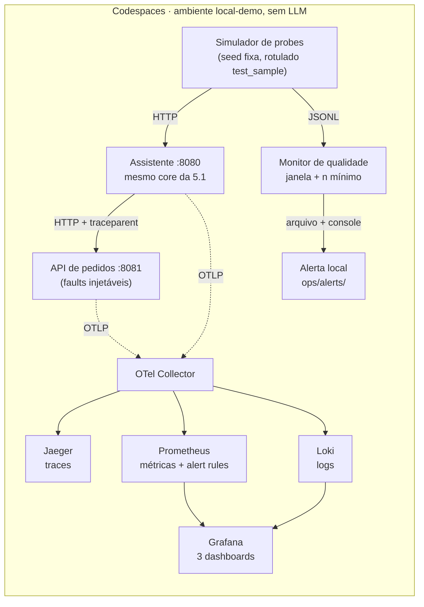
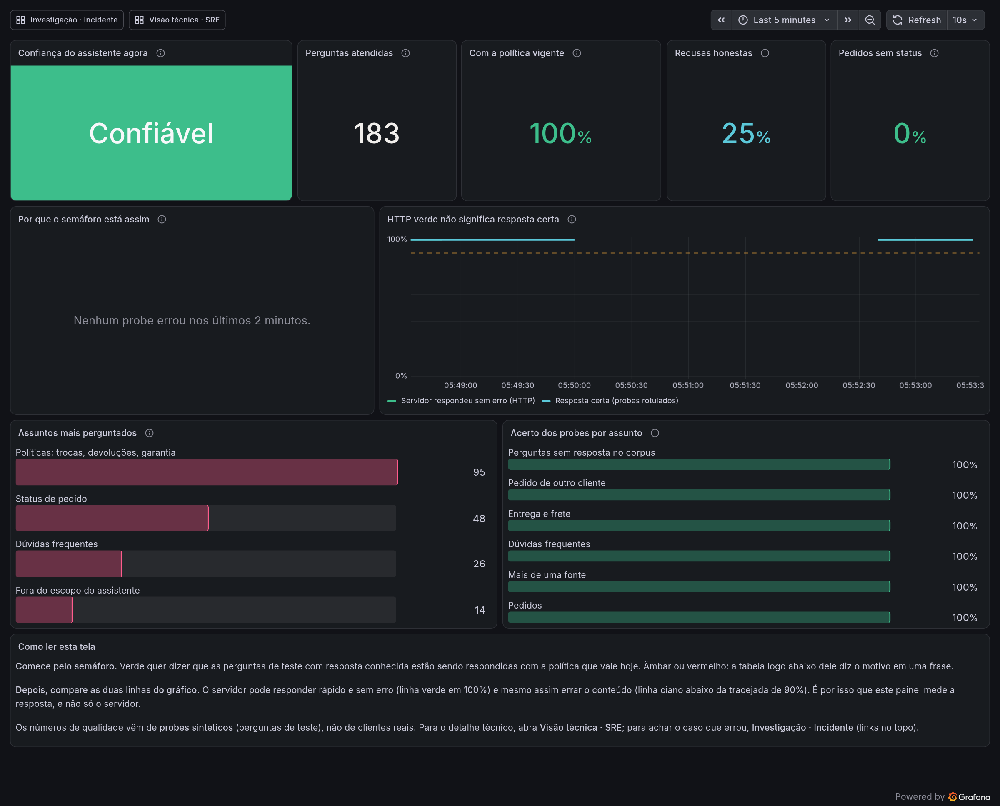
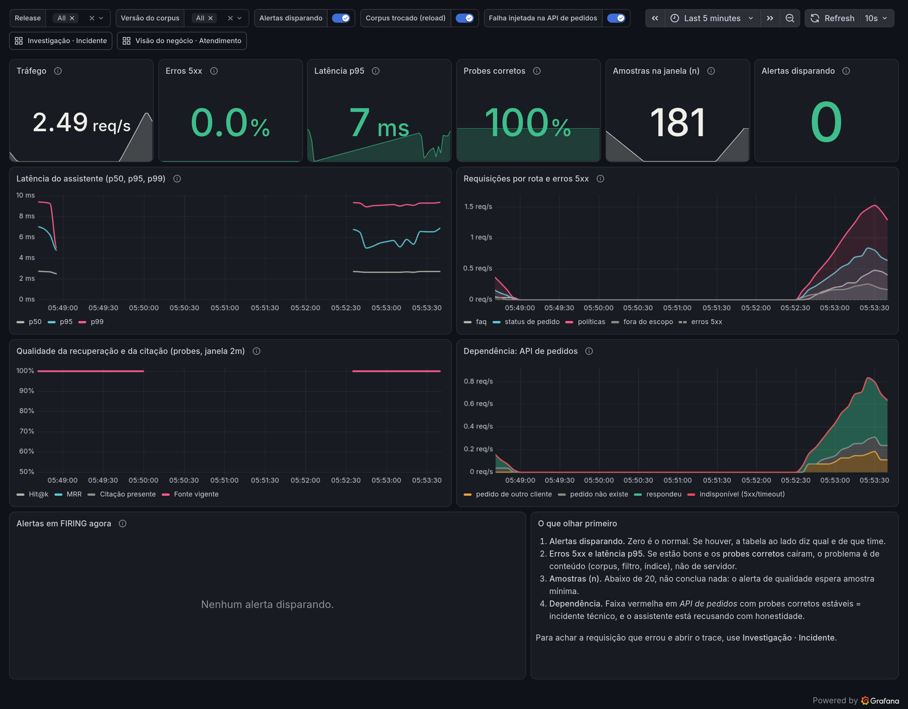
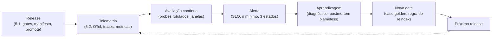

# 04.2 — Demo 5.2: O assistente foi publicado; quem percebe que ele piorou?

<!--
CONVENÇÃO DE PRINTS DESTE README (nota para o professor, não aparece renderizada)
- NOVA-IMAGEM: print que ainda não existe; salve o PNG no caminho indicado e descomente a linha de imagem logo abaixo.
Nenhum número deste arquivo foi inventado: saídas vêm do ensaio no devcontainer da disciplina (RAG, OBS e QA, 02/11/2026); onde um valor varia por execução, o texto diz o que conferir em vez de um número.
-->

> **Quinta-feira, 8h40. Três dias depois do release da Demo 5.1.**
> **Diego Tavares**, AI SRE sênior, chama você na sala de operação com o celular na mão:
>
> > *— "O atendimento abriu três tickets desde ontem: cliente perguntou o prazo de troca e o assistente respondeu um prazo que não existe mais. Olhei o painel: health 200, latência normal, zero erro 5xx, nenhum deploy desde terça. **Tudo verde e o produto errado.** Onde você começa a investigar?"*
>
> **Helena Marques**, Head de Engenharia de IA e Entrega Contínua, chega logo depois: *— "Na terça o pipeline passou em todos os gates. Se o gate passou e mesmo assim piorou, ou o gate não vale nada ou falta alguma coisa depois do deploy. Quero saber qual das duas, e quero que a próxima vez a gente descubra antes do cliente."*

Os comandos de terminal rodam no **terminal do Codespaces**. Grafana, Jaeger e Prometheus abrem no **seu navegador**, pelas portas que o Codespaces encaminha (aba **PORTS**). A Parte 9 usa o **AWS Console** e a AWS CLI uma única vez, para fechar o ciclo de nuvem da disciplina. Cada passo diz onde executar.

> [!WARNING]
> **Pré-requisitos obrigatórios antes de começar:**
>
> - [ ] **Codespaces aberto no fork do repositório da disciplina**, com o fork **sincronizado hoje** pelo [Início de aula](../../00-create-codespaces/Inicio-de-aula.md) (a pasta `04-GenAIOps/` só existe depois da sincronização) e com Docker funcionando (o devcontainer já traz docker-in-docker).
> - [ ] **Python 3.12** disponível (vem no devcontainer).
> - [ ] **Portas livres** 8080, 8081, 3000, 9090, 16686, 3100 e 4318 (nada da Demo 5.1 ou de outro lab ainda rodando).
> - [ ] **Só para os passos 4, 26 e 27:** credenciais AWS do Academy atualizadas. A demo em si (passos 1-25) não usa a AWS; a Parte 9 pode ficar para a próxima sessão.
>
> **Você NÃO precisa** ter rodado a Demo 5.1 hoje, nem ter o runner ligado, nem ter a API na AWS de pé. Esta demo roda inteira no Codespaces, com o mesmo código do assistente.
>
> **Valide rapidamente** (terminal do Codespaces):
>
> ```bash
> docker version --format '{{.Server.Version}}' && python3 --version && ls /workspaces/FIAP-AI-Devops-CICD/04-GenAIOps/quantum-assistant/ops/
> ```
>
> Saída esperada: a versão do Docker, `Python 3.12.x` e a lista de arquivos de `ops/` (com `bootstrap-demo52.sh`, `run`, `docker-compose.yml`, `simulator.py`, `quality_monitor.py`, `inject.py`, `restore.py`). Se o `ls` disser `No such file or directory`, o fork não está sincronizado: faça o [Início de aula](../../00-create-codespaces/Inicio-de-aula.md) e volte. Se o `docker version` falhar, reinicie o Codespaces (`Rebuild Container` não é necessário).
>
> **Tempo estimado de aula: 90-120 min** (execução pura ~25 min; o resto é observar os painéis, formular hipóteses e discutir cada decisão). É deliberadamente a demo mais longa da disciplina, porque é a que a fecha.

Nesta demo o assistente da Quantum Commerce **já está publicado**; ninguém escreve código novo nem roda pipeline. O trabalho é **operar**: subir o mesmo núcleo da Demo 5.1 com OpenTelemetry, medir, ver um incidente de qualidade e um de disponibilidade, diagnosticar, mitigar e devolver o aprendizado ao pipeline. O Mapa do lab, abaixo, mostra a sequência.

O que você vai ver é um ambiente `local-demo`: o assistente roda no Codespaces, não na Lambda da Demo 5.1, com o mesmo código e telemetria real. Os números deste README vêm de um ensaio no devcontainer da disciplina (a mesma imagem do Codespaces); os seus devem bater nos hashes, nos contadores e nos vereditos, e podem variar nos milissegundos. Não há LLM, então não existem tokens, custo de inferência nem "taxa de alucinação" para medir; esses painéis simplesmente não existem aqui, e nenhuma métrica de custo é emitida, em vez de inventar um número. As métricas de qualidade vêm de **probes sintéticos**, perguntas com gabarito rotuladas `test_sample`: um proxy que mede se os contratos conhecidos continuam valendo, não a qualidade do tráfego humano.

## Principais pontos de aprendizagem

- separar **disponibilidade** (HTTP 200, p95) de **qualidade** (fonte vigente, citação, recusa correta) e ver por que uma não prova a outra
- ler um **trace distribuído** do OpenTelemetry e localizar em qual etapa (`route → retrieve → filter → compose`, `order_api.lookup`) a resposta errada nasceu
- definir **SLIs** a partir de probes rotulados e discutir **SLO, janela e amostra mínima** antes de ligar um alerta
- distinguir **alerta de qualidade** (documento obsoleto com HTTP 200) de **alerta técnico** (dependência lenta ou com 5xx)
- evitar a **ação placebo** (reiniciar) e escolher a mitigação que reverte o artefato certo (reindexar ou restaurar o corpus)
- provar a recuperação com **replay da mesma semente**
- escrever um **postmortem blameless** cuja ação preventiva é um novo caso golden no pipeline

## O que você terá ao final

Um incidente de qualidade detectado por medição, diagnosticado por trace, mitigado e provado como recuperado; um postmortem preenchido em `ops/postmortem-template.md`; e um caso novo em `evals/golden_v1.jsonl` pronto para o pipeline da Demo 5.1. **Diego quer ver o alerta disparar antes de alguém abrir ticket. Helena quer ver o incidente virar gate.**

Os blocos **💡 Clique para entender** trazem o aprofundamento (OpenTelemetry, SLO, cardinalidade, como seria na AWS); os blocos **⚠ Se der erro** só importam se o passo falhar. Os blocos **🤔 Pare e pense** são perguntas que o professor faz antes de revelar a resposta: tente responder antes de rolar a tela.

## Mapa do lab

| Parte | O que você faz | Passos | Tempo |
|-------|----------------|--------|-------|
| [Parte 0](#parte-0---bootstrap-independente) | Subir o runtime e a pilha de observabilidade do zero | [1](#passo-1) · [2](#passo-2) · [3](#passo-3) · [4](#passo-4) | ~10 min |
| [Parte 1](#parte-1---health-verde-não-é-qualidade) | Ver o health verde e perguntar o que ele prova | [5](#passo-5) | ~5 min |
| [Parte 2](#parte-2---um-pedido-vira-um-trace) | Seguir uma pergunta pelo trace, do HTTP à fonte | [6](#passo-6) · [7](#passo-7) | ~10 min |
| [Parte 3](#parte-3---linha-de-base) | Gerar tráfego sintético e fixar os SLIs | [8](#passo-8) · [9](#passo-9) · [10](#passo-10) | ~15 min |
| [Parte 4](#parte-4---incidente-de-conteúdo) | Injetar a política obsoleta e ver o alerta disparar com HTTP 200 | [11](#passo-11) · [12](#passo-12) · [13](#passo-13) · [14](#passo-14) | ~15 min |
| [Parte 5](#parte-5---diagnóstico-e-mitigação) | Achar a causa pelo trace, descartar o placebo, restaurar e provar | [15](#passo-15) · [16](#passo-16) · [17](#passo-17) · [18](#passo-18) | ~20 min |
| [Parte 6](#parte-6---cenário-b-a-dependência-que-degrada) | API de pedidos lenta e com 5xx: alerta técnico e fallback honesto | [19](#passo-19) · [20](#passo-20) · [21](#passo-21) · [22](#passo-22) | ~15 min |
| [Parte 7](#parte-7---postmortem-e-o-novo-gate) | Postmortem blameless e o incidente virando caso golden | [23](#passo-23) · [24](#passo-24) | ~10 min |
| [Parte 8](#parte-8---fechamento-da-disciplina) | O ciclo completo e o que você construiu em cada módulo | leitura | ~10 min |
| [Parte 9](#parte-9---limpeza-e-fim-do-ciclo-de-nuvem) | Parar a pilha local, conferir a 5.1 e destruir o runner | [25](#passo-25) · [26](#passo-26) · [27](#passo-27) | ~10 min |

<details>
<summary><b>💡 Clique para entender: por que operar é diferente de entregar (em 3 parágrafos)</b></summary>
<blockquote>

Na Demo 5.1 a pergunta era "**esta mudança** é segura para publicar?". O gate roda **uma vez**, sobre um conjunto conhecido, **antes** do deploy. Ele protege contra o que a equipe previu e colocou no golden set.

Depois do deploy, três coisas mudam sem passar pelo pipeline: o **corpus** (alguém reindexa, publica uma política, muda um metadado), as **dependências** (a API de pedidos fica lenta ou devolve 5xx) e os **usuários** (perguntam coisas novas, em volume diferente). Nenhuma delas gera um `git push`. Logo, nenhuma passa pelo gate. É por isso que o DevOps Handbook insiste no **Second Way**: feedback vindo da operação, rápido e visível, de volta para quem muda o sistema.

Para aplicações de IA isso tem uma dificuldade a mais. Numa API comum, "funcionando" é quase sinônimo de "200 e rápido". Num assistente, o 200 chega com um **texto**, e o texto pode estar errado. Medir isso em produção exige perguntas com **resposta conhecida** rodando continuamente (probes) e comparadas com o esperado. É o que você vai construir.

</blockquote>
</details>

## Contexto

| Aspecto | Resposta |
|---------|----------------|
| **Problema de negócio** | O assistente responde com prazo de troca de uma política que não vale mais, com fonte citada e cara de certo. Health verde, cliente errado, ticket no atendimento. |
| **Pergunta que este lab responde bem** | "Depois de publicado, como sabemos que o assistente **continua** respondendo o que deveria, e como descobrimos **o que mudou** quando ele para de responder?" |
| **Pergunta que ele responde mal** | "A resposta a este cliente específico estava certa?" Sem rótulo humano, o tráfego real não tem gabarito; os probes medem contratos, não a satisfação de cada pessoa. |
| **Quando acontece na vida real** | Toda equipe que opera um assistente sobre uma base documental viva: a base muda por fora do pipeline (jurídico publica, marketing edita, alguém reindexa), e ninguém faz deploy. |




O tráfego sintético, o assistente e a API de pedidos são **processos reais** trocando HTTP de verdade; os traces e as métricas nascem dessas requisições, não de um arquivo estático. O que é simulado é o **cenário** (qual falha injetar), não a telemetria.

---

## Parte 0 - Bootstrap independente

### Resultado esperado desta parte

A pilha inteira de pé no Codespaces (assistente, API de pedidos, Collector, Jaeger, Prometheus, Grafana), com as versões do release impressas no terminal e os painéis abertos no navegador. Sem depender de nada da Demo 5.1.

---

<a id="passo-1"></a>

**1. Suba tudo com um comando**

**Onde:** terminal do Codespaces.
**Por quê:** a demo precisa de sete peças de pé (assistente, API de pedidos, Collector, Jaeger, Prometheus, Loki, Grafana), e nenhuma delas depende da Demo 5.1 nem da AWS. Um único script idempotente evita que a aula comece com dez comandos de infraestrutura.
**Execute:**

```bash
cd /workspaces/FIAP-AI-Devops-CICD/04-GenAIOps/quantum-assistant
bash ops/bootstrap-demo52.sh
```

**Esperado:**

> Saída esperada (cinco etapas no terminal, ~30 s com as imagens já baixadas e alguns minutos na primeira vez; a última linha, em stdout, é o JSON do `/health` do assistente):
>
> ```text
> == 1/5 Pre-requisitos
>    docker 29.x.x, compose 2.40.x, Python 3.12.x
> == 2/5 venv com requirements-ops.txt em /home/vscode/.venvs/quantum-demo52
>    opentelemetry-sdk 1.45.2
> == 3/5 Stack de observabilidade (docker compose)
>    Prometheus ok
>    Jaeger ok
>    Grafana ok
>    OTel Collector ok (OTLP/HTTP 4318)
> == 4/5 API de pedidos (8081) e assistente (8080)
>    orders ok
>    assistant ok
> == 5/5 Versoes do que esta atendendo
>    ambiente=local-demo release_id=local-<sha> corpus=repositorio telemetria=otlp
>    application_version  1.0.0
>    prompt_version       templates-v1
>    corpus_version       72532257bea3
>    index_version        4f0ea92022d2
>    eval_set_version     43efffd5a04b
>    model_version        none
> {"status": "ok", "environment": "local-demo", "release_id": "local-<sha>", "versions": {...}, ...}
> ```

**Se falhar:** os dois erros comuns estão nos blocos `⚠` abaixo (porta ocupada e Docker parado). Qualquer outro: leia a etapa (`== N/5`) em que parou; o script falha cedo, com a mensagem do que faltou.

O script é **idempotente**: se algo já estiver de pé, ele diz `ja estava no ar (pid ...); reaproveitado` e segue; se o Codespaces foi recriado, ele reconstrói. Pode rodar quantas vezes precisar. O venv da telemetria fica **fora** do repositório (`~/.venvs/quantum-demo52`), para não entrar no Git. E `model_version: "none"` não é um defeito: é o registro de que este assistente não usa modelo de linguagem.

Nos comandos deste README, `localhost` e `127.0.0.1` são a mesma coisa; o script usa `127.0.0.1` porque em algumas máquinas `localhost` resolve para IPv6 e cai em outro programa na mesma porta. Se um `curl` para `localhost` devolver algo estranho, troque por `127.0.0.1`.

<details>
<summary><b>💡 Clique para entender: o que o <code>bootstrap-demo52.sh</code> faz por baixo dos panos</b></summary>
<blockquote>

As cinco etapas que ele imprime:

1. **Pré-requisitos**: Docker, Docker Compose e Python. Falha cedo com mensagem clara se faltar algo.
2. **venv com `requirements-ops.txt`** em `~/.venvs/quantum-demo52` (`opentelemetry-sdk` e o exporter OTLP pinados). O `core/` continua sem dependência nenhuma: quem liga o OpenTelemetry é a variável `OTEL_EXPORTER_OTLP_ENDPOINT`; sem ela, `core/telemetry.py` vira no-op e o mesmo código roda na Lambda e no runner.
3. **Stack de observabilidade** com `docker compose -f ops/docker-compose.yml up -d`: OTel Collector (contrib), Jaeger, Prometheus (com `ops/alert-rules.yml`), Loki (logs) e Grafana (dashboards provisionados, acesso anônimo somente leitura, só em localhost). Imagens com versão fixa (`otel/opentelemetry-collector-contrib:0.164.0`, `jaegertracing/jaeger:2.22.0`, `prom/prometheus:v3.15.1`, `grafana/grafana:13.2.5`) e limite de memória (256 MB para Collector e Jaeger, 384 MB para Prometheus, 512 MB para Grafana): medida com todos os cenários rodados, a pilha ocupa ~480 MB, com folga no Codespaces padrão de 8 GB.
4. **API de pedidos (8081) e assistente (8080)**, dois processos Python no host (não em container), ambos exportando para o Collector. O assistente constrói o índice a partir de `corpus/` e `config/settings.json`, com os mesmos cálculos de hash da Demo 5.1.
5. **Versões do que está atendendo**: o `/health` do assistente, que também é a única linha em stdout.

Com `--from-live URL` (a URL é a saída `api_url` do pipeline da Demo 5.1, a mesma do `curl` do smoke), o script ainda consulta o `/health` do release publicado na AWS e compara as versões. Saída real contra a API publicada no Learner Lab:

```text
--from-live ...: release_id publicado = rel-82b4d77b-46ec99
application_version local=1.0.0        live=1.0.0        igual
prompt_version      local=templates-v1 live=templates-v1 igual
corpus_version      local=72532257bea3 live=72532257bea3 igual
index_version       local=4f0ea92022d2 live=4f0ea92022d2 igual
eval_set_version    local=43efffd5a04b live=43efffd5a04b igual
model_version       local=none         live=none         igual
```

Repare que o `release_id` publicado é `rel-...` (gerado pelo pipeline) e o local é `local-<sha>`: são identidades diferentes para o mesmo conjunto coerente, e é por isso que a comparação é feita versão a versão, não pelo `release_id`. Se alguma linha vier `DIFERENTE`, o que você observa aqui **não** é o que está em produção; descubra qual versão divergiu antes de seguir. O `--from-live` é só um `GET` público: não usa credencial AWS, então funciona mesmo com a sessão do Learner Lab vencida (a API continua no ar entre sessões). Sem a URL, o script apenas registra `local-demo` e segue. Em nenhum caso ele afirma que os traces locais vieram da Lambda.

📚 Documentação oficial: [Docker Compose file reference](https://docs.docker.com/reference/compose-file/) explica `mem_limit` e `depends_on`, os dois campos que mantêm a pilha leve e na ordem certa.

</blockquote>
</details>

<details>
<summary><b>⚠ Se der erro: <code>port is already allocated</code> ou <code>Address already in use</code></b></summary>
<blockquote>

Algum processo de um lab anterior ainda ocupa a porta. Pare a pilha e os servidores antigos e rode o bootstrap de novo:

```bash
cd /workspaces/FIAP-AI-Devops-CICD/04-GenAIOps/quantum-assistant
bash ops/stop-demo52.sh
bash ops/bootstrap-demo52.sh
```

</blockquote>
</details>

<details>
<summary><b>⚠ Se der erro: <code>Cannot connect to the Docker daemon</code></b></summary>
<blockquote>

O docker-in-docker do devcontainer não subiu. Rode `sudo service docker start` e repita o passo 1. Se persistir, reinicie o Codespaces (três pontinhos → **Stop Codespace**, depois reabra).

</blockquote>
</details>

---

<a id="passo-2"></a>

**2. Confira que o assistente está de pé e qual release ele carrega**

**Onde:** terminal do Codespaces.
**Por quê:** antes de medir qualquer coisa, você precisa saber **o que** está atendendo: release, corpus e índice. Sem esses três valores anotados, não há como dizer depois "mudou" ou "não mudou".
**Execute:**

```bash
curl -s http://127.0.0.1:8080/health | python3 -m json.tool --no-ensure-ascii
```

**Esperado:**

> Saída esperada:
>
> ```json
> {
>   "status": "ok",
>   "environment": "local-demo",
>   "release_id": "local-<sha curto do seu commit>",
>   "versions": {
>     "application_version": "1.0.0",
>     "prompt_version": "templates-v1",
>     "corpus_version": "72532257bea3",
>     "index_version": "4f0ea92022d2",
>     "eval_set_version": "43efffd5a04b",
>     "model_version": "none"
>   }
> }
> ```

**Se falhar:** `Connection refused` significa que o assistente não subiu; repita o passo 1 e leia a etapa `4/5`. Se o JSON vier sem `versions`, você está falando com outro programa na porta 8080: use `127.0.0.1` em vez de `localhost`.

Os três hashes acima são os do repositório no momento em que este README foi validado; se o corpus, a configuração ou o golden set mudarem no seu fork, os seus serão outros, e isso é esperado. O que importa é que eles sejam **iguais** entre o `/health` e as respostas, e que voltem a estes valores no passo 17. Anote `corpus_version` e `index_version`: na Parte 5 você vai compará-los com os que aparecem no trace do incidente. O `release_id` é `local-` mais o commit do repositório; ele **não muda** quando só o corpus muda, e é essa separação que responde a pergunta do Diego ("o deploy novo causou isso?").

---

<a id="passo-3"></a>

**3. Abra os três painéis no navegador**

**Onde:** aba **PORTS** do Codespaces e o seu navegador.
**Por quê:** a demo inteira é lida em três telas (métricas, traces, alertas), e trocar de aba no meio de um incidente é parte do trabalho de quem opera. Abrir as três agora evita procurar janela na hora errada.
**Execute:** no Codespaces, abra a aba **PORTS** (ao lado de TERMINAL). As portas 3000, 16686 e 9090 aparecem encaminhadas; clique no ícone de globo de cada uma. Deixe as três abas abertas: a demo inteira alterna entre elas.

| Porta | Ferramenta | O que você vai ver nela |
|-------|-----------|-------------------------|
| 3000 | **Grafana** | Três dashboards, um por público: **Visão do negócio · Atendimento** (o que a Helena olha), **Visão técnica · SRE** (o que o Diego olha) e **Investigação · Incidente** (onde o log vira trace). |
| 16686 | **Jaeger** | Os traces, um por requisição, com os spans de cada etapa. |
| 9090 | **Prometheus** | As métricas cruas, as consultas PromQL e a aba **Alerts** com as regras. |

**Esperado:** três abas abertas; o Grafana lista os três dashboards (menu **Dashboards**), o Jaeger mostra a tela de busca com o serviço `quantum-assistant` disponível, e o Prometheus a aba **Alerts** com cinco regras; quatro inativas e `QualityNoData` em FIRING, porque ainda não há probes (ela some depois do passo 8). Nos primeiros minutos o Grafana mostra `No data`: ainda não há tráfego. É esperado; o passo 8 resolve.

**Se falhar:** porta ausente na aba PORTS, veja o bloco `⚠` abaixo. Grafana pedindo senha: você abriu um endereço diferente do encaminhado; use o link da aba PORTS, que é anônimo e somente leitura. Se o menu **Dashboards** mostrar um único dashboard, **Quantum Commerce - Demo 5.2 - Tecnico x Qualidade**, o seu fork ainda não tem os três painéis separados: ele reúne os mesmos sinais (coluna técnica à esquerda, qualidade à direita) e serve para toda a demo; onde o texto disser "Visão técnica" leia a coluna da esquerda, e onde disser "Visão do negócio" leia a da direita.

<details>
<summary><b>⚠ Se der erro: a porta não aparece na aba PORTS</b></summary>
<blockquote>

Clique em **Forward a Port** e digite o número. Se o navegador abrir uma página do GitHub pedindo autenticação, aceite: é o encaminhamento do Codespaces, privado para você. Os painéis não têm senha porque só existem dentro do seu Codespaces; em produção, Grafana e Jaeger ficam atrás de autenticação, sempre.

</blockquote>
</details>

---

<a id="passo-4"></a>

**4. (Opcional) Confira o runner da disciplina sem ligá-lo**

**Onde:** terminal do Codespaces, com credenciais AWS do dia.
**Por quê:** este passo só faz sentido se você renovou as credenciais hoje e quer saber em que estado o runner da Demo 5.1 ficou. **Ele não é necessário para a demo**, que roda inteira no Codespaces; está aqui para você ver que "runner desligado entre aulas" é um estado normal e diagnosticável, não um problema. Se não tiver credenciais, pule para a Parte 1.
**Execute:**

```bash
cd /workspaces/FIAP-AI-Devops-CICD/04-GenAIOps
bash shared/runner/runner-preflight.sh
```

**Esperado:**

> Saída esperada quando o runner está **ligado** (as linhas `[preflight] ...` são o progresso; o resultado são as linhas `chave=valor`, e a última é o diagnóstico):
>
> ```text
> aws_account=************  aws_credentials=ok  region=us-east-1
> state=present  state_instance_id=i-0...  token_param=present
> instance_count=1  instance_state=running  public_ip=...  ssm_ping=Online
> runner_binary=present  runner_service=active  runner_config=present
> runners_in_config=1  runner_verify=valid  token_newer_than_config=no
> reason=runner_online
> diagnosis=reuse
> ```
>
> Com o runner **desligado** entre aulas (o normal hoje), as linhas da EC2 vêm com `instance_state=stopped`, `public_ip=none` e a última linha é `diagnosis=start`, com exit `2`.

**Se falhar:** `ExpiredToken` ou `aws_credentials=invalid` é credencial vencida: refaça o [Início de aula](../../00-create-codespaces/Inicio-de-aula.md). `diagnosis=blocked` vem com uma dica na linha de cima; não tente resolver na mão, siga a dica.

O preflight é **somente leitura** e termina com exit `0` (`diagnosis=reuse`, pode usar), `2` (precisa de ação: `start`, `restart`, `reconfigure`, `recreate`) ou `3` (`blocked`, com uma dica no terminal). Ele leva ~17 s. Se vier `diagnosis=start`, é porque você desligou o runner no fim da 5.1 (ou da Aula 4), como manda o passo 15 do Lab 03.2. Para religá-lo existe o `runner-recover.sh` (plano por padrão; `--apply` executa), e o ritual completo de início de aula está em [`shared/runner/README.md`](../shared/runner/README.md). Hoje não precisamos: nenhuma parte desta demo roda pipeline. O runner volta a aparecer na Parte 9, quando for destruído.

<details>
<summary><b>💡 Clique para entender: stop/start, reboot e o IP que muda</b></summary>
<blockquote>

Quando a EC2 faz **stop/start**, ela ganha outro IPv4 público; num **reboot**, mantém o mesmo. Isso costuma assustar quem acha que o GitLab "liga" para o runner. Não liga: o **runner faz polling de saída** para o GitLab, pela porta 443. O IP de entrada é irrelevante, e por isso o `config.toml` e o token sobrevivem ao stop/start. Mudança de IP **não** é perda de registro; `runner-preflight.sh` mostra isso sem alterar nada.

📚 Documentação oficial: [Stop and start Amazon EC2 instances](https://docs.aws.amazon.com/AWSEC2/latest/UserGuide/Stop_Start.html) para a regra do IP, e [GitLab Runner commands](https://docs.gitlab.com/runner/commands/) para entender que `gitlab-runner verify` prova comunicação, não execução de jobs.

</blockquote>
</details>

### Checkpoint

- `bootstrap-demo52.sh` terminou imprimindo as versões, com `environment: local-demo` e `model=none`
- `curl /health` devolveu `status: ok` e você anotou `corpus_version` e `index_version`
- Grafana, Jaeger e Prometheus abertos no navegador (Grafana ainda sem dados)

---

## Parte 1 - Health verde não é qualidade

### Resultado esperado desta parte

Você terá visto o sinal técnico verde e formulado, antes de qualquer ferramenta, o que ele **não** prova.

---

<a id="passo-5"></a>

**5. Faça o que o painel do Diego fazia: olhe o health e uma resposta**

**Onde:** terminal do Codespaces.
**Por quê:** é a reprodução exata do que o Diego viu antes de te chamar: um health verde e uma resposta rápida. Você precisa ver esse "tudo bem" com os seus olhos antes de descobrir o que ele esconde.
**Execute:**

```bash
curl -s -o /dev/null -w 'HTTP %{http_code} em %{time_total}s\n' http://127.0.0.1:8080/health
curl -s http://127.0.0.1:8080/assistant/ask \
  -H 'Content-Type: application/json' \
  -d '{"question": "Quantos dias eu tenho para trocar um produto?"}' | python3 -m json.tool --no-ensure-ascii
```

**Esperado:**

> Saída esperada:
>
> ```text
> HTTP 200 em 0.00xs
> {
>   "answer": "Você tem até 30 dias corridos, contados a partir da data de recebimento, para trocar qualquer produto de moda (roupas, calçados e acessórios) ou eletrônico. Depois de 30 dias, a troca só acontece se o produto apresentar defeito, pelas regras de garantia. Fonte: Política de trocas, secao \"Prazo para troca\" (versao 3, vigente desde 2026-01-01).",
>   "mode": "deterministic",
>   "route": "policy",
>   "citations": [
>     {"doc_id": "politica-trocas", "chunk_id": "politica-trocas@v3#prazo-para-troca", "section": "Prazo para troca", "version": "3", "effective_date": "2026-01-01"}
>   ],
>   "abstained": false,
>   "abstain_reason": null,
>   "versions": {"application_version": "1.0.0", "prompt_version": "templates-v1", "corpus_version": "72532257bea3", "index_version": "4f0ea92022d2", "eval_set_version": "43efffd5a04b", "model_version": "none"},
>   "trace_id": "...",
>   "release_id": "local-<sha>",
>   "environment": "local-demo"
> }
> ```

Os 30 dias são a política **fictícia** da Quantum Commerce (versão 3 da `politica-trocas`), não um prazo legal real. **Copie o `trace_id`** desta resposta e guarde: o passo 7 abre esse trace depois do trace de pedido.

**Se falhar:** resposta sem `citations` ou com `abstained: true` para essa pergunta significa que o índice não carregou o corpus: rode `ops/run inject.py --status` e confira `corpus_source`; se não for `repositorio`, rode `ops/run restore.py`.

> 🤔 **Pare e pense (R1):** o `HTTP 200` em poucos milissegundos prova que a resposta está certa? O que exatamente ele prova? Escreva uma frase antes de abrir o bloco abaixo.

<details>
<summary><b>💡 Clique para entender: Golden Signals × qualidade de resposta</b></summary>
<blockquote>

Os quatro **Golden Signals** do SRE (latência, tráfego, erros, saturação) descrevem a **saúde do serviço**: ele está respondendo, rápido, sem erro, com folga. Para uma API de pedidos isso basta quase sempre, porque o conteúdo da resposta é um registro do banco: ou veio ou não veio.

Um assistente devolve **texto montado a partir de uma fonte escolhida**. Ele pode escolher a fonte errada, uma versão vencida, um documento de outro tenant, e ainda assim responder em 40 ms com `200`. Os Golden Signals continuam verdes porque, do ponto de vista do HTTP, nada falhou.

Por isso esta demo tem **dois dashboards**. A **Visão técnica · SRE** são os Golden Signals. A **Visão do negócio · Atendimento** são sinais que só existem porque alguém definiu o que é uma resposta certa: fonte vigente (`source_is_current_rate`), citação presente (`citation_presence_rate`), recusa quando deveria (`abstention_rate` nos casos que exigem), probes passando (`synthetic_quality_pass_rate`). Nenhum deles sai do HTTP. Todos saem de **perguntas com gabarito** feitas continuamente. Esse é o custo de operar IA: a qualidade precisa ser **medida de propósito**, ela não aparece de graça no log de acesso.

O que o `200` prova: o processo está vivo, recebeu, roteou, montou e devolveu. O que ele não prova: que o que devolveu é o que a política vigente diz.

</blockquote>
</details>

### Checkpoint

- health `200` e uma resposta de política com `citations` preenchido e `mode: deterministic`
- você escreveu a sua resposta à R1 (vai confrontá-la na Parte 4)

---

## Parte 2 - Um pedido vira um trace

### Resultado esperado desta parte

Você terá seguido uma pergunta sobre pedido pelo Jaeger, do span `http.request` até o `order_api.lookup` que cruzou para o outro serviço, e saberá ler em qual etapa a fonte foi escolhida.

---

<a id="passo-6"></a>

**6. Faça uma pergunta que exige a API de pedidos**

**Onde:** terminal do Codespaces.
**Por quê:** status de pedido é dado **transacional**: muda a cada hora e vive num sistema, não num documento. A Demo 5.1 fixou a regra de que a API vence o texto; aqui você vai ver essa regra como uma chamada entre dois serviços, que o trace do passo 7 torna visível.
**Execute:** use um pedido e um token **de laboratório**, todos fictícios, de `orders/fixtures.json`. Veja o arquivo:

```bash
cd /workspaces/FIAP-AI-Devops-CICD/04-GenAIOps/quantum-assistant
python3 -c 'import json; f=json.load(open("orders/fixtures.json")); print(json.dumps({"tokens": f["tokens"], "orders": f["orders"]}, indent=2, ensure_ascii=False))'
```

**Esperado:**

> Saída esperada:
>
> ```json
> {
>   "tokens": {
>     "lab-token-ana": "cliente-ana",
>     "lab-token-bruno": "cliente-bruno"
>   },
>   "orders": {
>     "Q-1001": {"customer_id": "cliente-ana", "status": "em_transito", "updated_at": "2026-10-30T14:05:00Z"},
>     "Q-1002": {"customer_id": "cliente-ana", "status": "entregue", "updated_at": "2026-10-21T10:12:00Z"},
>     "Q-1003": {"customer_id": "cliente-ana", "status": "em_separacao", "updated_at": "2026-11-01T09:30:00Z"},
>     "Q-2001": {"customer_id": "cliente-bruno", "status": "confirmado", "updated_at": "2026-11-01T18:45:00Z"}
>   }
> }
> ```

Os tokens **não são segredo**: só mapeiam um cliente fictício, para a API de pedidos decidir a autorização **no servidor**. Vamos usar o pedido `Q-1001` com o token da Ana:

```bash
curl -s http://127.0.0.1:8080/assistant/ask \
  -H 'Content-Type: application/json' \
  -d '{"question": "Onde está o meu pedido?", "order_id": "Q-1001", "auth_token": "lab-token-ana"}' | python3 -m json.tool --no-ensure-ascii
```

**Esperado:**

> Saída esperada:
>
> ```json
> {
>   "answer": "O pedido Q-1001 esta com status em_transito (atualizado em 2026-10-30T14:05:00Z, segundo o sistema de pedidos). O pedido já saiu do centro de distribuição e está com a transportadora a caminho do seu endereço. Fonte: Significado dos status do pedido, secao \"em_transito\" (versao 1, vigente desde 2025-01-15).",
>   "route": "order_status",
>   "order": {"order_id": "Q-1001", "status": "em_transito", "updated_at": "2026-10-30T14:05:00Z"},
>   "citations": [
>     {"doc_id": "status-do-pedido", "chunk_id": "status-do-pedido@v1#em-transito", "section": "em_transito", "version": "1", "effective_date": "2025-01-15"}
>   ],
>   "abstained": false,
>   "abstain_reason": null,
>   "trace_id": "...",
>   "...": "..."
> }
> ```

Repare na divisão de trabalho: o **status** (`em_transito`, com data) veio da **API de pedidos**, no campo `order`; o documento citado só explica **o que esse status significa**. Pergunta de pedido nunca tira o status de um texto. **Copie o `trace_id`** desta resposta: o passo 7 começa por ele.

**Se falhar:** `abstain_reason: order_api_unavailable` aqui, antes de qualquer incidente, significa que a API de pedidos (porta 8081) não subiu: `curl -s http://127.0.0.1:8081/health` e, se recusar conexão, repita o passo 1. `forbidden` com o token da Ana e o pedido `Q-1001` é erro de digitação no token. Se quiser ver a autorização no servidor funcionando, troque o token por `lab-token-bruno` (dono do `Q-2001`, não do `Q-1001`): a resposta volta com `abstain_reason: forbidden`, porque o pedido é de outro cliente. Essa é a regra que a Demo 5.1 fixou e que o trace vai mostrar: a origem transacional vence o documento quando a pergunta é sobre o pedido. **Copie o `trace_id`** desta resposta.

---

<a id="passo-7"></a>

**7. Abra esse trace no Jaeger**

**Onde:** navegador, aba do Jaeger (porta 16686).
**Por quê:** o log diz **que** a requisição aconteceu; o trace diz **por onde** ela passou e quanto tempo ficou em cada etapa, inclusive dentro de outro serviço. É a ferramenta que, na Parte 5, vai apontar em qual etapa a resposta errada nasceu.
**Execute:** no Jaeger, a barra do topo tem um campo de busca por ID; cole ali o `trace_id` da resposta do passo 6 e tecle Enter. (O outro caminho é o painel **Search** à esquerda: em **Service** escolha `quantum-assistant`, em **Operation** `http.request`, clique em **Find Traces** e abra o mais recente da lista.) Dentro do trace, clique em cada span para expandir os atributos.

**Esperado:**

> O que você deve ver (de cima para baixo, aninhados):
>
> ```text
> quantum-assistant    http.request          POST /assistant/ask   route=order_status  corpus_version=72532257bea3   (release_id em Process: quantum.release_id=local-<sha>)
>   quantum-assistant    route_intent
>   quantum-assistant    order_api.lookup    outcome=ok   (SpanKind CLIENT)
>     quantum-orders-api   orders.get        http.response.status_code=200   (outro serviço, mesmo trace)
> ```

A linha que importa é a última: o span `orders.get` do serviço **`quantum-orders-api`** aparece **dentro** do trace do `quantum-assistant`. São dois processos, duas portas, e um só trace. Isso só acontece porque o assistente enviou o cabeçalho `traceparent` na chamada HTTP e o serviço de pedidos o leu. Sem isso, você teria dois traces soltos e nenhuma causalidade.

Agora cole, no mesmo campo do topo, o `trace_id` que você guardou no passo 5 (a pergunta de **política**). A árvore muda:

> ```text
> quantum-assistant   http.request                 POST /assistant/ask   route=policy  corpus_version=72532257bea3  index_version=4f0ea92022d2   (release_id em Process)
>   quantum-assistant   route_intent
>   quantum-assistant   rag.retrieve               top_doc_id=politica-trocas  top_score=...
>     quantum-assistant   rag.filter_documents     blocked_status=2  blocked_future=3  blocked_tenant=1  blocked_access_level=1  chunks_allowed=24
>   quantum-assistant   rag.compose_deterministic  abstain_reason=none  injection_dropped=0
> ```

Repare que `rag.filter_documents` fica **dentro** de `rag.retrieve`: o filtro roda antes do ranking, e um trecho bloqueado nunca ocupa vaga no top-k. As contagens `blocked_*` dizem quantos trechos cada regra tirou do caminho: `blocked_status=2` são os dois trechos da `politica-trocas` v2 (obsoleta), `blocked_future=3` a campanha de Black Friday com vigência futura, `blocked_tenant=1` o documento do parceiro e `blocked_access_level=1` o manual interno. Sobram `chunks_allowed=24`. **Anote o `blocked_status=2`**: é o número que o passo 15 compara.

<!-- NOVA-IMAGEM: img/jaeger-trace-politica.png | capturar: trace da pergunta de política expandido no Jaeger, com route_intent, rag.retrieve (contendo rag.filter_documents) e rag.compose_deterministic, e os atributos top_doc_id, blocked_status=2, chunks_allowed=24 e abstain_reason visíveis | depois de salvar o arquivo, descomente a linha abaixo -->
<!--  -->

**Se falhar:** trace não encontrado é quase sempre atraso de exportação: espere 10 s e busque de novo. Se o span do `quantum-orders-api` aparecer como um trace **separado**, a propagação do `traceparent` falhou: os dois processos precisam do mesmo `OTEL_EXPORTER_OTLP_ENDPOINT`, que o `bootstrap-demo52.sh` define; repita o passo 1.

> 🤔 **Pare e pense (R2):** se a resposta citasse uma política vencida, em qual desses spans você procuraria o motivo? Em `retrieve` (que documento ficou no topo), em `filter_documents` (ela devia ter sido bloqueada e não foi) ou em `compose` (ele respondeu em vez de recusar)? Guarde a resposta: é o roteiro da Parte 5.

<details>
<summary><b>💡 Clique para entender: OpenTelemetry em 5 palavras (trace, span, contexto, Collector, exporter)</b></summary>
<blockquote>

Um **trace** é a história de uma requisição do começo ao fim. Ele é formado por **spans**: cada span é uma etapa com nome, início, fim e **atributos** (pares chave-valor como `route=policy` ou `index_version=...`). Spans se aninham: `rag.retrieve` é filho de `http.request`.

Para que o span da API de pedidos entre no mesmo trace, o **contexto** (o `trace_id` e o id do span pai) precisa viajar com a chamada. O padrão **W3C Trace Context** define o cabeçalho `traceparent`; `core/telemetry.py` o injeta com `inject_headers()` antes do `GET /orders/{id}`, e o serviço de pedidos o extrai. É isso que transforma dois processos num trace só. A regra geral: **sem propagação, não há trace distribuído**, só logs correlacionados na mão.

A aplicação não fala com o Jaeger nem com o Prometheus. Ela exporta tudo por **OTLP** para o **Collector**, e o Collector decide para onde mandar (traces para o Jaeger, métricas para o Prometheus). Trocar de backend em produção é editar o `ops/otel-collector.yaml`, não o código. Essa é a promessa do OpenTelemetry: instrumenta uma vez, escolhe o destino depois.

No `core/`, a instrumentação é **manual** (`with telemetry.span("rag.retrieve", k=...)`), porque as etapas de RAG não são HTTP: nenhuma biblioteca automática sabe que "retrieve" e "filter" existem. Já o `http.request` e o `order_api.lookup` seguem as convenções semânticas HTTP (`http.request.method`, `http.response.status_code`), para que qualquer ferramenta os entenda. Sobre as convenções `gen_ai.*` do OpenTelemetry: elas descrevem chamadas a modelos. Este assistente não faz nenhuma, então **não as usamos**, em vez de preencher com valores fictícios.

📚 Documentação oficial: [OpenTelemetry Python — Instrumentation](https://opentelemetry.io/docs/languages/python/instrumentation/) mostra o `start_as_current_span` que a fachada `telemetry.span` embrulha; [Collector configuration](https://opentelemetry.io/docs/collector/configuration/) explica receivers, processors e exporters do `otel-collector.yaml`; [Semantic Conventions](https://opentelemetry.io/docs/concepts/semantic-conventions/) lista os nomes de atributos HTTP usados nos spans.

</blockquote>
</details>

### Checkpoint

- a pergunta de pedido devolveu `route: order_status` com `order` preenchido pela API e uma citação do documento de **significado** do status (`status-do-pedido@v1`)
- no Jaeger, o span `orders.get` do `quantum-orders-api` aparece **dentro** do trace do assistente
- a pergunta de política mostra os spans `route_intent → rag.retrieve (com rag.filter_documents dentro) → rag.compose_deterministic`, com `blocked_status=2` anotado

---

## Parte 3 - Linha de base

### Resultado esperado desta parte

Alguns minutos de tráfego sintético com semente fixa, o Grafana com as duas metades preenchidas, e uma janela do monitor de qualidade registrada como baseline: o "normal" contra o qual o incidente vai ser medido.

---

<a id="passo-8"></a>

**8. Ligue o simulador no cenário `baseline`**

**Onde:** um **segundo terminal** do Codespaces (ícone `+` ao lado do terminal); deixe o simulador rodando nele.
**Por quê:** sem tráfego não há medida, e tráfego humano não tem gabarito. O simulador manda perguntas **com resposta conhecida**, em ritmo constante e com semente fixa, para que exista um "normal" contra o qual comparar o incidente.
**Execute:**

```bash
cd /workspaces/FIAP-AI-Devops-CICD/04-GenAIOps/quantum-assistant
ops/run simulator.py --seed 42 --scenario baseline --rate 2 --duration 30
```

**Esperado:**

> Saída esperada (o progresso vai para o terminal a cada 10 probes; a última linha é o resumo, em JSON):
>
> ```text
> alvo http://127.0.0.1:8080 release=local-<sha> corpus=72532257bea3 fonte=repositorio
> 60 probes do cenario baseline (seed 42, 2.0/s) -> ops/results/baseline-seed42-<hora>.jsonl
>   10/60 pass=10 fail=0 fallback=0
>   ...
>   60/60 pass=60 fail=0 fallback=0
> {"results": "ops/results/baseline-seed42-<hora>.jsonl", "scenario": "baseline", "seed": 42, "n": 60, "release_id": "local-<sha>", "corpus_version": "72532257bea3", "pass": 60, "fail": 0, "fallback": 0, "pass_rate": 1.0}
> ```

Antes do primeiro probe o simulador espera ~6 s: ele publica as séries zeradas para o Prometheus "ver o zero" antes de contar (sem isso, a função `increase()` perderia os primeiros probes). Depois, faz **requisições HTTP reais** ao assistente em ritmo fixo, sorteando com a semente `42` perguntas **do golden set da Demo 5.1** (`evals/golden_v1.jsonl`), com a distribuição por slice definida em `ops/scenarios.json` para o cenário `baseline`: um dia normal, mistura de políticas, entrega, FAQ e pedidos. A mesma referência que aprovou o release mede a operação. Cada amostra vai para o JSONL com `test_sample=true`, `trace_id`, as versões e o motivo (`reason`) quando falha. O rótulo é o que separa probe de usuário real nas métricas.

**Se falhar:** `runtime fora do ar ... rode ops/bootstrap-demo52.sh` é o assistente parado: passo 1 de novo. Se o terminal mostrar `AVISO: telemetria DESLIGADA`, veja o bloco `⚠` abaixo. Se o resumo final vier com `pass_rate` muito abaixo de 1,0 já no baseline, confira `corpus_source` com `ops/run inject.py --status`: um overlay esquecido de outra sessão deve ser removido com `ops/run restore.py`.

<details>
<summary><b>⚠ Se der erro: o Grafana não mostra os probes (Visão do negócio em <code>No data</code>)</b></summary>
<blockquote>

Você rodou o script com `python3` em vez de `ops/run`. O `python3` do terminal do Codespaces (o `~/venv` do Ansible) não tem OpenTelemetry; os probes rodam, o JSONL é gravado, mas nada chega ao Prometheus. O próprio script avisa:

```text
AVISO: telemetria DESLIGADA (OTEL_EXPORTER_OTLP_ENDPOINT nao definido). Rode via 'ops/run <script>' (depois de 'bash ops/bootstrap-demo52.sh'): sem isso os probes NAO aparecem no Prometheus/Grafana e os alertas QualityProbeDegraded/StaleSourceServed nao acendem.
```

O `ops/run` escolhe o venv criado pelo bootstrap (`~/.venvs/quantum-demo52`) e exporta `OTEL_EXPORTER_OTLP_ENDPOINT=http://127.0.0.1:4318`, o Collector local. Interrompa (`Ctrl+C`), repita o comando com `ops/run` e o painel preenche em ~15 s. Se o `ops/run` responder `venv da Demo 5.2 nao encontrado`, rode o passo 1. Nos primeiros segundos depois do bootstrap pode aparecer `Transient error ... Connection refused ... retrying`: é o SDK esperando o Collector subir; ele repete sozinho e nada se perde.

</blockquote>
</details>

Três contadores, não dois: `pass` e `fail` são probes julgados; `fallback` é quando o assistente recusou por dependência indisponível (`order_api_unavailable`), que não é erro de qualidade documental e por isso não entra no `pass_rate`. O `pass_rate` é **calculado**, não forçado: aqui deu `1.0` porque o golden set da 5.1 passa inteiro contra o corpus vigente. Se um dia vier abaixo, é o conjunto rotulado tendo casos que o assistente não acerta, e o baseline é o que **é**.

<details>
<summary><b>💡 Clique para entender: por que semente fixa e por que rótulo <code>test_sample</code></b></summary>
<blockquote>

A **semente fixa** torna o experimento repetível: na Parte 5, você vai rodar o mesmo cenário com a mesma semente depois da mitigação, e a única variável que mudou será o corpus. Sem semente, uma diferença de 2 pontos no `pass_rate` poderia ser sorte no sorteio das perguntas. Com semente, é sinal.

O **rótulo** evita a confusão mais comum em observabilidade de IA: misturar probes com tráfego de clientes. Os probes têm gabarito; os clientes não. Se as duas populações entram na mesma métrica, o `pass_rate` deixa de significar qualquer coisa. Por isso toda métrica de qualidade desta demo tem a dimensão `scenario`/`slice` e só conta amostras rotuladas. Medir a qualidade de uma resposta a uma pergunta nova, sem gabarito, exigiria avaliação humana ou um avaliador competente; nenhum dos dois existe aqui.

</blockquote>
</details>

---

<a id="passo-9"></a>

**9. Feche a primeira janela no monitor de qualidade**

**Onde:** o **primeiro terminal** do Codespaces, enquanto o simulador roda no segundo.
**Por quê:** uma amostra isolada não diz nada; o monitor transforma centenas de probes em um veredito por janela, com o `n` mínimo que torna esse veredito defensável. É aqui que "qualidade" vira um número que se pode acompanhar.
**Execute:** o monitor lê o último JSONL de cada cenário em `ops/results/`, agrupa os probes em janelas de 2 minutos (`--window-s 120`) por cenário, release e corpus, e só emite veredito quando a janela tem pelo menos 20 amostras (`--min-n 20`):

```bash
cd /workspaces/FIAP-AI-Devops-CICD/04-GenAIOps/quantum-assistant
ops/run quality_monitor.py --prometheus http://127.0.0.1:9090
```

**Esperado:**

> Saída esperada (uma linha por janela; os 60 probes de 30 s cabem numa janela de 2 minutos):
>
> ```text
> [OK               ] baseline               release=local-<sha> corpus=72532257bea3 n=60 pass_rate=1.0 fonte_vigente=1.0 hit@k=1.0 mrr=1.0 obsoletas=0 fallback=0 p95=10.5ms (dentro do limiar)
> Prometheus FIRING: nenhum
> {"windows": [...], "alerts": [], ...}
> ```

**Se falhar:** `INSUFFICIENT_DATA`: o simulador ainda não completou 20 probes; espere ele terminar e rode de novo. `nenhum probe encontrado`: o simulador não gravou nada, volte ao passo 8. Se o Prometheus mostrar `QualityNoData` em FIRING, é só o estado "sem probes ainda" de um stack recém-criado; ele some depois do baseline.

Leia a etiqueta entre colchetes: `OK` quando a janela tem `n ≥ 20` e nada errado; se você rodar o monitor com menos de 20 probes gravados (por exemplo, no meio do simulador), a etiqueta é `INSUFFICIENT_DATA`. Ausência de amostra **não** é sucesso: uma janela com 8 probes não recebe `OK` só porque nenhum falhou. O `p95=10.5ms` é a latência dos probes vista pelo simulador; o `--prometheus` acrescenta a linha `Prometheus FIRING: nenhum`, as regras concordando. Esse é um dos limites estatísticos que o bloco 💡 do passo 10 discute. O JSON final em stdout é o relatório completo; as linhas legíveis vão para o terminal. O exit code resume: `0` tudo OK, `1` houve warning ou critical, `3` só `insufficient_data`.

---

<a id="passo-10"></a>

**10. Leia o Grafana com os olhos da Helena e os do Diego**

**Onde:** navegador, aba do Grafana (porta 3000).
**Por quê:** a mesma telemetria serve a duas perguntas diferentes. A Helena quer saber se o assistente está **respondendo certo** aos clientes; o Diego quer saber se o serviço está **de pé e rápido**. Dois dashboards, um por pergunta, é a tese da demo inteira: saúde do serviço e qualidade do conteúdo são sinais diferentes, medidos de formas diferentes, e um não substitui o outro.
**Execute:** no menu **Dashboards**, abra primeiro **Visão do negócio · Atendimento**, depois **Visão técnica · SRE**. Em cada um, ajuste o intervalo para **Last 15 minutes** e o refresh para 10 s.

> **Helena**, olhando a Visão do negócio pela primeira vez: *— "Então esse semáforo é o que eu queria desde terça. Verde aqui quer dizer que as perguntas com resposta conhecida estão saindo certas, com a política vigente. Não quer dizer que o servidor está de pé; para isso existe o painel do Diego. **HTTP verde não significa resposta certa**, e eu não quero mais confundir as duas coisas."*

**Esperado:**

> O que você deve ver:
>
> | Visão técnica · SRE (o painel do Diego) | Visão do negócio · Atendimento (o painel da Helena, proxy sintético) |
> |---|---|
> | **Tráfego**: ~2 req/s durante os 30 s | **Confiança do assistente agora**: semáforo **Confiável** (verde) |
> | **Erros 5xx**: 0,0% | **Com a política vigente**: 100% |
> | **Latência p95**: poucos ms | **Recusas honestas**: a fração dos probes que exigem recusa (no ensaio, 24%) |
> | **Probes corretos**: 100% · **Amostras na janela (n)**: ~60 (no print, 181: o ensaio rodou um baseline mais longo) | **Pedidos sem status**: 0% |
> | **Dependência: API de pedidos**: só `respondeu` | **HTTP verde não significa resposta certa**: as duas faixas em 100% |
> | **Alertas disparando**: 0 | **Por que o semáforo está assim**: "Nenhum probe errou nos últimos 2 minutos." |




**Se falhar:** `No data` em todos os painéis: intervalo de tempo errado (use **Last 15 minutes**) ou o simulador do passo 8 ainda não começou a contar (espere 15 s). `No data` só na Visão do negócio: as métricas `quality_*` só existem depois do primeiro probe; confira que o simulador está rodando no segundo terminal.

Leia o rodapé **Como ler esta tela** da Visão do negócio: "os números de qualidade vêm de probes sintéticos (perguntas de teste), não de clientes reais". Está escrito no painel de propósito: quem olhar daqui a seis meses precisa saber que "Com a política vigente: 100%" não é "100% dos clientes satisfeitos"; é "100% dos probes com gabarito passaram". Na Visão técnica, o painel **Amostras na janela (n)** é o `n` do passo 9, visível; sem ele, nenhum dos outros números tem como ser interpretado (o próprio dashboard avisa: "abaixo de 20, não conclua nada"). Como os 60 probes duram 30 s, as faixas aparecem como um patamar que some ~2 minutos depois que o simulador termina: a janela deslizou. Em produção, os probes rodam o tempo todo e o patamar vira linha.

Se quiser ver a métrica crua, na aba do **Prometheus** (porta 9090) rode:

```promql
qc:synthetic_quality_pass_rate:2m{scenario="baseline"}
```

Essa série é uma **recording rule** de `ops/alert-rules.yml`: o Prometheus calcula, a cada avaliação, `probes que passaram / probes totais` nos últimos 2 minutos, por `scenario`, `release_id` e `corpus_version`. É a mesma conta do monitor local, feita do lado do servidor de métricas.

> 🤔 **Pare e pense (R3):** Helena pergunta "qual desses números representa o negócio?". A latência p95 ou o `source_is_current_rate`? Por quê o segundo não pode ser medido sem gabarito?

<details>
<summary><b>💡 Clique para entender: SLI, SLO, janela e amostra mínima</b></summary>
<blockquote>

**SLI** (indicador) é a medida: "fração dos probes cuja resposta cita uma fonte vigente". **SLO** (objetivo) é o alvo sobre a medida numa janela: "≥ 0,90 em janelas de 2 minutos com pelo menos 20 probes". **Alerta** é a decisão de avisar alguém quando o SLO é violado. São três coisas diferentes, e a maior parte dos alertas ruins vem de confundi-las.

Esta demo tem **dois SLOs** didáticos, e os números são **configuração de exercício**, não padrão de mercado:

| SLO | SLI | Alvo (exemplo) | Janela / n mínimo | Tipo de alerta |
|---|---|---|---|---|
| Serviço (dependência de pedidos) | consultas de pedido que falharam (5xx/timeout) | ≤ 20% de falha | 2 min / 10 consultas | técnico (`OrderApiDegraded`, time SRE) |
| Qualidade sintética | probes rotulados que respeitam fonte vigente e resposta/recusa esperada | `pass_rate` ≥ 0,90 | 2 min / 20 probes | qualidade (`QualityProbeDegraded`, warning); fonte obsoleta servida ou violação de ACL = critical, **sem** limiar |

Por que **janela**: um probe isolado falhando não é incidente, é ruído. A janela aqui é de 2 minutos, escolha **didática** para o alerta aparecer durante a aula; em produção seriam 30-60 minutos. Por que **n mínimo**: com 3 amostras, uma falha já é 33%; o alerta dispararia à toa. Com 20, uma falha é 5% e o limiar de 0,90 tolera duas. Esse é o eixo **sensibilidade × especificidade**: janela curta e n pequeno pegam o problema cedo e geram falso alarme; janela longa e n grande são confiáveis e lentos. Não há valor certo; há o valor que a equipe aceita, escrito e revisado.

E por que `insufficient_data` existe como terceiro estado: às 3h da manhã, sem tráfego, o `pass_rate` não é 100%, é **indefinido**. Um alerta que trata "sem dados" como "tudo bem" fica cego exatamente quando ninguém está olhando.

20 probes artificiais por janela não têm validade populacional. Para produção, você dimensionaria o erro amostral e a cadência; aqui o objetivo é entender o mecanismo.

</blockquote>
</details>

### Checkpoint

- o simulador rodou 30 s em `baseline` (60 probes) e gravou o JSONL com `pass_rate=1.0`
- o monitor fechou uma janela com `n=60`, etiqueta `OK` e `Prometheus FIRING: nenhum`
- o Grafana mostra a Visão técnica e a Visão do negócio com dados, e o rodapé "probes sintéticos, não clientes reais" na Visão do negócio

---

## Parte 4 - Incidente de conteúdo

### Resultado esperado desta parte

A política de trocas obsoleta volta a ser escolhida pelo assistente **sem nenhum deploy**; o HTTP continua 200 e a latência normal; o monitor e o Prometheus disparam o alerta de qualidade por medição real.

---

<a id="passo-11"></a>

**11. Injete o incidente: a política antiga reaparece no índice**

**Onde:** o **primeiro terminal** do Codespaces.
**Por quê:** é o que acontece quando alguém reindexa o corpus com um metadado errado, ou publica uma versão antiga por engano, **sem** passar pelo pipeline. Você vai provocar isso de forma controlada para ver se o sistema percebe. **Nada aqui é irreversível**: o `inject.py` trabalha numa cópia e o `restore.py` devolve.
**Execute:**

```bash
cd /workspaces/FIAP-AI-Devops-CICD/04-GenAIOps/quantum-assistant
ops/run inject.py stale_policy
```

**Esperado:**

> Saída esperada:
>
> ```text
> stale_policy: corpus/trocas-v2.md: status obsolete -> active (politica de 15 dias volta ao indice)
> corpus_version 72532257bea3 -> 7e012a21c8b8  index_version 4f0ea92022d2 -> 590caec17844
> {"injected": "stale_policy", "change": "corpus/trocas-v2.md: status obsolete -> active (politica de 15 dias volta ao indice)", "versions_before": {...}, "versions_after": {...}, "corpus_source": "overlay"}
> ```

**Se falhar:** `nao consegui falar com o runtime` é o assistente parado: passo 1. Se os hashes `antes` e `depois` vierem **iguais**, ou se o `antes` já for `7e012a21c8b8`, o overlay já estava ativo de uma tentativa anterior: rode `ops/run restore.py` e repita este passo.

O que o script fez: copiou o corpus para um *overlay* em `ops/.runtime/overlay/stale_policy/`, trocou **uma linha** do front matter de `trocas-v2.md` (`status: obsolete` → `status: active`) só nessa cópia, e pediu ao assistente um `/admin/reload`. O repositório continua intacto (`git status` limpo); o runtime passou a indexar a partir do overlay. É a mesma mudança que a regressão `obsolete-priority` da Demo 5.1 fazia no pipeline, só que agora **sem commit e sem pipeline**: alguém "republicou" a política antiga direto no ambiente.

Anote os novos valores, `7e012a21c8b8` e `590caec17844`. Compare com os do passo 2: **mudaram** (e são exatamente os da regressão `obsolete-priority` da 5.1, porque a mudança é a mesma). O `release_id` e a `application_version`, não. Esse é o rastro que você vai seguir na Parte 5. A qualquer momento, `ops/run inject.py --status` mostra o overlay ativo, as falhas da API de pedidos e o `/health`.

---

<a id="passo-12"></a>

**12. Rode o simulador no cenário do incidente, com a mesma semente**

**Onde:** o **segundo terminal** (o do simulador, que já deve ter terminado o baseline).
**Por quê:** para comparar com o baseline, a única coisa que pode mudar é o que você injetou. Mesma semente e mesmo ritmo fazem da diferença no `pass_rate` um sinal, não sorte de sorteio.
**Execute:**

```bash
cd /workspaces/FIAP-AI-Devops-CICD/04-GenAIOps/quantum-assistant
ops/run simulator.py --seed 42 --scenario stale_policy --rate 2 --duration 30
```

**Esperado:**

> Saída esperada (resumo final):
>
> ```text
> 60 probes do cenario stale_policy (seed 42, 2.0/s) -> ops/results/stale_policy-seed42-<hora>.jsonl
>   ...
>   60/60 pass=49 fail=11 fallback=0
> {"results": "...", "scenario": "stale_policy", "seed": 42, "n": 60, "release_id": "local-<sha>", "corpus_version": "7e012a21c8b8", "pass": 49, "fail": 11, "fallback": 0, "pass_rate": 0.8167}
> ```

**Se falhar:** `pass_rate` igual a 1,0 neste cenário significa que o inject não pegou: confira `corpus_source` com `ops/run inject.py --status` (deve ser `overlay`) e repita o passo 11.

O cenário `stale_policy` muda a **distribuição** das perguntas (em `ops/scenarios.json`: peso maior em políticas e vigência, simulando o que seria um pico de perguntas sobre troca logo depois da republicação), e a semente `42` torna esse sorteio repetível. Onze probes em sessenta falharam: `pass_rate=0.8167`. Repare nos dois identificadores do resumo: `release_id` igual ao do passo 8, `corpus_version` diferente (`7e012a21c8b8`). É a assinatura de "mudou o conteúdo, não o software".

---

<a id="passo-13"></a>

**13. Confirme que o serviço continua "saudável"**

**Onde:** o **primeiro terminal** do Codespaces.
**Por quê:** é exatamente o que o Diego fez antes de te chamar. Você precisa ver, com o incidente em curso, que o sinal técnico **não** acusa nada: é a prova concreta de que disponibilidade não é qualidade.
**Execute:**

```bash
curl -s -o /dev/null -w 'HTTP %{http_code} em %{time_total}s\n' http://127.0.0.1:8080/health
curl -s http://127.0.0.1:8080/assistant/ask \
  -H 'Content-Type: application/json' \
  -d '{"question": "Quantos dias eu tenho para trocar um produto?"}' | python3 -c 'import json,sys; r=json.load(sys.stdin); print("route:", r["route"]); print("citacao:", r["citations"][0] if r["citations"] else None); print("answer:", r["answer"][:160])'
```

**Esperado:**

> Saída esperada:
>
> ```text
> HTTP 200 em 0.00xs
> route: policy
> citacao: {'doc_id': 'politica-trocas', 'chunk_id': 'politica-trocas@v2#prazo-para-troca', 'section': 'Prazo para troca', 'version': '2', ...}
> answer: ... 15 dias ... (o prazo da v2, que não vale mais; a v3 vigente diz 30 dias)
> ```

**Se falhar:** se a citação vier `version: 3` e "30 dias", o incidente não está ativo (veja o **Se falhar** do passo 12). Se o `curl` do `/health` não devolver `200`, o problema é outro (serviço parado) e não é este o incidente; passo 1.

Volte à sua resposta da **R1** (passo 5). O `200` continua lá, a latência também (no ensaio desta demo, o p95 do runtime **durante** o incidente foi 7,65 ms, com zero 5xx, e os 60 probes do passo 12 receberam `HTTP 200` enquanto 11 deles citavam a v2). O único rastro no `/health` é discreto: o campo `corpus_source` passou de `repositorio` para `overlay`, e `corpus_version` para `7e012a21c8b8`. Um painel que só olha `status: ok` não vê isso. O que mudou foi o `version: 2` na citação (a versão obsoleta da `politica-trocas`, não a `3` vigente) e o prazo no texto: 15 dias em vez de 30. Um cliente leria isso como uma resposta confiante, com fonte. É o ticket do atendimento.

No **Grafana**, abra os dois dashboards lado a lado: a **Visão técnica · SRE** não se mexeu (requisições, 5xx, latência iguais); na **Visão do negócio · Atendimento**, o semáforo vira **Não confiável** (vermelho), **Com a política vigente** cai (no ensaio, para 92%; depende de quantos probes da janela caíram na política de trocas), a tabela **Por que o semáforo está assim** diz `Citou uma política obsoleta · 7e012a21c8b8` com a contagem de probes, e no painel **HTTP verde não significa resposta certa** a faixa do servidor segue em 100% enquanto a de resposta certa despenca. Em **Acerto dos probes por assunto**, só `Vigência da política` e `Políticas` caem. É o painel da Helena acusando o que o do Diego não vê.


---

<a id="passo-14"></a>

**14. Veja o alerta disparar por medição**

**Onde:** o **primeiro terminal** (monitor local) e depois o navegador, aba do Prometheus (porta 9090).
**Por quê:** até aqui **você** olhou e viu o problema. Em produção ninguém está olhando; o que avisa é um alerta calculado sobre a janela, com amostra mínima. Você vai ver o mesmo incidente disparar por dois caminhos independentes: o monitor local (arquivo) e o Prometheus (regra).
**Execute:** primeiro no monitor local:

```bash
cd /workspaces/FIAP-AI-Devops-CICD/04-GenAIOps/quantum-assistant
ops/run quality_monitor.py --prometheus http://127.0.0.1:9090
ls ops/alerts/
cat ops/alerts/$(ls -t ops/alerts/ | head -1)
```

**Esperado:**

> Saída esperada:
>
> ```text
> [CRITICAL         ] stale_policy           release=local-<sha> corpus=7e012a21c8b8 n=60 pass_rate=0.8167 fonte_vigente=0.8167 hit@k=1.0 mrr=0.9035 obsoletas=11 fallback=0 p95=12.6ms (stale_source_served)
> Prometheus FIRING: ['StaleSourceServed/critical']
> LOCAL ALERT gravado em ops/alerts/<ts>.json
> {"windows": [...], "alerts": [{"level": "critical", "why": "stale_source_served", "scenario": "stale_policy", "release_id": "local-<sha>", "corpus_version": "7e012a21c8b8", "window_start": "...", "n": 60, "pass_rate": 0.8167, "stale_sources": 11, "acl_violations": 0, "fail_reasons": {"fonte_obsoleta": 11}, "sample_trace_ids": ["...", "...", "..."]}], ...}
> ```

A etiqueta é `CRITICAL`, não `WARNING`, e o motivo é `stale_source_served`: o monitor aplica a mesma hierarquia das regras do Prometheus. Uma fonte obsoleta citada já é crítica, sem precisar que a taxa caia abaixo de 0,90; a taxa (`pass_rate < 0.90`) só vira `WARNING` quando **não** há violação mais grave na janela. Repare também em `hit@k=1.0` e `mrr=0.9035`: a busca continua achando a política de trocas (a v3 ainda está no top-k), mas a v2 aparece junto e às vezes vence; o que falhou foi a **versão**, e isso só a taxa de fonte vigente (`0.8167`) mostra. Recuperar o documento certo não garante citar o certo.

Depois no **Prometheus** (porta 9090), aba **Alerts**. Duas regras acendem, com a mesma hierarquia que o monitor local acabou de aplicar, e a diferença entre elas é a lição:

| Regra | Condição (de `ops/alert-rules.yml`) | Severidade | Por quê |
|---|---|---|---|
| `QualityProbeDegraded` | `pass_rate` dos probes < 0,90 **e** n ≥ 20 na janela de 2 min, sustentado por 30 s (`for`) | `warning` | Tendência: precisa de amostra mínima e de persistência, para não gritar com ruído. |
| `StaleSourceServed` | **qualquer** probe citou fonte não vigente na janela (`> 0`) | `critical` | Ocorrência: uma única política obsoleta servida ao cliente já é grave; nenhuma média compensa. |

A primeira fica em **PENDING** até ~30 s depois de o simulador terminar e então vai a **FIRING**; a segunda não tem `for:` e já estava FIRING quando o monitor rodou.

<!-- NOVA-IMAGEM: img/prometheus-alerta-firing.png | capturar: aba Alerts do Prometheus com QualityProbeDegraded (warning) e StaleSourceServed (critical) em FIRING, mostrando os labels scenario, release_id e corpus_version | depois de salvar o arquivo, descomente a linha abaixo -->
<!--  -->

Cada alerta do Prometheus traz, na descrição, um link para a seção correspondente de **`ops/runbook.md`** (`#stalesourceserved`, `#qualityprobedegraded`...). É o roteiro do plantonista: telas a abrir, consultas a rodar e o que **não** fazer. A Parte 5 segue esse roteiro. Leia o arquivo `ops/alerts/<ts>.json` como um plantonista leria: ele diz **o nível e o motivo** (`critical`, `stale_source_served`), **em que janela** (`window_start`), **com quantas amostras** (`n`), **em qual release e corpus**, os **motivos de falha** por tipo (`fail_reasons`) e até três **`sample_trace_ids`** de probes que falharam. É tudo o que a Parte 5 precisa. E é um alerta **local**: ficou num arquivo e no terminal; ninguém foi acionado de verdade.

**Se falhar:** o caso mais comum (monitor só com `INSUFFICIENT_DATA`, ou Prometheus em PENDING) está no bloco `⚠` logo abaixo. Se o arquivo em `ops/alerts/` não foi criado, a janela ainda estava `OK`: rode o monitor de novo depois que o simulador passar de 20 probes no cenário.

<details>
<summary><b>⚠ Se der erro: o monitor diz <code>insufficient_data</code>, ou o Prometheus mostra PENDING e não FIRING</b></summary>
<blockquote>

Os dois têm a mesma causa: a janela ainda não tem amostras suficientes. O simulador do passo 12 faz 2 probes por segundo; tanto o monitor (`--min-n 20`) quanto a regra do Prometheus precisam de 20 na janela de 2 minutos, e o `QualityProbeDegraded` ainda espera 30 s em PENDING. Confira que o simulador do passo 12 terminou os 60 probes e rode o monitor de novo. Para o Prometheus, se o simulador terminou há mais de 2 minutos a janela já deslizou e as regras voltam a INACTIVE: rode o simulador outra vez (mesmo comando do passo 12) e olhe a aba Alerts durante os 30 s seguintes.

</blockquote>
</details>

> 🤔 **Pare e pense (R4):** o mesmo incidente gerou um `warning` (taxa) e um `critical` (ocorrência). Se você fosse o plantonista, qual dos dois acionaria primeiro, e por quê? E se `n` fosse 8, o `QualityProbeDegraded` dispararia? O que o monitor local diria nesse caso (dica: releia as etiquetas do passo 9)?

<details>
<summary><b>💡 Clique para entender: o que está em <code>ops/alert-rules.yml</code> e por que a regra tem três estados</b></summary>
<blockquote>

O arquivo tem duas partes. As **recording rules** (`qc:...:2m`) pré-calculam as taxas por janela de 2 minutos, por `scenario`, `release_id` e `corpus_version`: é o que o Grafana lê e o que as regras comparam. As **alert rules** são cinco:

```yaml
- alert: QualityProbeDegraded
  expr: qc:synthetic_quality_pass_rate:2m < 0.90 and qc:quality_probes:n_2m >= 20
  for: 30s
  labels: {severity: warning, team: ai-quality, signal: quality}
```

Sem a condição `n_2m >= 20`, o primeiro probe falho do dia dispararia o alerta; o `for: 30s` segura o PENDING para absorver ruído. `StaleSourceServed` e `QualityAclViolation` são `critical` **sem** limiar nem `for`: uma ocorrência basta, porque não existe média aceitável de política vencida ou de documento de outro tenant servido. `OrderApiDegraded` é o alerta **técnico** da Parte 6: falha de consulta de pedido > 20% com n ≥ 10, e vai para `team: sre`, não para o time de conteúdo. E `QualityNoData` é o `insufficient_data` do passo 9 em forma de regra: sem probe em 5 minutos, o sinal não pode ser avaliado.

Repare também no que **não** há: Alertmanager. O alerta aparece em `/alerts` do Prometheus e no arquivo do monitor local; nenhuma notificação sai para pager, e-mail ou chat. O arquivo diz isso no cabeçalho, de propósito.

Um sistema de alerta que só conhece dois estados mente num deles.

📚 Documentação oficial: [Prometheus alerting rules](https://prometheus.io/docs/prometheus/latest/configuration/alerting_rules/) explica `expr`, `for` e `labels`; é o que você precisa para traduzir o monitor local em regra.

</blockquote>
</details>

### Checkpoint

- depois do `inject.py`, o `index_version` mudou e o `release_id` não
- a mesma pergunta de trocas voltou com `HTTP 200`, latência normal e a citação `politica-trocas@v2` (obsoleta, 15 dias) no lugar da `v3` (30 dias)
- o monitor emitiu `CRITICAL` (`stale_source_served`) e criou `ops/alerts/<ts>.json`; no Prometheus, `QualityProbeDegraded` (warning) e `StaleSourceServed` (critical) estão em FIRING

---

## Parte 5 - Diagnóstico e mitigação

### Resultado esperado desta parte

Você terá localizado, no trace, o span e o artefato responsáveis; terá descartado o reinício como placebo com evidência; terá restaurado o corpus e provado a recuperação com a mesma semente.

---

<a id="passo-15"></a>

**15. Siga um `trace_id` do alerta até o documento**

**Onde:** navegador, Grafana (dashboard **Investigação · Incidente**) e Jaeger (porta 16686), com o arquivo de alerta do passo 14 aberto no terminal.
**Por quê:** o alerta diz **que** a qualidade caiu; o trace diz **onde** a resposta errada nasceu e **qual artefato** mudou. Sem isso, a mitigação é chute. É a R2 do passo 7 respondida com evidência.

> **Diego**, abrindo a Investigação: *— "Cenário `stale_policy` no topo, e a tabela já me diz: release `local-...`, corpus `7e012a21c8b8`, e quantos probes erraram no intervalo (o painel soma tudo o que está na janela de tempo do dashboard; com uma rodada de 60, são os 11 do passo 12). Na linha do tempo, a marca magenta é a troca de corpus; a faixa vermelha, `Fonte obsoleta servida`, começa logo depois. Nos logs eu busco `probe fail`, abro a linha e clico em **Ver este trace (Jaeger) no painel**; o trace aparece logo abaixo, na mesma tela. Era isso que eu fazia com três terminais abertos."*

**Execute:** no dashboard **Investigação · Incidente**, escolha **Cenário** `stale_policy` no topo e digite `fonte_obsoleta` em **Buscar no log**. O painel **Logs do assistente, da API de pedidos e dos probes** (Loki) mostra linhas `ERROR probe fail caso=... motivo=fonte_obsoleta http=200 ... corpus=7e012a21c8b8 ... trace_id=...`. Clique numa linha para expandir e, ao lado do `trace_id`, em **Ver este trace (Jaeger) no painel**: o trace abre no painel **Trace da requisição escolhida**, logo abaixo dos logs (há também a variável `trace_id` no topo, onde você pode colar um ID do arquivo de alerta). Se preferir o caminho manual, ou se o dashboard não existir no seu fork, pegue um dos `sample_trace_ids` do arquivo de alerta e cole no campo de busca do Jaeger; o resultado é o mesmo trace. Em qualquer dos dois, expanda `rag.retrieve`, `rag.filter_documents` e `rag.compose_deterministic` e leia os atributos.

**Esperado:**

> O que você deve ver:
>
> ```text
> quantum-quality-probe  quality.evaluate         outcome=fail  reason=fonte_obsoleta  scenario=stale_policy
>   quantum-assistant    http.request             corpus_version=7e012a21c8b8   index_version=590caec17844   (Process: quantum.release_id=local-<sha>, o MESMO do baseline)
>     quantum-assistant    route_intent
>     quantum-assistant    rag.retrieve           top_doc_id=politica-trocas
>       quantum-assistant    rag.filter_documents blocked_future=3  blocked_tenant=1  blocked_access_level=1  chunks_allowed=26   (sem blocked_status)
>     quantum-assistant    rag.compose_deterministic  abstain_reason=none  injection_dropped=0
> ```


O trace começa num serviço a mais, `quantum-quality-probe`: é o **simulador**, que abriu o span `quality.evaluate` e propagou o contexto para o assistente. Por isso o veredito do probe (`outcome=fail reason=fonte_obsoleta`) e a execução que o gerou estão no mesmo trace.

**Se falhar:** `trace_id` não encontrado: o Jaeger guarda os traces em memória e o bootstrap do passo 1 pode ter reiniciado o container; pegue um `trace_id` mais recente do JSONL em `ops/results/` (campo `trace_id` de uma linha com `"outcome": "fail"`). Painel de logs vazio no dashboard **Investigação**: confira o filtro **Cenário** no topo e o intervalo de tempo (**Last 15 minutes**, como nos outros dashboards; o print usa 10); se continuar vazio, o Loki ainda não leu os arquivos, espere 15 s ou use o caminho pelo Jaeger.

<details>
<summary><b>💡 Clique para entender: como o clique no log vira um trace</b></summary>
<blockquote>

O assistente e a API de pedidos escrevem logs **JSON** em `ops/.runtime/*.log`, e o simulador grava cada probe em `ops/results/*.jsonl`; todos com o campo `trace_id`. Nada no código fala com o Loki: é o **OTel Collector** que lê esses arquivos (receiver `filelog`) e os envia ao Loki, do mesmo jeito que recebe os spans por OTLP e os envia ao Jaeger. No Grafana, o datasource do Loki está configurado para reconhecer o campo `trace_id` e transformá-lo num link para o datasource do Jaeger, e o dashboard tem um painel de trace que lê a variável `trace_id`: o clique só funciona porque o **mesmo identificador** está no log e no span, que é a propagação de contexto do passo 7 vista de outro ângulo. É também por isso que os logs não têm pergunta, token nem `order_id` em claro (só `order_id_ref`, um hash curto): o que a investigação precisa é o caminho da requisição, não o conteúdo.

</blockquote>
</details>

Agora você responde a **R2** com evidência, span por span:

| Span | O que ele diz | O que isso elimina |
|---|---|---|
| `http.request` (aba **Process** do span) | `quantum.release_id` igual ao do baseline (`local-<sha>`) | **Não foi deploy.** O commit, o código e o bundle são os mesmos. |
| `http.request` (atributos) | `corpus_version` e `index_version` diferentes dos do passo 2 | O índice foi reconstruído sem release. Aqui mora a mudança. |
| `rag.filter_documents` | `blocked_status` **sumiu** (era 2 no passo 7) e `chunks_allowed` subiu de 24 para 26 | Os dois trechos da v2 que o filtro `require_active` bloqueava passaram, porque o metadado `status` que ele lê mudou. |
| `rag.compose_deterministic` | `abstain_reason=none`: ele **respondeu**, não recusou | A resposta foi **montada** a partir da fonte errada, não "inventada": qual fonte, você vê na `citation` da resposta (`politica-trocas@v2#prazo-para-troca`) e no campo `cited` da linha do JSONL. |

O artefato que mudou foi o **corpus/índice**; código, prompt e aplicação são os mesmos. É a resposta para a Helena: o gate da terça não falhou; o que mudou não passou por ele.

---

<a id="passo-16"></a>

**16. Teste a hipótese errada: "reinicia que resolve"**

**Onde:** o **primeiro terminal** do Codespaces.
**Por quê:** em quase todo incidente alguém propõe reiniciar. Em vez de discutir, vamos fazer, **com medição**, para ver o que acontece. O `/admin/reload` recarrega o índice do zero a partir do que está em disco, que é o equivalente operacional de reiniciar o serviço.
**Execute:**

```bash
curl -s -X POST http://127.0.0.1:8080/admin/reload | python3 -c 'import json,sys; r=json.load(sys.stdin); print("reloaded:", r["reloaded"], "| changed:", r["changed"]); print("index_version:", r["versions"]["index_version"])'
curl -s http://127.0.0.1:8080/assistant/ask \
  -H 'Content-Type: application/json' \
  -d '{"question": "Quantos dias eu tenho para trocar um produto?"}' | python3 -c 'import json,sys; r=json.load(sys.stdin); print("index_version:", r["versions"]["index_version"]); print("citacao version:", r["citations"][0]["version"] if r["citations"] else None)'
```

**Esperado:**

> Saída esperada:
>
> ```text
> reloaded: True | changed: ...
> index_version: 590caec17844
> index_version: 590caec17844
> citacao version: 2
> ```

O valor de `changed` varia (ele descreve o que o reload releu); o que importa são as duas linhas seguintes: `index_version` **igual** ao do passo 11, `590caec17844`, e a citação ainda na versão `2`.

**Se falhar:** se o `index_version` **mudar** e a citação voltar a `3`, alguém já rodou o `restore.py`; o experimento perdeu o sentido. Refaça o passo 11 e repita este.

Recarregou, e o `index_version` é o mesmo: o índice foi reconstruído a partir do **mesmo corpus alterado**. A resposta continua errada. Reiniciar é um placebo aqui, porque a causa não está em memória, está em disco; e ainda custa indisponibilidade e apaga pistas (spans em buffer, estado). Mitigue o artefato que o diagnóstico apontou, não o que é mais fácil de mexer.

<details>
<summary><b>💡 Clique para entender: onde o <code>inject.py</code> mexeu, e por que o reload não desfaz</b></summary>
<blockquote>

O servidor local (`adapters/http_server.py`) monta o índice a partir do corpus do repositório **ou**, se existir `ops/.runtime/overlay.json`, a partir da cópia alterada em `ops/.runtime/overlay/<cenario>/`. O `/admin/reload` relê e reindexa, mas lê o overlay de novo, porque ele continua lá. É por isso que o `index_version` não muda: reload (e reinício) reconstroem o mesmo estado a partir do mesmo disco. O `restore.py` do passo seguinte remove o overlay e aí sim o reload volta ao índice original. É uma forma segura de simular "alguém republicou a política errada" sem tocar nos arquivos versionados em `corpus/`.

</blockquote>
</details>

---

<a id="passo-17"></a>

**17. Mitigue de verdade: restaure o corpus e reindexe**

**Onde:** o **primeiro terminal** do Codespaces.
**Por quê:** o diagnóstico apontou o corpus/índice, então a mitigação é devolver **esse** artefato ao estado conhecido e reindexar. Não é rollback de código (o `release_id` nunca mudou), e é verificável: as versões têm que voltar às do passo 2.
**Execute:**

```bash
cd /workspaces/FIAP-AI-Devops-CICD/04-GenAIOps/quantum-assistant
ops/run restore.py; echo "exit=$?"
```

**Esperado:**

> Saída esperada:
>
> ```text
> removido ops/.runtime/overlay.json
> reindexado a partir do repositorio: corpus_version=72532257bea3 (esperado 72532257bea3) index_version=4f0ea92022d2; falhas de pedidos zeradas
> {"restored": true, "versions": {"application_version": "1.0.0", "prompt_version": "templates-v1", "corpus_version": "72532257bea3", "index_version": "4f0ea92022d2", "eval_set_version": "43efffd5a04b", "model_version": "none"}, "changed": ..., "corpus_source": "repositorio", "faults": {"latency_ms": 0, "error_rate": 0.0, "timeout_rate": 0.0, "seed": null}}
> exit=0
> ```

**Se falhar:** `exit=1` com `restored: false` significa que o `corpus_version` do runtime não bateu com o do repositório: confira que nenhum arquivo em `corpus/` foi editado à mão (`git status` dentro de `quantum-assistant/`) e repita.

O `restore.py` não recebe argumento: ele desfaz **tudo** o que o `inject.py` possa ter feito (apaga o overlay, reindexa a partir do repositório e zera as falhas da API de pedidos) e depois **confere**: compara o `corpus_version` do runtime com o calculado a partir de `corpus/` e sai com `1` se não bater. `restored: true` e `corpus_source: repositorio` são a prova. As versões voltaram **exatamente** às do passo 2. É isso que "rollback de corpus" significa: não é reverter código, é devolver o artefato documental ao estado conhecido e reindexar. Na Demo 5.1, o manifesto do release registra `corpus_version` e `index_version` justamente para que este passo tenha um alvo verificável.

---

<a id="passo-18"></a>

**18. Prove a recuperação com a mesma semente**

**Onde:** o **segundo terminal** (simulador) e depois o primeiro (monitor).
**Por quê:** "restaurei" não é "recuperou". A prova é repetir **o mesmo experimento que falhou** (cenário `stale_policy`, semente 42) e vê-lo passar. Sem isso, o postmortem fica no "achamos que resolveu".
**Execute:**

```bash
cd /workspaces/FIAP-AI-Devops-CICD/04-GenAIOps/quantum-assistant
ops/run simulator.py --seed 42 --scenario stale_policy --rate 2 --duration 30
```

E, ao terminar, no **primeiro terminal** (o `--results` aponta para o JSONL desta rodada, para o monitor não reler o do passo 12):

```bash
cd /workspaces/FIAP-AI-Devops-CICD/04-GenAIOps/quantum-assistant
ops/run quality_monitor.py --results "$(ls -t ops/results/stale_policy-seed42-*.jsonl | head -1)" --prometheus http://127.0.0.1:9090
```

**Esperado:**

> Saída esperada:
>
> ```text
> {"results": "...", "scenario": "stale_policy", "seed": 42, "n": 60, "release_id": "local-<sha>", "corpus_version": "72532257bea3", "pass": 60, "fail": 0, "fallback": 0, "pass_rate": 1.0}
> [OK               ] stale_policy           release=local-<sha> corpus=72532257bea3 n=60 pass_rate=1.0 fonte_vigente=1.0 hit@k=1.0 mrr=1.0 obsoletas=0 fallback=0 p95=9.5ms (dentro do limiar)
> Prometheus FIRING: ['QualityProbeDegraded/warning', 'StaleSourceServed/critical']   (ainda, por 2-3 min)
> ```

**Se falhar:** `pass_rate` ainda `0.8167`: confira `corpus_source` (`ops/run inject.py --status`); se não for `repositorio`, o restore não completou. Se o monitor imprimir **duas** linhas de `stale_policy` (uma `CRITICAL` e uma `OK`), você rodou sem o `--results` e ele releu o JSONL do passo 12 também; é a rodada mais recente que vale.

Repare que o replay usa o **mesmo cenário** `stale_policy` (as mesmas 60 perguntas que falharam no passo 12), e agora `pass_rate=1.0`, `obsoletas=0`, `corpus_version` de volta a `72532257bea3`: a recuperação está **provada**, não presumida. Os alertas do Prometheus ainda aparecem em FIRING por 2-3 minutos: a série do corpus antigo precisa sair da janela de 2 minutos. O alerta "resolve" pela janela, não por um clique, e o monitor local, que lê só esta rodada, já mostra `OK`. No **Prometheus**, as duas regras voltam a INACTIVE depois que a janela de 2 minutos passa sem fonte obsoleta; no **Grafana**, a metade direita sobe de volta. Guarde o `trace_id` do passo 15: ele é a evidência da causa no postmortem.

### Checkpoint

- no trace do incidente, `release_id` igual ao baseline, `corpus_version`/`index_version` diferentes e `rag.filter_documents` sem `blocked_status`; a `citation` do probe aponta `politica-trocas@v2`
- o `/admin/reload` não mudou nada (mesmo `index_version`, mesma citação obsoleta): placebo descartado com evidência
- depois do `restore.py`, as versões voltaram às do passo 2 e o replay de `stale_policy` com `--seed 42` passou com `pass_rate=1.0` e `obsoletas=0`

---

## Parte 6 - Cenário B: a dependência que degrada

### Resultado esperado desta parte

Um incidente de natureza oposta: a qualidade documental intacta, a API de pedidos lenta e com 5xx. Você verá um alerta **técnico** diferente, um fallback honesto do assistente e a mesma disciplina de mitigar e provar.

---

<a id="passo-19"></a>

**19. Injete latência e erros na API de pedidos**

**Onde:** o **primeiro terminal** do Codespaces.
**Por quê:** o incidente anterior foi de **conteúdo** com serviço saudável; este é o oposto, uma **dependência** doente com conteúdo intacto. Ver os dois lado a lado é o que ensina a ler qual alerta pede qual mitigação.
**Execute:**

```bash
cd /workspaces/FIAP-AI-Devops-CICD/04-GenAIOps/quantum-assistant
ops/run inject.py order_api_degradation
```

**Esperado:**

> Saída esperada:
>
> ```text
> order_api_degradation: API de pedidos com {'latency_ms': 250, 'error_rate': 0.7, 'timeout_rate': 0.05, 'seed': 7}
> {"injected": "order_api_degradation", "faults": {"latency_ms": 250, "error_rate": 0.7, "timeout_rate": 0.05, "seed": 7}}
> ```

**Se falhar:** `nao consegui falar` com a porta 8081: a API de pedidos não está de pé (`curl -s http://127.0.0.1:8081/health`); passo 1.

Desta vez nada mudou no corpus nem no índice. A falha está **fora** do assistente, na dependência. O serviço de pedidos local (`adapters/orders_service.py`, só em `127.0.0.1`) sorteia os erros com a `seed` recebida: a mesma `seed` produz a mesma sequência de 5xx e timeouts, por isso o incidente é repetível. Para ver o que está ativo a qualquer momento:

```bash
curl -s http://127.0.0.1:8081/admin/faults
```

**Esperado:**

> Saída esperada (com as falhas ligadas):
>
> ```json
> {"latency_ms": 250, "error_rate": 0.7, "timeout_rate": 0.05, "seed": 7}
> ```

Leia os números: 250 ms de atraso em cada chamada, 70% delas respondendo 5xx e 5% estourando o timeout. É uma degradação forte de propósito, para o alerta aparecer dentro do tempo de aula.

---

<a id="passo-20"></a>

**20. Rode o cenário e veja o fallback honesto**

**Onde:** o **segundo terminal** (simulador) e o primeiro (`curl`).
**Por quê:** quando a fonte transacional falha, o assistente tem duas saídas: inventar um status plausível ou dizer que não conseguiu. Você vai ver qual delas ele escolhe, e por que a segunda vale mais.
**Execute:**

```bash
cd /workspaces/FIAP-AI-Devops-CICD/04-GenAIOps/quantum-assistant
ops/run simulator.py --seed 42 --scenario order_api_degradation --rate 2 --duration 30
```

**Execute** também, **depois** que o simulador terminar (um `curl` no meio consumiria o mesmo sorteio de falhas e mudaria os contadores), a pergunta de pedido no primeiro terminal (bloco abaixo).

O cenário `order_api_degradation` concentra as perguntas em **pedidos** (peso 6 em `ops/scenarios.json`). No resumo final, repare no terceiro contador: no ensaio, `fallback=19` (recusas por `order_api_unavailable`) com `fail=0`, porque a qualidade documental não mudou; os 41 probes julgados passaram. Esses dois números dependem do sorteio da API de pedidos (`seed: 7`) e só se repetem se nada mais chamar a API durante os 30 s.

Quando ele terminar, no **primeiro terminal**, faça a pergunta de pedido do passo 6 (as falhas continuam ativas até o passo 22):

```bash
curl -s -w '\nHTTP %{http_code} em %{time_total}s\n' http://127.0.0.1:8080/assistant/ask \
  -H 'Content-Type: application/json' \
  -d '{"question": "Onde está o meu pedido?", "order_id": "Q-1001", "auth_token": "lab-token-ana"}'
```

**Esperado:**

> Saída esperada (quando a chamada à API de pedidos falha; os erros são sorteados, então repita 2-3 vezes para pegar uma):
>
> ```text
> {"route": "order_status", "abstained": true, "abstain_reason": "order_api_unavailable", "order": null, "answer": "...", ...}
> HTTP 200 em 1.4s
> ```

O texto do `answer` é um pedido de desculpas padronizado (vem de `prompts/templates.json`); o que importa são os três campos: `abstained: true`, `abstain_reason: order_api_unavailable` e `order: null`. Nenhum status inventado. E o tempo: ~1,4 s, porque o cliente tentou três vezes (250 ms cada) com backoff antes de desistir.

**Se falhar:** o `curl` nunca devolve `order_api_unavailable`: veja o bloco `⚠` abaixo (ou use `Q-5000`, que falha sempre).

<details>
<summary><b>⚠ Se der erro: o <code>curl</code> sempre devolve o status normal, sem <code>order_api_unavailable</code></b></summary>
<blockquote>

Ou o `inject.py` do passo 19 não foi aplicado (confira com `curl -s http://127.0.0.1:8081/admin/faults`: `error_rate` e `timeout_rate` devem ser maiores que zero), ou a sorte do sorteio não trouxe erro nas suas tentativas. Repita mais algumas vezes ou use o pedido `Q-5000`, descrito logo abaixo, que falha sempre.

</blockquote>
</details>

Se quiser uma falha **garantida**, sem sorteio, use o pedido `Q-5000`, que está em `fixtures.json` na lista `faults` e devolve sempre `503`, com ou sem incidente injetado:

```bash
curl -s http://127.0.0.1:8080/assistant/ask -H 'Content-Type: application/json' -d '{"question": "Onde está o meu pedido?", "order_id": "Q-5000", "auth_token": "lab-token-ana"}' | python3 -m json.tool --no-ensure-ascii
``` É assim que o golden set da Demo 5.1 prova a recusa por API fora.

Leia com atenção o que o assistente **não** fez: não inventou um status, não buscou "pedido" nos documentos para responder alguma coisa. Ele disse que não conseguiu, com `abstain_reason: order_api_unavailable`. É o fallback que a Demo 5.1 testou como regra dura: a origem transacional vence o documento; sem ela, recusa.

No **Jaeger**, abra um desses traces (no ensaio, o `order_api.lookup` levou 1370 ms): dentro dele há **três** spans `orders.get` do `quantum-orders-api`, de ~250 ms cada, todos com `http.response.status_code=503` e `fault.fate=error`; são a tentativa original e os dois retries com backoff (0,2 s e 0,4 s). O `http.request` do assistente termina com `status_code=200` e `abstain_reason=order_api_unavailable`. É a prova de que a lentidão nasceu na dependência, não no RAG. Repare num detalhe do cliente de pedidos (`core/orders.py`): ele **repete** a chamada só em 5xx e timeout, porque um `GET` de consulta é idempotente; em `429` ele **não** repete, porque o servidor pediu para esperar e insistir piora a fila. Retry sem critério é como uma dependência lenta vira uma dependência derrubada.

---

<a id="passo-21"></a>

**21. Veja um alerta diferente disparar**

**Onde:** o **primeiro terminal** (monitor) e o navegador, abas do Prometheus e do Grafana.
**Por quê:** se os dois incidentes disparassem o mesmo alerta, o plantonista não saberia o que mexer. Alertas diferentes para causas diferentes, com times diferentes (`ai-quality` × `sre`), é o que torna o runbook útil.
**Execute:** depois que o simulador do passo 20 terminar (o `--results` isola esta rodada; o `--prometheus` traz as regras em FIRING):

```bash
cd /workspaces/FIAP-AI-Devops-CICD/04-GenAIOps/quantum-assistant
ops/run quality_monitor.py --results "$(ls -t ops/results/order_api_degradation-seed42-*.jsonl | head -1)" --prometheus http://127.0.0.1:9090
```

**Esperado:**

> Saída esperada:
>
> ```text
> [OK               ] order_api_degradation  release=local-<sha> corpus=72532257bea3 n=41 pass_rate=1.0 fonte_vigente=1.0 hit@k=1.0 mrr=1.0 obsoletas=0 fallback=19 p95=3119.9ms (dentro do limiar)
> Prometheus FIRING: ['OrderApiDegraded/warning']
> {"windows": [...], "alerts": [], ...}
> ```

**Se falhar:** `OrderApiDegraded` não aparece em FIRING: a regra exige n ≥ 10 consultas de pedido em 2 minutos e `for: 30s`; confira que o simulador do passo 20 rodou com `--scenario order_api_degradation` (no ensaio a regra acendeu em 5-10 s) e espere 30 s.

Leia com calma, porque é o oposto do passo 14: o monitor de **qualidade** diz `OK` (`pass_rate=1.0`, `obsoletas=0`, `corpus` igual ao baseline), mas dois números técnicos saltaram: `fallback` (recusas por `order_api_unavailable`, que ficam **fora** do `pass_rate` de propósito) e `p95`. Quem alerta é o Prometheus, com `OrderApiDegraded` (no ensaio, `transaction_lookup_failure_rate` chegou a 0,49 com 33 consultas na janela, e o p95 do runtime a ~3 s). As duas leituras aparecem lado a lado por causa do `--prometheus`.

No **Grafana**, agora é a **Visão técnica · SRE** que se mexe: **Latência do assistente (p50, p95, p99)** sobe e **Dependência: API de pedidos** ganha a faixa vermelha `indisponível (5xx/timeout)`; **Alertas em FIRING agora** lista `OrderApiDegraded`. A **Visão do negócio** continua **Confiável**, com **Com a política vigente** em 100% e só **Pedidos sem status** subindo: o painel da Helena fica verde, o do Diego acusa. O rodapé **O que olhar primeiro** da Visão técnica resume a regra: "faixa vermelha em API de pedidos com probes corretos estáveis = incidente técnico, e o assistente está recusando com honestidade". No **Prometheus**, a regra em FIRING é outra: `OrderApiDegraded` (falha de consulta de pedido > 20% com n ≥ 10, `team: sre`, `signal: technical`). `StaleSourceServed` e `QualityProbeDegraded` ficam INACTIVE: o corpus não mudou.

A seção `#orderapidegraded` de `ops/runbook.md` é diferente da do incidente anterior: aponta para a dependência, não para o corpus. Compare com o alerta do passo 14: lá o monitor local gravou `critical` com `stale_source_served` e `corpus_version` novo; aqui não há alerta de qualidade, o `corpus_version` é o do baseline e o sinal é técnico (`fallback`, `p95`, `OrderApiDegraded`). O plantonista que lê isso sabe que **não** deve mexer no corpus.

> 🤔 **Pare e pense (R5):** a resposta operacional é a mesma do incidente anterior? Reindexar resolveria algo aqui? O que você faria se a API de pedidos fosse de outro time e demorasse horas para ser corrigida? (Palavras-chave para a discussão: *circuit breaker*, degradação graciosa, comunicação ao cliente.)

---

<a id="passo-22"></a>

**22. Restaure a dependência e confirme**

**Onde:** o **primeiro terminal** do Codespaces.
**Por quê:** mesma disciplina do passo 17: desfazer a causa e **conferir** o efeito com um número (o tempo de resposta da API de pedidos), não com "parece que voltou".
**Execute:**

```bash
cd /workspaces/FIAP-AI-Devops-CICD/04-GenAIOps/quantum-assistant
ops/run restore.py
curl -s -o /dev/null -w 'HTTP %{http_code} em %{time_total}s\n' http://127.0.0.1:8081/orders/Q-1001 -H 'Authorization: Bearer lab-token-ana'
```

**Esperado:**

> Saída esperada:
>
> ```text
> removido ops/.runtime/faults.json
> reindexado a partir do repositorio: corpus_version=72532257bea3 (esperado 72532257bea3) index_version=4f0ea92022d2; falhas de pedidos zeradas
> {"restored": true, "versions": {...}, "changed": ..., "corpus_source": "repositorio", "faults": {"latency_ms": 0, "error_rate": 0.0, "timeout_rate": 0.0, "seed": null}}
> HTTP 200 em 0.0xxs
> ```

**Se falhar:** `HTTP 503` ou tempo acima de 0,2 s depois do restore: confira com `curl -s http://127.0.0.1:8081/admin/faults` que `error_rate` e `latency_ms` zeraram; se não, repita o `restore.py`.

É o mesmo `restore.py` do passo 17: ele sempre desfaz tudo, e aqui o que havia para desfazer eram só as falhas da API (`faults` zerados).

<details>
<summary><b>💡 Clique para entender: cardinalidade, ou por que <code>order_id</code> nunca vira label de métrica</b></summary>
<blockquote>

Você viu `order_id` e `trace_id` nos **spans** e nos **logs**, mas nunca nos painéis do Grafana. Não é descuido. Uma métrica no Prometheus é uma série temporal **por combinação de labels**. `route` tem 4 valores, `scenario` tem 4, `release_id` muda a cada release: tudo pequeno. `order_id` tem um valor por pedido; `trace_id`, um por requisição. Colocá-los como label cria milhões de séries, o Prometheus consome memória até cair, e nenhuma delas é útil para agregar.

A regra: **métrica agrega, trace e log individualizam**. Quer saber "quantos lookups falharam na última hora"? Métrica. Quer saber "o que aconteceu com o pedido X"? Trace, achado pelo `trace_id` que está no log JSON e na resposta HTTP. O `core/telemetry.py` aplica isso: `record_request` só aceita labels de baixa cardinalidade; identificadores vão para atributos de span.

E PII: os logs são JSON com `trace_id`, `route`, `release_id` e códigos de motivo. Sem a pergunta do cliente, sem token, sem CPF. O que a observabilidade precisa é **o caminho** da requisição, não o conteúdo.

</blockquote>
</details>

### Checkpoint

- com a API de pedidos degradada, o assistente devolveu `abstain_reason: order_api_unavailable` em vez de inventar status
- o alerta foi técnico (`OrderApiDegraded`), com `corpus_version` inalterado e o monitor de qualidade ainda `OK`
- depois do `restore.py`, a API de pedidos voltou a responder em milissegundos

---

## Parte 7 - Postmortem e o novo gate

### Resultado esperado desta parte

Um postmortem blameless preenchido para o incidente de conteúdo, e um caso novo no golden set da Demo 5.1 que faria o pipeline reprovar se a política obsoleta voltasse a ser elegível.

---

<a id="passo-23"></a>

**23. Preencha o postmortem blameless**

**Onde:** terminal e editor do Codespaces.
**Por quê:** o incidente só vira aprendizado se for escrito: o que o sistema permitiu, qual hipótese errada foi testada e descartada, qual artefato foi revertido e qual prova existe. Sem registro, a próxima pessoa de plantão recomeça do zero.
**Execute:** abra o modelo no editor e preencha com o que você observou (não com o que "deveria" ter acontecido):

```bash
cd /workspaces/FIAP-AI-Devops-CICD/04-GenAIOps/quantum-assistant
cp ops/postmortem-template.md ops/postmortem-stale-policy.md
code ops/postmortem-stale-policy.md
```

**Esperado:** o arquivo `ops/postmortem-stale-policy.md` aberto no editor, com as oito seções do modelo. O que vai em cada uma, com base no que você observou:

| Seção do modelo | O que escrever |
|---|---|
| **1. Resumo** | Severidade `critical`; alerta `StaleSourceServed`; `release_id` do `/health`; `corpus_version` e `index_version` **antes → durante → depois** (passos 2, 11 e 17: `72532257bea3 → <novo> → 72532257bea3`); impacto simulado = `fail`/`n` do resumo do passo 12 e o slice `vigencia`. |
| **2. Linha do tempo** | Uma linha por evento com hora e evidência: inject (passo 11, `ops/inject.py`) → primeiro probe com falha (`trace_id` do JSONL) → alerta FIRING (`/alerts` e `ops/alerts/<ts>.json`) → hipótese inicial → `restore.py` → replay com a mesma seed e monitor `OK`. |
| **3. Detecção** | Qual sinal disparou primeiro: o de qualidade; `/health` e p95 estavam verdes o tempo todo. Quanto tempo entre a mudança e o alerta, e se a janela de 2 min e o `n ≥ 20` ajudaram ou atrasaram. |
| **4. Hipóteses e decisão** | "Reiniciar o serviço": plausível porque "algo travou"; **descartada** pelo passo 16 (`/admin/reload` manteve `index_version` e citação v2). "Conteúdo/índice mudou": `corpus_version` diferente com o mesmo `release_id`; **confirmada** pelo trace do passo 15 (`rag.filter_documents` deixou de bloquear a v2) e pelo JSONL (`cited` com `@v2`). |
| **5. Causa raiz** | `trocas-v2.md` republicada como `active` fora do pipeline; nenhum gate rodou porque não houve commit; o sinal técnico não viu porque o HTTP continuou 200. |
| **6. Mitigação e recuperação** | Ação: reindexar a partir do corpus do repositório (`restore.py`). Artefato revertido: corpus/índice, **não** o código. Prova: replay `--seed 42 --scenario stale_policy`, `pass_rate` `0.8167` (passo 12) → `1.0` (passo 18), `obsoletas` 11 → 0. |
| **7. Ações preventivas** | Promover `pm-stale-trocas-site` a caso do golden set (passo 24), dono `ai-quality`; mudança de corpus passa pelo pipeline como qualquer release, dono do processo. |
| **8. O que aprendemos** | O que funcionou (alerta por medição antes do ticket), o que foi sorte, o que fica mais fácil da próxima vez. |

**Se falhar:** o `code` não abre o arquivo: clique nele no explorador de arquivos do Codespaces (`04-GenAIOps/quantum-assistant/ops/`). Faltou algum número (hash, `pass_rate`): tudo está nos resumos JSON dos passos 8, 12 e 18 e no arquivo de alerta do passo 14.

O cabeçalho do modelo lembra: ambiente `local-demo`, sinais de qualidade são proxy sintético. Deixe isso no documento; postmortem honesto diz em que condições foi observado.

"Blameless" não é cortesia: é método. A pergunta não é "quem reindexou", é "**o que no sistema permitiu** que uma reindexação chegasse ao cliente sem passar por nenhum gate". A resposta a essa pergunta é o que vira melhoria; a resposta à primeira só vira medo de mexer.

---

<a id="passo-24"></a>

**24. Transforme o incidente em um caso golden da Demo 5.1**

**Onde:** o **primeiro terminal** do Codespaces.
**Por quê:** é a seta de volta da disciplina. O incidente nasceu de uma pergunta ("prazo de troca") respondida com uma versão errada.
**Execute:** primeiro veja um caso existente, depois acrescente o seu e rode a avaliação. Esse par **pergunta → fonte esperada (versão vigente)** é exatamente o formato de um caso do golden set. Veja um caso existente para copiar o formato:

```bash
cd /workspaces/FIAP-AI-Devops-CICD/04-GenAIOps/quantum-assistant
head -1 evals/golden_v1.jsonl | python3 -m json.tool --no-ensure-ascii
```

**Esperado:**

> Saída esperada (o caso `troca-prazo`, que já existia na Demo 5.1):
>
> ```json
> {
>     "case_id": "troca-prazo",
>     "question": "Qual o prazo para trocar uma roupa que comprei?",
>     "intent": "policy",
>     "expected_route": "policy",
>     "expected_docs": ["politica-trocas"],
>     "expected_doc_version": {"politica-trocas": "3"},
>     "expected_answer_fields": ["30 dias"],
>     "must_abstain": false,
>     "expected_order_status": null,
>     "tenant": "quantum",
>     "user_role": "customer",
>     "slice": "politicas",
>     "severity": "critical",
>     "must_not_cite": ["politica-trocas@v2"],
>     "explanation": "Pergunta central da Demo 5.1: a v3 vigente diz 30 dias; a v2 obsoleta dizia 15."
> }
> ```

Repare em dois campos: `expected_doc_version` exige a **versão 3** e `must_not_cite` proíbe o chunk `politica-trocas@v2`. Esse caso já cobre a pergunta sobre roupa; o incidente mostrou que a formulação genérica, **"qualquer produto"**, também precisa estar protegida, e no slice de **vigência**, que é o que o monitor mediu. Adicione o caso do incidente, no mesmo schema:

O comando abaixo acrescenta **uma** linha ao arquivo e se recusa a duplicar se você rodar duas vezes (para desfazer de vez: `git checkout -- evals/golden_v1.jsonl` dentro de `quantum-assistant/`):

```bash
cd /workspaces/FIAP-AI-Devops-CICD/04-GenAIOps/quantum-assistant
grep -q '"case_id": "pm-stale-trocas-site"' evals/golden_v1.jsonl && echo "ja existe, nao vou duplicar" || cat >> evals/golden_v1.jsonl <<'EOF'
{"case_id": "pm-stale-trocas-site", "question": "Quantos dias eu tenho para trocar um produto?", "intent": "policy", "expected_route": "policy", "expected_docs": ["politica-trocas"], "expected_doc_version": {"politica-trocas": "3"}, "expected_answer_fields": ["30 dias"], "must_abstain": false, "expected_order_status": null, "tenant": "quantum", "user_role": "customer", "slice": "vigencia", "severity": "critical", "must_not_cite": ["politica-trocas@v2"], "must_not_contain": ["15 dias"], "explanation": "Postmortem stale_policy (Demo 5.2): a v2 obsoleta voltou a ser elegivel sem release e respondeu 15 dias; este caso reprova o pipeline se isso se repetir."}
EOF
python3 evals/run_eval.py --set golden_v1 --target http --url http://127.0.0.1:8080 --out /tmp/eval-pm.json --junit /tmp/junit-pm.xml --seed 42; echo "exit=$?"
```

Repare no `--target http`: a avaliação roda **contra o assistente que está atendendo** (o mesmo que o simulador mediu), não contra o código em disco. É o mesmo modo que o stage pós-deploy da Demo 5.1 usa contra o `/candidate`. Com `--target local` ela leria o corpus do repositório e ignoraria o overlay do `inject.py`; passaria sempre, e a segunda rodada abaixo não provaria nada.

**Esperado:**

> Saída esperada (resumo; a tabela por slice vem no meio):
>
> ```text
> == Avaliacao golden_v1 | alvo=http | seed=42 | as_of_date=2026-11-01 | release_id=local-<sha>
>    versoes: {'application_version': '1.0.0', 'prompt_version': 'templates-v1', 'corpus_version': '72532257bea3', 'index_version': '4f0ea92022d2', 'eval_set_version': '43efffd5a04b', 'model_version': 'none'}
>    Hit@k=1.0 MRR=1.0 (n=16) | citacao=1.0 | abstencao=1.0 | fonte_vigente=1.0 | casos=1.0 (n=29)
>    slice            n  pass   hit@k  mrr
>    ...
>    vigencia         3  1.0    1.0    1.0
> == VEREDITO: PASS
> exit=0
> ```

Com os 28 casos originais, essa avaliação `--target http` contra o runtime da 5.2 deu `PASS` com JUnit `45/0/0` no ensaio; com o seu caso a mais, `n` sobe para 29 (16 em Hit@k, 3 em `vigencia`). Atenção a um detalhe: no modo `http`, a linha `versoes:` mostra o que o **runtime** calculou no último reload, então o `eval_set_version` ali ainda pode ser `43efffd5a04b`; ele só muda depois de um `POST /admin/reload`. A prova de que o caso entrou é o `casos=... (n=29)` e, se quiser, `grep -c pm-stale-trocas-site evals/golden_v1.jsonl` devolvendo `1`.

Passou, porque o corpus está restaurado. Agora veja o gate **pegar** o incidente: injete de novo, rode a mesma avaliação e restaure.

```bash
cd /workspaces/FIAP-AI-Devops-CICD/04-GenAIOps/quantum-assistant
ops/run inject.py stale_policy
python3 evals/run_eval.py --set golden_v1 --target http --url http://127.0.0.1:8080 --out /tmp/eval-pm-stale.json --junit /tmp/junit-pm-stale.xml --seed 42; echo "exit=$?"
ops/run restore.py
```

**Esperado:**

> Saída esperada (as linhas que importam):
>
> ```text
>    Hit@k=1.0 MRR=0.9 (n=16) | citacao=1.0 | abstencao=1.0 | fonte_vigente=0.83 | casos=0.89 (n=29)
>    REPROVADO metrica.source_is_current_rate: source_is_current_rate=0.83 (minimo 1.0): citar politica obsoleta ou futura informa prazo errado ao cliente
>    REGRA DURA fonte_obsoleta violada no caso troca-politica-obsoleta (vigencia): citou fora de vigencia/versao: ['politica-trocas@v2', 'politica-trocas@v2#prazo-para-troca']
>    REGRA DURA fonte_obsoleta violada no caso troca-politica-obsoleta (vigencia): apareceu: ['15 dias']
>    REGRA DURA fonte_obsoleta violada no caso pm-stale-trocas-site (vigencia): citou fora de vigencia/versao: ['politica-trocas@v2', 'politica-trocas@v2#prazo-para-troca']
> == VEREDITO: FAIL
> exit=1
> ```

**Se falhar:** `exit=1` logo na primeira avaliação (com o corpus restaurado) é o caso novo mal formado: compare a sua linha com a do `troca-prazo` (`head -1`) e confira que o arquivo termina com uma quebra de linha antes do `cat >>`. `exit=0` na segunda avaliação (sob `stale_policy`) significa que o inject não pegou; veja o **Se falhar** do passo 12.

As linhas de `REPROVADO`/`REGRA DURA` acima são as da regressão `obsolete-priority` da Demo 5.1, que é **exatamente a mesma mudança** (`trocas-v2.md` com `status: active`); aqui ela chega pelo overlay do `inject.py` e pelo `--target http`. Os decimais acima são aproximados (os reais com 28 casos foram `0.8333` e `0.8929`; com 29 mudam um pouco); o que importa é `== VEREDITO: FAIL`, `exit=1` e o seu caso `pm-stale-trocas-site` entre as regras duras violadas. O `exit=1` é o que, na Demo 5.1, impede o job `deploy` de começar. O JUnit em `/tmp/junit-pm-stale.xml` é gravado mesmo na falha (é o que o GitLab mostra na aba **Tests**). Leia a primeira linha com atenção: **Hit@k continua 1.0**. A busca acha "trocas"; o que muda é a **versão**. Quem reprova é `source_is_current_rate` e a regra dura `fonte_obsoleta`, em vários casos que já existiam (`troca-politica-obsoleta`, `troca-como-solicitar`) e no seu caso novo. O golden set da 5.1 **já protegia** essa pergunta; o que faltava era rodar a avaliação quando o corpus muda **sem** commit, e é essa regra que o postmortem adiciona.

Repare que o `eval_set_version` mudou: o golden set é um artefato versionado como qualquer outro. Para que o pipeline da Demo 5.1 carregue este caso, ele precisa chegar ao `primeiro-projeto` no GitLab, que é a cópia que o runner constrói. Se você ainda tem essa cópia e o runner ligado, é um commit comum:

```bash
cp /workspaces/FIAP-AI-Devops-CICD/04-GenAIOps/quantum-assistant/evals/golden_v1.jsonl /home/vscode/environment/primeiro-projeto/quantum-assistant/evals/golden_v1.jsonl
cd /home/vscode/environment/primeiro-projeto
git add quantum-assistant/evals/golden_v1.jsonl
git commit -m "golden set: caso do postmortem stale_policy (pm-stale-trocas-site)"
eval $(ssh-agent -s) && ssh-add -k /home/vscode/.ssh/gitlab
git push origin "$(git branch --show-current)"
```

O `$(git branch --show-current)` evita o erro `src refspec main does not match any`: a branch do seu `primeiro-projeto` pode se chamar `main` ou `master`, e a Demo 5.1 usa a mesma forma.

Esse push dispara o pipeline da 5.1 com 29 casos: é a seta de volta, executada. É a única exceção à regra de que esta demo não roda pipeline, e é **opcional**: ela exige o runner ligado e a cópia do `primeiro-projeto`. Se um dos dois não estiver disponível hoje, deixe para a próxima sessão com a AWS (antes do passo 27, que destrói o runner): o caso já está no seu fork e nada se perde.

### Checkpoint

- `ops/postmortem-stale-policy.md` preenchido com causa raiz, hipótese errada, mitigação e evidências
- o caso `pm-stale-trocas-site` está em `evals/golden_v1.jsonl` (29 casos), passa com o corpus restaurado e reprova sob `stale_policy`

---

## Parte 8 - Fechamento da disciplina

Nenhum comando nesta parte: leia, discuta e responda à última pergunta.

### O ciclo que você fechou



Na Aula 1 isso tinha nome: os **Three Ways**. Fluxo (o release sai pelo pipeline, não pelo laptop), feedback (a operação devolve sinal, rápido e visível) e aprendizagem contínua (o incidente vira gate, não vira culpa). A IA não mudou o ciclo. Ela mudou **o que precisa ser medido** em cada volta: além de "está de pé", "está respondendo o que a política vigente diz".

### O que você construiu em cada módulo

| Módulo | O que você construiu | O que ele responde | O que ele sozinho não responde |
|---|---|---|---|
| **01 Terraform** (Aula 2) | A infraestrutura da Quantum como código: rede, EC2, ALB, state remoto, workspaces | "Consigo recriar o ambiente igual, quantas vezes quiser?" | Como a máquina fica configurada por dentro |
| **02 Ansible** (Aula 3) | O GitLab Runner configurado de forma idempotente, via SSM, com token no Parameter Store | "Consigo configurar a máquina igual, sem SSH e sem segredo em texto?" | O que roda nele |
| **03 CI/CD** (Aula 4) | O pipeline que testa e publica o assistente a cada push, com gates de infra e de comportamento | "Essa mudança é segura **antes** de publicar?" | O que acontece depois do deploy |
| **04 GenAIOps** (Aula 5) | 5.1: release rastreável com manifesto e rollback por conjunto coerente. 5.2: operação com OTel, SLOs, alerta por medição, diagnóstico, mitigação e postmortem | "Ela continua segura **depois**, e como descubro o que mudou quando não continua?" | A qualidade da resposta a cada cliente real, que exige rótulo humano |

Com os quatro módulos, a pergunta central da disciplina tem resposta: aplicações experimentais de IA viram sistemas reproduzíveis (01, 02), testáveis (03), continuamente entregáveis (03, 5.1) e **operáveis** (5.2), sem perder qualidade, segurança e controle. O Trabalho Final da Aula 6 pede que você junte essas peças num projeto só.

### E na AWS, como seria?

A pilha desta demo roda ao lado do assistente, no Codespaces. Em produção, o mesmo core instrumentado iria para a Lambda da Demo 5.1, e o que muda é o caminho da telemetria, não o código.

<details>
<summary><b>💡 Clique para entender: como isto seria em produção na AWS (ADOT, Lambda, CloudWatch) e por que a demo é local</b></summary>
<blockquote>

Nesta demo, o Collector roda ao lado da aplicação, no mesmo Codespaces. Na Lambda da Demo 5.1 não existe "ao lado": cada invocação é efêmera. O caminho da AWS é o **ADOT** (AWS Distro for OpenTelemetry), uma **Lambda layer** que embute um Collector enxuto no runtime da função; a aplicação exporta por OTLP para `localhost` dentro da própria Lambda, e a layer encaminha para o destino (X-Ray para traces, CloudWatch ou Amazon Managed Prometheus para métricas). Os **spans manuais** do `core/` (`rag.retrieve`, `rag.filter_documents`...) seriam exatamente os mesmos, porque o código não sabe quem está do outro lado do OTLP.

Para métricas sem Collector, a Lambda pode escrever logs no formato **EMF** (Embedded Metric Format): o CloudWatch extrai métricas de linhas de log JSON, com dimensões de baixa cardinalidade. Os alertas viram **CloudWatch Alarms** sobre essas métricas, com a condição `TreatMissingData` fazendo o papel do `insufficient_data` daqui. O simulador de probes viraria uma Lambda agendada pelo **EventBridge Scheduler** chamando `/assistant/ask` publicado.

Por que não fizemos isso aqui: no Learner Lab, X-Ray, Application Signals, Synthetics e RUM estão bloqueados, e um Collector local não enxerga Lambdas remotas. A demo roda o **mesmo core e o mesmo bundle** localmente, com telemetria real, e registra `environment=local-demo` em cada span para que ninguém confunda com produção. É um fallback **operacional**, não uma simulação: as requisições, os traces e as métricas que você viu existem. A diferença em produção é o endereço do exporter e o backend, não a instrumentação.

📚 Documentação oficial: [AWS Distro for OpenTelemetry — Lambda](https://aws-otel.github.io/docs/getting-started/lambda) para a layer e o Collector embutido; [CloudWatch Embedded Metric Format](https://docs.aws.amazon.com/AmazonCloudWatch/latest/monitoring/CloudWatch_Embedded_Metric_Format.html) para métricas via log; [CloudWatch alarms — missing data](https://docs.aws.amazon.com/AmazonCloudWatch/latest/monitoring/AlarmThatSendsEmail.html#alarms-and-missing-data) para o equivalente do `insufficient_data`.

</blockquote>
</details>

### A pergunta final

> 🤔 **Pergunta R6 (para discutir em sala e levar para o seu time):** Helena vai apresentar o assistente para a liderança de **CX** (experiência do cliente). Ela pode escolher **um** painel para colocar na parede. Qual sinal você colocaria para que essa liderança **confiasse** na IA: o uptime? o p95? o `pass_rate` dos probes? a taxa de fonte vigente? Defenda sua escolha em três frases, e diga o que o painel escolhido **não** mostra, para a liderança não se iludir.

### Mensagem de Helena e Diego

> **Helena:** *— "O gate da terça não falhou. O que mudou não passou por ele. O caso do incidente já está no golden set; a próxima regra, toda reindexação rodar a avaliação, é a ação preventiva número dois do postmortem, e é a primeira coisa que eu quero ver na próxima sprint. Da próxima vez, o pipeline fica vermelho antes do cliente ligar."*
>
> **Diego:** *— "E eu não reinicio mais nada sem abrir o trace. Painel verde não é produto certo; o painel da Helena é o que eu olho primeiro agora, e da Investigação eu vou do log ao trace com um clique."*

---

## Parte 9 - Limpeza e fim do ciclo de nuvem

### Resultado esperado desta parte

A pilha local parada, a Demo 5.1 conferida (sem destruir nada por engano) e, agora sim, o runner destruído: o fim do ciclo de AWS desta disciplina.

---

<a id="passo-25"></a>

**25. Desfaça qualquer injeção e pare a pilha local**

**Onde:** o **primeiro terminal** do Codespaces.
**Por quê:** deixar um overlay ativo contamina a próxima sessão (o baseline nasceria errado), e a pilha ocupa memória e portas.
**Execute:** primeiro o `restore.py`, depois o `stop`. A ordem importa: o `stop-demo52.sh` **não** desfaz o overlay do `inject.py`, de propósito (parar e subir de novo com o mesmo corpus ruim não conserta nada, como você viu no passo 16). Se você já rodou o `restore.py` no passo 22, ele só vai confirmar que está tudo no lugar.

```bash
cd /workspaces/FIAP-AI-Devops-CICD/04-GenAIOps/quantum-assistant
ops/run restore.py
bash ops/stop-demo52.sh
```

**Esperado:**

> Saída esperada:
>
> ```text
> reindexado a partir do repositorio: corpus_version=72532257bea3 (esperado 72532257bea3) index_version=4f0ea92022d2; falhas de pedidos zeradas
> {"restored": true, ...}
> parado: assistant (pid ...)
> parado: orders (pid ...)
> ...
> stack parado. Overlay ativo: nao
> ```

**Se falhar:** `Overlay ativo: sim`: você parou sem restaurar; rode `bash ops/bootstrap-demo52.sh`, depois `ops/run restore.py` e `bash ops/stop-demo52.sh`. Containers que não param: `docker compose -f ops/docker-compose.yml down` à mão.

A última linha é a conferência: `Overlay ativo: nao`. Se vier `sim`, você parou sem restaurar; rode o `bootstrap-demo52.sh` de novo, depois `restore.py` e `stop-demo52.sh`. Nada disso custa dinheiro (é tudo no Codespaces), mas ocupa memória e portas. Lembre-se também de **desligar o Codespaces** ao final da aula.

---

<a id="passo-26"></a>

**26. Confira o que a Demo 5.1 deixou na AWS, sem destruir ainda**

**Onde:** terminal do Codespaces, com credenciais AWS do dia.
**Por quê:** antes de qualquer remoção na nuvem, você precisa **ver a lista**. O `--dry-run` mostra o que seria removido e não remove nada; é o hábito que evita apagar o recurso errado.
**Execute:** o script lê o state remoto, então o bucket precisa ser o seu `base-config-<RM>`; passe-o explicitamente, e assim tanto faz de qual cópia da pasta você roda (a do fork, abaixo, ou a do `primeiro-projeto` usada na 5.1):

```bash
cd /workspaces/FIAP-AI-Devops-CICD/04-GenAIOps/quantum-assistant
BUCKET=$(aws s3 ls | awk '{print $3}' | grep '^base-config' | head -1); echo "bucket: $BUCKET"
bash scripts/cleanup.sh --dry-run --bucket "$BUCKET"
```

**Esperado:**

> Saída esperada:
>
> ```text
> Initializing the backend...
> ...
> cleanup: recursos que seriam destruidos (todos com prefixo qc-assistant-):
>   # aws_apigatewayv2_api.http will be destroyed
>   # aws_apigatewayv2_route.routes["POST /assistant/ask"] will be destroyed
>   # aws_dynamodb_table.orders will be destroyed
>   # aws_dynamodb_table_item.fixtures["Q-1001"] will be destroyed
>   # aws_lambda_alias.live will be destroyed
>   # aws_lambda_function.assistant will be destroyed
>   # aws_lambda_function.orders will be destroyed
>   ...
> Plan: 0 to add, 0 to change, 25 to destroy.
> cleanup: --dry-run: nada foi destruido. Para destruir: scripts/cleanup.sh --apply --bucket <seu-bucket>
> ```

A lista mostra **endereços Terraform** (`aws_lambda_function.assistant`, não o nome na AWS); todos são do `infra/` da Demo 5.1, que só cria recursos com o nome `qc-assistant-*`. São **25** recursos (foi o número do ensaio real na AWS): duas Lambdas, dois aliases, três permissões, a API HTTP com três integrações, cinco rotas e o stage, a tabela DynamoDB com os quatro itens de fixture e três log groups. O que importa: nenhum endereço de VPC, EC2, security group ou do módulo 03 (`quantum-ai-*`) pode aparecer, e a última linha tem de dizer `nada foi destruido`. O script roda um `terraform plan -destroy` de verdade e **só mostra** o plano; sem `--apply`, nada muda na AWS. Nenhum recurso da lista pode ter nome fora do prefixo `qc-assistant-`: a rede `fiap-lab`, a API do módulo 03 (`quantum-ai-*`), o runner e o bucket de state não são tocados, por construção.

**Se falhar:** `ExpiredToken`: credenciais vencidas, refaça o [Início de aula](../../00-create-codespaces/Inicio-de-aula.md). `Error: No valid credential sources` sem credencial nenhuma: este passo não roda sem AWS; deixe os passos 26 e 27 para a próxima sessão com credenciais. Se o plano listar algo de rede (`aws_vpc`, `aws_subnet`, `aws_security_group`), EC2, ou qualquer endereço que não comece por `aws_apigatewayv2_`, `aws_lambda_`, `aws_dynamodb_` ou `aws_cloudwatch_log_group`, pare e avise o professor antes de qualquer `--apply`.

Se o plano vier com `0 to destroy`, você já limpou no fim da 5.1. Se vier preenchido e quiser remover agora, rode `bash scripts/cleanup.sh --apply --bucket "$BUCKET"`: ele pede que você digite `destruir qc-assistant` para confirmar, destrói **só** o que a 5.1 criou e apaga o registro de releases em `s3://<bucket>/quantum-assistant/releases/` (o state fica). Os recursos são serverless e custam centavos parados, então não há urgência. **O que custa parado é o runner**, no próximo passo.

---

<a id="passo-27"></a>

**27. Destrua o runner: fim do ciclo de AWS da disciplina**

**Onde:** terminal do Codespaces, com credenciais AWS do dia.
**Por quê:** até aqui, todo lab pedia para **desligar** o runner entre aulas e **não** destruí-lo, porque o módulo seguinte precisava dele. Esta é a última demo que usa o `primeiro-projeto`, e o [Trabalho Final](../../Trabalho-final/README.md#parte-0---preparação-provisionamento-entregue) **não reaproveita** este runner: a Aula 6 sobe um runner **novo**, registrado no projeto `trabalho-final`, com o script `subir-runner.sh` da Parte 0. Logo, destruir aqui não deixa nada órfão, e o runner é o único recurso da disciplina que custa parado. Este é um `terraform destroy` **manual e deliberado**: nenhum script da demo o executa por você, e ele **destrói a EC2 do runner**. Só rode quando tiver certeza de que não vai voltar à Demo 5.1 nem ao módulo 03.
**Execute:** em dois blocos. O primeiro só **mostra** o que seria destruído; o segundo destrói, sem pausa.

```bash
cd /workspaces/FIAP-AI-Devops-CICD/02-Ansible/01-provisionando-gitlab-runner/terraform-gitlab-runner
BUCKET=$(aws s3 ls | awk '{print $3}' | grep '^base-config' | head -1); echo "bucket: $BUCKET"
terraform init -input=false -reconfigure -backend-config="bucket=$BUCKET"
terraform plan -destroy -input=false
```

O plano deve terminar em `Plan: 0 to add, 0 to change, 3 to destroy.` (a EC2, o Security Group e o `terraform_data` de bootstrap). Se vier qualquer coisa a mais, ou `0 to destroy`, **não** rode o bloco seguinte e avise o professor. Com o plano conferido:

```bash
cd /workspaces/FIAP-AI-Devops-CICD/02-Ansible/01-provisionando-gitlab-runner/terraform-gitlab-runner
terraform destroy -auto-approve
```

**Esperado** (última linha):

> ```text
> Destroy complete! Resources: 3 destroyed.
> ```

**Se falhar:** `ExpiredToken`: credenciais vencidas. `Error acquiring the state lock`: outro `terraform` do módulo 02 ficou aberto; feche-o e repita. `0 to destroy` no plano: o `init` apontou para um state vazio, quase sempre porque o `BUCKET` não é o seu `base-config-<RM>` (confira o `echo` e `aws s3 ls`); não rode o `destroy`.

Se o runner estava `stopped`, o `destroy` funciona do mesmo jeito. No **AWS Console** (EC2 → Instances, região `us-east-1`), a instância `quantum-ai-gitlab-runner` aparece como `terminated` por alguns minutos e depois some. No **GitLab** (Settings → CI/CD → Runners do `primeiro-projeto`), o runner fica **offline**; pode removê-lo pela interface.

> [!CAUTION]
> **Nunca destrua a rede `fiap-lab`** (`vpc-call` e `RT-call`, da Demo 01.2): o Trabalho Final usa essa rede. O comando acima só remove a EC2 do runner, o Security Group e o que o Terraform do módulo 02 criou (`Resources: 3 destroyed`). O token no SSM Parameter Store (`/fiap/gitlab-runner/token`) não custa nada e pode ficar; o Trabalho Final o sobrescreve com o token do runner novo.


### Checkpoint

- `restore.py` confirmou `restored: true` e `stop-demo52.sh` terminou com `Overlay ativo: nao`
- `cleanup.sh --dry-run` listou (ou não) os recursos `qc-assistant-*`, sem tocar na rede `fiap-lab`
- o `terraform destroy` do runner terminou com `Resources: 3 destroyed` e a EC2 aparece `terminated`

---

## Conclusão

Nesta demo você:

- operou o mesmo assistente da 5.1 com OpenTelemetry e separou, com medição, disponibilidade de qualidade
- viu um incidente de conteúdo com HTTP verde, diagnosticou pelo trace (`index_version` mudou, `release_id` não), descartou o reinício e mitigou o artefato certo, provando a recuperação com a mesma semente
- viu um incidente técnico com alerta e fallback diferentes, e transformou o primeiro incidente em postmortem e em novo caso golden do pipeline

A mensagem de Helena e Diego está na Parte 8; o ciclo que ela descreve, do release seguro ao feedback que orienta a próxima mudança, é o que a disciplina inteira construiu.

---

## Próximo passo

Prossiga para o **[Trabalho Final](../../Trabalho-final/README.md)** (Aula 6), onde você junta Terraform, Ansible e CI/CD num projeto entregável, com um runner **novo** provisionado pela Parte 0 dele. Leve desta demo a pergunta R6: o trabalho vai pedir que você defenda as suas decisões, não só que rode os comandos.

---

<details>
<summary><b>💡 Glossário rápido</b></summary>
<blockquote>

| Termo | O que é |
|-------|---------|
| **`local-demo`** | O ambiente desta demo: o mesmo core da 5.1 rodando no Codespaces, com telemetria real, mas fora da Lambda. |
| **Probe sintético** | Pergunta com gabarito, enviada continuamente ao assistente e rotulada `test_sample`. Mede contratos conhecidos, não usuários reais. |
| **Golden Signals** | Latência, tráfego, erros e saturação: a saúde do serviço, não a correção do conteúdo. |
| **SLI / SLO** | Indicador (o que se mede) / objetivo (o alvo sobre o indicador numa janela). |
| **Janela e n mínimo** | O período de agregação (2 min nesta demo) e a quantidade de amostras (20) abaixo da qual o monitor diz `INSUFFICIENT_DATA` em vez de `OK`. |
| **Trace / span** | A história de uma requisição / cada etapa dela, com nome, duração e atributos. |
| **Propagação de contexto** | O cabeçalho `traceparent` (W3C) que faz dois serviços entrarem no mesmo trace. |
| **OTLP / Collector** | O protocolo pelo qual a aplicação exporta telemetria / o processo que a recebe e encaminha aos backends. |
| **Cardinalidade** | Número de combinações de labels de uma métrica. `order_id` como label = explosão; por isso vai no span. |
| **`source_is_current_rate`** | Fração dos probes cuja fonte citada está vigente (ativa, dentro da data, do tenant certo). |
| **Ação placebo** | Mitigação que alivia a ansiedade sem atingir a causa (reiniciar quando o problema está em disco). |
| **Rollback de corpus** | Devolver os documentos/índice a um estado conhecido e reindexar; não envolve código. |
| **Postmortem blameless** | Revisão de incidente focada no que o sistema permitiu, não em quem errou. |
| **ADOT / EMF** | AWS Distro for OpenTelemetry / Embedded Metric Format: como a telemetria desta demo seria coletada numa Lambda de produção. |

</blockquote>
</details>

<details>
<summary><b>💡 Como pedir ajuda se travou</b></summary>
<blockquote>

Antes de pedir ajuda, junte estas 4 informações:

1. **Em que passo você está** (ex.: "passo 14, o monitor diz `INSUFFICIENT_DATA` e não `CRITICAL`")
2. **A mensagem literal** do terminal ou do painel (texto, não print)
3. **O estado da pilha**: a saída de `docker compose -f ops/docker-compose.yml ps` (rodado dentro de `04-GenAIOps/quantum-assistant/`) e de `curl -s 127.0.0.1:8080/health`
4. **O que você já tentou** (incluindo se rodou `stop-demo52.sh` + `bootstrap-demo52.sh`)

Canais, em ordem:

- **Issues do repositório:** [github.com/vamperst/FIAP-AI-Devops-CICD/issues](https://github.com/vamperst/FIAP-AI-Devops-CICD/issues)
- **E-mail do professor:** `Rafael@rfbarbosa.com`
- **LinkedIn:** [rafael-barbosa-serverless](https://www.linkedin.com/in/rafael-barbosa-serverless/)

</blockquote>
</details>
