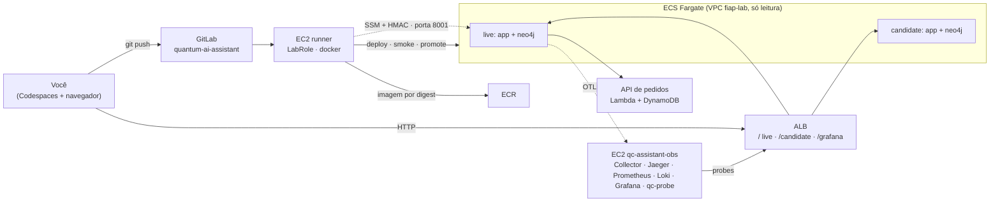

# 04 — GenAIOps e RAG na Prática

Módulo prático da **Aula 5**, o fechamento da disciplina. O **Quantum Commerce AI Customer Assistant** (o Assistente de Rastreio e Políticas) deixa de ser um experimento e vira um **produto de IA operado na AWS**: responde sobre trocas, devoluções, entrega e garantia citando a política **aplicável** (vigente, da loja certa, com permissão, na data certa), consulta o **status do pedido na API de pedidos** (nunca em documento), e é publicado, promovido, observado, quebrado de propósito e corrigido como um sistema em produção.

São **2 demos de 60 minutos**, uma por metade da aula, sobre **o mesmo ambiente**:

| # | Demo | Pergunta que ela responde | Tempo de aula |
|---|------|---------------------------|---------------|
| **04.1** | **[Demo 5.1: A evidência por trás da resposta](01-Release-RAG-Quality-Gates/README.md)** | *"De onde veio esta resposta, por que esta fonte foi escolhida e ela **se aplica** a este cliente, produto e data?"* A mesma pergunta respondida por **BM25**, **busca vetorial** (embeddings open source, CPU) e **grafo** (Neo4j, caminho produto → categoria → campanha → política → versão), com evidências lado a lado; `as_of_date` em 2026, na Black Friday de 2027 e depois dela; tenant errado bloqueado; uma aresta alterada em runtime e o `graph_version` denunciando. | 60 min + preparação fora do relógio |
| **04.2** | **[Demo 5.2: O dashboard estava verde. O cliente, errado.](02-Operacao-Observabilidade-Qualidade-Continua/README.md)** | *"Como impedir que a evidência errada seja publicada, e como descobrir, sem ninguém olhando, que ela mudou depois?"* Pipeline GitLab real **vermelho** por uma aresta errada (`live` intocado), correção e promoção `candidate → live` por **digest** com manifesto, observabilidade OpenTelemetry **na AWS**, incidente injetado **sem commit** com HTTP 200, alerta de qualidade por probes, trace até o span da causa, restore, replay, postmortem e caso golden novo. | 60 min + preparação fora do relógio |

A **Parte 0 da Demo 5.1** prepara as duas: cria o projeto GitLab, sobe o ambiente na AWS e espera o `/ready`. Ela leva mais tempo do que a aula permite e por isso fica **fora do relógio** (em casa, no início do dia, ou feita pelo professor). A 5.2 acrescenta só a observabilidade (`bash ops/cloud/obs.sh up`) e parte do que a 5.1 deixou de pé.

> [!IMPORTANT]
> **A Aula 5 é independente das anteriores.** O assistente vive num projeto GitLab **próprio**, `quantum-ai-assistant`, criado na Parte 0 da Demo 5.1 com o código de `quantum-assistant/` na raiz. Quem fez as Aulas 2 a 4 reaproveita bucket, rede `fiap-lab` e runner; quem não fez tem tudo criado pelo `make bootstrap` (bucket, rede, API de pedidos) e pelo `make runner` (runner novo, com o token no SSM). Nenhum passo depende do `primeiro-projeto` nem do módulo 03.

## Aula 5 na Quantum Commerce

> **Quinta-feira, 8h50. Três semanas depois do pipeline com quality gates entrar no ar.**
> **Helena Marques**, Head de Engenharia de IA e Entrega Contínua, chega com o celular na mão e um print de conversa:
>
> > *— "Uma cliente perguntou quantos dias tinha para trocar um fone. O assistente respondeu **15 dias**, com fonte citada, em HTTP 200. A política vigente diz **30**. O pipeline estava verde. Eu descobri pelo Instagram. Eu quero três coisas: **ver a evidência** por trás de cada resposta; que **nenhuma mudança** chegue ao cliente sem a gente saber que ela é segura; e que, se ele piorar **depois** de publicado, a gente descubra antes da cliente."*
>
> **Diego Tavares**, AI SRE sênior: *— "A busca achou um texto **parecido** com a pergunta. Parecido não é **aplicável**. E o dashboard estava verde porque mede a coisa certa com o instrumento errado: HTTP 200 não é resposta certa."*

A frase-guia da aula: **uma resposta pode estar bem escrita, vir com HTTP 200 e até citar uma fonte. Mas essa fonte se aplica àquele cliente, produto e momento?**

A Demo 5.1 responde "de onde veio e se aplica"; a Demo 5.2 responde "como impedir e como perceber". Juntas, fecham o arco da disciplina com os Three Ways de *The DevOps Handbook*: **fluxo** (o gate de grafo e a promoção por digest), **feedback** (probes rotulados e trace na AWS) e **aprendizagem** (postmortem blameless que vira caso golden).

## Antes vs depois

| | Módulo 03 (Aula 4) e versão anterior deste módulo | Aula 5 (hoje) |
|---|---|---|
| **Onde o assistente roda** | Lambda + API Gateway, com aliases `candidate`/`live`. | **ECS Fargate**: uma task por ambiente com dois contêineres (app FastAPI + Neo4j), dois services (`live`, `candidate`) atrás de um ALB. A **API de pedidos continua em Lambda + DynamoDB**. |
| **Como recupera** | BM25 (palavras) com filtros de vigência e ACL. | **Três estratégias lado a lado**, com o **mesmo** filtro: BM25, vetorial (embeddings `paraphrase-multilingual-MiniLM-L12-v2`, 384 dims, índice vetorial no Neo4j) e grafo (consulta Cypher parametrizada sobre produto, categoria, campanha, política, versão, documento, trecho, com procedência em cada aresta). |
| **O que é o release** | `bundle.zip` + versão numerada da Lambda. | A **imagem** no ECR, identificada por **digest**: código + corpus + semente do grafo + pesos do modelo + embeddings pré-calculados. Rollback volta tudo junto. |
| **O que o pipeline testa** | Golden set BM25 com slices e regras duras; Checkov bloqueante. | O mesmo, **mais** o `graph-policy-gate` (caminho e versão esperados no grafo; `wrong_graph_edge`, `stale_source_served`, `tenant_acl_violation` como regras duras) e o smoke/golden **contra o candidate real na AWS** pelo ALB, inclusive `--target http` do gate de grafo. |
| **Versões por resposta** | Seis (`application`, `prompt`, `corpus`, `index`, `eval_set`, `model=none`). | As seis **mais** `vector_index_version`, `graph_seed_version` (o publicado), `graph_version` (o que está atendendo), `embedding_model_id/revision/dim`, `git_sha`, `image_digest`, `release_id`. `graph_version ≠ graph_seed_version` = **drift**. |
| **Observabilidade** | OpenTelemetry **no Codespaces**, com o mesmo core (fallback honesto por limitação do Academy). | OpenTelemetry **na AWS**: tasks exportam OTLP para uma EC2 `qc-assistant-obs` (Collector, Jaeger, Prometheus, Loki, Grafana com login atrás do ALB) e um contêiner `qc-probe` faz perguntas com gabarito ao `live`. |
| **O incidente** | Overlay de corpus no runtime local; `reload` não resolvia (causa em disco). | Mutação **no grafo em memória da task `live`**, via porta administrativa privada com HMAC: a v2 vira `active` e supersede a v3. HTTP 200, resposta errada, alerta `critical` por medição. Restart **restauraria** aqui (fonte de verdade é a imagem), e a demo explica por que isso não generaliza. |
| **LLM** | Não há. | Continua não havendo no caminho da turma (`model_version = none`). O **modelo de embeddings não é LLM gerativo**; a Demo 5.1 explica onde um LLM entraria. |

O que **não** muda: Terraform, GitLab, o runner de EC2 com `LabRole`, o `core/` do assistente e o corpus. A versão anterior de cada demo está preservada em [`01-.../LEGADO-lambda.md`](01-Release-RAG-Quality-Gates/LEGADO-lambda.md) e [`02-.../LEGADO-local-demo.md`](02-Operacao-Observabilidade-Qualidade-Continua/LEGADO-local-demo.md), com nota de migração: o código Lambda e a pilha local continuam no repositório e funcionam.

## Pré-requisitos do módulo

> [!WARNING]
> - [ ] **Codespaces aberto no fork da disciplina**, sincronizado hoje pelo [Início de aula](../00-create-codespaces/Inicio-de-aula.md), com as **credenciais AWS do Academy** atualizadas.
> - [ ] **Conta no GitLab** (gratuita) e chave SSH (a Parte 0 da 5.1 ensina, se faltar).
> - [ ] **Parte 0 da [Demo 5.1](01-Release-RAG-Quality-Gates/README.md#parte-0---preparação-antes-da-aula) feita antes da aula** (ou pelo professor).
>
> **Valide rapidamente** (terminal do Codespaces):
>
> ```bash
> aws sts get-caller-identity --query Account --output text
> ls /workspaces/FIAP-AI-Devops-CICD/04-GenAIOps/quantum-assistant/Makefile
> ```
>
> Saída esperada: o número da sua conta (12 dígitos) e o caminho do `Makefile`. `ExpiredToken` = refazer o Início de aula; `No such file` = sincronizar o fork.

## Ritual do dia: credenciais → `make ready` → demo

Toda sessão deste módulo começa igual:

**A. Atualize as credenciais do Academy** no Codespaces ([Início de aula](../00-create-codespaces/Inicio-de-aula.md)). Credenciais velhas dão `ExpiredToken` em qualquer `aws`.

**B. Confira o ambiente** a partir do seu projeto (nunca do repositório do curso):

```bash
cd /home/vscode/environment/quantum-ai-assistant
make preflight
make ready | tail -1
```

> Saída esperada: `[PASS] preflight ok` e `HTTP 200`. Se as tasks foram desligadas entre sessões (`make down`, ou a sessão do Academy encerrou), `make start` as religa na mesma revisão (alguns minutos). Se a rede `fiap-lab` sumiu (reset do Academy), `make bootstrap` a recria.

**C. Confira o runner** quando a sessão envolver pipeline (Demo 5.2):

```bash
cd /home/vscode/environment/quantum-ai-assistant
make runner
```

> Saída esperada: `diagnostico do runner: reuse`, `Runner da EC2 pronto...` e as linhas `docker_installed=already` ... `docker_version=...` do `runner-docker.sh` (25 s na homologação). Se a EC2 estava desligada, o diagnóstico é `start`: o alvo a liga e espera o runner voltar online; por fim confere o Docker no runner. Ele **nunca** registra um runner duplicado. Os scripts por baixo (`runner-preflight.sh`, `runner-recover.sh`) são os de [`shared/runner/`](shared/runner/README.md), lidos do repositório do curso via `COURSE_REPO`.

<details>
<summary><b>💡 Clique para entender: reboot, stop/start, terminate, Codespaces parado e sessão do Academy expirada não são a mesma coisa</b></summary>
<blockquote>

| O que aconteceu | O que muda | O runner sobrevive? | E as tasks ECS? |
|---|---|---|---|
| **EC2 reboot** | Nada de identidade. | Sim, em ~1 min. | Não se aplica. |
| **EC2 stop/start** (entre aulas) | O IP público do runner muda; ID, disco, `config.toml` e token continuam. | Sim. O runner **chama** o GitLab (saída 443); IP novo não é runner perdido. | Fargate não para com a EC2; continua cobrando. |
| **EC2 terminate** | Instância e disco somem. | Não. `make runner` recria (Terraform + Ansible). | Não se aplica. |
| **Codespaces parado** | Só o seu terminal parou. | Sim. Refaça `ssh-add` e `export`. | Continuam de pé na AWS. |
| **Sessão do Learner Lab expirada** | `ExpiredToken` no Codespaces. Ao encerrar o Lab, o Academy **para** as EC2. | Sim, parado. | **Tasks Fargate param também** quando o Lab encerra; `make up && make ready` sobe de novo. |

📚 Documentação oficial: [ciclo de vida da instância EC2](https://docs.aws.amazon.com/AWSEC2/latest/UserGuide/ec2-instance-lifecycle.html); [GitLab Runner commands](https://docs.gitlab.com/runner/commands/).

</blockquote>
</details>

## Arquitetura



<!-- NOVA-IMAGEM: 01-Release-RAG-Quality-Gates/img/arquitetura-modulo-04.png | capturar: diagrama Excalidraw da arquitetura acima, com ícones oficiais AWS, legível em telão | depois de salvar o arquivo, descomente a linha abaixo -->
<!--  -->

Capacidades, não logotipos: `cliente → ALB → app → auth.tenant → intent.route → (entity.link → graph.traverse | vector.embed → vector.query | bm25) → policy.version.filter → compose.deterministic (sem LLM) → citações e recusas`, com `orders.lookup` para pedidos. Tudo isso vira spans OpenTelemetry com os mesmos nomes.

| Componente | Onde roda | Papel |
|---|---|---|
| `quantum-assistant/core/` | Dentro da imagem | Roteamento, BM25, `check_access` (a **única** regra de vigência/tenant/ACL, usada pelas três estratégias), composer, versões. Preservado da versão anterior. |
| `graph/`, `vector/`, `lab/`, `web/` | Dentro da imagem | Semente do grafo (JSON com procedência), encoder e recuperador vetorial, motor do `/lab/compare`, API FastAPI e Central de Evidências. |
| Neo4j Community (pinado) | Mesma task, só `localhost` | Grafo + índice vetorial `chunk_embedding` (cosseno, 384). Dados efêmeros, reconstruídos da imagem a cada subida. |
| `infra-ecs/` | Terraform, state `quantum-assistant/ecs/terraform.tfstate` | ECR, cluster, services, ALB, TGs, SGs, logs. Zero `aws_iam_*`. |
| `infra/` | Terraform, state `quantum-assistant/terraform.tfstate` | API de pedidos (Lambda + API Gateway + DynamoDB), a mesma de antes. |
| `infra-obs/` + `ops/cloud/` | Terraform, state `quantum-assistant/obs/terraform.tfstate` | EC2 de observabilidade (sem SSH) e o compose com a pilha OSS + `qc-probe`. |
| `.gitlab-ci.yml` + `scripts/release-ecs/` | Raiz do projeto do aluno | Pipeline com `QC_TARGET_RUNTIME=ecs`; manifestos em `s3://base-config-<RM>/quantum-assistant/releases-ecs/`. |
| `Makefile` + `scripts/cloud/` + `ops/cloud/obs.sh` | Codespaces (o build da imagem roda **no runner**, via SSM) | `make bootstrap`, `runner`, `secrets`, `image` (`remote-build.sh` → `build-push.sh` no runner), `up`, `deploy-live`/`deploy-candidate` (`deploy.sh`), `ready`, `diagnose`, `down`/`start`, `plan`, `destroy-dry-run` (`cleanup.sh`); observabilidade por `ops/cloud/obs.sh up|status|url|destroy`. Por baixo: `scripts/cloud/preflight.sh`, `secrets.sh`, `deploy.sh <live\|candidate> <sha256:...>` (o mesmo caminho para deploy, promote e rollback: registra uma revisão da task definition com a imagem por digest e espera `/ready` 200 pelo ALB servido por ela).  |

Tudo com prefixo **`qc-assistant-`**, tags `Project=quantum-commerce`, `Lab=05-x`, `ManagedBy=terraform`. A rede `fiap-lab` é **só lida**. Nenhuma IAM role é criada: tasks e EC2 usam `LabRole`/`LabInstanceProfile`.

**Regras do Learner Lab que explicam o desenho** (do guia oficial da AWS Academy): só `us-east-1` e `us-west-2`; EC2 até `large`, no máximo 9 instâncias e 32 vCPU ao mesmo tempo; ECS/Fargate usam o `LabRole` como task role e execution role (se aparecer `the ECS service linked role could not be assumed` no primeiro `apply`, repita); ao encerrar a sessão, as EC2 **param** e voltam com IP público novo, e as tasks Fargate param também. O runner constrói e publica a imagem no ECR com o `LabRole`: isso foi **testado** na conta do laboratório.

## Custo do módulo

| Recurso | Custo no volume do lab | Quando cobra |
|---|---|---|
| **2 tasks Fargate** (1 vCPU + 3 GB cada; app + Neo4j) | ~US$ 0,053/h por task (preço de lista `us-east-1`) | **Por hora, de pé, com ou sem uso.** |
| **ALB** | ~US$ 0,0225/h + LCU | Por hora, de pé. |
| **EC2 de observabilidade** (`t3.medium`) | ~US$ 0,04/h | Por hora, `running`. |
| **EC2 do runner** (`t3.small`) | ~US$ 0,02/h | Por hora, `running`. |
| ECR, S3, SSM, CloudWatch Logs | Centavos | Armazenamento e volume do lab. |
| Lambda + API Gateway + DynamoDB (pedidos) | ~US$ 0 parados | Por chamada. |

> [!CAUTION]
> Diferente da versão anterior (quase tudo serverless), **este módulo cobra por hora enquanto estiver de pé**. Entre a 5.1 e a 5.2 no mesmo dia, deixe tudo como está. Se as demos forem em dias diferentes, confirme com o professor: `make down` escala os services a zero (as tasks param de cobrar) e mantém ALB, ECR e state (volta com `make up`); `make destroy-dry-run` mostra o que a destruição completa faria; `make down` **não** toca na EC2 de observabilidade (ela é de outro state, `infra-obs/`; para ela, `bash ops/cloud/obs.sh destroy --apply`, ou `stop-instances` na instância `qc-assistant-obs`); desligue o runner com `stop-instances`. A limpeza completa (`scripts/cloud/cleanup.sh`) começa sempre em `--dry-run` e está no fim da Demo 5.2. A rede `fiap-lab` **nunca** é destruída: o Trabalho Final a usa.

## Decisões pedagógicas

- **Por que o build da imagem roda no runner, e não no Codespaces?** Porque o runner é `amd64` (a arquitetura do Fargate escolhido), já tem Docker desde a preparação, e é onde o pipeline da 5.2 vai construir: o aluno não instala nada, e o build de aula é o mesmo build do CI.

- **Por que um projeto GitLab novo?** Porque o assistente virou produto, com ciclo de release próprio; e porque a Aula 5 precisa ser cursável por quem não fez as anteriores. O custo é uma Parte 0 maior, fora do relógio.
- **Por que ECS Fargate e não Lambda?** Porque um grafo Neo4j e um modelo de embeddings não cabem no modelo Lambda do laboratório, e porque "imagem = release" é a lição central da 5.2 (rollback de conjunto, digest como identidade, grafo reconstruído da fonte de verdade).
- **Por que o Neo4j dentro da task, efêmero?** Para que a fonte de verdade seja a imagem versionada, não um disco. É o que torna o restart da task uma restauração **nesta** arquitetura, e a 5.2 usa isso para discutir quando restart resolve e quando é placebo.
- **Por que sem LLM, de novo?** Bedrock bloqueado no Learner Lab e, mais importante, **determinismo**: a mesma regressão reprova pelo mesmo motivo em todas as contas da turma, e a aula olha só para a escolha da fonte. O modelo de embeddings é aberto, pequeno e roda em CPU; ele **não gera texto**. Onde um LLM entraria está explicado na 5.1.
- **Por que três estratégias e nenhuma "vencedora"?** Porque cada uma enxerga uma coisa (palavras, significado, relações) e erra de um jeito. A Central mostra as três; o aluno escolhe e justifica.
- **Por que observabilidade na AWS agora?** Porque o runtime está na AWS, e a telemetria que o aluno lê deve ser a do que está no ar. Grafana com login atrás do ALB; Jaeger, Prometheus e Loki só na VPC. A pilha local anterior continua no repositório para estudo offline.
- **Por que métricas "modestas"?** Hit@k mede busca; probes medem contratos conhecidos. Sem LLM não há `faithfulness` nem `hallucination rate`, e não fingimos que há. Todo painel de qualidade diz "proxy sintético" no rodapé.

## Fundamentação

- Gene Kim, Jez Humble, Patrick Debois e John Willis, *The DevOps Handbook*: as Three Ways (fluxo, feedback, aprendizagem) estruturam as duas demos. Os autores não tratam de RAG, grafos nem LLM: a transposição é nossa.
- Nicole Forsgren, Jez Humble e Gene Kim, *Accelerate*: entrega frequente e segura depende de teste automatizado e feedback rápido; aplicamos a mudanças de **conteúdo e de relações** (políticas, arestas), não só de código.
- Cathy Chen et al., *Reliable Machine Learning* (2022): golden sets, avaliação offline, rollout controlado, incidentes e rollback de conjunto.
- Patrick Lewis et al., *Retrieval-Augmented Generation for Knowledge-Intensive NLP Tasks* (2020): o RAG original. Aqui, só o "R", com três recuperadores e composer determinístico.
- Nils Reimers e Iryna Gurevych, *Sentence-BERT* (EMNLP 2019): a família de modelos de embeddings de frases usada na busca vetorial.
- Neo4j, *Vector indexes* (manual do Cypher): o índice vetorial em Community com `LIST<FLOAT>`, e a distinção entre busca por similaridade e travessia.
- OWASP GenAI, *Prompt Injection*; NIST, *AI RMF: Generative AI Profile*: a fronteira entre instrução e conteúdo não confiável.
- D. Sculley et al., *Hidden Technical Debt in Machine Learning Systems* (NeurIPS 2015): dependência de dados como dívida técnica. Aqui, o grafo é o "dado" que muda sem o código mudar.

## Próximo passo

Comece pela **[Demo 5.1](01-Release-RAG-Quality-Gates/README.md)**, pela Parte 0 (antes da aula). A pergunta que ela deixa aberta ("qual evidência autoriza o release, e quem percebe quando ela muda por fora?") é a abertura da **[Demo 5.2](02-Operacao-Observabilidade-Qualidade-Continua/README.md)**.
